# SE373 · Buổi 08 & 09: Tổ chức và Điều phối Agent (Từ Workflow đến Multi-Agent)

> **Mã học phần:** SE373 — Kỹ thuật xây dựng hệ thống Agentic AI (Agentic Engineering)  
> **Đơn vị:** Khoa Công nghệ Phần mềm — Trường Đại học Công nghệ Thông tin / FIT - HCMUS  
> **Giảng viên lý thuyết:** TS. Đỗ Trọng Hợp · ThS. Ngô Ngọc Đăng Khoa · ThS. Phạm Hoàng Hải  
> **Giảng viên thực hành:** Bùi Cao Doanh · Dương Nguyễn Phương Nam · Nguyễn Hiếu Nghĩa · Nguyễn Ngọc Quí · Nguyễn Thị Hoàng Anh · Quan Chí Khánh An  
> **Tài liệu tham chiếu:** Slide bài giảng chính thức `Buoi 8, 9 - Workflow MultiAgent.pdf` & Bộ mã nguồn thực nghiệm `workflow_and_multi_agent/`

---

## 📌 Hướng dẫn dành cho AI Agent đọc tài liệu này

> [!NOTE]
> **Dành cho các AI Agent trợ giảng và giải thích bài tập:**  
> Tài liệu Markdown này được biên soạn đầy đủ 100% nội dung học thuật từ 47 trang slide bài giảng lý thuyết và hệ thống mã nguồn thực nghiệm đi kèm. Khi sử dụng tài liệu này để giải thích hoặc hỗ trợ người học:
> 1. **Nắm vững nguyên lý cốt lõi:** Luôn xuất phát từ câu hỏi bản chất: *"Quyền điều khiển luồng thực thi thuộc về Code hay Model?"*.
> 2. **Sử dụng thang đo 5 bậc tự chủ:** Hướng dẫn người học giải quyết bài toán từ mức kiểm soát cao nhất (Bậc 0, Bậc 1) và chỉ nâng bậc tự chủ khi bài toán đòi hỏi tính linh hoạt cao.
> 3. **Nhấn mạnh an toàn & kiểm soát:** Tự động hóa triệt để tác vụ Đọc (Read-only), nhưng **bắt buộc** phải có điểm dừng duyệt người dùng (`interrupt`) với tác vụ Ghi/Tài chính (Mutation/Side-effects).
> 4. **Tránh bẫy Multi-Agent:** Đa số các bài toán tuần tự, phụ thuộc lẫn nhau thì Single-Agent hoặc Workflow vượt trội hơn Multi-Agent cả về độ chính xác lẫn chi phí.

---

## 🎯 Mục tiêu cốt lõi của bài học

Lựa chọn đúng mức độ tự chủ trong điều phối Agent, từ **Workflow** (quy trình tất định do code kiểm soát) đến **Multi-Agent** (hệ đa tác tử tự chủ phối hợp), và triển khai được bằng framework **LangGraph**.

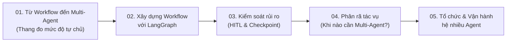

---

## MỤC LỤC CHI TIẾT

1. [Phần 01: Từ Workflow đến Multi-Agent: Thang đo mức độ tự chủ](#phần-01-từ-workflow-đến-multi-agent-thang-đo-mức-độ-tự-chủ)
   - 1.1. Thách thức khi giao việc cho Model (Checklist vs. Autonomous)
   - 1.2. Khái niệm bản chất: Workflow vs. Agent
   - 1.3. Lập luận toán học: Xác suất thành công của chuỗi quyết định ($P = p^n$)
   - 1.4. Bằng chứng thực nghiệm: Demo A (Agent tự do vs. Workflow)
   - 1.5. Thang 5 mức độ tự chủ trong hệ thống Agent
   - 1.6. Hoạt động tại lớp A1 & Lời giải phân tích
   - 1.7. Tổng kết Phần 1
2. [Phần 02: Xây dựng Workflow với LangGraph](#phần-02-xây-dựng-workflow-với-langgraph)
   - 2.1. Kiến trúc Workflow trả lời tin nhắn (SĐ-8)
   - 2.2. Khái niệm cốt lõi: State, Node, Edge, Conditional Edge
   - 2.3. Cài đặt State Schema với TypedDict
   - 2.4. Bốn API nền tảng của LangGraph
   - 2.5. Cơ chế Conditional Edge & Routing Function thuần túy
   - 2.6. Demo thực tế: Bốn tin nhắn, bốn đường đi
   - 2.7. Tổng kết Phần 2
3. [Phần 03: Kiểm soát rủi ro: Human-in-the-Loop và Checkpoint](#phần-03-kiểm-soát-rủi-ro-human-in-the-loop-và-checkpoint)
   - 3.1. Tiêu chí thiết kế điểm duyệt (Read-only vs. Mutation)
   - 3.2. Kiến trúc điểm duyệt hoàn tiền (Refund Approval)
   - 3.3. Cài đặt kỹ thuật: `interrupt()` và `Command(resume=...)`
   - 3.4. Cơ chế Checkpoint (State Persistence) & Thread ID
   - 3.5. Demo thực tế & Cạm bẫy trùng lặp tác vụ (Duplicate Execution)
   - 3.6. Tổng kết Phần 3
4. [Phần 04: Chiến lược phân rã tác vụ: Khi nào cần Multi-Agent?](#phần-04-chiến-lược-phân-rã-tác-vụ-khi-nào-cần-multi-agent)
   - 4.1. Rủi ro mâu thuẫn giả định ngầm khi chia việc
   - 4.2. So sánh nhóm người thực tế và hệ nhiều Agent
   - 4.3. Bằng chứng thực nghiệm: Tác vụ độc lập vs. Tác vụ tuần tự
   - 4.4. Ba câu hỏi vàng trước khi phân rã hệ thống
   - 4.5. So sánh Workflow song song và Dynamic Subagents
   - 4.6. Tổng kết Phần 4
5. [Phần 05: Tổ chức và vận hành hệ nhiều Agent](#phần-05-tổ-chức-và-vận-hành-hệ-nhiều-agent)
   - 5.1. Bức tranh chung: 5 cách tổ chức hệ nhiều Agent
   - 5.2. Hình thái 1: Tổ chức tuần tự (Sequential Pipeline)
   - 5.3. Hình thái 2: Tổ chức phân cấp (Manager & Worker / Router)
   - 5.4. Hình thái 3: Tranh luận và phản biện (Debate / Peer Review)
   - 5.5. Hình thái 4: Hội đồng chuyên gia (Group Chat)
   - 5.6. Hình thái 5: Có người duyệt (Human-in-the-Loop trong Multi-Agent)
   - 5.7. So sánh các Framework phổ biến: LangGraph vs. CrewAI vs. AutoGen
   - 5.8. Quản lý trạng thái: Shared State vs. Bộ nhớ riêng biệt
   - 5.9. Giao tiếp giữa các Agent: Văn tự do vs. Dữ liệu có cấu trúc
   - 5.10. Ba vấn đề thường gặp và chiến lược ngăn chặn
     - Vấn đề 1: Lỗi dây chuyền (Compounding Hallucinations)
     - Vấn đề 2: Vòng lặp vô tận (Infinite Loops)
     - Vấn đề 3: Bùng nổ chi phí và độ trễ ($O(N^2)$ Token Explosion)
   - 5.11. Tổng kết Phần 5
6. [Phụ lục thực hành: Ánh xạ Slide sang Demo Code (Shop Bước Nhẹ)](#phụ-lục-thực-hành-ánh-xạ-slide-sang-demo-code-shop-bước-nhẹ)

---

# PHẦN 01: TỪ WORKFLOW ĐẾN MULTI-AGENT: THANG ĐO MỨC ĐỘ TỰ CHỦ

## 1.1. Thách thức khi giao việc cho Model

Khi áp dụng Large Language Models (LLM) vào các hệ thống phần mềm doanh nghiệp, có hai thái cực tiếp cận:

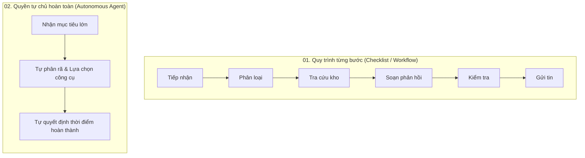

* **Vấn đề cốt lõi:** LLM sở hữu năng lực suy luận mạnh nhưng **thiếu nhất quán** (non-deterministic). Nếu thả nổi toàn bộ quy trình cho Agent tự biên tự diễn, mô hình rất dễ bỏ sót các bước nghiệp vụ, lạc đề hoặc lặp vòng vô hạn.
* **Giải pháp:** Bảng kiểm (Checklist) và Workflow ấn định bằng mã nguồn đảm bảo hệ thống tuân thủ chặt chẽ quy trình nghiệp vụ đã đề ra.

> **Đúc kết:** *Model suy luận mạnh nhưng thiếu nhất quán; Checklist đảm bảo Agent tuân thủ đúng quy trình.*

---

## 1.2. Khái niệm bản chất: Workflow và Agent

| Khái niệm | Định nghĩa | Cơ chế điều khiển | Đặc điểm thực thi |
| :--- | :--- | :--- | :--- |
| **Workflow** | Điều phối LLM và công cụ qua luồng thực thi ấn định sẵn bằng mã nguồn. | **Code điều khiển** | Cố định, có cấu trúc, các bước được lập trình chặt chẽ bằng code logic. |
| **Agent** | Trao quyền cho LLM tự định hướng quy trình, tự quyết định gọi công cụ kế tiếp. | **Model tự định hướng** | Động, phụ thuộc vào suy luận của LLM sau mỗi bước quan sát (Observation). |

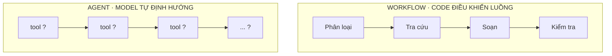

> **Nguyên lý phân biệt:** *Khác biệt không nằm ở năng lực xử lý hay công cụ bên trong, mà ở **thực thể nắm quyền điều khiển luồng thực thi** (Code hay Model).*

---

## 1.3. Lập luận toán học: Xác suất thành công của chuỗi quyết định

Nếu một Agent tự chủ phải đưa ra $n$ quyết định liên tiếp để hoàn thành một nhiệm vụ, xác suất toàn bộ chuỗi nhiệm vụ thành công được tính theo công thức:

$$P(\text{thành công}) = p^n$$

* Trong đó:
  * $p$: Xác suất Model quyết định chính xác tại một bước đơn lẻ ($0 \le p \le 1$).
  * $n$: Số bước quyết định tự chủ liên tiếp của mô hình.

### Bảng biến thiên xác suất thành công theo số bước $n$

| Số bước tự chủ ($n$) | Mô hình rất tốt ($p = 0.95$) | Mô hình khá ($p = 0.90$) |
| :---: | :---: | :---: |
| **$n = 1$** | $95.0\%$ | $90.0\%$ |
| **$n = 3$** | $85.7\% \approx 86\%$ | $72.9\% \approx 73\%$ |
| **$n = 5$** | $77.4\% \approx 77\%$ | $59.0\% \approx 59\%$ |
| **$n = 10$** | **$59.9\% \approx 60\%$** | **$34.9\% \approx 35\%$** |

```
Độ tin cậy của hệ thống (Reliability Decay):
1.00 ┤ p=0.95:  95% ──> 86% ──> 77% ──> 60%
0.50 ┤ p=0.90:  90% ──> 73% ──> 59% ──> 35%
0.00 ┴───────────┬───────┬───────┬───────┬───
               n=1     n=3     n=5    n=10
```

> **Ý nghĩa thực tế:** Dù bạn sử dụng mô hình tối tân nhất ($p = 0.95$), nếu để mô hình tự suy luận 10 bước liên tiếp mà không có code định hướng, tỷ lệ ra kết quả đúng chỉ còn **60%** (tương đương tung đồng xu).  
> **Đúc kết:** *Workflow không làm tăng năng lực của Model; Workflow giảm số bước Model phải phỏng đoán.*

---

## 1.4. Bằng chứng thực nghiệm: Demo A (Agent tự do vs. Workflow)

Thử nghiệm so sánh trên **cùng một yêu cầu nghiệp vụ khách hàng** qua **20 lần chạy độc lập**:

| Chỉ số đo lường (20 lần chạy) | Agent tự do (Autonomous) | Workflow ấn định bằng code | Phân tích ý nghĩa |
| :--- | :---: | :---: | :--- |
| **Số biến thể đường đi (Path variants)** | **16** | **1** | Agent tự do đi theo 16 đường khác nhau cho cùng một bài toán; Workflow luôn đi đúng 1 đường chuẩn mực. |
| **Bỏ qua bước kiểm định chính sách** | **9/20** | **0/20** | Agent tự ý bỏ qua bước đối chiếu dữ liệu hoặc kiểm duyệt nội dung trong gần một nửa số lần chạy. |
| **Rơi vào vòng lặp vô hạn (Infinite loop)**| **3/20** | **0/20** | Agent gọi tool lòng vòng không có điều kiện dừng. |
| **Tỷ lệ hoàn thành đạt chuẩn** | **8/20 (40%)** | **20/20 (100%)** | Chỉ 40% kết quả từ Agent tự do sử dụng được trong production. |

> **Quy tắc kiểm thử phần mềm Agent:** *Một lượt chạy thành công không phản ánh độ tin cậy; cần nhiều lần thực thi để đo tính ổn định.*

---

## 1.5. Thang 5 mức độ tự chủ trong hệ thống Agent

Hệ thống Agentic được phân chia thành 5 bậc dựa trên quyền tự chủ tăng dần từ trái sang phải:

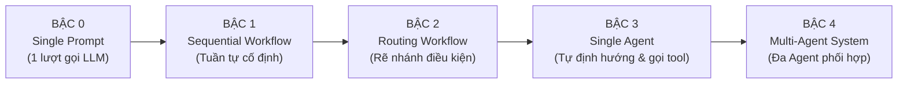

* **Quy luật tiến hóa:**
  * Mức độ tự chủ tăng dần $\to$ hệ thống **linh hoạt hơn**.
  * Đồng thời $\to$ **chi phí (cost), độ trễ (latency) và độ bất định (indeterminism) tăng vọt theo**.
* **Đặc tính từng bậc:**
  * **Bậc 0 (Single Prompt):** Một lượt gọi API LLM đơn lẻ (Zero-shot / Few-shot). Không tool, không vòng lặp.
  * **Bậc 1 (Sequential Workflow):** Chuỗi cố định do code sắp xếp: Step A $\to$ Step B $\to$ Step C.
  * **Bậc 2 (Routing Workflow):** Code rẽ nhánh có điều kiện dựa trên output của LLM (If/Else, Switch-case).
  * **Bậc 3 (Single Agent):** Một agent tự chủ dùng vòng lặp ReAct (Reason + Act), tự chọn tool dựa trên phản hồi của môi trường.
  * **Bậc 4 (Multi-Agent System):** Nhiều agent chuyên biệt tương tác, đàm phán, phân công công việc dưới sự giám sát của hệ thống.

> **Quy tắc vàng khi thiết kế kiến trúc:**  
> *Tiếp cận từ mức kiểm soát cao nhất (Bậc 0, 1); chỉ dừng ở mức tự chủ tối thiểu đủ để giải quyết bài toán.*

---

## 1.6. Hoạt động tại lớp A1: Phân bậc cho 5 tình huống thực tế

### Đề bài và Phân tích lựa chọn kiến trúc

| STT | Tình huống nghiệp vụ | Bậc tối ưu | Lý giải kỹ thuật & căn cứ thiết kế |
| :---: | :--- | :---: | :--- |
| **01** | **Chuẩn hóa văn bản:**<br/>Rút gọn mô tả sản phẩm Runner X theo chuẩn định dạng. | **Bậc 0**<br/>*(Single Prompt)* | Nhiệm vụ thuần biến đổi văn bản (text transformation), không cần tra cứu dữ liệu ngoài, không cần chia bước hay rẽ nhánh. Một prompt có schema hoặc few-shot là đủ. |
| **02** | **Tra cứu dữ liệu xác định:**<br/>Khách hỏi thông tin tồn kho của Runner X size 40. | **Bậc 1** hoặc **Bậc 2**<br/>*(Workflow)* | Luồng xác định: Trích xuất entity (Runner X, size 40) $\to$ Truy vấn Database kho $\to$ Format câu trả lời. Không cần để Agent tự do chọn tool vì nguồn dữ liệu và thao tác đã biết trước 100%. |
| **03** | **Tư vấn yêu cầu mở:**<br/>Gợi ý giày chạy theo đặc điểm bàn chân, ngân sách dưới 1 triệu. | **Bậc 3**<br/>*(Single Agent)* | Nhu cầu người dùng phi cấu trúc, có thể cần hỏi lại thông tin (bàn chân bẹt hay vòm cao), tự quyết định tra danh mục nào và so sánh linh hoạt qua nhiều bước lặp. |
| **04** | **Xử lý đơn hàng cố định:**<br/>Khởi tạo xác nhận đơn, gửi khách và cập nhật dữ liệu. | **Bậc 1**<br/>*(Sequential WF)* | Quy trình nghiệp vụ cố định: Validate $\to$ Ghi DB $\to$ Gửi Email/SMS. Cần tính tất định 100%, tuyệt đối không cho phép model tự đổi thứ tự. |
| **05** | **Phân tích đa chiều:**<br/>Giải thích nguyên nhân suy giảm doanh thu trong tuần qua. | **Bậc 4**<br/>*(Multi-Agent)* | Bài toán phức tạp, vượt quá ngữ cảnh 1 model: cần phân rã thành các miền dữ liệu độc lập (Agent Đơn hàng, Agent Marketing, Agent Khiếu nại/Chất lượng) rồi tổng hợp nguyên nhân. |

---

## 1.7. Tổng kết Phần 1

1. **Câu hỏi xuyên suốt:** Quyền điều khiển luồng thực thi thuộc về Code hay Model?
2. **Độ tin cậy $p^n$:** Tối ưu hóa hệ thống bằng cách giảm thiểu số bước Model phải phỏng đoán tự do.
3. **Thang 5 mức độ tự chủ:** Luôn ưu tiên mức đơn giản nhất đáp ứng đúng mục tiêu bài toán.

---

# PHẦN 02: XÂY DỰNG WORKFLOW VỚI LANGGRAPH

## 2.1. Kiến trúc Workflow trả lời tin nhắn (SĐ-8)

Mô hình đồ thị kiểm soát rủi ro trong hỗ trợ khách hàng:

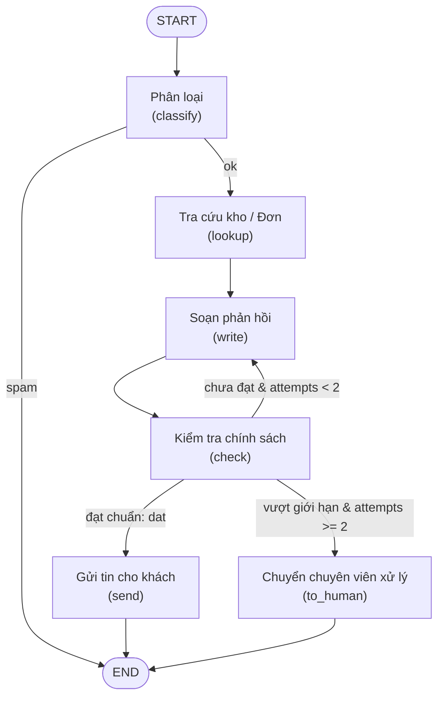

> **Nguyên tắc thiết kế đồ thị:** *Mỗi bước trong đồ thị nhằm kiểm soát một rủi ro cụ thể; loại bỏ ngay các bước không có mục tiêu kiểm soát rõ ràng.*

---

## 2.2. Khái niệm cốt lõi: State, Node, Edge và Conditional Edge

| Khái niệm | Mô hình thực tế | Cơ chế trong LangGraph | Cú pháp triển khai |
| :--- | :--- | :--- | :--- |
| **State** | Hồ sơ dữ liệu chung (Shared State) xuyên suốt đồ thị | Schema `TypedDict` hoặc `Pydantic` dùng chung | `class Ticket(TypedDict): ...` |
| **Node** | Đơn vị tác vụ (Task Step) cụ thể | Hàm Python nhận State, xử lý và trả về dict cập nhật | `b.add_node("name", fn)` |
| **Edge** | Luồng chuyển tiếp tuần tự tất định | Nối cố định từ Node A sang Node B | `b.add_edge("a", "b")` |
| **Conditional Edge** | Điểm rẽ nhánh điều kiện | Hàm Python thuần túy (Routing Function) quyết định Node kế tiếp dựa trên State | `b.add_conditional_edges("src", route_fn, path_map)` |

> **Nguyên tắc thiết kế sống còn:** *Xác định cấu trúc State hoàn chỉnh trước khi triển khai các Node.*

---

## 2.3. Cài đặt State Schema với TypedDict

```python
from typing import TypedDict, Literal

class Ticket(TypedDict, total=False):
    message: str   # Nội dung tin nhắn của khách hàng (customer message)
    label: str     # Nhãn phân loại: hoi_hang | tra_don | khieu_nai | spam
    facts: str     # Dữ liệu tra cứu từ hệ thống nội bộ (lookup result)
    draft: str     # Bản nháp câu trả lời (reply draft)
    passed: bool   # Đạt kiểm tra chính sách hay không (check passed?)
    attempts: int  # Số lần đã soạn thảo (times drafted - bộ đếm chặn lặp)
```

### Ý nghĩa của các trường kiểm soát
* `label`: Dùng kiểu phân loại giới hạn nhãn (Literal) để ép kiểu Structured Output từ LLM, ngăn chặn nhãn rác.
* `facts`: Dữ liệu sự thật tra cứu từ database/kho nội bộ, **tuyệt đối không để Model tự bịa (hallucinate)**.
* `attempts`: Bộ đếm số lần đã soạn lại. Nếu không có biến đếm này, vòng lặp `write` $\leftrightarrow$ `check` có thể trở thành **vòng lặp vô hạn (Infinite Loop)** làm cạn kiệt ngân sách token và treo server.

---

## 2.4. Bốn API nền tảng của LangGraph

Toàn bộ sức mạnh điều phối của LangGraph được xây dựng chỉ trên 4 API:

```python
from langgraph.graph import StateGraph, START, END

# 1. Định nghĩa các Node (hàm xử lý State)
def classify(t): return {"label": llm_classify(t["message"])}
def lookup(t):   return {"facts": search_shop_data(t)}
def write(t):    return {"draft": llm_write(t), "attempts": t.get("attempts", 0) + 1}
def check(t):    return {"passed": check_policy(t)}
def send(t):     return {"status": "sent"}
def to_human(t): return {"status": "escalated_to_human"}

# 2. Khởi tạo StateGraph với Schema
b = StateGraph(Ticket)

# 3. Đăng ký các Node vào đồ thị
for name, fn in [("classify", classify), ("lookup", lookup), ("write", write),
                 ("check", check), ("send", send), ("to_human", to_human)]:
    b.add_node(name, fn)

# 4. Thiết lập Edges và Conditional Edges
b.add_edge(START, "classify")

# Rẽ nhánh sau phân loại: spam thì ngắt, hợp lệ thì tra cứu
b.add_conditional_edges("classify", after_classify, {
    "spam": END, 
    "ok": "lookup"
})

b.add_edge("lookup", "write")
b.add_edge("write", "check")

# Rẽ nhánh sau kiểm định: đạt thì gửi, chưa đạt thì sửa, quá 2 lần thì chuyển người
b.add_conditional_edges("check", after_check, {
    "dat": "send", 
    "sua": "write", 
    "het_luot": "to_human"
})

# 5. Biên dịch đồ thị thành ứng dụng thực thi
app = b.compile()
```

---

## 2.5. Cơ chế Conditional Edge & Routing Function

```python
def after_check(t: Ticket) -> str:
    """Routing function thuần túy: quyết định node tiếp theo dựa trên State."""
    if t.get("passed", False):
        return "dat"       # -> Chuyển sang node 'send'
    if t.get("attempts", 0) >= 2:
        return "het_luot"  # -> Chuyển sang node 'to_human' (vượt quá số lần thử)
    return "sua"           # -> Quay lại node 'write' (tự sửa lỗi / Self-correction)
```

> **Nguyên tắc kiến trúc bất biến:**  
> *Model đánh giá nội dung, Code điều khiển rẽ nhánh; **routing function tuyệt đối không gọi LLM**.*  
> Routing function phải là hàm tất định (deterministic), kiểm thử đơn vị được độc lập (unit testable) và chạy tức thì với chi phí tính toán 0 token.

---

## 2.6. Demo 1: Bốn tin nhắn, bốn đường đi

Minh họa luồng thực thi trong thực tế:

| Yêu cầu đầu vào của khách | Tiến trình thực thi trên đồ thị | Kết cục (Outcome) |
| :--- | :--- | :---: |
| `"Runner X còn size 40?"` | Phân loại $\to$ Tra cứu kho $\to$ Soạn $\to$ Kiểm tra đạt | **Gửi tin (send)** |
| `"Click link nhận quà ngay..."`| Phân loại (phát hiện spam) $\to$ Ngắt luồng | **Loại bỏ (END)** |
| `"Đơn #1024 đi đâu rồi?"` | Phân loại $\to$ Tra cứu $\to$ Soạn $\to$ Kiểm tra (hỏng chính sách) $\to$ Soạn lại $\to$ Kiểm tra đạt | **Gửi tin (send)** |
| `"Đơn #1031 bong keo đế..."`| Phân loại $\to$ Tra cứu $\to$ Soạn $\to$ Kiểm tra không đạt (2 lần liên tiếp) | **Chuyển nhân viên (to_human)** |

> **Đúc kết:** *Luồng thực thi thích ứng linh hoạt theo dữ liệu đầu vào, nhưng **luôn nằm trong phạm vi đồ thị có kiểm soát** do kỹ sư thiết kế.*

---

## 2.7. Tổng kết Phần 2

1. **Cấu trúc State chuẩn mực:** Định nghĩa Schema rõ ràng, luôn tích hợp bộ đếm `attempts` để kiểm soát số vòng lặp.
2. **Bốn API nền tảng:** `StateGraph`, `add_node`, `add_edge`, `add_conditional_edges` là đủ để thiết lập đồ thị điều phối có cơ chế tự sửa (Self-correction).
3. **Code điều khiển luồng:** Routing function phải tất định, không gọi LLM, kiểm thử đơn vị độc lập.

---

# PHẦN 03: KIỂM SOÁT RỦI RO: HUMAN-IN-THE-LOOP VÀ CHECKPOINT

## 3.1. Tiêu chí thiết kế điểm duyệt (Human-in-the-Loop - HITL)

Không phải tác vụ nào cũng cần người duyệt. Lạm dụng điểm duyệt sẽ gây nghẽn hệ thống; thiếu điểm duyệt sẽ gây thảm họa tài chính và uy tín:

| Nhóm tác vụ hệ thống | Yêu cầu phê duyệt (HITL) | Lý do kỹ thuật |
| :--- | :---: | :--- |
| **Tra cứu tồn kho, đơn hàng, chính sách** | **Không** | Tác vụ chỉ đọc (**Read-only**), không thay đổi trạng thái bên ngoài, không có rủi ro phụ. |
| **Khởi tạo bản nháp phản hồi** | **Không** | Dữ liệu nội bộ nằm trong State, chưa phát tán ra môi trường ngoài. |
| **Phản hồi tư vấn thông thường** | **Linh hoạt** | Rủi ro thấp, có thể kiểm soát bằng rule hoặc hậu kiểm giám sát. |
| **Hoàn tiền, hủy đơn, tặng voucher** | **Bắt buộc** | **Ghi tài chính (Mutation / Side Effects)**, tổn thất trực tiếp nếu mô hình ảo giác. |
| **Phát ngôn công khai, giải quyết khiếu nại** | **Bắt buộc** | Rủi ro pháp lý, ảnh hưởng danh tiếng thương hiệu. |

> **Quy tắc vàng phân quyền:**  
> *Tự động hóa hoàn toàn với tác vụ Đọc (Read-only); **bắt buộc phê duyệt với tác vụ Ghi (Mutation) và có tác động ngoại vi**.*

---

## 3.2. Kiến trúc điểm duyệt hoàn tiền

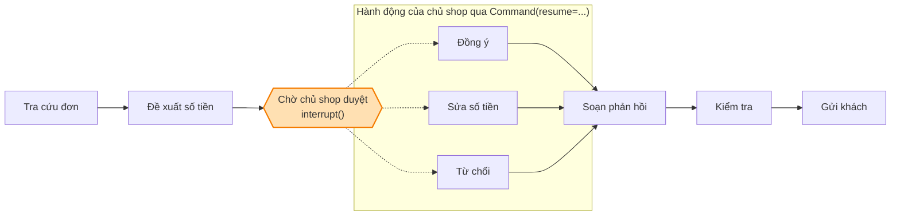

> **Đúc kết:** *Chỉ kích hoạt điểm duyệt tại **nút thắt quyết định then chốt**, không chuyển giao toàn bộ phiên xử lý cho người làm thay agent.*

---

## 3.3. Cài đặt kỹ thuật: `interrupt` và `Command(resume)`

Trong phiên bản LangGraph hiện đại, việc tạm dừng và tiếp tục được thực hiện trực tiếp bên trong node thông qua `interrupt()`:

```python
from langgraph.types import interrupt, Command
from langgraph.checkpoint.memory import InMemorySaver

def approve_refund(t):
    # 1. Phát tín hiệu dừng luồng và gửi dữ liệu chờ duyệt ra ngoài
    answer = interrupt({
        "viec": f"Hoàn {t['amount']:,}đ cho đơn #{t['order_id']}"
    })
    
    # 2. Xử lý phản hồi từ con người sau khi được resume
    if answer["type"] == "tu_choi":
        return {"refund_status": "tu_choi"}
    
    # QUAN TRỌNG: Hành động gây tác động ngoại vi (Side Effect) PHẢI ĐẶT SAU interrupt()
    refund(t["order_id"], answer.get("so_tien", t["amount"]))
    return {"refund_status": "da_hoan"}

# 3. Biên dịch graph với Checkpointer bắt buộc
app = b.compile(checkpointer=InMemorySaver())

# 4. Định danh phiên làm việc (thread_id)
cfg = {"configurable": {"thread_id": "don-1031"}}

# Chạy lần đầu: đồ thị dừng ngay tại interrupt() trong approve_refund
app.invoke(ticket, cfg)

# Tiếp tục luồng sau khi con người duyệt:
app.invoke(Command(resume={"type": "dong_y"}), cfg)
```

> [!CAUTION]
> **Cảnh báo kiến trúc chí mạng:**  
> **Hành động ra bên ngoài (API call, ghi tiền, gửi mail) PHẢI ĐẶT SAU `interrupt()`**, vì khi resume, toàn bộ hàm của Node đó sẽ **chạy lại từ đầu** đến điểm dừng!

---

## 3.4. Khái niệm Checkpoint (State Persistence)

Checkpoint là cơ chế chụp và lưu trữ bền vững trạng thái (State Persistence) của đồ thị sau mỗi bước thực thi, cho phép hệ thống khôi phục chính xác từ điểm gián đoạn.

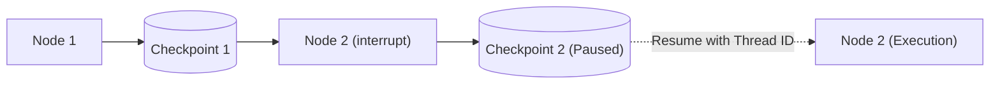

* **Các loại Checkpointer:**
  1. `InMemorySaver`: Lưu trên RAM. Dễ dùng, chỉ phục vụ môi trường phát triển (development) và Unit Test. Tắt app là mất.
  2. `SqliteSaver` / `PostgresSaver`: Lưu trữ bền vững trên ổ đĩa hoặc cơ sở dữ liệu quan hệ. Bảo toàn trạng thái kể cả khi sập nguồn server, khởi động lại dịch vụ hoặc người duyệt phản hồi sau nhiều ngày.
* **Quy luật:** *Thời gian tồn tại của Checkpointer phải tương ứng với độ trễ tối đa của quy trình phê duyệt ngoài đời thực.*

---

## 3.5. Demo 2: Duyệt hoàn tiền và bẫy hoàn hai lần (Duplicate Execution)

| Kịch bản kiểm thử | Hành vi hệ thống | Kết quả ghi nhận |
| :--- | :--- | :--- |
| **Chạy tới điểm duyệt** | Hệ thống chạy qua 3 ca khiếu nại và dừng lại | 3 cuộc dừng ở điểm `interrupt()`, 0 đồng nào bị thất thoát. |
| **Tắt máy, mở lại server** | Checkpointer tải lại trạng thái qua `thread_id` | Cả 3 phiên vẫn chờ đúng chỗ cũ, nguyên vẹn State. |
| **Người quản trị duyệt** | Gửi lệnh `Command(resume=...)` | Ca 1 đồng ý (hoàn 890k), Ca 2 sửa (hoàn 445k), Ca 3 từ chối (hoàn 0đ). |
| **CẠM BẪY VI PHẠM:**<br/>`refund()` đặt trước `interrupt()` | Khi gọi invoke lần đầu, `refund()` chạy. Khi người bấm duyệt và resume, Node chạy lại từ đầu, `refund()` chạy lần 2! | **Trùng lặp tác vụ (Duplicate Execution): Hoàn tiền 2 lần!** |

> [!WARNING]
> *Lỗi lặp tác vụ ngoại vi này **không làm crash chương trình**, không sinh exception, chỉ bị phát hiện khi đối soát dữ liệu kế toán.*

---

## 3.6. Tổng kết Phần 3

1. **Phân quyền theo rủi ro:** Tự động hóa tác vụ Đọc, bắt buộc phê duyệt với tác vụ Ghi; tối ưu hóa số lượng điểm dừng.
2. **`interrupt` cần checkpointer:** Bắt buộc phải có Checkpointer bền vững và khóa phiên duy nhất (`thread_id`).
3. **Thứ tự an toàn:** Tuyệt đối đặt mọi Side Effect sau lời gọi `interrupt()`.

---

# PHẦN 04: CHIẾN LƯỢC PHÂN RÃ TÁC VỤ: KHI NÀO CẦN MULTI-AGENT?

## 4.1. Rủi ro khi chia việc cho nhiều Agent

Khi giao một bài toán lớn cho nhiều Agent độc lập làm việc song song mà không có cơ chế căn chỉnh giả định ngầm, hệ thống sẽ gặp hiện tượng **xung đột phong cách và lệch hướng mục tiêu**:

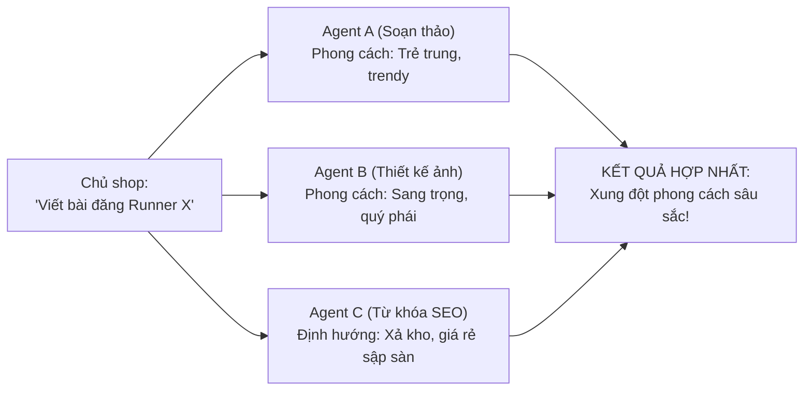

> **Đúc kết:** *Từng Agent đều hoàn thành xuất sắc nhiệm vụ cục bộ của mình; nhưng hệ thống tổng thể vẫn thất bại ê chề do **các giả định ngầm mâu thuẫn lẫn nhau**.*

---

## 4.2. So sánh nhóm người thực tế và hệ nhiều Agent

Nhiều kỹ sư thường áp dụng ngây thơ kinh nghiệm quản lý con người vào hệ thống Multi-Agent mà quên đi các rào cản kỹ thuật của LLM:

| Tiêu chí | Trong tổ chức con người | Trong hệ thống Multi-Agent (LLM) |
| :--- | :--- | :--- |
| **Chi phí vận hành** | Lương cố định theo giờ làm việc | **Token lũy tiến cực nhanh:** ~4× Single-Agent, ~15× Multi-Agent (theo đo lường thực tế của Anthropic, 06/2025). |
| **Độ trễ giao tiếp** | Con người trao đổi song song tức thì | Mỗi lượt phân công/trao đổi là **thêm một lần suy luận tuần tự của LLM** ($+\text{latency}$). |
| **Ngữ cảnh (Context)** | Con người có tri thức nền và linh cảm | **Thất thoát thông tin ngữ cảnh:** Subagent không thể kế thừa trọn vẹn ngữ cảnh của Agent điều phối. |
| **Lợi thế song song** | Phân công chuyên môn hóa | **Chỉ có lợi khi tác vụ hoàn toàn độc lập**; giúp giữ context window của từng Agent tinh gọn. |

> **Nguyên lý mở rộng (Scaling Law):** *Mở rộng hệ đa Agent chỉ mang lại hiệu quả khi bài toán phân rã được thành **các miền tác vụ độc lập**.* (Anthropic, 2025).

---

## 4.3. Bằng chứng thực nghiệm: Tác vụ độc lập vs. Tuần tự

Nghiên cứu của Google Research (01/2026, *Towards a science of scaling agent systems*, arXiv:2512.08296) chỉ ra hiệu suất trái ngược giữa hai dạng bài toán:

```
Hiệu quả của Multi-Agent so với Single-Agent (Mốc chuẩn 1 Agent = 0%):

+81% ┤  █████████████
     │  ██ Tác vụ phân rã độc lập ██ (Finance-Agent: Tra cứu các nguồn độc lập)
  0% ┼────────────────────────────────────────────────────────
     │                         ██ Tác vụ tuần tự phụ thuộc ██
-50% ┤                         █████████████ (-39% đến -70%, PlanCraft)
```

### Hiện tượng khuếch đại sai số (Error Amplification)
* Khi không có tầng điều phối kiểm soát: Sai số qua từng agent bị khuếch đại lên tới **17.2×**.
* Khi có Agent điều phối (Supervisor) giám sát chặt chẽ: Sai số được ghìm xuống còn **4.4×**.

> **Kết luận thực nghiệm:**  
> *Multi-Agent tối ưu cho tác vụ phân tách độc lập; đối với bài toán tuần tự, có sự phụ thuộc chuỗi, **Single-Agent hoặc Workflow vượt trội hoàn toàn**.*

---

## 4.4. Ba câu hỏi vàng trước khi phân rã hệ thống

Trước khi quyết định tách một bài toán thành Multi-Agent, bắt buộc phải trả lời 3 câu hỏi sau:

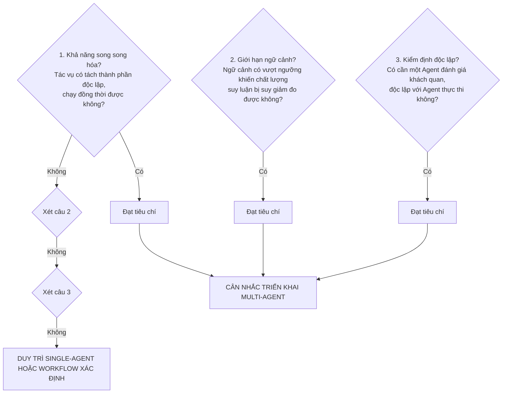

> **Quy tắc thiết kế:**  
> *Nếu không thỏa mãn **bất kỳ tiêu chí nào** trong ba tiêu chí trên, hãy duy trì Single-Agent hoặc một Workflow xác định.*

---

## 4.5. So sánh Workflow song song và Dynamic Subagents

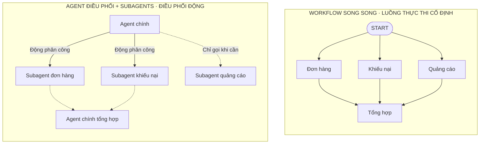

| Đặc điểm | Workflow song song (Static Parallel) | Agent điều phối + Subagents (Dynamic) |
| :--- | :--- | :--- |
| **Cơ chế gọi** | Luôn luôn gọi cố định cả 3 nguồn đã ấn định | Agent chính tự suy luận nhu cầu để quyết định gọi ai |
| **Độ phức tạp** | Rất thấp, code xác định, chi phí dự đoán được | Cao hơn, linh hoạt theo yêu cầu người dùng |
| **Khi nào dùng** | Các bài toán lặp lại có cấu trúc cố định | Khi yêu cầu biến động khó lường trước |

---

## 4.6. Tổng kết Phần 4

1. **Cân nhắc chi phí mở rộng:** Phân rã Agent chỉ sinh lợi khi bài toán tách được thành các phần độc lập.
2. **Ba tiêu chí cốt lõi:** Tính song song hóa, Giới hạn ngữ cảnh (Context limit), Yêu cầu kiểm định độc lập.
3. **Lựa chọn kiến trúc phù hợp:** Workflow song song cho quy trình cố định; Multi-Agent cho bài toán thích ứng động.

---

# PHẦN 05: TỔ CHỨC VÀ VẬN HÀNH HỆ NHIỀU AGENT

## 5.1. Bức tranh chung: 5 cách tổ chức hệ nhiều Agent

Năm hình thái kinh điển để tổ chức một hệ thống Multi-Agent:

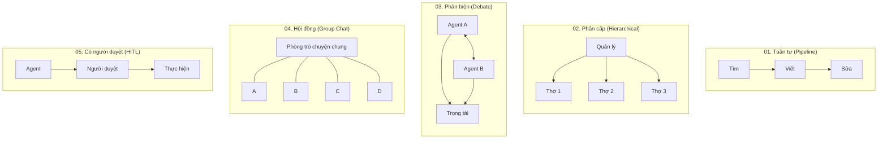

> **Hai câu hỏi bản chất để phân biệt mọi hình thái tổ chức:**  
> 1. **Ai nói với ai?** (Topology giao tiếp)  
> 2. **Ai là người quyết định cuối cùng?** (Cơ chế đồng thuận & quyền lực)

---

## 5.2. Hình thái 1: Tổ chức tuần tự (Sequential Pipeline)

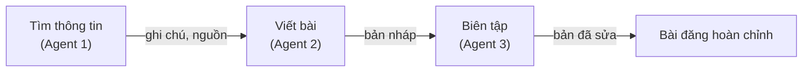

* **Cơ chế:** Người trước làm xong, bàn giao kết quả cho người sau làm tiếp.
* **Hợp khi:** Công việc có các giai đoạn rõ ràng, tuyến tính, bước sau cần nguyên liệu của bước trước.
* **Điểm yếu chí tử:** **Lỗi dây chuyền.** Bước đầu tiên làm sai thì các bước sau sai theo toàn bộ chuỗi; không có cơ chế tự quay lại sửa lỗi trừ khi có kiểm định lặp.
* **Bản chất:** *Đây chính là Workflow tuần tự (Phần 2), chỉ khác là mỗi bước do một LLM Agent chuyên trách đảm nhận.*

---

## 5.3. Hình thái 2: Tổ chức phân cấp (Manager và Worker)

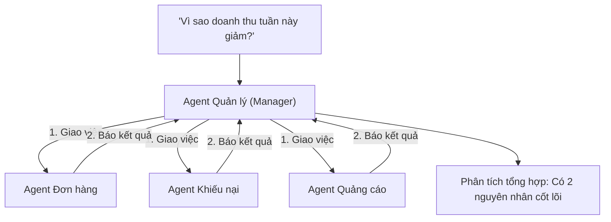

* **Các vai trò:**
  * **Quản lý (Manager / Supervisor):** Đọc mục tiêu lớn, lập kế hoạch, phân rã thành việc nhỏ, giao đúng người, tổng hợp kết quả.
  * **Thợ (Worker):** Chuyên gia trong một miền hẹp, thực hiện nhiệm vụ được giao và trả về báo cáo ngắn gọn.
  * **Router:** Dạng đơn giản nhất của mô hình phân cấp — chỉ chọn đúng một thợ phù hợp cho câu hỏi rồi chuyển việc (ví dụ: chuyển sang CSKH, Khiếu nại hoặc Bỏ qua).
* **Đặc điểm giao tiếp:**  
  * *Các thợ không nói chuyện với nhau: mọi luồng thông tin đều tập trung đi qua quản lý.*

---

## 5.4. Hình thái 3: Tranh luận và phản biện (Debate, Peer Review)

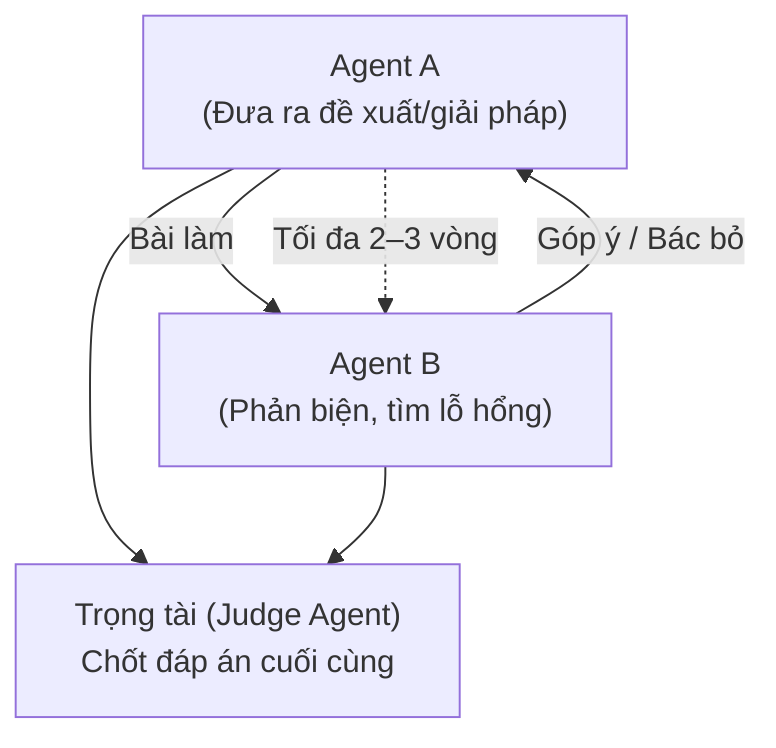

* **Cách làm:** Mỗi agent tự giải, đọc bài của nhau rồi điều chỉnh lập luận qua 2–3 vòng lặp.
* **Lợi ích:** Dễ dàng phát hiện ảo giác (hallucination), tính toán sai lệch hoặc thông tin bịa đặt.
* **Lưu ý & Rủi ro:**
  * Bắt buộc phải giới hạn cứng số vòng tranh luận.
  * **Cạm bẫy mô hình chung:** Nếu cả hai bên dùng chung một model (hoặc cùng một họ model), chúng rất dễ có chung điểm mù (bias) và cùng đưa ra đáp án sai giống nhau!
* **Nghiên cứu khoa học:** Du et al. (2023), *Multiagent Debate*, arXiv:2305.14325; Smit et al. (ICML 2024), *Should we be going MAD?*.

> **Đúc kết:** *Tranh luận tốn token gấp nhiều lần và **không phải lúc nào cũng tốt hơn** việc lấy mẫu nhiều lần từ một model rồi bỏ phiếu đa số (Majority Voting / Self-consistency).*

---

## 5.5. Hình thái 4: Hội đồng chuyên gia (Group Chat)

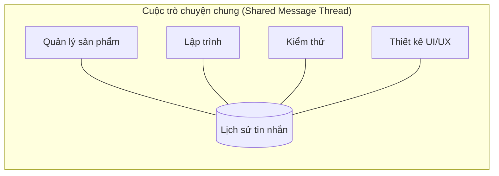

* **Cách làm:** Tất cả agent cùng nhìn thấy một lịch sử tin nhắn chung và lần lượt phát biểu ý kiến.
* **Cơ chế chọn người nói tiếp (Speaker Selection):**
  * Xoay vòng theo thứ tự cố định (**Round-robin**).
  * Dùng một Model làm người điều hành (**Selector Model**) chỉ định người nói tiếp theo ngữ cảnh.
* **Ví dụ kinh điển:**
  * *ChatDev:* Mô phỏng một công ty phần mềm ảo từ ý tưởng đến viết code và test.
  * *AutoGen:* Hỗ trợ sẵn kiến trúc `GroupChat` và `GroupChatManager`.
* **Cạm bẫy nghiêm trọng:**
  * **Cực kỳ tốn token:** Mỗi lượt nói mới, tất cả mọi Agent đều phải đọc lại toàn bộ lịch sử trò chuyện từ đầu.
  * Khó kiểm soát hướng thảo luận, dễ lan man ngoài lề.

> **Đúc kết:** *Hình thái linh hoạt nhất, nhưng cũng **khó đoán nhất và tốn token nhất**.*

---

## 5.6. Hình thái 5: Có người duyệt (Human-in-the-Loop)

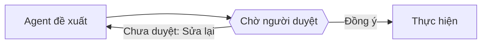

### Ba trường hợp bắt buộc phải có người duyệt
1. **Trước tác vụ khó đảo ngược (Irreversible Actions):** Hoàn tiền thật, gửi email chính thức cho khách hàng, xóa dữ liệu cơ sở dữ liệu.
2. **Khi Agent bế tắc (Deadlock / Stuck):** Vượt quá số lần thử cho phép (`attempts >= max`), hoặc hai bên tranh luận không thống nhất được kết quả.
3. **Khi thông tin bị thiếu hụt hoặc mơ hồ:** Khi yêu cầu khách hàng không rõ ràng, agent phải hỏi lại con người thay vì tự suy đoán bừa bãi.

> **Tính phổ quát:** *Người duyệt có thể ghép vào **mọi cách tổ chức** (Tuần tự, Phân cấp, Tranh luận, Hội đồng), bằng chính kỹ thuật `interrupt()` đã học ở Phần 3.*

---

## 5.7. So sánh ba Framework phổ biến: LangGraph vs. CrewAI vs. AutoGen

| Framework | Mô hình tổ chức đặc trưng | Thế mạnh vượt trội | Hạn chế / Điểm lưu ý |
| :--- | :--- | :--- | :--- |
| **LangGraph** | Đồ thị trạng thái có vòng lặp, kiểm soát từng bước tuần tự và rẽ nhánh. | **Môi trường Production**, nghiệp vụ thực tế phức tạp, kiểm soát chặt chẽ, hỗ trợ breakpoint/checkpoint xuất sắc. | Phải tự thiết kế kiến trúc đồ thị chi tiết, viết nhiều code hạ tầng hơn. |
| **CrewAI** | Tổ chức đội ngũ theo vai vế thực tế (`Crew`, `Agent`, `Task`, `Process`). | Dễ học, dựng ứng dụng văn phòng, nghiên cứu tài liệu, sáng tạo nội dung, marketing cực nhanh. | Khó can thiệp sâu vào từng quyết định nhỏ; tính kiểm soát quy trình thấp hơn. |
| **AutoGen** | Trò chuyện nhóm đa tác tử tự do, linh hoạt (`GroupChat`). | Phù hợp bài toán mô phỏng xã hội, tranh luận đa chiều, thử nghiệm học thuật. | Hiện đang ở chế độ bảo trì; Microsoft đang chuyển giao sang *Microsoft Agent Framework*. |

> **Lựa chọn của học phần:** *SE373 sử dụng **LangGraph** làm chuẩn mực công nghiệp: bạn nắm vững State, Node, Edge và `interrupt()` là có thể làm chủ mọi thiết kế.*

---

## 5.8. Quản lý trạng thái: State dùng chung vs. Bộ nhớ riêng biệt

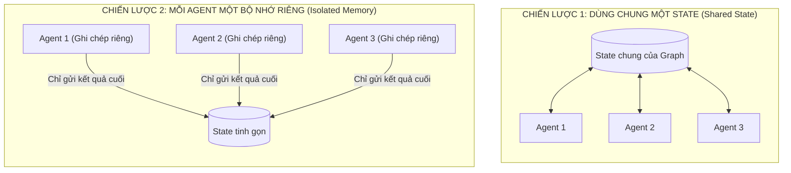

| Chiến lược | Ưu điểm | Nhược điểm |
| :--- | :--- | :--- |
| **Dùng chung một State** | Dễ chia sẻ dữ liệu, các agent thấy hết thông tin của nhau. | Dễ ghi đè lên dữ liệu của nhau (race condition); Context window phình to cực nhanh. |
| **Mỗi agent một bộ nhớ riêng** | Context từng agent rất gọn gàng; dữ liệu thô không làm ô nhiễm State chung. | Agent sau có thể thiếu hụt thông tin ngữ cảnh nếu kết quả trả về quá ngắn. |

> **Thực tiễn kỹ nghệ phần mềm:**  
> *Luôn kết hợp lai (Hybrid): **Dùng chung phần cả nhóm cần biết** (kết quả có cấu trúc), **giữ riêng phần nháp / dữ liệu thô** trong Subgraph của từng Agent.*

---

## 5.9. Giao tiếp giữa các Agent: Văn tự do vs. Dữ liệu có cấu trúc

### So sánh hai phương thức

* **Giao tiếp bằng văn tự do (Unstructured Text):**
  > *"Tôi đã xem đơn hàng. Có vẻ Runner X giảm khá nhiều, chắc là do quảng cáo."*
  * **Hậu quả:** Agent kế tiếp phải mất token suy luận và phỏng đoán (giảm bao nhiêu cái? chắc chắn bao nhiêu %?). Khó viết code kiểm thử tự động.
* **Giao tiếp bằng dữ liệu có cấu trúc (Structured Output với Pydantic):**

```python
from pydantic import BaseModel
from typing import Literal

class WorkerResult(BaseModel):
    source: Literal["orders", "complaints", "ads"]  # Nguồn dữ liệu
    finding: str                                    # Phát hiện chính
    evidence: list[str]                             # Bằng chứng trích xuất cụ thể
    confidence: Literal["high", "low"]              # Độ tin cậy
```

* **Lợi ích:**
  * Schema validate ngay lập tức: Thiếu trường hoặc sai kiểu dữ liệu sẽ báo lỗi tại chỗ (fail-fast).
  * Agent sau bốc đúng trường dữ liệu cần để xử lý mà không phải đọc hiểu lại văn bản.

> **Quy tắc vàng:**  
> *Giữa Agent với Agent: **Bắt buộc ưu tiên dữ liệu có cấu trúc**; văn tự do chỉ dành riêng cho câu trả lời cuối cùng gửi đến người dùng.*

---

## 5.10. Ba vấn đề thường gặp và chiến lược giải quyết

### 🔴 Vấn đề 1: Lỗi dây chuyền (Compounding Hallucinations)

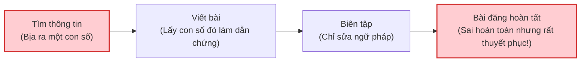

* **Bản chất:** Agent ở bước sau không thể biết thông tin từ agent trước là bịa đặt; chỉ một sai số ở khâu đầu sẽ biến thành chân lý giả tạo ở khâu cuối.
* **Cách chặn đứng:**
  1. Yêu cầu Agent ghi rõ nguồn (`source`, `evidence`) cho từng con số, từng nhận định.
  2. Bổ sung bước kiểm chứng chéo (Verifier) đối chiếu trực tiếp với database gốc, không chỉ đọc bản tóm tắt.
  3. **Agent kiểm chứng phải dùng context độc lập**, không được đọc chuỗi lập luận tự biện của agent trước đó.

---

### 🔴 Vấn đề 2: Vòng lặp vô tận (Infinite Loops)

* **Biểu hiện thực tế:**
  * *Văn hóa "Cảm ơn qua lại":*
    * Agent A: *"Bản này ổn rồi, cảm ơn bạn."*
    * Agent B: *"Cảm ơn bạn đã góp ý!"*
    * Agent A: *"Không có gì, rất vui được cộng tác!"* $\to$ Lặp vô tận!
  * *Đùn đẩy trách nhiệm sửa lỗi:*
    * Coder Agent: *"Unit test viết sai, code tôi không có lỗi."*
    * Tester Agent: *"Test tôi viết đúng quy chuẩn, lỗi nằm ở logic code."*
    * Coder Agent: *"Tôi vừa kiểm tra lại, code tôi hoàn toàn đúng."* $\to$ Bế tắc!
* **Cách chặn đứng:**
  1. **Giới hạn số vòng cứng (Max iterations):** Luôn duy trì biến đếm `attempts` trong State; vượt ngưỡng là ngắt luồng.
  2. **Code quyết định lúc dừng:** Dùng test runner, linter hoặc schema validation bằng code Python để quyết định dừng; tuyệt đối không hỏi model: *"Bạn đã xong chưa?"*.
  3. **Phát hiện trùng lặp:** Nếu hai lượt phản hồi liên tiếp có nội dung giống nhau hoặc độ sai khác dưới ngưỡng cho phép, chuyển ngay cho con người can thiệp.

> **Đúc kết:** *Điều kiện dừng **phải nằm trong code**, tuyệt đối không nằm trong lời hứa của Agent!*

---

### 🔴 Vấn đề 3: Bùng nổ chi phí và độ trễ ($O(N^2)$ Cost & Latency Explosion)

#### Ví dụ bài toán giả định: 5 Agent thảo luận trong 4 vòng
* Số lượt phát biểu: $5 \times 4 = 20$ lượt.
* Mỗi lượt phát biểu viết ra: $500\text{ tokens}$.
* Tổng token viết ra: $20 \times 500 = 10,000\text{ tokens}$.
* **Tổng token phải đọc lại (Quadratic Context):** Do mỗi lượt sau phải đọc toàn bộ các lượt trước, tổng số token đọc lại lên tới **$95,000\text{ tokens}$**!
* Thời gian chờ (trung bình 8 giây/lượt tuần tự): **160 giây** ($\approx 2.7\text{ phút}$).

> **Quy luật toán học:** *Lượng token đọc lại tăng theo **bình phương số lượt nói** ($O(N^2)$). Thêm một agent, tăng một vòng tranh luận là chi phí và độ trễ tăng phi mã.*

#### Chiến lược tối ưu hóa:
1. **Phân bổ mô hình theo độ khó (Model Routing):** Dùng model nhỏ, rẻ, nhanh (ví dụ: GPT-4o-mini, Gemini Flash) cho các Worker thực thi tác vụ đơn giản; chỉ dùng mô hình lớn mạnh nhất (Claude 3.7 Sonnet, GPT-4o, Gemini Pro) cho Agent Quản lý / Điều phối.
2. **Chạy song song (Parallel execution):** Bất kỳ tác vụ nào không phụ thuộc vào nhau thì bắt buộc kích hoạt thực thi đồng thời.
3. **Giữ Context tinh gọn:** Tóm tắt lịch sử hội thoại sau mỗi vòng, chỉ lưu trữ kết luận cấu trúc thay vì toàn bộ câu từ thô.

---

## 5.11. Tổng kết Phần 5

1. **Năm cách tổ chức:** Tuần tự, Phân cấp, Phản biện, Hội đồng; người duyệt (HITL) có thể lồng ghép vào mọi cách.
2. **Framework:** LangGraph khi cần kiểm soát chặt chẽ từng bước trong sản phẩm thật; CrewAI & AutoGen để thử nhanh prototype.
3. **State và Giao tiếp:** Chia sẻ vừa đủ, giữ context gọn gàng, giao tiếp giữa các agent bằng dữ liệu có cấu trúc (`Pydantic`).
4. **Ba vấn đề thường gặp:** Luôn chủ động phòng chống lỗi dây chuyền, bẫy vòng lặp vô hạn và bùng nổ chi phí/độ trễ.

---

# PHỤ LỤC THỰC HÀNH: ÁNH XẠ SLIDE SANG DEMO CODE (SHOP BƯỚC NHẸ)

Trong thư mục bài tập `workflow_and_multi_agent/`, bài toán xuyên suốt được mô phỏng trên dữ liệu của **Shop giày thể thao "Bước Nhẹ"** (mặt hàng tiêu biểu: **Runner X**). Dưới đây là bảng ánh xạ mã nguồn để AI Agent đối chiếu khi hướng dẫn lập trình:

| Tập tin demo | Thuộc Slide / Hình thái | Kiến trúc & Kỹ thuật trọng tâm trong code |
| :--- | :--- | :--- |
| `p5_1_sequential.py` | Hình thái 1: Tuần tự | Pipeline 3 bước: `researcher` $\to$ `writer` $\to$ `editor`. Mỗi agent cập nhật đúng một trường vào State (`notes`, `draft`, `post`). |
| `p5_2_hierarchical.py` | Hình thái 2: Phân cấp | **Phần A (Router):** Dùng LLM với Structured Output phân loại tin nhắn vào 4 nhánh (`product_advisor`, `order_tracker`, `complaint_handler`, `ignore`).<br/>**Phần B (Manager-Worker):** `manager_plan` chia nhỏ câu hỏi $\to$ `assign_tasks` dùng cơ chế `Send` của LangGraph đẩy 3 task song song cho 3 worker $\to$ `manager_summarize` gom kết quả. |
| `p5_3_debate.py` | Hình thái 3: Tranh luận | `proposer` $\leftrightarrow$ `critic` tranh luận tối đa 3 vòng $\to$ `judge` chốt đáp án. Minh họa cách phản biện bẻ gãy giả định sai lệch ban đầu. |
| `p5_4_group_chat.py` | Hình thái 4: Hội đồng | 4 Agent tham gia một thread chung. Thử nghiệm chế độ **Round-robin** (8 lượt) và **Select Speaker** (dừng khi phát hiện từ khóa "Chốt"). |
| `p5_5_human_in_the_loop.py`| Hình thái 5: Người duyệt | Tích hợp `interrupt()` trong LangGraph. Đồ thị tạm dừng để quản lý duyệt số tiền hoàn hoặc hỏi bổ sung mã đơn khi khách nhắn thiếu thông tin. Duyệt xong mới cho phép hoàn tiền. |
| `p5_6_state_and_messages.py`| Quản lý State & Giao tiếp | Tách biệt `SharedState` (chỉ chứa 276 token) và `WorkerState` (xử lý dữ liệu thô 3,438 token trong Subgraph riêng). Ép kiểu worker trả về schema `WorkerResult`. |

---

## 💡 Cheatsheet: Hướng dẫn nhanh cho AI Agent khi giải thích bài học

* Khi gặp câu hỏi: *"Khi nào nên dùng Multi-Agent thay vì Single-Agent?"*  
  $\to$ **Trả lời:** Dẫn chiếu ngay **Ba câu hỏi vàng ở Phần 4.4** và số liệu thực nghiệm của Google Research (Phần 4.3): chỉ dùng Multi-Agent khi tác vụ có thể phân tách độc lập song song hoặc ngữ cảnh vượt giới hạn 1 prompt. Nếu là tác vụ chuỗi tuần tự, Single-Agent/Workflow luôn tốt hơn và ít tốn token hơn 15 lần.
* Khi gặp câu hỏi: *"Làm sao để Agent không bị lặp vô tận?"*  
  $\to$ **Trả lời:** Dẫn chiếu **Phần 2.3 & 5.10**: Phải có biến đếm `attempts` trong State Schema và điều kiện ngắt cứng được viết bằng code Python trong Conditional Edge, không bao giờ tin vào lời hứa của LLM.
* Khi gặp câu hỏi: *"Làm sao để đảm bảo an toàn giao dịch tài chính trong Agent?"*  
  $\to$ **Trả lời:** Dẫn chiếu **Phần 3.3**: Dùng `interrupt()` với checkpointer (`SqliteSaver` / `PostgresSaver`), định danh `thread_id` và **bắt buộc đặt hàm gọi API trừ tiền/hoàn tiền SAU lời gọi `interrupt()`**.
