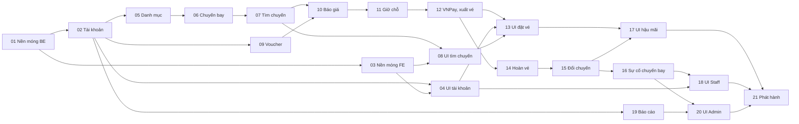

# Lộ trình phát triển SkyLine

| | |
|---|---|
| Ngày | 2026-10-09 |
| Nguồn | [PRD](../../PRD.md) · [TDD](../../TDD.md) · [App Flow](../../APP_FLOW.md) · [Backend Schema](../../BACKEND_SCHEMA.md) · [DESIGN.md](../../../DESIGN.md) |
| Plan chi tiết đã có | [Plan 01 — Nền móng backend](2026-10-09-01-backend-foundation.md) · [Plan 02 — Tài khoản, tham số, khung email](2026-10-09-02-accounts-settings-email.md) · [Plan 04 — Màn hình tài khoản](2026-10-10-04-account-screens.md) · [Plan 05 — Danh mục](2026-10-10-05-catalog.md) · [Plan 06 — Quản trị chuyến bay và kho ghế](2026-10-11-06-flights.md) · [Plan 07 — Tìm chuyến](2026-10-11-07-flight-search.md) · [Plan 08 — Màn hình tìm chuyến](2026-10-11-08-flight-search-screens.md) · [Plan 09 — Voucher](2026-10-12-09-voucher.md) · [Plan 10 — Báo giá booking](2026-10-13-10-booking-quote.md) · [Plan 11 — Giữ chỗ và vòng đời booking](2026-10-13-11-booking-hold.md) · [Plan 12 — Thanh toán VNPay và xuất vé](2026-10-14-12-vnpay-payment.md) · [Plan 13 — Màn hình đặt vé và quản lý booking](2026-10-15-13-booking-screens.md) · [Plan 14 — Hoàn vé](2026-10-18-14-refunds.md) · [Plan 15 — Đổi chuyến](2026-10-19-15-reschedule.md) · [Plan 16 — Sự cố chuyến bay và manifest](2026-10-20-16-flight-disruption.md) · [Plan 17 — Màn hình hậu mãi](2026-10-20-17-aftersales-screens.md) · [Plan 18 — Màn hình Staff](2026-10-20-18-staff-screens.md) · [Plan 19 — Báo cáo](2026-10-21-19-reports.md) |

Hệ thống có 10 module backend, khoảng 70 API, 28 màn hình, 16 test bắt buộc (T1–T16) và 11 kịch bản demo (D1–D11). Một plan duy nhất cho tất cả sẽ quá lớn để làm và review, nên dự án được chia thành **21 plan**. Mỗi plan tạo ra phần mềm chạy được, có test, và review độc lập được.

## Cách dùng tài liệu này

- **Plan chi tiết viết ngay trước khi làm**, theo thứ tự trong bảng §2. Plan sau dùng đúng tên lớp, API và bảng mà plan trước đã tạo thật, nên không viết trước toàn bộ 21 plan.
- **Làm theo nhóm:** các plan không phụ thuộc nhau chạy song song (sơ đồ §3, chia việc §4). **Làm một mình:** đi theo số thứ tự.
- **Xong một plan:** đánh dấu ở cột "Xong" (§2) và bổ sung API mà plan đó tạo ra vào bảng hợp đồng (§6).

---

## 1. Mốc

| Mốc | Plan | Chứng minh được | Tuần (nhóm 5 người) |
|---|---|---|---|
| M0 Nền móng | 01–04 | `docker compose up` chạy, CI xanh, đăng ký và đăng nhập được trên UI | 1–2 |
| M1 Tìm kiếm | 05–08 | Tìm thấy chuyến bay thẳng và nối chuyến trên UI với dữ liệu seed | 3–4 |
| M2 Đặt vé và thanh toán | 09–13 | Kịch bản D1–D5, D11 | 5–7 |
| M3 Hậu mãi và vận hành | 14–18 | Kịch bản D6–D8 | 8–10 |
| M4 Quản trị và phát hành | 19–21 | D9, D10, chạy lại toàn bộ D1–D11 bằng một lệnh `docker compose up` | 10–12 |

Số tuần là ước lượng thô theo bối cảnh PRD §1.1 (nhóm 5 người, 12 tuần).

---

## 2. Danh sách plan

Mức ưu tiên lấy từ PRD §5: **P0** bắt buộc cho demo cốt lõi, **P1** cần có, **P2** làm nếu còn thời gian.

| # | Plan | Chức năng | Quy tắc | Test bắt buộc | Cần có trước | Kết quả kiểm chứng được | Ưu tiên | Xong |
|---|---|---|---|---|---|---|---|---|
| 01 | Nền móng backend | — (NFR-03, 04, 07, 08, 10) | BR-25 (đọc tham số) | T15 (phân quyền theo đường dẫn) | — | `./mvnw verify` xanh trên PostgreSQL 18; `docker compose up` healthy; CI chạy | P0 | ☑ |
| 02 | Tài khoản, phiên đăng nhập, tham số, khung email | FR-01–04, FR-110, FR-111, email đặt lại mật khẩu (FR-130) | BR-100–105, BR-25 | — | 01 | Đăng ký, đăng nhập, khoá tài khoản qua API; email đặt lại mật khẩu xuất hiện trong Mailpit; seed `V105` | P0 (FR-01, 02), còn lại P1 | ☑ |
| 03 | Nền móng frontend | — (NFR-09, DESIGN.md) | — | — | 01 | `npm run build` và Playwright smoke xanh; `/api/*` đi qua rewrites; route cần đăng nhập chuyển về `/login?next=` | P0 | ☑ |
| 04 | Màn hình tài khoản | C-03–C-06, C-12 | — | — | 02, 03 | E2E: đăng ký → đăng nhập → sửa hồ sơ → đăng xuất | P0 (C-03, C-04) | ☑ |
| 05 | Danh mục | FR-10, FR-80–83 và API công khai `/airports`, `/airlines`, `/baggage-options` | BR-90–92 | — | 02 | CRUD của Admin, xoá dữ liệu đã tham chiếu báo `RESOURCE_IN_USE`; seed `V100`–`V103` | P0 (FR-83: P1) | ☑ |
| 06 | Quản trị chuyến bay và kho ghế | FR-90, FR-91, FR-92 (chưa gửi email), FR-94; `SeatInventory` (Q-01–Q-03) | BR-80–82, BR-85–87 | Kho ghế dưới tải đồng thời (tiền đề cho T1) | 05 | Tạo hàng loạt bỏ qua ngày trùng; không giảm ghế xuống dưới số đã bán; seed `V106` (1.200 chuyến) | P0 (FR-92: P1, FR-94: P2) | ☑ |
| 07 | Tìm chuyến | FR-11, FR-12; `FlightApi` kiểm tra và định giá hành trình | BR-01–06, BR-20, BR-21 | T13 | 06 | HAN→PQC trả cả chuyến thẳng lẫn nối chuyến; p95 dưới 1 giây trên dữ liệu seed (NFR-01) | P0 | ☑ |
| 08 | Màn hình tìm chuyến | C-01, C-02 | — | — | 03, 05, 07 | E2E: tìm khứ hồi 2 bước, lọc và sắp xếp ở client | P0 | ☑ |
| 09 | Voucher | FR-100; `VoucherApi` | BR-30 (điều kiện 1–4), BR-31, BR-32 | — | 02 | CRUD voucher; giữ và trả lượt nguyên tử (Q-14, Q-15); seed `V104` | P1 | ☑ |
| 10 | Báo giá booking | FR-20–23 | BR-10–14, BR-20–24, BR-30 (điều kiện 5), BR-33 | — | 07, 09 | `POST /bookings/quote` cho đúng các con số của ví dụ TDD §8.8 (tổng 5.848.000 đ) | P0 (FR-22, 23: P1) | ☑ |
| 11 | Giữ chỗ và vòng đời booking | FR-24, FR-33, FR-40, FR-41, FR-70 | BR-40, BR-45, BR-46, BR-104 | T1, T2, T5, T15 (404), T16 | 10 | 20 luồng đặt cùng lúc không bán vượt ghế; job hết hạn trả ghế và lượt voucher | P0 | ☑ |
| 12 | Thanh toán VNPay và xuất vé | FR-30, FR-31, FR-32 (phát sự kiện), FR-73, email vé | BR-41–44 | T3, T4 | 11 | Thanh toán sandbox → `ISSUED`, số vé 13 chữ số, email vé trong Mailpit | P0 (FR-73: P2) | ☑ |
| 13 | Màn hình đặt vé và quản lý booking | C-07, C-08, C-09 | — | — | 04, 08, 12 | E2E: chọn vé → khai hành khách → giữ chỗ → chuyển sang VNPay | P0 | ☑ |
| 14 | Hoàn vé | FR-50–52, FR-71, yêu cầu hoàn tự tạo (FR-32), email hoàn tiền và từ chối | BR-44, BR-50–53, BR-60–66 | T6, T7, T8, T14 | 12 | Staff duyệt → Refund API (giả lập) → `COMPLETED`; lỗi cổng thì thử lại chỉ hoàn phần thiếu | P1 | ☑ |
| 15 | Đổi chuyến | FR-60–62, email đổi chuyến | BR-70–75 | T9, T10, T11 | 14 | Đổi chiều về, trả phí và chênh lệch, có số vé mới | P1 | ☑ |
| 16 | Sự cố chuyến bay và manifest | FR-93, FR-72, email đổi giờ (FR-92), email huỷ chuyến | BR-83, BR-84 | T12 | 15 | Huỷ chuyến kéo theo đủ 4 hệ quả (a)–(d) của BR-84 | P1 (FR-72: P2) | ☑ |
| 17 | Màn hình hậu mãi | C-10, C-11 | — | — | 13, 15 | E2E: hoàn một chiều, đổi một chiều | P1 | ☑ |
| 18 | Màn hình Staff | S-01–S-06 | — | — | 04, 16 | E2E: tra cứu booking, duyệt yêu cầu hoàn | P0 (S-01, S-02), còn lại P1 | ☑ |
| 19 | Báo cáo | FR-120–122 | BR-110–112 | — | 02 | Số liệu khớp với dữ liệu test tự dựng | P1 (FR-122: P2) | ☑ |
| 20 | Màn hình Admin | A-01–A-10 | — | — | 04, 16, 19 | E2E: tạo chuyến hàng loạt rồi thấy chuyến đó trong kết quả tìm kiếm | P0 (A-01–A-06), còn lại P1 | ☐ |
| 21 | Phát hành và demo | D1–D11, NFR-01, NFR-08 | — | E2E toàn luồng | tất cả | `docker compose up` một lệnh; D1–D11 chạy được, có kịch bản thuyết trình | P0 | ☐ |

Kiểm tra độ phủ: mọi `FR-xx` của PRD §5, mọi `BR-xx` của PRD §6, mọi test T1–T16 của TDD §11.2, mọi email của FR-130 và mọi màn hình của APP_FLOW §2 đều thuộc đúng một plan ở bảng trên.

---

## 3. Sơ đồ phụ thuộc

Mũi tên `A --> B` nghĩa là B cần A xong trước. Sơ đồ đã bỏ các cạnh suy ra được qua bắc cầu.

Đường găng (dài nhất): 01 → 02 → 05 → 06 → 07 → 10 → 11 → 12 → 14 → 15 → 16 → 20 → 21. Mọi trễ trên đường này làm trễ cả dự án; các plan còn lại có thời gian dự phòng.

---

## 4. Chia việc

### Nhóm 5 người

Theo cách chia ở TDD §3.4. Mỗi nhóm làm cả màn hình cho phần backend của mình, vì DESIGN.md đã có.

| Nhóm | Phụ trách | Plan |
|---|---|---|
| A | common, identity, notification | 01, 02, 04, 18 |
| B | catalog, flight | 05, 06, 16, 20 |
| C | tìm kiếm, booking | 07, 08, 10, 11, 13 |
| D | payment, aftersales | 12, 14, 15, 17 |
| E | promotion, report, nền frontend, phát hành | 03, 09, 19, 21 |

Tuần 1, khi nhóm A làm Plan 01, các nhóm khác chuẩn bị: nhóm D đăng ký VNPay sandbox (§7), nhóm E dựng khung giao diện theo DESIGN.md, mọi người đọc PRD và TDD phần mình phụ trách.

### Làm một mình

Đi theo số thứ tự 01 → 21. Toàn bộ 21 plan khó xong trong 12 tuần bán thời gian, nên làm **đường P0** trước:

01, 02 (FR-01, 02), 03, 04 (C-03, C-04), 05 (FR-10, 80–82), 06 (FR-90, 91), 07, 08, 10 (bỏ hành lý, voucher), 11, 12 (bỏ FR-73), 13, 18 (S-01, S-02), 20 (A-01–A-06), 21.

Đường P0 đủ chạy D2, D3, D4, D5, D11 và D1 rút gọn (không hành lý, không voucher). Sau đó quay lại phần P1, P2 của từng plan.

---

## 5. Quy ước chung

Plan 01 thiết lập các quy ước dưới đây; mọi plan sau tuân theo.

### Backend

- **Module:** gói gốc `vn.edu.uit.flightbooking`, mỗi module là một gói con. Gói con `web`, `domain`, `infra` là nội bộ; lớp ở gói gốc của module là API công khai (TDD §3.2). `ModularityTest` chặn vi phạm.
- **API công khai** của module là một class `@Service` ở gói gốc (VD `common.SettingsApi`). Chỉ tách interface khi có từ hai cài đặt trở lên.
- **Lỗi nghiệp vụ:** `throw new BusinessException(ErrorCode.X, "câu tiếng Việt cho người dùng")`. Trường bổ sung truyền qua `Map`, VD `Map.of("reason", "EXPIRED")`.
- **Tham số hệ thống:** gọi `settingsApi.getInt(SettingKey.X)` đúng lúc tạo giao dịch (BR-25).
- **Migration:** thay đổi schema thêm vào `db/migration/V{n}__mo_ta.sql` (V2, V3…), không sửa V1. Seed đặt ở `db/seed/V10x__seed_*.sql`, đánh số theo BACKEND_SCHEMA §8. Plan 02 thêm `classpath:db/seed` vào `spring.flyway.locations` và bật `spring.flyway.out-of-order=true` cho profile `dev`, vì các plan thêm seed không theo thứ tự số (V105 ở Plan 02, V100–V103 ở Plan 05…).
- **Test:**
  - Integration test gắn `@IntegrationTest` để dùng chung một Spring context và một container PostgreSQL 18.
  - Test ghi dữ liệu thì gắn `@Transactional` để rollback. Riêng test đồng thời không dùng được cách này, nên phải tự tạo dữ liệu riêng và tự dọn.
  - Test tự tạo dữ liệu, không dựa vào seed.
  - CSRF trong test: dùng `TestCsrf.csrf(mvc)`. **Không** dùng `SecurityMockMvcRequestPostProcessors.csrf()`, vì nó thay repository của `CsrfFilter` dùng chung và làm hỏng các test chạy sau.
  - Test không đọc `.env` (chỉ profile `dev` đọc file này).
- **Commit:** nhỏ, mỗi task một lần; message dạng `feat(module): ...`, `test(module): ...`.

### Frontend (Plan 03 thiết lập)

- Landing (C-01) giữ nguyên CSS của bản thiết kế trong `landing.css` (scope `.sk`) thay vì chuyển sang Tailwind, để đối chiếu bằng diff khi thiết kế đổi. Các màn sau dùng token `@theme`.
- Next.js 16 bật Cache Components: không gọi `new Date()` hay `Date.now()` khi render (kể cả Client Component). Giá trị phụ thuộc giờ phải lấy sau hydrate, VD `useSyncExternalStore` với `getServerSnapshot` trả `null` (xem `search-context.tsx`).
- Token màu, chữ, khoảng cách lấy từ DESIGN.md và khai báo trong `@theme` của Tailwind v4.
- Mọi lời gọi ghi đi qua một hàm `apiFetch` duy nhất (tự gắn `X-XSRF-TOKEN`, chuyển ProblemDetail thành lỗi có `code`).
- Kiểu dữ liệu API sinh bằng `npm run gen:api` từ OpenAPI của backend vào `src/lib/api-types.ts`. Plan nào thêm hoặc đổi API thì chạy lại lệnh này và commit file sinh ra.
- Giờ hiển thị theo múi giờ của sân bay (TDD §7). Tên hành khách chuẩn hoá thành chữ in hoa không dấu trước khi gửi.

---

## 6. Hợp đồng giữa các plan

Cột "Tạo ra" liệt kê những gì plan sau được dùng. Plan nào xong thì cập nhật dòng của mình theo code thật. Các dòng "dự kiến" lấy tên từ TDD §3.2 và sẽ được chốt khi viết plan tương ứng.

| Plan | Tạo ra |
|---|---|
| 01 | `ErrorCode` (24 mã của TDD §9, `status()`), `BusinessException(code, detail[, properties])`, `GlobalExceptionHandler` (ProblemDetail có `code`, lỗi validation có `errors`), `SecurityConfig` (bảng quyền TDD §4.3, `ROLE_ADMIN > ROLE_STAFF`, CSRF SPA), `GET /api/auth/csrf` (204 + cookie `XSRF-TOKEN`), `SettingKey` (`key()`, `min()`, `max()`), `SettingsApi.getInt(SettingKey)`. Test: `@IntegrationTest`, `TestCsrf.csrf(mvc)`, `TestcontainersConfiguration` |
| 02 | `Role` (`CUSTOMER`, `STAFF`, `ADMIN`) và `CurrentUser(id, role)` ở `common`. `CurrentUser` là principal trong session; controller nhận bằng `@AuthenticationPrincipal CurrentUser me`. `BusinessException.invalidField(field, message)` (400 có `errors`). `SettingKey.of(key)`, `SettingsApi.list()`, `SettingsApi.update(key, value, updatedBy)`. `identity.UserApi.get(id) → UserSummary(id, email, fullName)`. Sự kiện `identity.PasswordResetRequested(userId, rawToken)`. Khung email: `notification.infra.Mailer.send(to, subject, template, variables)` + listener `@ApplicationModuleListener` (đã bật `@EnableAsync`), template ở `templates/email/`. Phân trang trả `new PagedModel<>(page)`. Seed `V105` (3 tài khoản, mật khẩu `Demo@1234`); profile `dev` nạp `db/seed` với `out-of-order`. Test: `TestUsers.loggedIn(mvc, jdbc, role)`, `TestUsers.login(mvc, email, password)`, `TestMailSender.sentTo(email)` |
| 03 (phần lớn làm cùng Plan 04) | Token `@theme` trong `src/app/globals.css`: màu DESIGN.md và màu theo vai trò (`ink`, `paper`, `muted`, `line`, `btn`... tự đổi ở chế độ tối), thang chữ `text-caption` … `text-hero` (line-height px), `--spacing: 1px`, `rounded-pill`, `max-w-page`. `rewrites` `/api/:path*` → `BACKEND_URL` (mặc định `http://localhost:8080`). `src/lib/api.ts`: `apiFetch<T>(path, {method, body})` (tự lấy và gửi `X-XSRF-TOKEN`), `ApiError(status, code, detail, errors)`, kiểu `User`, `Role`, `homeOf(role)`, `safeNext(next, role)`. `src/proxy.ts` chặn `/account`, `/bookings`, `/staff`, `/admin` khi thiếu cookie `JSESSIONID`. Playwright: `playwright.config.ts`, thư mục `e2e/`, `npm run e2e`; `e2e/smoke.spec.ts` mở mọi route (route mới thì thêm vào danh sách `PUBLIC` hoặc `PROTECTED`). `npm run gen:api` (cần backend chạy ở cổng 8080) sinh `src/lib/api-types.ts` từ `/v3/api-docs` với cờ `--properties-required-by-default`; file này được commit và không sửa tay. `api.ts` xuất `Schemas = components["schemas"]`, VD `Schemas["UserResponse"]`. CI có job `frontend`: `npm ci`, lint, `npm run build` (build tự kiểm tra kiểu; chưa chạy E2E vì cần backend) |
| 04 | Màn `/login` (C-03, nhận `?next=` và `?reset=1`), `/register` (C-04), `/forgot-password` (C-05), `/reset-password?token=` (C-06) trong route group `(auth)` dùng `AuthShell`; `/account` (C-12). `src/components/form.tsx`: `Field` (nhãn, lỗi, hiện/ẩn mật khẩu, câu báo tiếng Việt cho `required`/`type=email`/`pattern`), `Notice`, `FormSkeleton`, `useSubmit()` (lỗi theo trường lấy từ `errors` của ProblemDetail), class `pillDark`, `pillLine`, `textLink`, `PASSWORD_PATTERN`. `src/components/auth-shell.tsx`: `AuthShell`, `AuthHeading`, `Brand` |
| 05 | Module `catalog` (chỉ phụ thuộc `common`). Enum công khai `catalog.CabinClass` (`ECONOMY`, `PREMIUM_ECONOMY`, `BUSINESS`, `FIRST`). **Chưa có `CatalogApi`**: Plan 06 thêm ở gói gốc `catalog` đúng những hàm nó cần, gọi xuống `AirportService`, `AirlineService` (`get(code)` báo `RESOURCE_NOT_FOUND`), `FareFamilyService`, `BaggageOptionService` ở `catalog.domain`. API công khai: `GET /api/airports?q=` (không phân biệt hoa thường và dấu, đúng mã đứng đầu), `GET /api/airlines`, `GET /api/airlines/{code}/baggage-options`. API Admin CRUD theo TDD §8.7; dữ liệu trùng trả 400 `VALIDATION_FAILED` theo trường, xoá dữ liệu đã được tham chiếu trả 409 `RESOURCE_IN_USE` (phát hiện qua khoá ngoại); hạng ghế của gói giá không đổi được. Seed `V100`–`V103` (29 sân bay, 5 hãng, 16 gói giá, 20 mức hành lý). Kiểu frontend: `Schemas["AirportResponse"]`, `["AirlineResponse"]`, `["BaggageOptionResponse"]`, `["FareFamilyResponse"]`, `["FareFamilyFields"]` |
| 06 | Module `flight` (phụ thuộc `common`, `catalog`), không có entity JPA: mọi truy vấn dùng `JdbcClient`. `catalog.CatalogApi`: `airport(code) → Optional<AirportRef(zone, active)>`, `airlineActive(code)`, `fareFamilyCabins(airlineCode) → Map<Long, CabinClass>`. `flight.SeatInventory`: `hold(flightId, cabin, seats)` (Q-01, thiếu ghế báo `SEATS_UNAVAILABLE`), `release(flightId, cabin, seats)` (Q-02); bên gọi tự khoá chuyến `FOR SHARE` và giữ ghế theo `flightId` tăng dần. Sự kiện `flight.FlightTimeChanged(flightId)` phát khi Admin đổi giờ (Plan 16 thêm listener gửi email). Enum `flight.domain.FlightStatus` (`SCHEDULED`, `CANCELLED`). **Chưa có `FlightApi`**: Plan 07 tạo. API: `POST /api/admin/flights` (lẻ hoặc hàng loạt, trả `{created, skipped, flightIds}`), `GET`, `PUT`, `DELETE /api/admin/flights/{id}` (chi tiết `{flight, fares, bookingCount}`; `PUT` chỉ đổi giờ, loại máy bay, hạng ghế, giá bán), `GET /api/staff/flights?from=&to=&date=&airline=&status=` (phân trang). Giờ trả theo múi giờ sân bay kèm offset và tên múi giờ. Seed `V106`: 1.200 chuyến trong 60 ngày tính từ ngày chạy migration (giờ Việt Nam). Test: `flight.TestFlights` (`DAY`, `catalog(jdbc)` tạo hãng `Q1`–`Q3` và sân bay `QHA`–`QHD`, `newFlight(catalog, changes)`, `createOne`). Kiểu frontend: `Schemas["NewFlights"]`, `["CreatedFlights"]`, `["FlightChanges"]`, `["FlightDetail"]`, `["FlightView"]`, `["PagedModelFlightView"]` |
| 07 | `flight.FlightSearch` (API công khai): `search(SearchQuery(from, to, date, adults, children, infants, cabin)) → SearchResult(itineraries)`; mỗi `Itinerary(stops, totalDurationMinutes, segments, fareOptions)`, `Segment(flightId, flightNumber, airline{code, name}, departure/arrival{airport, city, time, timezone}, durationMinutes, aircraftModel, layoverMinutesAfter)` (`null` ở chặng cuối), `FareOption(fareFamilyId, name, cabinClass, carryOnKg, checkedBaggageKg, refundable, refundFee, changeable, changeFee, adultPrice, totalPrice, seatsLeft)`. Hành trình xếp theo giá rẻ nhất rồi giờ hạ cánh; gói giá xếp theo `totalPrice`. `FlightSearch.totalPrice(adultLegPrices, adults, children, infants, childPercent, infantPercent)` (BR-21, làm tròn từng chặng) để Plan 10 dùng lại. **Chưa có `FlightApi`**: Plan 10 tạo (kiểm tra BR-01–05 và định giá hành trình đã chọn). API: `GET /api/flights/search?from=&to=&date=&adults=&children=&infants=&cabin=` (công khai; không có kết quả thì `itineraries` rỗng; số khách sai BR-11 hay `from = to` trả 400 `VALIDATION_FAILED` theo trường). Khứ hồi: client gọi hai lần và tự lọc chiều về theo BR-04. Kiểu frontend: `Schemas["SearchResult"]`, `["Itinerary"]`, `["Segment"]`, `["FareOption"]`, `["AirportTime"]`, `["AirlineRef"]`; tham số ở `operations["searchFlights"]["parameters"]["query"]` |
| 08 | Ô tìm chuyến của C-01 dùng `src/lib/airports.ts`: `useAirports() → {airports, failed}` (tải `GET /airports` một lần cho cả trang), `countryName(code)`. Màn C-02 `/flights?from=&to=&date=&returnDate=&adults=&children=&infants=&cabin=` (công khai); bước 2 của khứ hồi thêm `out` (id các chặng nối bằng dấu phẩy) và `outFare` (`fareFamilyId`). Hàm thuần ở `src/app/flights/itineraries.ts`: `hhmm`, `dayShift`, `duration`, `vnd`, `cheapest`, `itineraryKey`, `departsAfter` (BR-04), `applyFilters`, `sortItineraries`. Chọn gói xong lưu `sessionStorage["skyline.selection"]` = `Selection{adults, children, infants, journeys}`, mỗi `Journey{direction: "OUTBOUND" \| "RETURN", flightIds, fareFamilyId, itinerary, fare}` (`src/lib/selection.ts`: `SELECTION_KEY`, `saveSelection`; Plan 13 thêm hàm đọc), rồi mở `/checkout` (trang tạm C-07, đã cần đăng nhập trong `proxy.ts`). Unit test logic frontend chạy bằng Playwright không mở trình duyệt (`e2e/itineraries.spec.ts`); Playwright chạy 4 luồng |
| 09 | Module `promotion` (chỉ phụ thuộc `common`). `promotion.VoucherApi` (API công khai): `check(code, subtotal) → Applied(voucherId, code, discount)` kiểm tra BR-30 điều kiện 1–4 và tính mức giảm BR-31, chỉ đọc (mã không phân biệt hoa thường, bỏ khoảng trắng hai đầu); `reserve(voucherId)` (Q-14, hết lượt báo `VOUCHER_INVALID` lý do `EXHAUSTED`); `release(voucherId)` (Q-15, không xuống dưới 0, bên gọi tự bảo đảm mỗi lượt chỉ trả một lần). Enum công khai `promotion.VoucherRejection` (`NOT_FOUND`, `INACTIVE`, `NOT_STARTED`, `EXPIRED`, `EXHAUSTED`, `MIN_ORDER_NOT_MET`, `ALREADY_USED`) với `toException()` → `BusinessException(VOUCHER_INVALID, câu tiếng Việt, {reason})`: Plan 10, 11 dùng `ALREADY_USED` khi kiểm tra điều kiện 5 của BR-30 (bắt vi phạm `uq_bookings_voucher_user`). **Chưa làm:** BR-30 điều kiện 5 và BR-33 (phân bổ mức giảm theo chiều), thuộc Plan 10. Bên gọi giữ lượt sau cùng trong transaction (thứ tự khoá TDD §5.4) và chỉ gọi `check` một lần trước `reserve`, vì `reserve` dùng SQL nên entity đã nạp không thấy `used_count` mới. API Admin: `GET`, `POST /api/admin/vouchers`, `PUT /api/admin/vouchers/{id}`; body chung `VoucherFields` gồm cả `code` (PUT đổi `code` trả 400 cho trường `code`); không có DELETE, chỉ ngừng kích hoạt. Thời gian nhận `OffsetDateTime`, trả theo `+07:00`; `maxDiscount` và `usageLimit` là `null` khi không giới hạn. Seed `V104`: `WELCOME10` (10%, tối đa 200.000, không giới hạn lượt, 1 năm) và `SALE100K` (100.000 cho đơn từ 1.000.000, 100 lượt, 3 tháng). Test: `promotion.TestVouchers.insert(jdbc, code, changes)` (tên cột → giá trị), `usedCount(jdbc, id)`. Kiểu frontend: `Schemas["VoucherFields"]`, `["VoucherResponse"]` |
| 10 | Module `booking` (phụ thuộc `common`, `catalog`, `flight`, `promotion`), chưa có entity JPA và chưa ghi bảng nào. `flight.FlightApi.price(List<JourneyChoice(flightIds, fareFamilyId)>, seats) → List<PricedJourney(airlineCode, fare, segments)>`: chiều đi ở vị trí 0, chiều về ở vị trí 1; `seats` là số khách chiếm ghế; chỉ đọc, không khoá. Kiểm tra BR-01–06 và BR-04: cấu trúc sai báo `ITINERARY_INVALID`; chuyến không còn, đã huỷ, quá sát giờ, gói ngừng bán hoặc không bán trên một chặng báo `FLIGHT_NOT_BOOKABLE`; thiếu ghế báo `SEATS_UNAVAILABLE` ("Chuyến X hạng Y không còn đủ N ghế"). `FareSnapshot(fareFamilyId, name, cabinClass, carryOnKg, checkedBaggageKg, refundable, refundFee, changeable, changeFee)` để chốt quy định gói (BR-24); `PricedSegment(flightId, flightNumber, departureAirport, arrivalAirport, departureTime, arrivalTime, international, adultPrice)`, giờ theo múi giờ sân bay. `FlightSearch.percentOf` thành công khai. `catalog.CatalogApi.baggageOptions(ids) → Map<id, BaggageRef(airlineCode, weightKg, price, active)>`. `booking.domain.QuoteService.quote(userId, BookingRequest) → Quote(journeys, voucherId, fareTotal, baggageTotal, discountTotal, totalAmount)`, mỗi chiều là `JourneyQuote(direction, itinerary, passengerFares, baggage, fareTotal, baggageTotal, discount)`, kèm `PassengerFare(type, count, unitPrice, total)` và `BaggageLine(passengerIndex, baggageOptionId, weightKg, price)`; chỉ đọc. Plan 11 gọi lại hàm này trong transaction ghi, rồi khoá chuyến, giữ ghế và giữ lượt voucher. `BookingRequest` là body chung của quote và giữ chỗ: `journeys[{direction, flightIds, fareFamilyId}]`, `passengers[{type, lastName, firstName, gender, dateOfBirth, nationality, passportNumber, passportExpiry}]`, `baggage[{passengerIndex, direction, baggageOptionId}]` (thiếu thì là rỗng), `contact{name, email, phone}`, `voucherCode` (rỗng là không dùng). Enum `booking.domain.PassengerType` (có `label()`), `Gender`, `Direction`. `Pricing.ticketPrice(adultPrice, type, childPercent, infantPercent)` là giá một vé một chặng (BR-21; Plan 11 ghi `tickets.fare_amount`); `Pricing.allocate(discount, subtotals)` cho BR-33. BR-10, BR-11, BR-13 trả 400 `PASSENGER_RULES_VIOLATED` kèm `errors[{field, message}]`; hành lý sai trả 400 `VALIDATION_FAILED` kèm `errors`. BR-30 điều kiện 5 kiểm tra bằng `SELECT EXISTS` trên `bookings`; Plan 11 vẫn phải bắt vi phạm `uq_bookings_voucher_user` khi ghi. API: `POST /api/bookings/quote` (Customer, 200) trả `{journeys[{direction, fareTotal, baggageTotal, discount, passengerFares[{type, count, unitPrice, total}]}], fareTotal, baggageTotal, discountTotal, totalAmount}`. Test: `BookingQuoteTest` có dữ liệu theo ví dụ TDD §8.8 (sân bay `QHE`, chuyến Q1100, Q1200, Q1300, Q1400). Kiểu frontend: `Schemas["BookingRequest"]`, `["JourneyRequest"]`, `["PassengerRequest"]`, `["BaggageRequest"]`, `["ContactRequest"]`, `["QuoteResponse"]`, `["JourneyTotals"]`, `["PassengerFare"]` |
| 11 | Module `booking` phụ thuộc thêm `identity` (`UserApi.get` cho chi tiết của Staff). Ghi bằng `JdbcClient`, không có entity JPA. **Chưa có `BookingApi` và `UnexpectedPaymentReceived`**: Plan 12, 14 tạo khi có nơi dùng. `flight.SeatInventory.lockFlights(flightIds)` (FOR SHARE theo id tăng dần). `booking.domain.BookingService.create(userId, BookingRequest) → Created(code, status, holdExpiresAt, quote)`: khoá chuyến, gọi lại `QuoteService.quote`, giữ ghế theo `flightId` tăng dần, giữ lượt voucher, ghi `bookings`, `booking_journeys` (snapshot gói và `discount_amount`), `booking_segments` (`ACTIVE`, `adult_price`), `passengers`, `tickets` (`fare_amount` = `Pricing.ticketPrice` với `Quote.childPercent`, `infantPercent`), `booking_baggage`; mã BR-46 bằng `ON CONFLICT (code) DO NOTHING`; vi phạm `uq_bookings_voucher_user` thành `VOUCHER_INVALID`/`ALREADY_USED`; tổng bằng 0 thì gọi `issue`. `BookingService.issue(bookingId)`: Q-13 cho vé của chặng `ACTIVE`, booking `ISSUED` kèm `issued_at`, phát `booking.BookingIssued(bookingId)` (chưa có listener; Plan 12 thêm email vé). Bên gọi `issue` tự khoá booking và kiểm tra `PENDING_PAYMENT`. `BookingCancellation.cancel(userId, code)` (FR-33), `expire(bookingId) → boolean`, `overdue()` (Q-07), `notFound()`: khoá booking `FOR UPDATE`, chặng `ACTIVE` thành `CANCELLED`, trả ghế (Q-02) và lượt (Q-15) đúng một lần. `BookingExpiryJob` chạy mỗi 60 giây (`@EnableScheduling`), chưa xử lý `reschedules` (Plan 15). `BookingQueries.mine/search/detail/staffDetail`; chặng hiện hành là `ACTIVE` hoặc `CANCELLED` (Plan 15 tinh chỉnh). Giờ của booking theo `+07:00` (`BookingService.VIETNAM`). Enum `BookingStatus`. API: `POST /api/bookings` (201, mẫu TDD §8.8), `GET /api/bookings?status=&page=&size=`, `GET /api/bookings/{code}` (của người khác trả 404), `POST /api/bookings/{code}/cancel` (204, không còn chờ thanh toán thì 409 `INVALID_STATE`), `GET /api/staff/bookings?q=&status=` (khớp mã, email không phân biệt hoa thường, hoặc số điện thoại), `GET /api/staff/bookings/{code}` (`{account, booking}`). Đã sửa lỗi nhỏ 1, 2, 3, 6 của Plan 10 (lỗi hành khách và hành lý trả cùng lúc; chuỗi hộ chiếu trống là `null`; `Quote` mang tỉ lệ giá; mỗi dòng hành lý báo đủ lỗi). Test: `booking.TestBookings` (`trip`, `body`, `hold`, `holdCode`, `baggageOption`, `bag`, `bookingId`, `available`). Kiểu frontend: `Schemas["BookingCreatedResponse"]`, `["PagedModelBookingSummary"]`, `["BookingSummary"]`, `["RouteView"]`, `["BookingDetail"]`, `["JourneyView"]`, `["SegmentView"]`, `["BaggageView"]`, `["PassengerView"]`, `["TicketView"]`, `["StaffBookingDetail"]` |
| 12 | Module `payment` (chỉ phụ thuộc `common`, ghi bảng `payments` bằng `JdbcClient`). `payment.PaymentApi.charge(bookingId, amount, expiresAt, orderInfo, clientIp) → paymentUrl`: ghi lượt thu `CHARGE`/`VNPAY`/`PENDING`, `txn_ref` là UUID không gạch nối, link hết hạn cùng `expiresAt`. `payment.domain.Vnpay` (`payUrl`, `verify`, `hash`) ký theo code mẫu VNPay 2.1.0; cấu hình `app.vnpay.tmn-code`, `hash-secret`, `pay-url`, `return-url` từ `VNPAY_*`. `PaymentCallbackService.handle(params) → Outcome(rspCode, message, bookingCode, paid)` dùng chung cho IPN và Return URL theo đúng 6 bước TDD §6.3 (khoá `payments FOR UPDATE OF p`, đọc `bookings.code` bằng SQL). Sự kiện `payment.PaymentSucceeded(paymentId, bookingId, amount)` phát trong transaction của callback (chưa có `rescheduleId`; Plan 15 thêm). `booking` phụ thuộc thêm `payment`: `booking.domain.BookingPayments.start(userId, code, clientIp)` (BR-41: quá hạn hoặc `EXPIRED` báo `HOLD_EXPIRED`, trạng thái khác báo `INVALID_STATE`) và `@EventListener` đồng bộ cho `PaymentSucceeded`: khoá booking, `PENDING_PAYMENT` (kể cả trong ân hạn) thì `BookingService.issue`, ngược lại phát `booking.UnexpectedPaymentReceived(paymentId, bookingId)` (chưa có listener; Plan 14 tạo yêu cầu hoàn `INVALID_PAYMENT`). `booking.BookingApi.issued(bookingId) → IssuedBooking(code, contactName, contactEmail, totalAmount, tickets[IssuedTicket])`. Sự kiện `booking.TicketEmailRequested(bookingId)` cho FR-73. `notification` phụ thuộc thêm `booking`: `TicketEmail` nghe `BookingIssued` và `TicketEmailRequested`, template `email/ticket.html`. `BookingDetail` có thêm `payments[{kind, status, amount, createdAt, completedAt}]` (mọi lượt, cũ nhất trước). API: `POST /api/bookings/{code}/payments` (201 `{paymentUrl}`), `GET /api/payments/vnpay/ipn` (luôn 200 `{RspCode, Message}`), `GET /api/payments/vnpay/return` (302 `{APP_BASE_URL}/bookings/{code}?payment=success\|failed`, không biết mã thì `/bookings?payment=failed`), `POST /api/staff/bookings/{code}/resend-ticket-email` (204, chưa `ISSUED` thì 409 `INVALID_STATE`). Test: `payment.TestVnpay` (`TMN_CODE`, `SECRET` đặt trong `@IntegrationTest`; `query(url)`, `paymentUrl`, `start`, `callback(vnpay, txnRef, amount, responseCode)`). Kiểu frontend: `Schemas["PaymentUrlResponse"]`, `["PaymentView"]` |
| 13 | Màn `/checkout` (C-07), `/bookings` (C-08), `/bookings/[code]` (C-09), đầu trang chung `src/components/customer-header.tsx`. `src/lib/selection.ts` thêm `parseSelection`, `useSelection()` (`undefined` khi prerender, `null` khi không có) và `clearSelection()` (gọi sau khi giữ chỗ). `src/lib/booking.ts`: `STATUS_LABEL`, `DIRECTION_LABEL`, `PASSENGER_LABEL`, `dmy`, `clock` (đọc thẳng chuỗi có offset), `countdown(ms)`, `useNow()`. `src/app/checkout/booking-request.ts`: `asciiUpper` (BR-12), `passengerTypes`, `isInternational(selection, airports)` (BR-13), `bagField`, `bookingRequest(selection, formData, voucherCode)`, `searchUrl(selection)`. Form C-07 đặt tên ô theo đường dẫn trường của `errors` backend (`passengers[i].x`, `contact.x`). `src/components/form.tsx` thêm `SelectField`; `src/components/price-table.tsx`: `PriceTable({rows, total})`. `fareRules` chuyển sang `src/app/flights/itineraries.ts`. C-02 hiện thông báo khi URL có `unavailable=1` (C-07 mở lại C-02 khi chuyến hết chỗ hoặc ngừng bán). Đăng nhập và đăng ký chuyển trang bằng `window.location.replace` (client router giữ kết quả chuyển hướng về `/login` của `proxy.ts` từ lúc chưa đăng nhập). C-09 chưa có hoàn, đổi chuyến (Plan 17 thêm vào `booking-view.tsx`). E2E `e2e/booking.spec.ts` chạy ở múi giờ New York, giả lập trang VNPay bằng `page.route`, dùng `page.clock` cho hết hạn giữ chỗ |
| 14 | Module `aftersales` (phụ thuộc `common`, `booking`, `payment`, `identity`; ghi `refund_requests` bằng `JdbcClient`). Enum `aftersales.domain.RefundSource`, `RefundStatus`. `CustomerRefunds.quote/request(userId, code, direction[, reason])` kiểm tra BR-51 (cả `reschedules` `PENDING_PAYMENT`) và BR-60; `RefundQuote.of(value, refundFee, seated)` (BR-53, BR-61). `RefundRequests`: listener đồng bộ `UnexpectedPaymentReceived` tạo yêu cầu `INVALID_PAYMENT`; `approve` (khoá booking → yêu cầu, `BookingApi.refundJourney`), `execute` (bước 2, trả `last_error`), `reject`, `markManual`. `StaffRefunds` (không `@Transactional`) ném `PAYMENT_GATEWAY_ERROR` sau khi bước 2 commit. Sự kiện `aftersales.RefundCompleted(refundRequestId)`, `RefundRejected(refundRequestId)`; `AftersalesApi.refund(id) → RefundNotice`. `booking.BookingApi`: `journey/lockJourney(userId, code, direction) → Optional<JourneyRef(bookingId, journeyId, bookingIssued, journeyActive, refundable, refundFee, seated, firstDeparture, value)>`, `lock(bookingId)`, `refundJourney(journeyId)` (chặng `CANCELLED`, trả ghế, chiều `REFUNDED`, booking `REFUNDED` khi hết chiều). `BookingDetail.refundRequests`. `payment.PaymentApi`: `refund(RefundOrder(bookingId, refundRequestId, amount, onlyChargeId, excludedChargeIds, createdBy)) → RefundOutcome(refunded, error)`, `refundManually`, `unrefunded(chargeId)`, `refunds(refundRequestId) → List<RefundAttempt>`; `payment.infra.VnpayApi.post`; `Vnpay.refundBody(RefundCall)`; cấu hình `app.vnpay.api-url` (`VNPAY_API_URL`). Notification: `RefundEmail`, template `refund-completed`, `refund-rejected`. API: `GET /api/bookings/{code}/journeys/{direction}/refund-quote`, `POST .../refund-requests` (201), `GET /api/staff/refund-requests?status=&source=`, `GET /api/staff/refund-requests/{id}`, `POST .../{id}/approve\|reject\|retry\|mark-manual` (200 `RefundDetail`). Test: `payment.TestVnpayApi` (`respond`, `requests`, `reset`, `TIMEOUT`; import trong `@IntegrationTest`), `aftersales.TestRefunds` (`REFUND_FEE`, `refundable`, `issued(mvc, jdbc, vnpay, TestUser customer, body)`, `quote`, `request`, `requestId`). Kiểu frontend: `Schemas["RefundQuote"]`, `["RefundCreatedResponse"]`, `["RefundSummary"]`, `["RefundDetail"]`, `["RefundAttempt"]`, `["RefundRequestView"]` |
| 15 | `aftersales` phụ thuộc thêm `catalog`, `flight`; ghi `reschedules` bằng `JdbcClient`. `payment.PaymentSucceeded(paymentId, bookingId, rescheduleId, amount)` (`rescheduleId` null với lượt thu của booking; listener của booking bỏ qua lượt thu có `rescheduleId`); `PaymentApi.charge(bookingId, rescheduleId, amount, expiresAt, orderInfo, clientIp)`. `booking.BookingApi`: `JourneyRef` thêm `changeable`, `changeFee`; `change/lockChange(userId, code, direction) → Optional<ChangeRef(journey, fareFamilyId, cabinClass, adults, children, infants, flightIds, origin, destination, fareTotal, departAfter, arriveBefore)>`; `holdChange(journeyId, rescheduleId, segments, childPercent, infantPercent)` (giữ ghế, chặng `PENDING_CHANGE`, vé mới), `completeChange(journeyId, rescheduleId)` (chặng cũ `REPLACED` và trả ghế, chặng mới `ACTIVE`, cấp số vé), `cancelChange(rescheduleId)` (chặng mới `CANCELLED`, trả ghế; Plan 16 dùng khi huỷ chuyến). Chi tiết booking: chặng hiện hành bỏ `REPLACED`, `PENDING_CHANGE` và chặng của lần đổi chưa hoàn tất; mảng `reschedules[RescheduleView]`. Aftersales: `JourneyRules.check(JourneyRef, Action.REFUND\|CHANGE)` (BR-51, BR-60, BR-70); `RescheduleQuote.of(old, new, changeFee, seated)` (BR-72); `CustomerReschedules.options/quote/confirm/pay`; `Reschedules.complete(id)`, listener `PaymentSucceeded` (hoàn tất, hoặc `RefundRequests.createInvalidPayment`), `overdue()`, `expire(id)`; `RescheduleExpiryJob` mỗi 60 giây. Sự kiện `aftersales.RescheduleCompleted(rescheduleId)`; `AftersalesApi.reschedule(id) → RescheduleNotice`. Notification: `RescheduleEmail`, template `reschedule-completed`. API: `GET /api/bookings/{code}/journeys/{direction}/reschedule-options?date=`, `POST .../reschedule-quote`, `POST .../reschedules` (201 `{id, status, amountDue, holdExpiresAt}`), `POST /api/reschedules/{id}/payments` (201 `{paymentUrl}`). Test: `TestBookings.returnFlight`, `aftersales.TestReschedules` (`CHANGE_FEE`, `changeFee`, `options`, `quote`, `confirm`, `confirmId`, `pay`, `payTxnRef`). Kiểu frontend: `Schemas["RescheduleOptions"]`, `["RescheduleOption"]`, `["RescheduleQuote"]`, `["RescheduleCreatedResponse"]`, `["ReschedulePaymentResponse"]`, `["RescheduleView"]` |
| 16 | `common.LockRetry.run(Supplier)`: `@Retryable` (`PessimisticLockingFailureException`, 3 lần, 100 ms) ngoài transaction, bật bằng `@EnableResilientMethods`; đang bọc huỷ chuyến và xác nhận đổi chuyến. `flight.FlightCancelled(flightId)`; `FlightService.cancel` (khoá `FOR UPDATE`; đã huỷ → `INVALID_STATE`, đã cất cánh → `DEADLINE_PASSED`). Listener đồng bộ: `BookingCancellation.on(FlightCancelled)` (`@Order(1)`, khoá mọi booking Q-16 theo id, huỷ booking `PENDING_PAYMENT`), `aftersales.domain.FlightCancellations` (`@Order(2)`, huỷ yêu cầu đổi có chặng cũ hoặc mới trên chuyến, tạo hoặc chuyển yêu cầu hoàn sang `FLIGHT_CANCELLED` phí 0, số tiền = giá trị chiều). `booking.BookingApi.issuedJourneysOn(flightId) → List<JourneyRef>`, `contactsOn(flightId) → List<FlightContact(code, contactName, contactEmail)>`. `flight.FlightApi.flight(id) → FlightRef(id, flightNumber, departureAirport, arrivalAirport, departureTime, arrivalTime)`. `notification` phụ thuộc thêm `flight`: `FlightEmail` nghe `FlightTimeChanged`, `FlightCancelled`, template `flight-time-changed`, `flight-cancelled`. `FlightQueries.manifest(id) → Manifest(flight, passengers[ManifestPassenger])` (Q-17). API: `POST /api/admin/flights/{id}/cancel` (200 `FlightDetail`), `GET /api/staff/flights/{id}/passengers`. Kiểu frontend: `Schemas["Manifest"]`, `["ManifestPassenger"]` |
| 17 | Màn `/bookings/[code]/refund/[direction]` (C-10) và `/bookings/[code]/reschedule/[direction]` (C-11), `direction` viết thường (`outbound`, `return`). `src/lib/booking.ts` thêm `Direction`, `REFUND_STATUS`, `REFUND_SOURCE`, `RESCHEDULE_STATUS`, `directionParam(param)`, `journeyActions(booking, journey, now) → {refund, change}` (BR-51 trừ hạn chót giờ, BR-60, BR-70). C-09: mỗi chiều là `article` theo nhãn chiều, link "Hoàn chiều này", "Đổi chiều này", khu "Yêu cầu hoàn", "Đổi chuyến" (thanh toán đổi chuyến, đếm ngược), thông báo `?refund=sent`, `?reschedule=done`; `booking-view.tsx` export `Section`, `at`. `PriceTable` thêm `totalLabel`. E2E `e2e/aftersales.spec.ts`: `issuedBooking(page, fare, legs)` tạo booking đã xuất vé bằng API, `paidReturn(paymentUrl)` ký Return URL VNPay bằng `VNPAY_HASH_SECRET` của `../.env` |
| 18 | Màn Staff (Admin cũng dùng): `/staff/bookings` (S-01), `/staff/bookings/[code]` (S-02), `/staff/refunds` (S-03), `/staff/refunds/[id]` (S-04), `/staff/flights` (S-05), `/staff/flights/[id]/passengers` (S-06). `SiteHeader({area: "customer" | "staff"})` (Plan 20 thêm `admin`). `src/lib/use-api.ts`: `useApi<T>(path, version?) → {data} | {error} | undefined` (401 về đăng nhập, bỏ phản hồi cũ). `src/lib/staff.ts`: `listQuery(params, keys)` (bỏ ô rỗng, trang URL từ 1 sang API từ 0), `pageOf`, `pageHref`, `refundActions(status, source)`, `FLIGHT_STATUS`, `REFUND_PROVIDER`, `cabinLabel`. `src/app/staff/staff-ui.tsx`: `StaffPage`, `Pager`, `tableBox`, `th`, `td`. Form lọc dùng `next/form` (GET). `booking.ts` thêm `at`, `PAYMENT_STATUS`; `booking-view.tsx` export `BookingBody` (prop `staff`: chỉ xem, link "Xử lý yêu cầu" sang S-04). E2E: helper chung `e2e/helpers.ts` (`day`, `field`, `csrfHeaders`, `paidReturn`, `issuedBooking`); `e2e/staff.spec.ts` (`loginStaff`) duyệt hoàn trên VNPay sandbox thật, luôn lỗi vì lượt thu tự ký |
| 19 | Module report: ReportService, ReportPeriod, CashFlowGroupBy (DAY, MONTH, YEAR), SalesGroupBy (AIRLINE, ROUTE). Endpoints: GET /api/admin/reports/cash-flow, GET /api/admin/reports/sales, GET /api/admin/reports/load-factor. Kiểu frontend: Schemas["CashFlowReport"], ["CashFlowItem"], ["SalesReport"], ["SalesItem"], ["LoadFactorReport"], ["LoadFactorItem"] |

---

## 7. Quyết định cần chốt

1. **Plan 01 có 4 điểm cố ý khác TDD.** Nếu bạn không đồng ý điểm nào, báo lại để sửa plan trước khi làm.
   - `SettingsApi` đọc DB mỗi lần gọi, không cache (TDD §6.9 ghi có cache). Mỗi lần đọc là một lần tra khoá chính, khoảng 1 ms. Bù lại, giá trị không bao giờ bị cũ và không cần logic làm mới cache.
   - `GET /api/auth/csrf` trả `204`; token nằm trong cookie `XSRF-TOKEN` (TDD §4.2 ghi "trả token"). Với `csrf.spa()`, token trong body bị mã hoá XOR; gửi giá trị đó vào header sẽ bị từ chối, chỉ giá trị trong cookie mới đúng. Trả token trong body chỉ dễ gây nhầm.
   - Lỗi 405, 415 và các lỗi 4xx khác của Spring MVC dùng `code = VALIDATION_FAILED`, vì TDD §9 không có mã riêng cho chúng.
   - Cổng PostgreSQL trên máy host đổi được qua `DB_PORT` trong `.env`. Máy dev hiện tại có PostgreSQL cài dạng Windows service chiếm cổng 5432.
2. **Plan 02 có 3 điểm cố ý khác TDD** (chi tiết ở [Plan 02](2026-10-09-02-accounts-settings-email.md#điểm-cố-ý-khác-tdd)):
   - Đăng nhập tự kiểm tra BCrypt, không dùng `DaoAuthenticationProvider`. Lý do: provider đó báo "tài khoản bị khoá" trước khi kiểm tra mật khẩu, làm lộ trạng thái tài khoản.
   - Chặn phiên của tài khoản bị khoá bằng `HandlerInterceptor` ở `identity`, không bằng filter của Spring Security, vì `common` không được phụ thuộc `identity`.
   - Nhập sai mật khẩu hiện tại khi đổi mật khẩu trả 400 `VALIDATION_FAILED` cho trường `currentPassword`, không trả 401.
3. **DESIGN.md còn 2 lỗi, ảnh hưởng Plan 03.**
   - Các token `--leading-*` không có đơn vị, nên CSS hiểu là bội số cỡ chữ (`17` = 17 lần cỡ chữ).
   - Màu nút chính mâu thuẫn: Components ghi `#000d10`, Agent Prompt Guide ghi `#bc7155`.

   Mặc định của Plan 03: line-height viết theo px qua `--text-*--line-height` của Tailwind v4; nút chính màu `#000d10`; màu clay chỉ dùng cho một card nổi bật mỗi trang.
4. **Token spacing của DESIGN.md trùng thang mặc định của Tailwind.** `--spacing-16: 16px` biến `p-16` thành 16px, trong khi `p-12` (không có token) vẫn là 48px. Mặc định của Plan 03: đặt `--spacing: 1px` để mọi `p-N` đều bằng N px, khớp toàn bộ thang spacing (11, 13, 22, 53, 80, 119…).
5. **Làm nhóm hay một mình?** PRD ghi nhóm từ 5 người, còn bạn có nhắc "đồ án cá nhân". Lộ trình dùng được cho cả hai cách (§4).
6. **Đăng ký VNPay sandbox sớm** tại <https://sandbox.vnpayment.vn/devreg/>. Plan 12 cần `VNPAY_TMN_CODE` và `VNPAY_HASH_SECRET`; VNPay gửi qua email và có thể mất vài ngày.
7. **Plan 05 có 1 điểm cố ý khác lộ trình** (chi tiết ở [Plan 05](2026-10-10-05-catalog.md#điểm-cố-ý-khác-tdd)): chưa tạo `CatalogApi` vì chưa module nào gọi sang `catalog`; Plan 06 tạo khi có nơi dùng. Dữ liệu trùng trả 400 `VALIDATION_FAILED` cho đúng trường, vì TDD §9 không có mã riêng.
8. **Plan 06 có 3 điểm cố ý khác TDD và lộ trình** (chi tiết ở [Plan 06](2026-10-11-06-flights.md#điểm-cố-ý-khác-tdd)): module `flight` dùng `JdbcClient`, không có entity JPA; chưa tạo `FlightApi`, Plan 07 tạo khi có nơi dùng; `PUT /admin/flights/{id}` không đổi được hãng, số hiệu và tuyến, kể cả khi chuyến chưa có booking.
9. **Plan 07 có 2 điểm cố ý khác TDD và lộ trình** (chi tiết ở [Plan 07](2026-10-11-07-flight-search.md#điểm-cố-ý-khác-tdd-và-lộ-trình)): chưa tạo `FlightApi`, Plan 10 tạo cùng với báo giá (Plan 07 chỉ để lại hàm tính giá BR-21); tìm chiều về không có tham số riêng, Plan 08 lọc BR-04 ở client và Plan 10 kiểm tra lại ở server.
10. **Plan 08 có 3 điểm cố ý khác TDD và APP_FLOW** (chi tiết ở [Plan 08](2026-10-11-08-flight-search-screens.md#điểm-cố-ý-khác-tdd-và-app_flow)): ô tìm chuyến tải `GET /airports` một lần rồi lọc ở client, không gọi `?q=` mỗi lần gõ; giờ hiển thị đọc thẳng từ chuỗi có offset của API thay vì qua `Intl.DateTimeFormat`; `/checkout` có sẵn dạng trang tạm và đã cần đăng nhập để luồng chọn vé → đăng nhập → C-07 chạy được từ plan này.
11. **Plan 10 có 4 điểm cố ý khác TDD** (chi tiết ở [Plan 10](2026-10-13-10-booking-quote.md#điểm-cố-ý-khác-tdd)): phản hồi báo giá có thêm `passengerFares` theo loại khách (FR-20); `PASSENGER_RULES_VIOLATED` kèm `errors` theo trường để C-07 đánh dấu từng trường; BR-11 kiểm tra trước hành trình vì số ghế cần kiểm tra phụ thuộc số khách; `FlightApi` mới có hàm kiểm tra và định giá, chưa có hàm đọc chuyến.
12. **Plan 11 có 5 điểm cố ý khác TDD** (chi tiết ở [Plan 11](2026-10-13-11-booking-hold.md#điểm-cố-ý-khác-tdd)): chưa tạo `BookingApi` và `UnexpectedPaymentReceived`; `booking` phụ thuộc thêm `identity` cho chi tiết của Staff; chi tiết booking chưa có lượt thu, hoàn, đổi (Plan 12, 14, 15 thêm); job hết hạn chưa xử lý yêu cầu đổi chuyến (Plan 15); huỷ giữ chỗ trả 204. Hai lỗi nhỏ của Plan 10 được giữ nguyên có chủ ý: `FlightSearch.percentOf` vẫn ở lớp tìm kiếm, và câu báo thiếu ghế vẫn ghi tên hạng bằng enum như mẫu TDD §8.8.
13. **Plan 12 có 7 điểm cố ý khác TDD** (chi tiết ở [Plan 12](2026-10-14-12-vnpay-payment.md#điểm-cố-ý-khác-tdd)):
    - xác nhận thanh toán chưa bọc `@Retryable`, vì thứ tự khoá không tạo vòng chờ và VNPay tự gọi lại khi nhận `99`;
    - `PaymentSucceeded` chưa có `rescheduleId`;
    - `payment` đọc `bookings.code` bằng SQL cho Return URL;
    - tạo lượt thu trả 201;
    - có sự kiện mới `TicketEmailRequested` cho FR-73;
    - `BookingApi` mới chỉ có hàm cho email vé;
    - chưa có `VNPAY_API_URL` (Plan 14).
14. **Plan 13 có 4 điểm cố ý khác TDD và APP_FLOW** (chi tiết ở [Plan 13](2026-10-15-13-booking-screens.md#điểm-cố-ý-khác-tdd-và-app_flow)): báo giá chỉ gọi khi mọi ô đã hợp lệ (chờ 400 ms), trước đó bảng giá là tạm tính; đọc dữ liệu ở Client Component, không ở Server Component chuyển tiếp cookie; giờ đọc thẳng từ chuỗi có offset; C-09 chưa có hoàn, đổi chuyến (Plan 17).
15. **Plan 14 có 9 điểm cố ý khác TDD** (chi tiết ở [Plan 14](2026-10-18-14-refunds.md#điểm-cố-ý-khác-tdd)): duyệt hoàn chưa bọc `@Retryable`; `aftersales` phụ thuộc thêm `identity`, chưa phụ thuộc `flight`; vòng hoàn tiền nằm ở `PaymentApi.refund`; hoàn theo chiều bỏ qua lượt thu đã có yêu cầu `INVALID_PAYMENT`; Refund API giả lập bằng `TestVnpayApi` thay cho `MockRestServiceServer`; lỗi ở một lượt thu thì dừng; không kiểm chữ ký phản hồi Refund API, `vnp_IpAddr` cố định; chi tiết booking đọc `refund_requests` bằng SQL; giới hạn đã biết: đọc quá thời gian chờ ghi `FAILED` dù VNPay có thể đã hoàn, Staff phải kiểm tra cổng VNPay trước khi thử lại (QueryDR hoãn lại). Bước 2 (`execute`) và hoàn thủ công khoá `bookings` trước để tuần tự hoá các lần hoàn trên cùng lượt thu.
16. **Plan 15 có 6 điểm cố ý khác TDD** (chi tiết ở [Plan 15](2026-10-19-15-reschedule.md#điểm-cố-ý-khác-tdd)): xác nhận và hoàn tất đổi chuyến chưa bọc `@Retryable` (đường 0 đ có thể deadlock hiếm gặp; Plan 16 thêm); yêu cầu đổi quá hạn do `RescheduleExpiryJob` của aftersales xử lý, không nằm trong job của booking; BR-04 với chiều còn lại kiểm tra bằng giờ đọc từ `ChangeRef`, `FlightApi.price` chỉ nhận chiều mới; `reschedules` được chèn trước khi giữ ghế và ghi chặng mới; `aftersales` phụ thuộc thêm `catalog`; tỉ lệ giá trẻ em, em bé được truyền vào `holdChange` để tổng vé mới bằng `new_fare_total`.
17. **Plan 16 có 1 điểm cố ý khác TDD** (chi tiết ở [Plan 16](2026-10-20-16-flight-disruption.md#điểm-cố-ý-khác-tdd)): `@Retryable` nằm ở lớp bọc dùng chung `LockRetry`, mới bọc huỷ chuyến và xác nhận đổi chuyến; xác nhận thanh toán, hoàn tất đổi chuyến qua IPN và duyệt hoàn vẫn chưa bọc như quyết định của Plan 12, 14, 15.
18. **Plan 17 có 1 điểm cố ý khác APP_FLOW** (chi tiết ở [Plan 17](2026-10-20-17-aftersales-screens.md#điểm-cố-ý-khác-app_flow)): C-09 không kiểm tra hạn chót `aftersales.min_hours_before_departure` khi hiện "Hoàn chiều này", "Đổi chiều này" (tham số không có trong `BookingDetail`), chỉ ẩn khi chặng đầu đã cất cánh; C-10, C-11 hiện `DEADLINE_PASSED` của backend. E2E hậu mãi cần `VNPAY_HASH_SECRET` trong `.env`.

---

## 8. Rủi ro đã biết

| Rủi ro | Cách xử lý |
|---|---|
| Spring Boot 4, Security 7, Jackson 3 và Next.js 16 còn mới; nhiều ví dụ trên mạng là của bản cũ (VD `spring-boot-starter-web` nay là `-webmvc`, `middleware.ts` nay là `proxy.ts`) | Plan chỉ ghi API đã chạy thử. Plan 01 đã chạy thật trên Boot 4.1.1 |
| Windows: `mvnw` mất quyền thực thi khi commit, CI trên Ubuntu báo `Permission denied` | Plan 01 Task 1 có bước `git update-index --chmod=+x` |
| Testcontainers cần Docker Desktop đang chạy khi chạy `./mvnw verify` | Ghi trong CLAUDE.md (Plan 01 Task 6) |
| IPN của VNPay cần URL công khai | Dùng tunnel khi dev; Return URL là kênh dự phòng (TDD AD-07) |
| Seed chuyến bay sinh theo ngày chạy migration, dữ liệu demo cũ dần | Làm mới bằng `docker compose down -v && docker compose up` |
| Plan sau thay đổi hợp đồng của plan trước | Cập nhật §6 khi xong mỗi plan; đổi hợp đồng thì sửa cả các test đang dùng nó |
