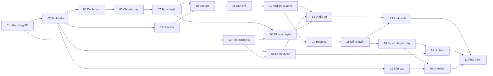

# Chương 1. Giới thiệu tổng quan về đề tài

## 1.1. Giới thiệu tổng quan về đề tài

### 1.1.1. Bối cảnh đề tài

Trong lĩnh vực hàng không thương mại và du lịch hiện đại, các đại lý bán vé máy bay trực tuyến (Online Travel Agency - OTA) như Traveloka, Expedia hay Skyscanner đóng vai trò trung gian phân phối vé máy bay đa hãng. Mô hình này giúp khách hàng dễ dàng tìm kiếm, so sánh giá cả, lựa chọn lịch trình bay phù hợp và tiến hành đặt vé cũng như thanh toán trực tuyến nhanh chóng.

Đề tài **Hệ thống bán vé máy bay trực tuyến (SkyLine)** là đồ án môn Nhập môn Công nghệ Phần mềm tại Trường Đại học Công nghệ Thông tin (UIT), ĐHQG-HCM, do nhóm 5 sinh viên thực hiện trong 12 tuần. Hệ thống mô phỏng một OTA bán vé của nhiều hãng bay. Khách hàng tự tra cứu, đặt vé và thanh toán trực tuyến. Nhân viên vận hành hỗ trợ khách hàng và xử lý hoàn tiền. Quản trị viên quản lý danh mục, lịch bay, kho ghế, bảng giá và theo dõi báo cáo doanh thu.

Do điều kiện học thuật không kết nối trực tiếp với các hệ thống phân phối toàn cầu (Global Distribution System - GDS) hoặc kết nối trực tiếp chuẩn NDC (New Distribution Capability) của các hãng hàng không thực tế, nguồn dữ liệu vé và lịch bay của hệ thống được xây dựng dưới dạng mô phỏng: Quản trị viên nhập lịch bay, định cấu hình kho ghế, các gói giá dịch vụ (fare families) và chính sách giá bán của từng hãng bay vào cơ sở dữ liệu hệ thống.

### 1.1.2. Mục tiêu của đề tài

Hệ thống được thiết kế và xây dựng nhằm đạt được các mục tiêu kỹ thuật và nghiệp vụ cụ thể sau:

1. **Khách hàng tự tìm kiếm và đặt vé:** Khách hàng tra cứu chuyến bay thẳng hoặc nối chuyến (tối đa 1 điểm dừng) cho hành trình một chiều hoặc khứ hồi. Khách hàng chọn gói giá và hạng ghế, mua thêm hành lý ký gửi và áp dụng mã giảm giá. Sau khi thanh toán qua cổng VNPay, khách hàng nhận vé điện tử (e-ticket) qua email.
2. **Khách hàng tự quản lý đặt chỗ (booking):** Cho phép khách hàng quản lý các booking của mình: tiếp tục thanh toán trong thời hạn giữ chỗ, chủ động hủy giữ chỗ, gửi yêu cầu hoàn vé theo chính sách hoặc tự thực hiện đổi lịch trình chuyến bay (có tính phí đổi và chênh lệch giá vé).
3. **Vận hành và xử lý hậu mãi:** Cung cấp giao diện và chức năng cho nhân viên vận hành (Staff) tra cứu toàn bộ booking trên hệ thống, xử lý và phê duyệt các yêu cầu hoàn tiền của khách hàng, đồng thời hỗ trợ thông tin hành khách khi có phát sinh sự cố chuyến bay.
4. **Quản trị hệ thống:** Cung cấp bộ công cụ cho quản trị viên (Admin) quản lý danh mục dùng chung (sân bay, hãng hàng không, gói giá, bảng giá hành lý), tạo và quản lý chuyến bay (hỗ trợ tạo lịch bay hàng loạt), quản lý kho ghế và mã giảm giá, cấu hình các tham số nghiệp vụ và xem báo cáo thống kê doanh thu.
5. **Đảm bảo tính nhất quán và toàn vẹn dữ liệu dưới tải đồng thời:** Khi nhiều người dùng thao tác cùng lúc, hệ thống đảm bảo không bán vượt số ghế khả dụng (overbooking), không xuất trùng vé điện tử và không hoàn vượt số tiền khách hàng đã thanh toán.

### 1.1.3. Đối tượng người dùng và phân quyền

Hệ thống có 4 nhóm người dùng, mỗi nhóm có vai trò và quyền hạn riêng:

_Bảng 1.1: Danh sách các vai trò người dùng trong hệ thống_

| Vai trò            | Mã vai trò | Mô tả                                                                                                                      | Phương thức khởi tạo tài khoản                                                |
| ------------------ | ---------- | -------------------------------------------------------------------------------------------------------------------------- | ----------------------------------------------------------------------------- |
| Khách vãng lai     | —          | Người dùng chưa đăng nhập, chỉ tra cứu thông tin chuyến bay, danh mục sân bay và hãng hàng không                           | Không cần tài khoản                                                           |
| Khách hàng         | `CUSTOMER` | Khách hàng đã đăng nhập, thực hiện đặt vé, thanh toán trực tuyến, quản lý và theo dõi các booking cá nhân                  | Tự đăng ký tài khoản trên hệ thống                                            |
| Nhân viên vận hành | `STAFF`    | Nhân viên hỗ trợ nghiệp vụ, tra cứu booking, tiếp nhận và duyệt xử lý các yêu cầu hoàn tiền, quản lý danh sách hành khách  | Do Quản trị viên (`ADMIN`) tạo                                                |
| Quản trị viên      | `ADMIN`    | Quản trị toàn bộ hệ thống, quản lý tài khoản người dùng, danh mục, lịch bay, kho ghế, voucher, tham số hệ thống và báo cáo | Do Quản trị viên tạo; tài khoản admin đầu tiên được khởi tạo qua seed dữ liệu |

Mỗi tài khoản người dùng chỉ đảm nhận đúng một vai trò. Tài khoản nhân viên và quản trị viên là tài khoản vận hành chuyên biệt, không sử dụng để thực hiện đặt vé.

Ma trận phân quyền giữa các vai trò đối với các phân hệ chức năng được thể hiện trong Bảng 1.2:

_Bảng 1.2: Ma trận phân quyền chức năng theo vai trò_

| Chức năng                                                                     | Chưa đăng nhập | Customer | Staff | Admin |
| ----------------------------------------------------------------------------- | :------------: | :------: | :---: | :---: |
| Tìm kiếm chuyến bay, tra cứu thông tin sân bay và hãng hàng không             |       ✓        |    ✓     |   ✓   |   ✓   |
| Đặt vé, thanh toán trực tuyến qua VNPay, hủy giữ chỗ                          |                |    ✓     |       |       |
| Xem lịch sử đặt chỗ cá nhân, gửi yêu cầu hoàn vé, đổi chuyến bay              |                |    ✓     |       |       |
| Tra cứu toàn bộ booking trong hệ thống, gửi lại email vé điện tử              |                |          |   ✓   |   ✓   |
| Xử lý và phê duyệt yêu cầu hoàn tiền của khách hàng                           |                |          |   ✓   |   ✓   |
| Xem danh sách chuyến bay và danh sách hành khách theo chuyến (manifest)       |                |          |   ✓   |   ✓   |
| Quản lý danh mục sân bay, hãng hàng không, gói giá, bảng giá hành lý          |                |          |       |   ✓   |
| Quản lý chuyến bay (tạo đơn lẻ, tạo hàng loạt, sửa, hủy, xóa)                 |                |          |       |   ✓   |
| Quản lý mã giảm giá (voucher), quản lý tài khoản, điều chỉnh tham số hệ thống |                |          |       |   ✓   |
| Xem báo cáo thống kê doanh thu và chuyến bay                                  |                |          |       |   ✓   |

### 1.1.4. Phạm vi của đề tài

#### Phạm vi thực hiện (In-Scope)

- **Tuyến bay và tiền tệ:** Áp dụng cho các tuyến bay nội địa Việt Nam và các tuyến bay quốc tế; đơn vị tiền tệ giao dịch thống nhất là Việt Nam Đồng (VND).
- **Hành trình:** Hỗ trợ hành trình một chiều (one-way) và khứ hồi (round-trip). Mỗi chiều bay hỗ trợ bay thẳng (direct flight) hoặc nối chuyến (connecting flight) tối đa 1 điểm dừng; hai chặng bay trong chuyến nối bắt buộc phải cùng một hãng hàng không vận hành.
- **Hạng ghế và gói giá:** Quản lý kho ghế theo 4 hạng dịch vụ (`ECONOMY`, `PREMIUM_ECONOMY`, `BUSINESS`, `FIRST`) và các gói giá dịch vụ (`Fare Family`) do từng hãng định nghĩa quy định quyền lợi kèm theo (hành lý miễn cước, chính sách hoàn/đổi vé).
- **Hành khách:** Hỗ trợ 3 nhóm đối tượng hành khách: người lớn (`ADULT`), trẻ em (`CHILD`) và em bé (`INFANT`).
- **Dịch vụ bổ trợ và khuyến mãi:** Hỗ trợ mua thêm các gói hành lý ký gửi theo từng chặng và áp dụng mã giảm giá (voucher) hợp lệ theo giá trị tối thiểu của đơn hàng.
- **Giữ chỗ và thanh toán:** Cơ chế giữ chỗ tạm thời có thời hạn (hold booking) nhằm bảo lưu chỗ trong lúc khách hàng thanh toán; tích hợp cổng thanh toán trực tuyến VNPay qua môi trường sandbox; tự động cấp số vé điện tử (e-ticket 13 chữ số) và gửi thông tin xác nhận qua email khi giao dịch thành công.
- **Nghiệp vụ sau bán hàng:** Hỗ trợ hoàn vé (khách hàng gửi yêu cầu, nhân viên duyệt, hệ thống gọi API hoàn tiền sang VNPay) và đổi chuyến bay (khách hàng tự chọn chuyến mới, thanh toán phí đổi và tiền chênh lệch vé nếu có).
- **Xử lý sự cố lịch bay:** Cung cấp quy trình cập nhật giờ bay và hủy chuyến bay do hãng vận hành, gửi email thông báo tự động và tự động tạo yêu cầu hoàn tiền 100% cho các booking bị ảnh hưởng.
- **Quản trị và báo cáo:** Quản trị toàn bộ danh mục dữ liệu, quản lý lịch bay và kho ghế, cấu hình mã voucher, cấu hình tham số hệ thống động không cần khởi động lại ứng dụng, cùng phân hệ kết xuất báo cáo doanh thu và tỷ lệ lấp đầy chuyến bay.

#### Giới hạn hệ thống (Out-of-Scope)

Để tập trung nguồn lực giải quyết bài toán cốt lõi trong thời lượng đồ án, các tính năng sau nằm ngoài phạm vi thực hiện của đề tài:

_Bảng 1.3: Danh mục các hạng mục nằm ngoài phạm vi hệ thống_

| Hạng mục                                                         | Diễn giải                                                                                                                              |
| ---------------------------------------------------------------- | -------------------------------------------------------------------------------------------------------------------------------------- |
| Kết nối GDS/NDC thật                                             | Dữ liệu lịch bay và kho ghế do quản trị viên khởi tạo và cấu hình trong hệ thống, không kết nối API trực tiếp với hãng hàng không thật |
| Thiết kế UI/UX nâng cao ngoài màn hình chức năng                 | Tập trung vào luồng tương tác chức năng và tính khả dụng của các form nghiệp vụ                                                        |
| Chọn chỗ ngồi, suất ăn, bảo hiểm du lịch                         | Khách hàng chỉ chọn hạng ghế và gói giá, không chọn vị trí ghế cụ thể trên sơ đồ máy bay                                               |
| Hành trình đa chặng (multi-city)                                 | Không hỗ trợ hành trình phức hợp nhiều hơn 1 điểm dừng hoặc nối chuyến khác hãng                                                       |
| Đặt vé không cần tài khoản                                       | Khách hàng bắt buộc phải đăng ký/đăng nhập tài khoản để thực hiện giao dịch và quản lý đặt chỗ                                         |
| Cổng riêng cho đối tác hãng bay (B2B Portal)                     | Mọi cấu hình chuyến bay của các hãng đều do Quản trị viên của hệ thống SkyLine nhập liệu                                               |
| Định giá động, đa tiền tệ, tích lũy điểm thưởng                  | Hệ thống áp dụng một bảng giá cố định theo từng chuyến/gói giá và sử dụng duy nhất đồng VND                                            |
| Hoàn/đổi lẻ từng hành khách hoặc từng chặng bay                  | Nghiệp vụ hoàn vé và đổi chuyến áp dụng đồng thời cho toàn bộ hành khách trong cùng một chiều bay                                      |
| Chỉnh sửa thông tin hành khách sau khi xuất vé                   | Không hỗ trợ đổi tên hoặc sửa đổi thông tin cá nhân của hành khách sau khi vé điện tử đã phát hành                                     |
| Thông báo qua SMS hoặc Push Notification                         | Mọi thông báo giao dịch, vé điện tử và sự cố chuyến bay chỉ được gửi qua email                                                         |
| Đăng nhập mạng xã hội (SSO)                                      | Hệ thống chỉ sử dụng hình thức xác thực tài khoản qua email và mật khẩu nội bộ                                                         |
| Check-in trực tuyến và phát hành thẻ lên máy bay (Boarding pass) | Nghiệp vụ dừng lại ở bước phát hành vé điện tử e-ticket                                                                                |

### 1.1.5. Tiêu chí thành công và nghiệm thu

Đề tài được đánh giá hoàn thành khi đáp ứng các tiêu chuẩn kỹ thuật sau:

- **Khả năng triển khai và tương thích:** Hệ thống triển khai hoàn chỉnh thông qua một lệnh `docker compose up`, kết nối hoạt động với cơ sở dữ liệu PostgreSQL 18, dịch vụ giả lập email Mailpit và cổng thanh toán VNPay sandbox.
- **Tính đúng đắn của nghiệp vụ:** Hệ thống thực thi thành công toàn bộ 11 kịch bản kiểm thử nghiệm thu người dùng (D1 đến D11), bao gồm: tìm kiếm chuyến bay, giữ chỗ, thanh toán qua cổng VNPay, xử lý hủy/hết hạn giữ chỗ, hoàn vé, đổi lịch trình chuyến bay, xử lý sự cố chuyến bay và kết xuất báo cáo thống kê.
- **Kiểm soát tranh chấp đồng thời (Concurrency control):** Có bài kiểm thử tích hợp (integration test) chứng minh hệ thống xử lý chính xác tình huống nhiều yêu cầu đặt vé gửi đồng thời trên cùng một chuyến bay, đảm bảo không bán vượt số ghế khả dụng của kho ghế.
- **Tính bao phủ của kiểm thử tự động:** Mọi quy tắc nghiệp vụ định danh (`BR-01` đến `BR-112`) và các yêu cầu chức năng (`FR-01` đến `FR-122`) đều được cài đặt và kiểm chứng bằng các bộ kiểm thử tự động (Unit Test, Integration Test và E2E Test).

---

## 1.2. Mô tả quy trình thực hiện các công việc chính của đề tài

### 1.2.1. Mô hình và phương pháp phát triển

Nhóm áp dụng mô hình phát triển phần mềm lặp (Iterative Development), kết hợp với phương pháp phát triển hướng kiểm thử (Test-Driven Development - TDD) và quy trình tích hợp liên tục (Continuous Integration - CI):

- **Phát triển lặp tăng dần (Iterative & Incremental):** Thay vì xây dựng toàn bộ hệ thống trong một chu kỳ kéo dài, khối lượng công việc được phân rã thành các giai đoạn (Milestones) và 21 kế hoạch phát triển thành phần (Plans). Mỗi plan giải quyết một lát cắt tính năng (feature slice) từ thiết kế cơ sở dữ liệu, API backend đến giao diện người dùng frontend.
- **Phát triển hướng kiểm thử (TDD):** Test được viết trước mã nguồn chức năng. Mỗi task cài đặt trong plan đi theo thứ tự: viết test, chạy test và xác nhận test thất bại, cài đặt mã nguồn, chạy lại test và xác nhận test đạt, rồi commit. Integration test chạy trên PostgreSQL thật trong Testcontainers.
- **Tích hợp liên tục (CI):** Hệ thống sử dụng GitHub Actions tự động hóa quy trình kiểm tra mã nguồn, chạy toàn bộ bộ kiểm thử tự động (`mvn verify`, `npm run build`, E2E test) ngay khi có thay đổi được đẩy lên kho lưu trữ.

### 1.2.2. Các mốc phát triển chính (Milestones)

Lộ trình thực hiện đề tài trong 12 tuần được chia thành 5 mốc phát triển chính, mô tả cụ thể trong Bảng 1.4:

_Bảng 1.4: Lộ trình các mốc phát triển chính của đề tài_

| Mốc phát triển | Tên mốc                                       | Kế hoạch thực hiện (Plans) | Kết quả kiểm chứng đạt được                                                                                                                                                                           | Thời gian dự kiến |
| -------------- | --------------------------------------------- | -------------------------- | ----------------------------------------------------------------------------------------------------------------------------------------------------------------------------------------------------- | ----------------- |
| M0             | Nền móng (Foundation)                         | Plan 01 – 04               | Khởi tạo khung dự án backend (Spring Boot) và frontend (Next.js); tích hợp cơ sở dữ liệu PostgreSQL qua Docker Compose; hoàn thành module tài khoản, phiên đăng nhập và giao diện xác thực người dùng | Tuần 1 – 2        |
| M1             | Tìm kiếm chuyến bay (Search)                  | Plan 05 – 08               | Hoàn thiện quản lý danh mục (sân bay, hãng hàng không, gói giá); quản lý lịch bay và kho ghế; cài đặt thuật toán và giao diện tìm kiếm chuyến bay thẳng và nối chuyến                                 | Tuần 3 – 4        |
| M2             | Đặt vé và thanh toán (Booking & Payment)      | Plan 09 – 13               | Cài đặt logic áp dụng voucher, báo giá booking, cơ chế giữ chỗ và chống bán vượt ghế; tích hợp thanh toán VNPay sandbox, cấp vé điện tử và gửi email xác nhận                                         | Tuần 5 – 7        |
| M3             | Hậu mãi và vận hành (Aftersales & Operations) | Plan 14 – 18               | Cài đặt quy trình hoàn vé, đổi lịch trình chuyến bay, xử lý sự cố chuyến bay (đổi giờ, hủy chuyến) và xuất manifest; hoàn thiện màn hình nghiệp vụ cho nhân viên (`STAFF`)                            | Tuần 8 – 10       |
| M4             | Quản trị và phát hành (Admin & Release)       | Plan 19 – 21               | Cài đặt module báo cáo doanh thu; hoàn thiện bộ màn hình quản trị (`ADMIN`); tích hợp hệ thống và chạy đủ 11 kịch bản demo (D1–D11)                                                                   | Tuần 10 – 12      |

### 1.2.3. Danh sách các gói công việc chi tiết

Dự án được phân rã thành 21 gói công việc (plans) độc lập, có thể kiểm chứng riêng biệt theo Bảng 1.5:

_Bảng 1.5: Danh sách 21 gói công việc triển khai hệ thống_

| STT | Gói công việc (Plan)                             | Yêu cầu chức năng / Nghiệp vụ phụ trách                                           | Kết quả kiểm chứng được                                                                                            | Mức ưu tiên |
| :-: | ------------------------------------------------ | --------------------------------------------------------------------------------- | ------------------------------------------------------------------------------------------------------------------ | :---------: |
| 01  | Nền móng backend                                 | Cấu hình Spring Boot, Flyway, Testcontainers, phân quyền cơ bản                   | `./mvnw verify` thành công trên PostgreSQL 18; Docker Compose khởi động ổn định; CI vận hành                       |     P0      |
| 02  | Tài khoản, phiên đăng nhập, tham số, khung email | `FR-01`–`FR-04`, `FR-110`, `FR-111`, `FR-130`; quy tắc `BR-100`–`BR-105`, `BR-25` | Đăng ký, đăng nhập, khóa tài khoản qua API; email gửi thành công tới Mailpit; nạp seed dữ liệu mẫu                 |   P0 / P1   |
| 03  | Nền móng frontend                                | Khung ứng dụng Next.js, cấu hình App Router, Tailwind CSS, API client             | `npm run build` thành công; route cần đăng nhập chuyển hướng về trang đăng nhập                                    |     P0      |
| 04  | Màn hình tài khoản                               | Các màn hình `C-03`–`C-06`, `C-12`                                                | Kiểm thử E2E: Đăng ký → Đăng nhập → Chỉnh sửa hồ sơ cá nhân → Đăng xuất                                            |     P0      |
| 05  | Danh mục hệ thống                                | `FR-10`, `FR-80`–`FR-83`; quy tắc `BR-90`–`BR-92`                                 | CRUD danh mục sân bay, hãng bay, gói giá; chặn xóa dữ liệu đã có tham chiếu (`RESOURCE_IN_USE`)                    |   P0 / P1   |
| 06  | Quản trị chuyến bay và kho ghế                   | `FR-90`–`FR-92`, `FR-94`; quy tắc `BR-80`–`BR-82`, `BR-85`–`BR-87`                | Tạo chuyến bay hàng loạt; kiểm soát kho ghế; không cho phép giảm số ghế xuống dưới số ghế đã bán                   |   P0 / P1   |
| 07  | Tìm kiếm chuyến bay                              | `FR-11`, `FR-12`; quy tắc `BR-01`–`BR-06`, `BR-20`, `BR-21`                       | Tìm kiếm chính xác chuyến bay thẳng và chuyến nối; thời gian phản hồi p95 dưới 1 giây                              |     P0      |
| 08  | Màn hình tìm chuyến                              | Các màn hình `C-01`, `C-02`                                                       | Kiểm thử E2E: Tra cứu vé khứ hồi qua 2 bước, lọc và sắp xếp kết quả                                                |     P0      |
| 09  | Quản lý voucher                                  | `FR-100`; quy tắc `BR-30`–`BR-32`                                                 | CRUD voucher; cơ chế giữ và hoàn lượt sử dụng voucher nguyên tử (`atomic operation`)                               |     P1      |
| 10  | Báo giá booking                                  | `FR-20`–`FR-23`; quy tắc `BR-10`–`BR-14`, `BR-20`–`BR-24`, `BR-33`                | API tính toán chính xác tổng giá vé, giá hành lý và chiết khấu voucher theo công thức chuẩn                        |   P0 / P1   |
| 11  | Giữ chỗ và vòng đời booking                      | `FR-24`, `FR-33`, `FR-40`, `FR-41`, `FR-70`; quy tắc `BR-40`, `BR-45`, `BR-46`    | 20 luồng đặt vé đồng thời không bán vượt ghế; tiến trình tự động giải phóng ghế khi hết hạn giữ chỗ                |     P0      |
| 12  | Thanh toán VNPay và xuất vé                      | `FR-30`–`FR-32`, `FR-73`; quy tắc `BR-41`–`BR-44`                                 | Xử lý callback/IPN từ VNPay sandbox; chuyển trạng thái booking sang `ISSUED`, sinh vé điện tử 13 chữ số, gửi email |     P0      |
| 13  | Màn hình đặt vé và quản lý booking               | Các màn hình `C-07`, `C-08`, `C-09`                                               | Kiểm thử E2E: Chọn gói vé → Nhập thông tin hành khách → Tạo giữ chỗ → Chuyển hướng thanh toán VNPay                |     P0      |
| 14  | Nghiệp vụ hoàn vé                                | `FR-50`–`FR-52`, `FR-71`; quy tắc `BR-50`–`BR-53`, `BR-60`–`BR-66`                | Nhân viên duyệt yêu cầu hoàn vé; gọi API cổng thanh toán hoàn tiền; gửi email xác nhận hoàn tiền                   |     P1      |
| 15  | Nghiệp vụ đổi chuyến bay                         | `FR-60`–`FR-62`; quy tắc `BR-70`–`BR-75`                                          | Khách hàng chọn chuyến mới, thanh toán phí đổi và chênh lệch vé; xuất số vé điện tử mới                            |     P1      |
| 16  | Sự cố chuyến bay và manifest                     | `FR-93`, `FR-72`; quy tắc `BR-83`, `BR-84`                                        | Cập nhật đổi giờ hoặc hủy chuyến bay; kích hoạt gửi thông báo tự động và tạo yêu cầu hoàn tiền                     |     P1      |
| 17  | Màn hình hậu mãi                                 | Các màn hình `C-10`, `C-11`                                                       | Kiểm thử E2E: Gửi yêu cầu hoàn vé cho một chiều bay, thực hiện đổi lịch trình một chiều bay                        |     P1      |
| 18  | Màn hình cho nhân viên (Staff)                   | Các màn hình `S-01`–`S-06`                                                        | Kiểm thử E2E: Nhân viên tra cứu booking theo mã/họ tên, phê duyệt yêu cầu hoàn tiền                                |   P0 / P1   |
| 19  | Báo cáo thống kê                                 | `FR-120`–`FR-122`; quy tắc `BR-110`–`BR-112`                                      | Kết xuất chính xác số liệu doanh thu theo tháng/quý/năm và tỷ lệ lấp đầy theo tuyến bay                            |     P1      |
| 20  | Màn hình quản trị (Admin)                        | Các màn hình `A-01`–`A-10`                                                        | Kiểm thử E2E: Quản trị viên tạo lịch bay hàng loạt, cấu hình tham số hệ thống                                      |   P0 / P1   |
| 21  | Tích hợp hệ thống và demo                        | Kịch bản `D1`–`D11`, chỉ số `NFR-01`, `NFR-08`                                    | Hệ thống khởi chạy đồng bộ bằng một lệnh `docker compose up`; chạy được đủ 11 kịch bản demo                        |     P0      |

### 1.2.4. Sơ đồ phụ thuộc giữa các gói công việc

Mối quan hệ phụ thuộc kỹ thuật giữa 21 gói công việc được mô hình hóa trong Hình 1.1:

_Hình 1.1: Sơ đồ quan hệ phụ thuộc giữa 21 gói công việc triển khai hệ thống_

**Phân tích đường găng (Critical Path):**

Chuỗi các gói công việc tạo thành đường găng dài nhất của dự án bao gồm:
$$\text{Plan 01} \rightarrow \text{Plan 02} \rightarrow \text{Plan 05} \rightarrow \text{Plan 06} \rightarrow \text{Plan 07} \rightarrow \text{Plan 10} \rightarrow \text{Plan 11} \rightarrow \text{Plan 12} \rightarrow \text{Plan 14} \rightarrow \text{Plan 15} \rightarrow \text{Plan 16} \rightarrow \text{Plan 20} \rightarrow \text{Plan 21}$$

Mọi sự chậm trễ trên đường găng này đều sẽ ảnh hưởng trực tiếp đến thời hạn hoàn thành của toàn bộ dự án. Các gói công việc nằm ngoài đường găng (như giao diện tài khoản, voucher, báo cáo thống kê) có biên độ thời gian dự phòng để nhóm có thể phân phối nhân sự song song.

### 1.2.5. Phân công công việc trong nhóm

Dự án được chia việc cho 5 thành viên theo nhóm module chuyên môn kỹ thuật (thể hiện trong Bảng 1.6):

_Bảng 1.6: Bảng phân công trách nhiệm các thành viên trong nhóm_

| Nhóm trách nhiệm | Thành viên phụ trách    | Phân hệ / Module đảm nhiệm                                                                                       | Gói công việc phụ trách (Plans) |
| ---------------- | ----------------------- | ---------------------------------------------------------------------------------------------------------------- | ------------------------------- |
| Nhóm A           | Phạm Duy Hoàng          | Module nền tảng (`common`), quản lý danh tính (`identity`), dịch vụ thông báo email (`notification`)             | Plan 01, 02, 04, 18             |
| Nhóm B           | Huỳnh Quang Minh Quân   | Quản trị danh mục (`catalog`), quản lý lịch bay và kho ghế (`flight`)                                            | Plan 05, 06, 16, 20             |
| Nhóm C           | Nguyễn Hùng Cường       | Động cơ tìm kiếm chuyến bay, tính toán báo giá (`quote`), cơ chế giữ chỗ và quản lý vòng đời booking (`booking`) | Plan 07, 08, 10, 11, 13         |
| Nhóm D           | Hồ Minh Đạt             | Tích hợp cổng thanh toán VNPay (`payment`), phân hệ hậu mãi hoàn vé và đổi chuyến (`aftersales`)                 | Plan 12, 14, 15, 17             |
| Nhóm E           | Đặng Nguyễn Hoàng Thạch | Khuyến mại voucher (`promotion`), báo cáo thống kê (`report`), nền tảng giao diện frontend và phát hành hệ thống | Plan 03, 09, 19, 21             |

Mỗi thành viên làm cả backend, cơ sở dữ liệu và màn hình frontend của phân hệ mình phụ trách.

### 1.2.6. Quy trình kiểm thử và đảm bảo chất lượng

Nhóm kiểm thử hệ thống ở nhiều mức:

1. **Kiểm thử đơn vị và tích hợp (Unit & Integration Testing):**
   - Sử dụng JUnit 5, Mockito và Spring Boot Test để kiểm thử các lớp `Controller`, `Service` và `Repository`.
   - Kiểm thử tích hợp được thực thi trên môi trường cơ sở dữ liệu thực thông qua thư viện Testcontainers với phiên bản PostgreSQL 18. Cơ chế rollback giao dịch `@Transactional` được áp dụng cho các test ghi dữ liệu để đảm bảo môi trường kiểm thử luôn độc lập và sạch sẽ.
2. **Kiểm thử kiểm soát tải đồng thời (Concurrency Testing):**
   - Thiết kế bài kiểm thử đặc tả (T1, T2) giả lập 20 luồng giao dịch đồng thời yêu cầu giữ chỗ trên chuyến bay chỉ còn lại một số lượng ghế giới hạn.
   - Kiểm chứng cơ chế khóa bi quan (Pessimistic Locking / Atomic Decrement) của hệ thống quản lý kho ghế `SeatInventory`, xác nhận hệ thống không bán vượt số ghế khả dụng.
3. **Kiểm thử giao diện và kịch bản người dùng (End-to-End Testing):**
   - Sử dụng Playwright để tự động hóa kiểm thử giao diện người dùng trên nền tảng Next.js.
   - Thực thi các chuỗi hành động hoàn chỉnh: Đăng ký → Đăng nhập → Tìm kiếm chuyến bay → Chọn gói vé → Nhập thông tin hành khách → Tiến hành thanh toán và xác nhận đơn hàng.
4. **Kiểm soát tính hợp lệ của cấu trúc mã nguồn:**
   - Sử dụng Spring Modulith (`ModularityTest`) để tự động kiểm tra tính đóng gói và ranh giới giữa các module trong backend, ngăn chặn việc gọi mã trực tiếp giữa các module không tuân thủ quy tắc kiến trúc.
   - Sử dụng Flyway để quản lý phiên bản các migration của cơ sở dữ liệu, đảm bảo tính đồng bộ dữ liệu giữa các môi trường phát triển và môi trường chạy thử nghiệm.
