# Chương 2. Xác định và mô hình hóa yêu cầu phần mềm

## 2.1. Danh sách yêu cầu phần mềm

Các yêu cầu phần mềm của hệ thống được phân thành ba nhóm:

1. **Yêu cầu nghiệp vụ:** các yêu cầu lưu trữ, tra cứu, tính toán và kết xuất. Mỗi yêu cầu gắn với biểu mẫu (BMx) và quy định (QĐx) liên quan. Nhóm này bảo đảm **tính đúng đắn** của hệ thống khi mô phỏng hoạt động của một đại lý bán vé máy bay trực tuyến (OTA).
2. **Yêu cầu chất lượng:** tính tiến hóa, tính tiện dụng, tính hiệu quả và tính tương thích.
3. **Yêu cầu hệ thống:** tính an toàn và tính bảo mật.

**Quy ước ký hiệu trong chương:**

- `YCNV-xx` là mã yêu cầu nghiệp vụ, `BMx` là biểu mẫu của yêu cầu thứ x, `QĐx.y` là quy định thứ y của yêu cầu thứ x.
- Mã màn hình gồm tiền tố và số thứ tự: `C-xx` là màn hình của khách hàng, `S-xx` là màn hình của nhân viên, `A-xx` là màn hình của quản trị viên (VD `C-07 Đặt vé`).
- Tên có dấu chấm dạng `booking.hold_minutes` là tham số hệ thống Admin thay đổi được, liệt kê ở mục 2.1.2. Tên viết thường dạng `bookings` là bảng trong cơ sở dữ liệu, mô tả ở chương 4.
- Mã lỗi viết in hoa (VD `SEATS_UNAVAILABLE`) là mã hệ thống trả về khi từ chối một thao tác. Nghĩa của mã được ghi ngay cạnh mã.
- Trạng thái được giữ nguyên tên trong hệ thống:
  - Booking: `PENDING_PAYMENT` (đang giữ chỗ, chờ thanh toán), `ISSUED` (đã xuất vé), `EXPIRED` (quá hạn giữ chỗ), `CANCELLED` (đã hủy), `REFUNDED` (đã hoàn toàn bộ).
  - Chiều bay của booking: `ACTIVE` (còn hiệu lực), `REFUNDED` (đã hoàn).
  - Chặng bay của booking: `ACTIVE` (còn hiệu lực), `PENDING_CHANGE` (chặng mới đang chờ thanh toán đổi chuyến), `CANCELLED` (đã hủy), `REPLACED` (đã được thay bằng chặng mới sau khi đổi chuyến).
  - Yêu cầu hoàn: `PENDING` (chờ duyệt), `APPROVED` (đã duyệt, đang hoàn tiền), `REJECTED` (bị từ chối), `COMPLETED` (đã hoàn xong). Nguồn của yêu cầu: `CUSTOMER` (khách gửi), `FLIGHT_CANCELLED` (hệ thống tạo khi hủy chuyến), `INVALID_PAYMENT` (hệ thống tạo khi nhận một khoản thanh toán không còn hợp lệ).
  - Yêu cầu đổi chuyến: `PENDING_PAYMENT` (chờ thanh toán), `COMPLETED` (đã hoàn tất), `EXPIRED` (quá hạn thanh toán), `CANCELLED` (đã hủy).
  - Lượt thanh toán: `PENDING` (đang chờ kết quả), `SUCCESS` (thành công), `FAILED` (thất bại).
  - Chuyến bay: `SCHEDULED` (đang khai thác), `CANCELLED` (đã hủy). Tài khoản: `ACTIVE` (đang hoạt động), `LOCKED` (bị khóa).

---

### 2.1.1. Yêu cầu nghiệp vụ

Hệ thống SkyLine có 13 yêu cầu nghiệp vụ, tóm tắt trong Bảng 2.1:

_Bảng 2.1: Danh sách các yêu cầu nghiệp vụ của hệ thống_

| Mã YCNV     | Tên yêu cầu nghiệp vụ                                            | Phân loại          | Biểu mẫu liên quan                                | Quy định liên quan                       |
| :---------- | :--------------------------------------------------------------- | :----------------- | :------------------------------------------------ | :--------------------------------------- |
| **YCNV-01** | Tiếp nhận đăng ký tài khoản khách hàng                           | Lưu trữ            | BM1 (C-04 Đăng ký)                                | QĐ1.1, QĐ1.2                             |
| **YCNV-02** | Tiếp nhận thông tin sân bay                                      | Lưu trữ            | BM2 (A-01 Sân bay)                                | QĐ2.1, QĐ2.2                             |
| **YCNV-03** | Tiếp nhận thông tin hãng hàng không, gói giá và bảng giá hành lý | Lưu trữ            | BM3 (A-02 Hãng bay, A-03 Chi tiết hãng)           | QĐ3.1, QĐ3.2, QĐ3.3                      |
| **YCNV-04** | Lập lịch chuyến bay                                              | Lưu trữ            | BM4 (A-05 Tạo chuyến)                             | QĐ4.1, QĐ4.2, QĐ4.3, QĐ4.4               |
| **YCNV-05** | Tiếp nhận mã giảm giá (voucher)                                  | Lưu trữ            | BM5 (A-07 Voucher)                                | QĐ5.1, QĐ5.2, QĐ5.3                      |
| **YCNV-06** | Tra cứu chuyến bay                                               | Tra cứu            | BM6 (C-01 Tìm chuyến, C-02 Kết quả tìm kiếm)      | QĐ6.1, QĐ6.2, QĐ6.3, QĐ6.4, QĐ6.5        |
| **YCNV-07** | Tiếp nhận đặt vé và giữ chỗ                                      | Lưu trữ, Tính toán | BM7 (C-07 Đặt vé)                                 | QĐ7.1, QĐ7.2, QĐ7.3, QĐ7.4, QĐ7.5, QĐ7.6 |
| **YCNV-08** | Thanh toán và xuất vé điện tử                                    | Lưu trữ, Tính toán | BM8 (C-09 Chi tiết booking)                       | QĐ8.1, QĐ8.2, QĐ8.3, QĐ8.4               |
| **YCNV-09** | Tiếp nhận và xử lý yêu cầu hoàn vé                               | Lưu trữ, Tính toán | BM9 (C-10 Hoàn vé, S-04 Chi tiết yêu cầu hoàn)    | QĐ9.1, QĐ9.2, QĐ9.3, QĐ9.4, QĐ9.5, QĐ9.6 |
| **YCNV-10** | Đổi lịch trình chuyến bay                                        | Lưu trữ, Tính toán | BM10 (C-11 Đổi chuyến)                            | QĐ10.1, QĐ10.2, QĐ10.3, QĐ10.4, QĐ10.5   |
| **YCNV-11** | Lập báo cáo doanh thu và dòng tiền                               | Kết xuất           | BM11 (A-10 Báo cáo)                               | QĐ11.1, QĐ11.2, QĐ11.3                   |
| **YCNV-12** | Tra cứu booking                                                  | Tra cứu            | BM12 (C-08 Booking của tôi, S-01 Tra cứu booking) | QĐ12.1, QĐ12.2                           |
| **YCNV-13** | Hủy chuyến bay                                                   | Lưu trữ            | BM13 (A-06 Chi tiết chuyến)                       | QĐ13.1, QĐ13.2                           |

Mỗi yêu cầu được mô tả theo 6 khía cạnh: tên công việc, biểu mẫu, quy định, người thực hiện, thời điểm và cách thức thực hiện.

#### 1. YCNV-01: Tiếp nhận đăng ký tài khoản khách hàng

- **Tên công việc:** Tiếp nhận đăng ký tài khoản khách hàng.
- **Biểu mẫu liên quan:** BM1 - Phiếu đăng ký tài khoản (màn hình `C-04 Đăng ký`).
- **Quy định liên quan:**
  - `QĐ1.1`: Email là định danh đăng nhập, duy nhất, không phân biệt chữ hoa và chữ thường. Mật khẩu dài ít nhất 8 ký tự, có cả chữ và số.
  - `QĐ1.2`: Tài khoản tự đăng ký luôn có vai trò `CUSTOMER` và trạng thái `ACTIVE`. Tài khoản `STAFF` và `ADMIN` do Admin tạo.
- **Người thực hiện:** Khách chưa có tài khoản.
- **Thời điểm thực hiện:** Trước khi đặt vé. Khách chưa đăng nhập khi chọn gói giá ở `C-02` sẽ được chuyển sang đăng nhập hoặc đăng ký.
- **Cách thức thực hiện:** Khách nhập email, mật khẩu, họ tên và số điện thoại tại `C-04`. Hệ thống kiểm tra dữ liệu, kiểm tra email chưa được dùng, băm mật khẩu bằng thuật toán BCrypt, lưu tài khoản và đăng nhập luôn cho khách.

#### 2. YCNV-02: Tiếp nhận thông tin sân bay

- **Tên công việc:** Tiếp nhận thông tin sân bay.
- **Biểu mẫu liên quan:** BM2 - Phiếu thông tin sân bay (màn hình `A-01 Sân bay`).
- **Quy định liên quan:**
  - `QĐ2.1`: Mã sân bay là mã IATA (mã do Hiệp hội Vận tải Hàng không Quốc tế cấp) gồm 3 chữ cái in hoa, duy nhất (VD `SGN`, `HAN`). Quốc gia theo mã ISO 3166-1 alpha-2, tức mã quốc gia 2 chữ cái (VD `VN`). Múi giờ theo tên trong cơ sở dữ liệu múi giờ IANA (VD `Asia/Ho_Chi_Minh`).
  - `QĐ2.2`: Sân bay đã được chuyến bay tham chiếu thì chỉ ngừng kích hoạt được, không xóa được. Sân bay ngừng kích hoạt không chọn được khi tạo chuyến mới, nhưng chuyến đã có vẫn hoạt động bình thường.
- **Người thực hiện:** Quản trị viên (`ADMIN`).
- **Thời điểm thực hiện:** Bước đầu tiên khi chuẩn bị dữ liệu mở bán, vì chuyến bay tham chiếu sân bay.
- **Cách thức thực hiện:** Admin nhập mã IATA, tên sân bay, thành phố, mã quốc gia, múi giờ và trạng thái kích hoạt tại `A-01`. Hệ thống kiểm tra định dạng, kiểm tra mã chưa tồn tại và lưu vào bảng `airports`.

#### 3. YCNV-03: Tiếp nhận thông tin hãng hàng không, gói giá và bảng giá hành lý

- **Tên công việc:** Tiếp nhận thông tin hãng hàng không, gói giá và bảng giá hành lý.
- **Biểu mẫu liên quan:** BM3 - Phiếu thông tin hãng hàng không và dịch vụ (màn hình `A-02 Hãng bay`, `A-03 Chi tiết hãng`).
- **Quy định liên quan:**
  - `QĐ3.1`: Mã hãng bay là mã IATA gồm 2 ký tự, duy nhất (VD `VN`, `VJ`). Mã số vé gồm đúng 3 chữ số, duy nhất (VD `738`).
  - `QĐ3.2`: Trong một hãng, tên gói giá không trùng nhau và mức kg hành lý không trùng nhau.
  - `QĐ3.3`: Gói giá và mức hành lý đã được tham chiếu thì chỉ ngừng kích hoạt được, không xóa được. Gói giá hoặc mức hành lý ngừng kích hoạt thì không bán nữa. Sửa gói giá không ảnh hưởng booking đã tạo, vì booking lưu bản chụp (snapshot) quy định gói giá tại lúc giữ chỗ.
- **Người thực hiện:** Quản trị viên (`ADMIN`).
- **Thời điểm thực hiện:** Sau khi có sân bay và trước khi tạo chuyến bay của hãng, vì giá bán của chuyến cần gói giá và hành lý mua thêm cần bảng giá hành lý của hãng.
- **Cách thức thực hiện:** Admin khai báo hãng bay tại `A-02`, sau đó vào `A-03` để khai báo các gói giá (hạng ghế, hành lý xách tay và ký gửi, điều kiện và phí hoàn/đổi) và các mức hành lý ký gửi mua thêm (số kg, giá).

#### 4. YCNV-04: Lập lịch chuyến bay

- **Tên công việc:** Lập lịch chuyến bay (một chuyến hoặc cả lịch bay định kỳ).
- **Biểu mẫu liên quan:** BM4 - Phiếu lập lịch chuyến bay (màn hình `A-05 Tạo chuyến`).
- **Quy định liên quan:**
  - `QĐ4.1`: Số hiệu chuyến gồm mã hãng và 1–4 chữ số (VD `VN213`). Giờ cất cánh và hạ cánh nhập theo giờ địa phương của sân bay tương ứng, lưu dưới dạng thời điểm tuyệt đối. Giờ hạ cánh phải sau giờ cất cánh; sân bay đi khác sân bay đến. Không có hai chuyến cùng hãng, cùng số hiệu, cùng giờ cất cánh.
  - `QĐ4.2`: Mỗi chuyến có ít nhất một hạng ghế. Mỗi giá bán phải thuộc một gói giá của đúng hãng đó và gói giá phải thuộc một hạng ghế có trên chuyến.
  - `QĐ4.3`: Tạo hàng loạt trong khoảng ngày tối đa 180 ngày. Mỗi ngày rơi vào các thứ đã chọn tạo một chuyến; ngày đã có chuyến trùng theo `QĐ4.1` thì bỏ qua. Giờ hạ cánh = giờ cất cánh + thời lượng bay.
  - `QĐ4.4`: Sân bay hoặc hãng ngừng kích hoạt không chọn được khi tạo chuyến mới.
- **Người thực hiện:** Quản trị viên (`ADMIN`).
- **Thời điểm thực hiện:** Sau khi đã có sân bay, hãng bay và gói giá của hãng.
- **Cách thức thực hiện:** Admin nhập hãng, số hiệu, sân bay đi và đến, giờ cất cánh theo giờ địa phương, thời lượng bay, khoảng ngày, các thứ trong tuần, loại máy bay, số ghế từng hạng và giá bán từng gói giá tại `A-05`. Khoảng ngày chỉ gồm một ngày nghĩa là tạo chuyến lẻ. Hệ thống tạo các chuyến, kho ghế và giá bán, rồi báo số chuyến được tạo và số ngày bị bỏ qua.

#### 5. YCNV-05: Tiếp nhận mã giảm giá (voucher)

- **Tên công việc:** Tiếp nhận mã giảm giá (voucher).
- **Biểu mẫu liên quan:** BM5 - Phiếu tạo mã giảm giá (màn hình `A-07 Voucher`).
- **Quy định liên quan:**
  - `QĐ5.1`: Mã voucher duy nhất và không sửa được sau khi tạo. Thời hạn hiệu lực là nửa khoảng `[thời điểm bắt đầu, thời điểm kết thúc)`, thời điểm kết thúc phải sau thời điểm bắt đầu.
  - `QĐ5.2`: Loại `PERCENT` giảm theo phần trăm tạm tính, làm tròn xuống đến đồng, không vượt mức giảm tối đa (nếu có). Loại `FIXED` giảm một số tiền cố định. Mức giảm không vượt quá tạm tính.
  - `QĐ5.3`: Voucher chỉ dùng được khi đang kích hoạt, còn trong thời hạn, còn lượt (nếu có giới hạn lượt), tạm tính đạt giá trị đơn tối thiểu và tài khoản chưa có booking nào dùng voucher này ở trạng thái `PENDING_PAYMENT`, `ISSUED` hoặc `REFUNDED`. Mỗi booking dùng tối đa một voucher. Quy định này được kiểm tra khi đặt vé (YCNV-07).
- **Người thực hiện:** Quản trị viên (`ADMIN`).
- **Thời điểm thực hiện:** Trước khi bắt đầu các chiến dịch tiếp thị, chương trình khuyến mại kích cầu du lịch hoặc sự kiện tri ân khách hàng (tối thiểu trước mốc thời gian bắt đầu có hiệu lực `valid_from` để kiểm thử và công bố truyền thông).
- **Cách thức thực hiện:** Admin nhập mã, mô tả, loại giảm, mức giảm, mức giảm tối đa, giá trị đơn tối thiểu, giới hạn lượt, thời hạn hiệu lực và trạng thái kích hoạt tại `A-07`. Hệ thống kiểm tra và lưu vào bảng `vouchers`.

#### 6. YCNV-06: Tra cứu chuyến bay

- **Tên công việc:** Tra cứu chuyến bay.
- **Biểu mẫu liên quan:** BM6 - Phiếu tra cứu chuyến bay (màn hình `C-01 Tìm chuyến`, `C-02 Kết quả tìm kiếm`).
- **Quy định liên quan:**
  - `QĐ6.1`: Chỉ bán chuyến ở trạng thái `SCHEDULED` và cất cánh sau thời điểm hiện tại ít nhất `booking.min_hours_before_departure` giờ (mặc định 3). Áp dụng cho chặng đầu của mỗi chiều.
  - `QĐ6.2`: Một chiều gồm 1 chặng (bay thẳng) hoặc 2 chặng (nối chuyến, đúng 1 điểm dừng). Hai chặng nối chuyến cùng hãng; sân bay đến của chặng 1 là sân bay đi của chặng 2; thời gian nối nằm trong khoảng `search.min_connection_minutes` đến `search.max_connection_minutes` phút (mặc định 60–720).
  - `QĐ6.3`: Chiều về đi từ sân bay đến của chiều đi, về sân bay đi của chiều đi. Chặng đầu chiều về phải cất cánh sau giờ hạ cánh của chặng cuối chiều đi. Hai chiều độc lập về hãng và gói giá.
  - `QĐ6.4`: Mỗi chiều dùng đúng một gói giá đang kích hoạt, thuộc hãng khai thác và được bán trên mọi chặng của chiều. Mỗi chặng phải còn ít nhất (số người lớn + số trẻ em) ghế trong hạng ghế của gói giá.
  - `QĐ6.5`: Có ít nhất 1 người lớn, số em bé không vượt quá số người lớn, số khách chiếm ghế không vượt quá `booking.max_seated_passengers` (mặc định 9). Giá vé trẻ em và em bé bằng `pricing.child_percent` và `pricing.infant_percent` phần trăm giá người lớn (mặc định 90% và 10%), làm tròn đến đồng, phần lẻ từ 0,5 đồng trở lên thì làm tròn lên (half-up).
- **Người thực hiện:** Mọi người dùng, kể cả khách chưa đăng nhập.
- **Thời điểm thực hiện:** Bất kỳ lúc nào, không cần đăng nhập.
- **Cách thức thực hiện:** Người dùng nhập sân bay đi, sân bay đến, ngày đi, ngày về (nếu khứ hồi), số người lớn, trẻ em, em bé và hạng ghế tại `C-01`. Hệ thống trả các hành trình bay thẳng và nối chuyến kèm gói giá và tổng giá cho đúng số khách. Với khứ hồi, người dùng chọn chiều đi trước, sau đó hệ thống tìm chiều về theo tuyến ngược lại. Lọc và sắp xếp kết quả làm ở phía client.

#### 7. YCNV-07: Tiếp nhận đặt vé và giữ chỗ

- **Tên công việc:** Tiếp nhận đặt vé và giữ chỗ.
- **Biểu mẫu liên quan:** BM7 - Phiếu đặt vé máy bay (màn hình `C-07 Đặt vé`).
- **Quy định liên quan:**
  - `QĐ7.1`: Loại khách xác định theo tuổi tròn năm tại ngày cất cánh (giờ địa phương) của chặng đầu chiều đi: `ADULT` từ 12 tuổi, `CHILD` từ 2 đến dưới 12 tuổi, `INFANT` dưới 2 tuổi. Loại khách khai báo phải khớp với tuổi. Mỗi booking có ít nhất 1 người lớn, số em bé không vượt quá số người lớn, số khách chiếm ghế không vượt quá `booking.max_seated_passengers`.
  - `QĐ7.2`: Họ và tên đệm + tên viết in hoa không dấu (chỉ A–Z), mỗi phần dài 1–50 ký tự. Nếu booking có chặng quốc tế, mọi hành khách khai quốc tịch, số hộ chiếu (6–20 ký tự chữ in hoa và số) và ngày hết hạn; hộ chiếu còn hạn ít nhất 6 tháng tính từ ngày cất cánh của chặng cuối. Thông tin liên hệ bắt buộc gồm họ tên, email và số điện thoại (9–15 chữ số, có thể có dấu `+` ở đầu).
  - `QĐ7.3`: Giá người lớn của chiều là tổng giá người lớn các chặng. Giá vé từng khách theo tỉ lệ của `QĐ6.5`. Hành lý mua thêm tính theo từng hành khách trên từng chiều, mỗi khách chọn tối đa một mức, chỉ người lớn và trẻ em được mua. Tạm tính = tổng giá vé + tổng tiền hành lý. Tổng thanh toán = tạm tính − mức giảm của voucher.
  - `QĐ7.4`: Khi giữ chỗ, hệ thống chốt (snapshot) giá người lớn từng chặng, giá từng vé, giá hành lý và quy định gói giá. Admin thay đổi giá hay gói giá sau đó không ảnh hưởng booking đã tạo.
  - `QĐ7.5`: Giữ chỗ trừ ghế ngay. Booking ở trạng thái `PENDING_PAYMENT`, hạn giữ chỗ = thời điểm tạo + `booking.hold_minutes` phút (mặc định 15). Mã đặt chỗ gồm 6 ký tự chữ in hoa và chữ số, bỏ `0`, `O`, `1`, `I`, duy nhất. Tổng thanh toán bằng 0 thì booking được xuất vé ngay.
  - `QĐ7.6`: Voucher phải thỏa `QĐ5.3`, mức giảm tính theo `QĐ5.2`. Lượt dùng bị trừ khi giữ chỗ. Mức giảm được chia cho từng chiều theo tỉ lệ tạm tính của chiều, làm tròn xuống; chiều cuối nhận phần còn lại.
- **Người thực hiện:** Khách hàng (`CUSTOMER`) đã đăng nhập.
- **Thời điểm thực hiện:** Sau khi khách chọn hành trình và gói giá ở `C-02`.
- **Cách thức thực hiện:** Khách nhập thông tin hành khách, thông tin liên hệ, chọn hành lý và nhập voucher tại `C-07`. Mỗi lần dữ liệu thay đổi, hệ thống báo giá (`POST /api/bookings/quote`) mà không giữ ghế. Khi khách bấm "Giữ chỗ", hệ thống trừ ghế, tạo booking và trả mã đặt chỗ kèm hạn giữ chỗ.

#### 8. YCNV-08: Thanh toán và xuất vé điện tử

- **Tên công việc:** Thanh toán và xuất vé điện tử.
- **Biểu mẫu liên quan:** BM8 - Phiếu thanh toán và vé điện tử (màn hình `C-09 Chi tiết booking`, cổng thanh toán VNPay).
- **Quy định liên quan:**
  - `QĐ8.1`: Chỉ tạo được lượt thu khi booking đang `PENDING_PAYMENT` và chưa quá hạn giữ chỗ. Link thanh toán hết hạn đúng lúc hết hạn giữ chỗ. Khách được tạo nhiều lượt thu (thử lại) trong thời hạn.
  - `QĐ8.2`: Thanh toán thành công khi thỏa cả 4 điều kiện: chữ ký VNPay hợp lệ, số tiền khớp, mã phản hồi (`vnp_ResponseCode`) và trạng thái giao dịch (`vnp_TransactionStatus`) do VNPay trả về đều bằng `00`. Kết quả của mỗi lượt thu chỉ được xử lý một lần.
  - `QĐ8.3`: Thanh toán thành công cho booking đang `PENDING_PAYMENT` thì booking chuyển `ISSUED`. Mỗi hành khách trên mỗi chặng nhận một số vé 13 chữ số, gồm mã số vé 3 chữ số của hãng và 10 chữ số tăng dần trên toàn hệ thống. Hệ thống gửi email vé điện tử tới email liên hệ.
  - `QĐ8.4`: Thanh toán thành công nhưng booking (hoặc yêu cầu đổi chuyến) không còn chờ thanh toán thì hệ thống tự tạo yêu cầu hoàn 100% số tiền của lượt thu đó, nguồn `INVALID_PAYMENT`.
- **Người thực hiện:** Khách hàng (thanh toán); cổng VNPay (gửi kết quả giao dịch qua IPN, tức thông báo VNPay gửi thẳng tới server của hệ thống, và qua Return URL, tức địa chỉ VNPay chuyển trình duyệt của khách về sau khi thanh toán).
- **Thời điểm thực hiện:** Trong thời hạn giữ chỗ (`booking.hold_minutes`, mặc định 15 phút từ lúc giữ chỗ).
- **Cách thức thực hiện:** Khách bấm "Thanh toán" tại `C-09` và được chuyển sang trang VNPay. Sau khi khách thanh toán, VNPay gửi kết quả qua IPN và Return URL. Hệ thống kiểm tra chữ ký và số tiền, ghi nhận lượt thu, cấp số vé và gửi email vé. Khách quay về `C-09` và thấy kết quả.

#### 9. YCNV-09: Tiếp nhận và xử lý yêu cầu hoàn vé

- **Tên công việc:** Tiếp nhận và xử lý yêu cầu hoàn vé.
- **Biểu mẫu liên quan:** BM9 - Phiếu yêu cầu và xử lý hoàn vé (màn hình `C-10 Hoàn vé`, `S-03 Yêu cầu hoàn`, `S-04 Chi tiết yêu cầu hoàn`).
- **Quy định liên quan:**
  - `QĐ9.1`: Hoàn theo đơn vị chiều, áp dụng cho toàn bộ hành khách của chiều. Khách chỉ gửi yêu cầu khi: booking `ISSUED`; chiều đang `ACTIVE`; chặng đầu của chiều cất cánh sau thời điểm hiện tại ít nhất `aftersales.min_hours_before_departure` giờ (mặc định 24); chiều không có yêu cầu hoàn đang mở (`PENDING`, `APPROVED`) và không có yêu cầu đổi đang chờ thanh toán; gói giá của chiều cho phép hoàn.
  - `QĐ9.2`: Giá trị chiều = tổng giá vé các chặng `ACTIVE` + tiền hành lý của chiều − mức giảm đã phân bổ cho chiều (âm thì tính là 0). Phí hoàn = mức phí của gói giá (theo snapshot) × số khách chiếm ghế, em bé miễn phí. Số tiền hoàn = max(0, giá trị chiều − phí hoàn), chốt tại thời điểm gửi yêu cầu.
  - `QĐ9.3`: Khi Staff duyệt: chiều chuyển `REFUNDED`, các chặng của chiều chuyển `CANCELLED` và trả ghế ngay, sau đó hệ thống hoàn tiền qua VNPay. Số tiền hoàn được chia vào các lượt thu thành công của booking, lượt mới nhất trước, mỗi lượt hoàn tối đa phần chưa hoàn của nó. Hoàn đủ thì yêu cầu chuyển `COMPLETED`. Mọi chiều đều `REFUNDED` thì booking chuyển `REFUNDED`.
  - `QĐ9.4`: Staff từ chối thì phải ghi lý do. Yêu cầu chuyển `REJECTED`, booking giữ nguyên.
  - `QĐ9.5`: Cổng thanh toán lỗi khi hoàn thì yêu cầu giữ ở `APPROVED` kèm thông báo lỗi. Staff thử lại (chỉ hoàn phần còn thiếu) hoặc xác nhận đã hoàn thủ công (bắt buộc ghi chú).
  - `QĐ9.6`: Yêu cầu hoàn do hệ thống tạo (nguồn `FLIGHT_CANCELLED`, `INVALID_PAYMENT`) có phí bằng 0, không bị ràng buộc bởi `QĐ9.1` và không thể bị từ chối. Với nguồn `INVALID_PAYMENT`, số tiền hoàn là phần chưa hoàn của chính lượt thu đó và booking không đổi trạng thái.
- **Người thực hiện:** Khách hàng (gửi yêu cầu); Nhân viên vận hành (`STAFF`) hoặc Quản trị viên (xử lý yêu cầu).
- **Thời điểm thực hiện:** Khách gửi yêu cầu trước giờ cất cánh của chiều ít nhất `aftersales.min_hours_before_departure` giờ.
- **Cách thức thực hiện:** Khách mở `C-10` từ `C-09`, xem giá trị chiều, phí hoàn, số tiền được hoàn và nhập lý do. Yêu cầu vào hàng đợi `S-03`, cũ nhất trước. Staff mở `S-04` để duyệt, từ chối, thử lại hoặc xác nhận hoàn thủ công. Khách nhận email khi yêu cầu bị từ chối hoặc khi đã hoàn tiền xong.

#### 10. YCNV-10: Đổi lịch trình chuyến bay

- **Tên công việc:** Đổi lịch trình chuyến bay.
- **Biểu mẫu liên quan:** BM10 - Phiếu đổi lịch trình chuyến bay (màn hình `C-11 Đổi chuyến`).
- **Quy định liên quan:**
  - `QĐ10.1`: Đổi theo đơn vị chiều. Điều kiện như `QĐ9.1`, trừ điều kiện gói giá: gói giá của chiều phải cho phép đổi.
  - `QĐ10.2`: Hành trình mới phải cùng sân bay đi và sân bay đến với chiều hiện tại, do cùng hãng khai thác, bán cùng gói giá trên mọi chặng, thỏa `QĐ6.1`, `QĐ6.2` và điều kiện ghế của `QĐ6.4`, giữ đúng thứ tự `QĐ6.3` với chiều còn lại nếu chiều đó đang `ACTIVE`. Ngày mới có thể là bất kỳ ngày nào.
  - `QĐ10.3`: Số tiền phải trả = phí đổi (mức phí của gói giá × số khách chiếm ghế, em bé miễn phí) + max(0, tổng giá vé mới − tổng giá vé hiện tại của chiều). Giá vé mới tính theo giá bán và tham số hiện hành. Chuyến mới rẻ hơn thì phần chênh lệch không được hoàn.
  - `QĐ10.4`: Khi khách xác nhận đổi, hệ thống giữ ghế trên các chuyến mới, các chặng mới ở trạng thái `PENDING_CHANGE`, hạn thanh toán = thời điểm xác nhận + `booking.hold_minutes` phút. Số tiền phải trả bằng 0 thì hoàn tất ngay.
  - `QĐ10.5`: Thanh toán thành công thì chặng cũ chuyển `REPLACED` và trả ghế, chặng mới chuyển `ACTIVE`, hệ thống cấp số vé mới; hành lý mua thêm và mức giảm đã phân bổ của chiều giữ nguyên. Quá hạn thanh toán (có 5 phút chờ) thì yêu cầu đổi chuyển `EXPIRED`, các chặng mới chuyển `CANCELLED` và trả ghế, chiều giữ nguyên như trước khi đổi.
- **Người thực hiện:** Khách hàng (`CUSTOMER`).
- **Thời điểm thực hiện:** Trước giờ cất cánh của chiều ít nhất `aftersales.min_hours_before_departure` giờ.
- **Cách thức thực hiện:** Khách mở `C-11` từ `C-09`, chọn ngày mới, xem các hành trình thay thế kèm số tiền phải trả, xem báo giá và xác nhận. Nếu phải trả tiền, khách thanh toán qua VNPay như YCNV-08. Hoàn tất thì khách nhận email đổi chuyến thành công.

#### 11. YCNV-11: Lập báo cáo doanh thu và dòng tiền

- **Tên công việc:** Lập báo cáo doanh thu và dòng tiền.
- **Biểu mẫu liên quan:** BM11 - Báo cáo kinh doanh (màn hình `A-10 Báo cáo`).
- **Quy định liên quan:**
  - `QĐ11.1`: Dòng tiền tính theo thời điểm hoàn tất giao dịch, giờ Việt Nam. Tổng thu = tổng các lượt thu thành công. Tổng hoàn = tổng các lượt hoàn thành công, kể cả hoàn thủ công. Doanh thu ròng = tổng thu − tổng hoàn. Nhóm theo ngày, tháng hoặc năm.
  - `QĐ11.2`: Doanh số vé gồm số vé và tổng giá vé của các vé đã xuất trong kỳ và thuộc chặng đang `ACTIVE`. Nhóm theo hãng khai thác, hoặc theo tuyến (sân bay đi – sân bay đến của chặng).
  - `QĐ11.3`: Tỉ lệ lấp đầy của một chuyến = (tổng ghế − ghế còn) / tổng ghế, tính cho các chuyến `SCHEDULED` cất cánh trong kỳ. Ghế đang giữ chỗ cũng tính là đã lấp. Lọc được theo hãng.
- **Người thực hiện:** Quản trị viên (`ADMIN`).
- **Thời điểm thực hiện:** Định kỳ vào cuối ngày (chốt đối soát dòng tiền thanh toán và hoàn tiền qua cổng VNPay), cuối tháng/quý/năm tài chính (tổng kết doanh số và đối chiếu kế toán), hoặc đột xuất khi Quản trị viên và ban điều hành cần số liệu đánh giá hiệu quả khai thác các tuyến bay.
- **Cách thức thực hiện:** Admin mở `A-10`, chọn tab (dòng tiền, doanh số vé, tỉ lệ lấp đầy), chọn khoảng ngày và cách nhóm. Hệ thống tổng hợp số liệu và hiển thị bảng kết quả.

#### 12. YCNV-12: Tra cứu booking

- **Tên công việc:** Tra cứu booking.
- **Biểu mẫu liên quan:** BM12 - Phiếu tra cứu booking (màn hình `C-08 Booking của tôi`, `C-09 Chi tiết booking`, `S-01 Tra cứu booking`, `S-02 Chi tiết booking`).
- **Quy định liên quan:**
  - `QĐ12.1`: Customer chỉ xem và thao tác được trên booking của chính mình. Mở mã đặt chỗ của người khác thì hệ thống báo không tìm thấy (`RESOURCE_NOT_FOUND`). Staff và Admin xem được mọi booking.
  - `QĐ12.2`: Danh sách booking hiển thị mới nhất trước, lọc được theo trạng thái, có phân trang. Staff tìm theo mã đặt chỗ, email hoặc số điện thoại liên hệ. Chi tiết booking gồm thông tin chung, từng chiều, hành khách, số vé, hành lý, bảng giá, các lượt thu và hoàn, các yêu cầu hoàn và đổi; Staff xem thêm tài khoản đã đặt.
- **Người thực hiện:** Khách hàng (booking của mình); Nhân viên vận hành và Quản trị viên (mọi booking).
- **Thời điểm thực hiện:** Khách tra cứu sau khi đã đặt vé. Staff tra cứu khi khách liên hệ cần hỗ trợ.
- **Cách thức thực hiện:** Khách mở `C-08`, lọc theo trạng thái và chọn một booking để xem `C-09`. Staff nhập mã đặt chỗ, email hoặc số điện thoại tại `S-01` rồi mở `S-02`.

#### 13. YCNV-13: Hủy chuyến bay

- **Tên công việc:** Hủy chuyến bay.
- **Biểu mẫu liên quan:** BM13 - Phiếu hủy chuyến bay (màn hình `A-06 Chi tiết chuyến`).
- **Quy định liên quan:**
  - `QĐ13.1`: Chỉ hủy được chuyến chưa cất cánh và chưa bị hủy. Admin phải xác nhận hai bước. Hủy chuyến không đảo ngược được.
  - `QĐ13.2`: Hủy chuyến kéo theo 4 việc: **(a)** booking `PENDING_PAYMENT` có chặng trên chuyến chuyển `CANCELLED`, trả ghế và trả lượt voucher; **(b)** yêu cầu đổi đang chờ thanh toán có chặng cũ hoặc chặng mới trên chuyến chuyển `CANCELLED`, trả ghế các chặng mới; **(c)** mỗi chiều `ACTIVE` của booking `ISSUED` có chặng trên chuyến được tạo một yêu cầu hoàn nguồn `FLIGHT_CANCELLED`; nếu chiều đó đã có yêu cầu hoàn `PENDING` của khách thì yêu cầu đó được chuyển sang nguồn `FLIGHT_CANCELLED`, phí 0 và tính lại số tiền; **(d)** gửi email cho các booking ở (c).
- **Người thực hiện:** Quản trị viên (`ADMIN`).
- **Thời điểm thực hiện:** Khi hãng hủy chuyến (sự cố chuyến bay), trước giờ cất cánh.
- **Cách thức thực hiện:** Admin mở `A-06`, bấm "Hủy chuyến" và xác nhận hai bước. Hệ thống chuyển chuyến sang `CANCELLED`, xử lý các booking và yêu cầu đổi bị ảnh hưởng, tạo yêu cầu hoàn 100% cho các chiều đã xuất vé và gửi email cho khách. Các yêu cầu hoàn này được Staff xử lý như YCNV-09.

---

### 2.1.2. Yêu cầu chất lượng

#### 1. Tính tiến hóa

- **Thay đổi quy định qua tham số hệ thống:** Các giá trị dưới đây được lưu trong bảng `system_settings`. Admin sửa từng tham số tại `A-09 Tham số hệ thống`, trong khoảng hợp lệ, không cần sửa mã nguồn:
  - `booking.hold_minutes` (5–60 phút, mặc định 15): thời gian giữ chỗ, đồng thời là hạn thanh toán đổi chuyến.
  - `booking.min_hours_before_departure` (0–72 giờ, mặc định 3): không bán chuyến cất cánh trong vòng N giờ tới.
  - `booking.max_seated_passengers` (1–9, mặc định 9): số khách chiếm ghế tối đa trong một booking.
  - `pricing.child_percent` (0–100%, mặc định 90): giá vé trẻ em theo % giá người lớn.
  - `pricing.infant_percent` (0–100%, mặc định 10): giá vé em bé theo % giá người lớn.
  - `aftersales.min_hours_before_departure` (0–168 giờ, mặc định 24): hạn chót hoàn hoặc đổi, tính trước giờ cất cánh.
  - `search.min_connection_minutes` (30–600 phút, mặc định 60): thời gian nối chuyến tối thiểu.
  - `search.max_connection_minutes` (60–1440 phút, mặc định 720): thời gian nối chuyến tối đa, phải lớn hơn giá trị tối thiểu.
- **Nguyên tắc áp dụng quy định mới:** Giá trị mới chỉ áp dụng cho giao dịch tạo sau thời điểm thay đổi. Booking đã tạo giữ nguyên giá và quy định đã snapshot (`QĐ7.4`).
- **Thay đổi danh mục qua giao diện quản trị:** Admin thêm, sửa, ngừng kích hoạt sân bay, hãng bay, gói giá, bảng giá hành lý và voucher mà không sửa mã nguồn.
- **Bảo trì mã nguồn:** Backend chia thành các module. Ranh giới giữa các module được kiểm tra tự động bằng test.
- **Quản lý thay đổi schema:** Schema cơ sở dữ liệu được quản lý bằng Flyway migration có phiên bản.

#### 2. Tính tiện dụng

- **Gợi ý sân bay:** Ô chọn sân bay gợi ý theo mã IATA, tên sân bay hoặc thành phố, chỉ hiện sân bay đang hoạt động.
- **Tìm khứ hồi theo 2 bước:** Chọn chiều đi trước, sau đó chọn chiều về; màn hình luôn hiện tóm tắt chiều đi đã chọn.
- **Lọc và sắp xếp kết quả:** Lọc theo hãng, số điểm dừng, khung giờ cất cánh, khoảng giá; sắp xếp theo giá, giờ cất cánh, tổng thời lượng. Việc lọc và sắp xếp làm ở client.
- **Báo giá trực tiếp:** Ở `C-07`, mỗi lần dữ liệu thay đổi hệ thống báo giá lại. Báo giá kiểm tra giống hệt bước giữ chỗ, nên lỗi khi giữ chỗ cũng hiện ra trước ở bước này.
- **Báo lỗi theo từng trường:** Dữ liệu không hợp lệ thì form đánh dấu từng trường bị lỗi (VD màn hình `C-07 Đặt vé`).
- **Chỉ hiện thao tác hợp lệ:** `C-09` chỉ hiện các thao tác hợp lệ với trạng thái hiện tại (thanh toán, hủy giữ chỗ, hoàn một chiều, đổi một chiều) và đếm ngược hạn giữ chỗ.
- **Ngôn ngữ:** Giao diện và email bằng tiếng Việt.
- **Thiết kế thích ứng (Responsive Web Design):** Giao diện được tối ưu hóa hiển thị và tương tác mượt mà trên nhiều kích thước màn hình khác nhau dựa trên hệ thống breakpoint của Tailwind CSS:
  - **Máy tính để bàn / Laptop (Desktop):** Chiều rộng từ 1024px trở lên (tối ưu hóa hiển thị tốt nhất trên chuẩn màn hình 1280px và 1440px).
  - **Máy tính bảng (Tablet):** Chiều rộng từ 768px đến 1023px (hỗ trợ cả hai chế độ màn hình dọc và ngang).
  - **Điện thoại thông minh (Mobile):** Chiều rộng từ 375px đến 767px (tự động co giãn bố cục tìm kiếm, bảng chọn chuyến bay, thẻ tóm tắt giá vé và tối ưu hóa kích thước nút bấm thân thiện với thao tác chạm ngón tay).

#### 3. Tính hiệu quả

- **Thời gian đáp ứng:** Với dữ liệu mẫu (khoảng 30 sân bay, 1.200 chuyến) trên máy phát triển: 95% lượt tìm kiếm phản hồi dưới 1 giây (p95); 95% lượt gọi các API khác phản hồi dưới 500 ms.
- **Giữ và trả ghế bằng một câu lệnh:** Hệ thống trừ và trả ghế bằng một câu `UPDATE` nguyên tử có điều kiện trên bảng `flight_cabins`, không đọc rồi ghi lại.
- **Chỉ mục:** Các truy vấn chính có chỉ mục riêng, gồm partial index (chỉ mục chỉ chứa các dòng thỏa một điều kiện) cho booking đang chờ thanh toán (`ix_bookings_hold`), yêu cầu đổi đang chờ thanh toán (`ix_reschedules_hold`), vé đã xuất (`ix_tickets_issued_at`) và giao dịch thành công (`ix_payments_completed`).
- **Gửi email bất đồng bộ:** Email được gửi bất đồng bộ sau khi giao dịch commit. Gửi email lỗi thì chỉ ghi log, không làm hỏng giao dịch.
- **Cache tham số:** Giá trị trong `system_settings` được cache trong bộ nhớ và làm mới khi Admin sửa.

#### 4. Tính tương thích

- **Cổng thanh toán:** Tích hợp VNPay phiên bản 2.1.0 ở môi trường sandbox: tạo URL thanh toán, nhận kết quả qua IPN và Return URL, gọi Refund API (API hoàn tiền của VNPay); mọi dữ liệu trao đổi được ký bằng chữ ký HMAC-SHA512 với khóa bí mật do VNPay cấp.
- **Email:** Gửi qua giao thức gửi thư SMTP. Môi trường phát triển dùng Mailpit để xem email.
- **Thời gian:** Lưu thời điểm tuyệt đối theo giờ quốc tế (UTC). Hiển thị giờ địa phương của sân bay tương ứng. Báo cáo tính theo giờ Việt Nam.
- **Tiền:** Đơn vị VND, lưu số nguyên đồng. Làm tròn theo `QĐ6.5`, `QĐ5.2` và `QĐ7.6`.
- **Triển khai:** Toàn hệ thống chạy bằng một lệnh `docker compose up`, có health check (địa chỉ kiểm tra dịch vụ còn hoạt động). Tài liệu API được sinh tự động theo chuẩn OpenAPI.
- **Môi trường kiểm thử tương thích (Cross-platform & Cross-browser):**
  - **Trình duyệt web:** Google Chrome (phiên bản 120+), Microsoft Edge (phiên bản 120+), Mozilla Firefox (phiên bản 120+) và Apple Safari (phiên bản 17+). Toàn bộ bộ kiểm thử tự động E2E (Playwright) của dự án được cấu hình và chạy kiểm tra định kỳ trên nền Chromium.
  - **Hệ điều hành:** Microsoft Windows (Windows 10, Windows 11), macOS (Sonoma, Sequoia), iOS (17+) và Android (13+).

---

### 2.1.3. Yêu cầu hệ thống

#### 1. Tính an toàn

- **Đúng đắn khi đồng thời:** Không bán vượt ghế, không xuất vé hai lần, không hoàn vượt số tiền đã thu, kể cả khi nhiều request chạy cùng lúc. Mỗi bất biến có integration test riêng.
  - Không bán vượt ghế: câu `UPDATE` giữ ghế chỉ thành công khi còn đủ ghế, và ràng buộc `CHECK (available_seats BETWEEN 0 AND total_seats)` chặn ở mức cơ sở dữ liệu. Chặng nào thiếu ghế thì cả lượt giữ chỗ bị rollback và báo lỗi không đủ ghế (`SEATS_UNAVAILABLE`).
  - Không xuất vé hai lần: kết quả của mỗi lượt thu chỉ được xử lý một lần (`QĐ8.2`); số vé có ràng buộc `UNIQUE` và lấy từ sequence `ticket_number_seq`.
  - Không hoàn vượt số tiền đã thu: mỗi lượt thu chỉ hoàn tối đa phần chưa hoàn của nó (`QĐ9.3`).
- **Ràng buộc trong cơ sở dữ liệu:** Các bất biến chính được ràng buộc ngay trong cơ sở dữ liệu bằng khóa ngoại, `CHECK`, `UNIQUE` và unique có điều kiện (VD mỗi chiều chỉ có một yêu cầu hoàn đang mở, mỗi tài khoản chỉ dùng một voucher một lần).
- **Thứ tự khóa:** Mọi giao dịch khóa dữ liệu theo cùng một thứ tự (`flights → payments → bookings → refund_requests/reschedules → flight_cabins → vouchers`). Hủy chuyến và xác nhận đổi chuyến được thử lại tối đa 3 lần khi gặp deadlock (`@Retryable`).
- **Tự hủy giữ chỗ quá hạn:** Tiến trình định kỳ chuyển booking và yêu cầu đổi quá hạn 5 phút sang `EXPIRED`, trả ghế và trả lượt voucher.
- **Khả năng kiểm thử:** Logic nghiệp vụ có unit test. Các luồng chính có integration test chạy trên PostgreSQL thật. CI chạy toàn bộ test ở mỗi pull request.

#### 2. Tính bảo mật

- **Mật khẩu:** Mật khẩu được băm bằng BCrypt. Không ghi mật khẩu, khóa, token vào log.
- **Phiên đăng nhập:** Phiên lưu ở server, cookie phiên có cờ `HttpOnly`, `SameSite=Lax`, thêm `Secure` khi chạy HTTPS. Phiên hết hạn sau 30 phút không hoạt động. Đăng nhập sai chỉ báo một thông báo chung, không tiết lộ email có tồn tại hay không.
- **Chống CSRF (Cross-Site Request Forgery, giả mạo request từ trang web khác):** Frontend lấy CSRF token qua `GET /api/auth/csrf` và gửi kèm các request thay đổi dữ liệu.
- **Phân quyền:** Backend kiểm tra vai trò ở mọi API (`ADMIN` có toàn bộ quyền của `STAFF`) và kiểm tra quyền sở hữu booking. Customer mở booking của người khác thì nhận lỗi không tìm thấy (`RESOURCE_NOT_FOUND`), không biết được booking đó có tồn tại hay không.
- **Khóa tài khoản:** Tài khoản `LOCKED` không đăng nhập được, phiên đang mở mất hiệu lực từ request kế tiếp. Admin không tự khóa được tài khoản của mình.
- **Đặt lại mật khẩu:** Link đặt lại mật khẩu dùng một lần và hết hạn sau 30 phút.
- **Callback VNPay:** Mọi callback VNPay (IPN và Return URL) đều được kiểm tra chữ ký HMAC-SHA512.
- **Bí mật hệ thống:** Mật khẩu cơ sở dữ liệu, khóa VNPay và tài khoản SMTP lấy từ biến môi trường, không commit vào repo.

---

## 2.2. Mô hình hóa các yêu cầu phần mềm

Phần này mô hình hóa 13 yêu cầu nghiệp vụ và các yêu cầu thay đổi quy định bằng sơ đồ luồng dữ liệu (Data Flow Diagram - DFD).

### Sơ đồ phối hợp tổng quát giữa các yêu cầu nghiệp vụ

Hình 2.1 thể hiện các vai trò người dùng, các xử lý nghiệp vụ và các hệ thống bên ngoài mà chúng trao đổi dữ liệu. Admin có toàn bộ quyền của Staff, nên các xử lý của Staff không vẽ lặp lại cho Admin.

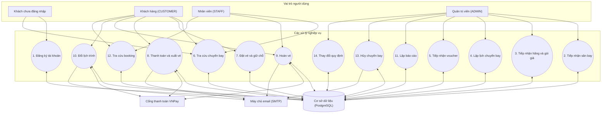

_Hình 2.1: Sơ đồ phối hợp tổng quát giữa các yêu cầu nghiệp vụ_

---

### 2.2.1. Yêu cầu 1: Tiếp nhận đăng ký tài khoản khách hàng

#### 1. Biểu mẫu và quy định liên quan

- **Biểu mẫu liên quan:** BM1 - Phiếu đăng ký tài khoản (màn hình `C-04 Đăng ký`).

_Bảng 2.2: Các trường dữ liệu của biểu mẫu BM1 (Đăng ký tài khoản)_

| STT | Tên trường | Kiểu dữ liệu  | Bắt buộc | Ràng buộc / Ý nghĩa                                     |
| :-- | :--------- | :------------ | :------: |
| 1   | `email`    | Chuỗi (≤ 255) |    Có    | Đúng định dạng email; lưu dạng chữ thường; duy nhất     |
| 2   | `password` | Chuỗi         |    Có    | Ít nhất 8 ký tự, có cả chữ và số, không dài quá 72 byte |
| 3   | `fullName` | Chuỗi (≤ 100) |    Có    | Họ và tên của khách                                     |
| 4   | `phone`    | Chuỗi (≤ 20)  |    Có    | Số điện thoại của khách                                 |

- **Quy định liên quan:** `QĐ1.1`, `QĐ1.2`, nội dung như mục 2.1.1.

#### 2. Sơ đồ luồng dữ liệu


_Hình 2.2: Sơ đồ luồng dữ liệu cho yêu cầu Tiếp nhận đăng ký tài khoản khách hàng_

#### 3. Mô tả các luồng dữ liệu

- **D1:** Email, mật khẩu, họ tên, số điện thoại.
- **D2:** Không có.
- **D3:** Danh sách email đã đăng ký (bảng `users`).
- **D4:** Email (chữ thường), mật khẩu đã băm BCrypt, họ tên, số điện thoại, vai trò `CUSTOMER`, trạng thái `ACTIVE`.
- **D5:** Không có.
- **D6:** Thông tin tài khoản vừa tạo (khách được đăng nhập luôn), hoặc thông báo lỗi theo trường, hoặc lỗi email đã được đăng ký (`EMAIL_ALREADY_USED`).

#### 4. Thuật toán

- **B1:** Nhận D1 từ người dùng.
- **B2:** Kết nối cơ sở dữ liệu.
- **B3:** Đọc D3 từ bộ nhớ phụ.
- **B4:** Kiểm tra định dạng email, độ dài các trường và quy tắc mật khẩu theo `QĐ1.1`. Nếu vi phạm thì đến B9.
- **B5:** Chuyển email sang chữ thường và so với D3. Nếu email đã tồn tại thì đến B9.
- **B6:** Băm mật khẩu bằng BCrypt, gán vai trò `CUSTOMER` và trạng thái `ACTIVE` theo `QĐ1.2`.
- **B7:** Lưu D4 xuống bộ nhớ phụ.
- **B8:** Tạo phiên đăng nhập, trả D6 cho người dùng. Đến B10.
- **B9:** Trả D6 thông báo lỗi cho người dùng.
- **B10:** Đóng kết nối cơ sở dữ liệu.
- **B11:** Kết thúc.

---

### 2.2.2. Yêu cầu 2: Tiếp nhận thông tin sân bay

#### 1. Biểu mẫu và quy định liên quan

- **Biểu mẫu liên quan:** BM2 - Phiếu thông tin sân bay (màn hình `A-01 Sân bay`).

_Bảng 2.3: Các trường dữ liệu của biểu mẫu BM2 (Thông tin sân bay)_

| STT | Tên trường    | Kiểu dữ liệu  | Bắt buộc | Ràng buộc / Ý nghĩa                                                                                              |
| :-- | :------------ | :------------ | :------: |
| 1   | `code`        | Chuỗi 3 ký tự |    Có    | Mã IATA, 3 chữ cái in hoa, duy nhất; không sửa được sau khi tạo                                                  |
| 2   | `name`        | Chuỗi (≤ 100) |    Có    | Tên sân bay                                                                                                      |
| 3   | `city`        | Chuỗi (≤ 100) |    Có    | Thành phố                                                                                                        |
| 4   | `countryCode` | Chuỗi 2 ký tự |    Có    | Mã quốc gia ISO 3166-1 alpha-2, phải có trong danh sách ISO (VD `VN`)                                            |
| 5   | `timezone`    | Chuỗi (≤ 50)  |    Có    | Tên múi giờ IANA theo vùng (VD `Asia/Ho_Chi_Minh`); không nhận dạng offset như `GMT+7` hay tên cố định như `UTC` |
| 6   | `active`      | Boolean       |    Có    | Trạng thái kích hoạt                                                                                             |

- **Quy định liên quan:** `QĐ2.1`, `QĐ2.2`, nội dung như mục 2.1.1. `QĐ2.2` áp dụng khi Admin xóa sân bay ở `A-01`.

#### 2. Sơ đồ luồng dữ liệu

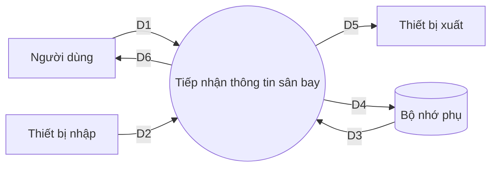

_Hình 2.3: Sơ đồ luồng dữ liệu cho yêu cầu Tiếp nhận thông tin sân bay_

#### 3. Mô tả các luồng dữ liệu

- **D1:** Mã IATA, tên sân bay, thành phố, mã quốc gia, múi giờ, trạng thái kích hoạt.
- **D2:** Không có.
- **D3:** Danh sách mã sân bay đã có (bảng `airports`).
- **D4:** D1.
- **D5:** Không có.
- **D6:** Thông tin sân bay vừa tạo, hoặc thông báo lỗi theo trường (sai định dạng, mã quốc gia không thuộc ISO 3166-1, múi giờ không hợp lệ, mã sân bay đã tồn tại).

#### 4. Thuật toán

- **B1:** Nhận D1 từ người dùng.
- **B2:** Kết nối cơ sở dữ liệu.
- **B3:** Đọc D3 từ bộ nhớ phụ.
- **B4:** Kiểm tra mã IATA, mã quốc gia và múi giờ theo `QĐ2.1`. Nếu vi phạm thì đến B8.
- **B5:** Kiểm tra mã sân bay trong D1 có trùng D3 không. Nếu trùng thì đến B8.
- **B6:** Lưu D4 xuống bộ nhớ phụ.
- **B7:** Trả D6 thông tin sân bay vừa tạo cho người dùng. Đến B9.
- **B8:** Trả D6 thông báo lỗi cho người dùng.
- **B9:** Đóng kết nối cơ sở dữ liệu.
- **B10:** Kết thúc.

---

### 2.2.3. Yêu cầu 3: Tiếp nhận thông tin hãng hàng không, gói giá và bảng giá hành lý

#### 1. Biểu mẫu và quy định liên quan

- **Biểu mẫu liên quan:** BM3 - Phiếu thông tin hãng hàng không và dịch vụ (màn hình `A-02 Hãng bay`, `A-03 Chi tiết hãng`). Biểu mẫu gồm 3 form: hãng bay (`A-02`), gói giá và mức hành lý (hai tab của `A-03`). Cột "Tên trường" ghi tên form trước dấu chấm.

_Bảng 2.4: Các trường dữ liệu của biểu mẫu BM3 (Hãng bay, gói giá và bảng giá hành lý)_

| STT | Tên trường                    | Kiểu dữ liệu    | Bắt buộc | Ràng buộc / Ý nghĩa                                                                     |
| :-- | :---------------------------- | :-------------- | :------: |
| 1   | `airline.code`                | Chuỗi 2 ký tự   |    Có    | Mã IATA của hãng, 2 ký tự chữ in hoa hoặc số, duy nhất                                  |
| 2   | `airline.name`                | Chuỗi (≤ 100)   |    Có    | Tên hãng                                                                                |
| 3   | `airline.ticketPrefix`        | Chuỗi 3 chữ số  |    Có    | Mã số vé của hãng, duy nhất (VD `738`)                                                  |
| 4   | `airline.active`              | Boolean         |    Có    | Trạng thái kích hoạt của hãng                                                           |
| 5   | `fareFamily.cabinClass`       | Enum            |    Có    | Hạng ghế: `ECONOMY`, `PREMIUM_ECONOMY`, `BUSINESS`, `FIRST`; không đổi được sau khi tạo |
| 6   | `fareFamily.name`             | Chuỗi (≤ 50)    |    Có    | Tên gói giá, không trùng trong cùng hãng                                                |
| 7   | `fareFamily.carryOnKg`        | Số nguyên (≥ 0) |    Có    | Hành lý xách tay (kg)                                                                   |
| 8   | `fareFamily.checkedBaggageKg` | Số nguyên (≥ 0) |    Có    | Hành lý ký gửi kèm gói (kg)                                                             |
| 9   | `fareFamily.refundable`       | Boolean         |    Có    | Gói có cho phép hoàn không                                                              |
| 10  | `fareFamily.refundFee`        | Số nguyên (≥ 0) |    Có    | Phí hoàn cho mỗi khách chiếm ghế (VND)                                                  |
| 11  | `fareFamily.changeable`       | Boolean         |    Có    | Gói có cho phép đổi không                                                               |
| 12  | `fareFamily.changeFee`        | Số nguyên (≥ 0) |    Có    | Phí đổi cho mỗi khách chiếm ghế (VND)                                                   |
| 13  | `fareFamily.active`           | Boolean         |    Có    | Trạng thái kích hoạt của gói giá                                                        |
| 14  | `baggageOption.weightKg`      | Số nguyên (≥ 1) |    Có    | Mức hành lý ký gửi mua thêm (kg), không trùng trong cùng hãng                           |
| 15  | `baggageOption.price`         | Số nguyên (≥ 1) |    Có    | Giá của mức hành lý (VND)                                                               |
| 16  | `baggageOption.active`        | Boolean         |    Có    | Trạng thái kích hoạt của mức hành lý                                                    |

- **Quy định liên quan:** `QĐ3.1`, `QĐ3.2`, `QĐ3.3`, nội dung như mục 2.1.1.

#### 2. Sơ đồ luồng dữ liệu


_Hình 2.4: Sơ đồ luồng dữ liệu cho yêu cầu Tiếp nhận hãng hàng không, gói giá và bảng giá hành lý_

#### 3. Mô tả các luồng dữ liệu

- **D1:** Thông tin hãng bay (mã, tên, mã số vé, trạng thái), hoặc thông tin gói giá (hạng ghế, tên, hành lý xách tay và ký gửi, điều kiện và phí hoàn/đổi, trạng thái), hoặc thông tin mức hành lý (số kg, giá, trạng thái).
- **D2:** Không có.
- **D3:** Mã hãng và mã số vé đã có (bảng `airlines`); tên các gói giá (bảng `fare_families`) và các mức kg (bảng `baggage_options`) đã có của hãng.
- **D4:** D1, kèm mã hãng đối với gói giá và mức hành lý.
- **D5:** Không có.
- **D6:** Thông tin vừa tạo, hoặc thông báo lỗi theo trường (sai định dạng, mã hãng đã tồn tại, mã số vé đã được hãng khác dùng, tên gói giá hoặc mức kg đã có trong hãng).

#### 4. Thuật toán

- **B1:** Nhận D1 từ người dùng.
- **B2:** Kết nối cơ sở dữ liệu.
- **B3:** Đọc D3 từ bộ nhớ phụ.
- **B4:** Kiểm tra định dạng các trường theo Bảng 2.4 và `QĐ3.1`. Nếu vi phạm thì đến B9.
- **B5:** Với hãng bay: kiểm tra mã hãng và mã số vé có trùng D3 không. Nếu trùng thì đến B9.
- **B6:** Với gói giá và mức hành lý: kiểm tra tên gói giá hoặc mức kg có trùng trong cùng hãng không theo `QĐ3.2`. Nếu trùng thì đến B9.
- **B7:** Lưu D4 xuống bộ nhớ phụ.
- **B8:** Trả D6 thông tin vừa tạo cho người dùng. Đến B10.
- **B9:** Trả D6 thông báo lỗi cho người dùng.
- **B10:** Đóng kết nối cơ sở dữ liệu.
- **B11:** Kết thúc.

---

### 2.2.4. Yêu cầu 4: Lập lịch chuyến bay

#### 1. Biểu mẫu và quy định liên quan

- **Biểu mẫu liên quan:** BM4 - Phiếu lập lịch chuyến bay (màn hình `A-05 Tạo chuyến`).

_Bảng 2.5: Các trường dữ liệu của biểu mẫu BM4 (Lập lịch chuyến bay)_

| STT | Tên trường         | Kiểu dữ liệu                         | Bắt buộc | Ràng buộc / Ý nghĩa                                            |
| :-- | :----------------- | :----------------------------------- | :------: |
| 1   | `airlineCode`      | Chuỗi 2 ký tự                        |    Có    | Hãng khai thác, phải tồn tại và đang hoạt động                 |
| 2   | `flightNumber`     | Chuỗi                                |    Có    | Số hiệu chuyến = mã hãng + 1–4 chữ số (VD `VN213`)             |
| 3   | `departureAirport` | Chuỗi 3 ký tự                        |    Có    | Sân bay đi, phải tồn tại và đang hoạt động                     |
| 4   | `arrivalAirport`   | Chuỗi 3 ký tự                        |    Có    | Sân bay đến, khác sân bay đi, phải tồn tại và đang hoạt động   |
| 5   | `departureTime`    | Giờ (giờ:phút)                       |    Có    | Giờ cất cánh theo giờ địa phương của sân bay đi                |
| 6   | `durationMinutes`  | Số nguyên (1–1440)                   |    Có    | Thời lượng bay (phút)                                          |
| 7   | `fromDate`         | Ngày                                 |    Có    | Ngày đầu của khoảng ngày                                       |
| 8   | `toDate`           | Ngày                                 |    Có    | Ngày cuối, không trước `fromDate`; khoảng ngày tối đa 180 ngày |
| 9   | `daysOfWeek`       | Danh sách thứ                        |    Có    | Các thứ trong tuần có chuyến, ít nhất 1 thứ                    |
| 10  | `aircraftModel`    | Chuỗi (≤ 50)                         |    Có    | Loại máy bay (VD `Airbus A321`)                                |
| 11  | `cabins`           | Danh sách `{cabinClass, totalSeats}` |    Có    | Ít nhất 1 hạng ghế, không lặp hạng; số ghế 1–999               |
| 12  | `fares`            | Danh sách `{fareFamilyId, price}`    |    Có    | Giá người lớn (VND, ≥ 1) cho từng gói giá; không lặp gói giá   |

- **Quy định liên quan:** `QĐ4.1`, `QĐ4.2`, `QĐ4.3`, `QĐ4.4`, nội dung như mục 2.1.1.

#### 2. Sơ đồ luồng dữ liệu

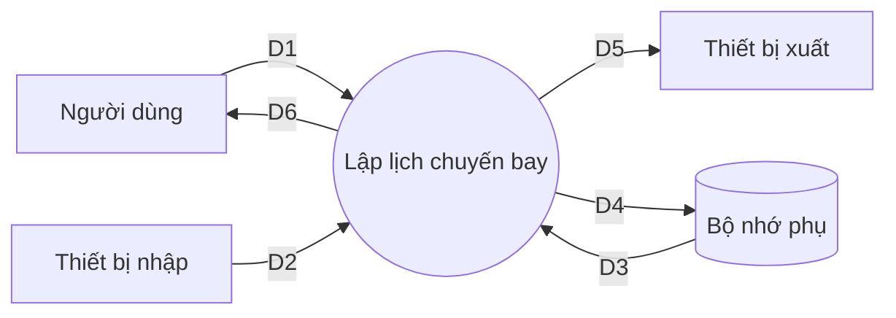

_Hình 2.5: Sơ đồ luồng dữ liệu cho yêu cầu Lập lịch chuyến bay_

#### 3. Mô tả các luồng dữ liệu

- **D1:** Hãng, số hiệu, sân bay đi và đến, giờ cất cánh, thời lượng bay, khoảng ngày, các thứ trong tuần, loại máy bay, số ghế từng hạng, giá bán từng gói giá.
- **D2:** Không có.
- **D3:** Hãng (trạng thái kích hoạt); sân bay đi và đến (trạng thái kích hoạt, múi giờ); gói giá của hãng (hạng ghế); các chuyến đã có (hãng, số hiệu, giờ cất cánh).
- **D4:** Các chuyến mới ở trạng thái `SCHEDULED` (bảng `flights`), số ghế từng hạng với số ghế còn bằng tổng số ghế (bảng `flight_cabins`), giá bán từng gói giá (bảng `flight_fares`).
- **D5:** Không có.
- **D6:** Số chuyến được tạo và số ngày bị bỏ qua vì trùng, hoặc thông báo lỗi theo trường.

#### 4. Thuật toán

- **B1:** Nhận D1 từ người dùng.
- **B2:** Kết nối cơ sở dữ liệu.
- **B3:** Đọc D3 từ bộ nhớ phụ.
- **B4:** Kiểm tra hãng và sân bay tồn tại và đang hoạt động theo `QĐ4.4`; số hiệu bắt đầu bằng mã hãng, theo sau 1–4 chữ số; sân bay đi khác sân bay đến theo `QĐ4.1`; ngày cuối không trước ngày đầu và khoảng ngày không quá 180 ngày theo `QĐ4.3`. Nếu vi phạm thì đến B9.
- **B5:** Kiểm tra hạng ghế không lặp; mỗi giá bán thuộc một gói giá của đúng hãng, hạng ghế của gói giá có trên chuyến, không lặp gói giá theo `QĐ4.2`. Nếu vi phạm thì đến B9.
- **B6:** Với mỗi ngày trong khoảng ngày rơi vào các thứ đã chọn:
  - Tính giờ cất cánh tuyệt đối từ ngày, giờ cất cánh và múi giờ sân bay đi; giờ hạ cánh = giờ cất cánh + thời lượng bay theo `QĐ4.3`.
  - Nếu giờ cất cánh không sau thời điểm hiện tại thì đến B9.
  - Nếu đã có chuyến cùng hãng, cùng số hiệu, cùng giờ cất cánh theo `QĐ4.1` thì tăng số ngày bỏ qua; ngược lại thêm chuyến, số ghế và giá bán vào D4.
- **B7:** Lưu D4 xuống bộ nhớ phụ.
- **B8:** Trả D6 số chuyến được tạo và số ngày bị bỏ qua cho người dùng. Đến B10.
- **B9:** Trả D6 thông báo lỗi cho người dùng.
- **B10:** Đóng kết nối cơ sở dữ liệu.
- **B11:** Kết thúc.

---

### 2.2.5. Yêu cầu 5: Tiếp nhận mã giảm giá (voucher)

#### 1. Biểu mẫu và quy định liên quan

- **Biểu mẫu liên quan:** BM5 - Phiếu tạo mã giảm giá (màn hình `A-07 Voucher`).

_Bảng 2.6: Các trường dữ liệu của biểu mẫu BM5 (Mã giảm giá)_

| STT | Tên trường       | Kiểu dữ liệu    | Bắt buộc | Ràng buộc / Ý nghĩa                                                       |
| :-- | :--------------- | :-------------- | :------: |
| 1   | `code`           | Chuỗi (3–30)    |    Có    | Chữ in hoa hoặc số, duy nhất, không sửa được sau khi tạo                  |
| 2   | `description`    | Chuỗi (≤ 255)   |    Có    | Mô tả voucher                                                             |
| 3   | `discountType`   | Enum            |    Có    | `PERCENT` (theo phần trăm) hoặc `FIXED` (số tiền cố định)                 |
| 4   | `discountValue`  | Số nguyên (≥ 1) |    Có    | Phần trăm giảm (1–100) hoặc số tiền giảm (VND)                            |
| 5   | `maxDiscount`    | Số nguyên (≥ 1) |  Không   | Mức giảm tối đa (VND), chỉ dùng cho `PERCENT`; để trống là không giới hạn |
| 6   | `minOrderAmount` | Số nguyên (≥ 0) |    Có    | Giá trị đơn (tạm tính) tối thiểu                                          |
| 7   | `validFrom`      | Thời điểm       |    Có    | Thời điểm bắt đầu hiệu lực                                                |
| 8   | `validTo`        | Thời điểm       |    Có    | Thời điểm kết thúc hiệu lực, phải sau `validFrom`                         |
| 9   | `usageLimit`     | Số nguyên (≥ 1) |  Không   | Tổng số lượt dùng tối đa; để trống là không giới hạn                      |
| 10  | `active`         | Boolean         |    Có    | Trạng thái kích hoạt                                                      |

- **Quy định liên quan:** `QĐ5.1`, `QĐ5.2`, `QĐ5.3`, nội dung như mục 2.1.1.

#### 2. Sơ đồ luồng dữ liệu

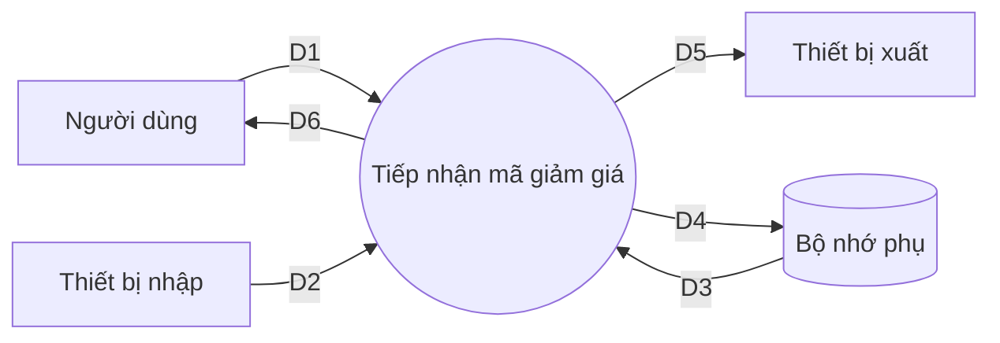

_Hình 2.6: Sơ đồ luồng dữ liệu cho yêu cầu Tiếp nhận mã giảm giá_

#### 3. Mô tả các luồng dữ liệu

- **D1:** Mã, mô tả, loại giảm, mức giảm, mức giảm tối đa, giá trị đơn tối thiểu, thời hạn hiệu lực, giới hạn lượt, trạng thái kích hoạt.
- **D2:** Không có.
- **D3:** Danh sách mã voucher đã có (bảng `vouchers`).
- **D4:** D1 và số lượt đã dùng ban đầu (`used_count = 0`).
- **D5:** Không có.
- **D6:** Thông tin voucher vừa tạo, hoặc thông báo lỗi theo trường.

#### 4. Thuật toán

- **B1:** Nhận D1 từ người dùng.
- **B2:** Kết nối cơ sở dữ liệu.
- **B3:** Đọc D3 từ bộ nhớ phụ.
- **B4:** Kiểm tra định dạng mã và các trường theo Bảng 2.6; loại `PERCENT` thì mức giảm từ 1 đến 100; loại `FIXED` thì không có mức giảm tối đa (`QĐ5.2`); thời điểm kết thúc sau thời điểm bắt đầu (`QĐ5.1`). Nếu vi phạm thì đến B8.
- **B5:** Kiểm tra mã trong D1 có trùng D3 không theo `QĐ5.1`. Nếu trùng thì đến B8.
- **B6:** Lưu D4 xuống bộ nhớ phụ.
- **B7:** Trả D6 thông tin voucher vừa tạo cho người dùng. Đến B9.
- **B8:** Trả D6 thông báo lỗi cho người dùng.
- **B9:** Đóng kết nối cơ sở dữ liệu.
- **B10:** Kết thúc.

---

### 2.2.6. Yêu cầu 6: Tra cứu chuyến bay

#### 1. Biểu mẫu và quy định liên quan

- **Biểu mẫu liên quan:** BM6 - Phiếu tra cứu chuyến bay (màn hình `C-01 Tìm chuyến`, `C-02 Kết quả tìm kiếm`).

_Bảng 2.7: Các trường dữ liệu của biểu mẫu BM6 (Tra cứu chuyến bay)_

| STT | Tên trường   | Kiểu dữ liệu    | Bắt buộc | Ràng buộc / Ý nghĩa                                                             |
| :-- | :----------- | :-------------- | :------: |
| 1   | `from`       | Chuỗi 3 ký tự   |    Có    | Mã IATA sân bay đi                                                              |
| 2   | `to`         | Chuỗi 3 ký tự   |    Có    | Mã IATA sân bay đến, khác sân bay đi                                            |
| 3   | `date`       | Ngày            |    Có    | Ngày đi theo giờ địa phương của sân bay đi                                      |
| 4   | `returnDate` | Ngày            |  Không   | Ngày về, không trước ngày đi; có thì tra cứu thêm chiều về theo tuyến ngược lại |
| 5   | `adults`     | Số nguyên (≥ 1) |    Có    | Số người lớn                                                                    |
| 6   | `children`   | Số nguyên (≥ 0) |  Không   | Số trẻ em, mặc định 0                                                           |
| 7   | `infants`    | Số nguyên (≥ 0) |  Không   | Số em bé, mặc định 0, không vượt quá số người lớn                               |
| 8   | `cabin`      | Enum            |    Có    | Hạng ghế: `ECONOMY`, `PREMIUM_ECONOMY`, `BUSINESS`, `FIRST`                     |

- **Quy định liên quan:** `QĐ6.1`, `QĐ6.2`, `QĐ6.3`, `QĐ6.4`, `QĐ6.5`, nội dung như mục 2.1.1.

#### 2. Sơ đồ luồng dữ liệu

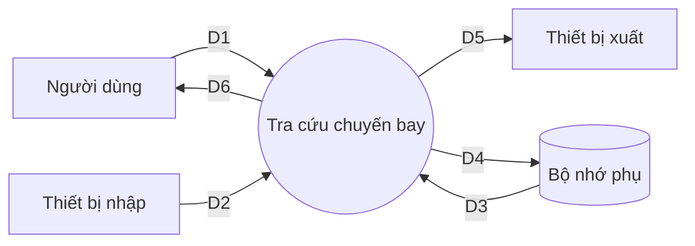

_Hình 2.7: Sơ đồ luồng dữ liệu cho yêu cầu Tra cứu chuyến bay_

#### 3. Mô tả các luồng dữ liệu

- **D1:** Sân bay đi, sân bay đến, ngày đi, số người lớn, trẻ em, em bé, hạng ghế.
- **D2:** Không có.
- **D3:** Các chuyến `SCHEDULED` trên tuyến và ngày cần tìm (bảng `flights`), số ghế còn theo hạng (bảng `flight_cabins`), giá bán các gói giá đang bán đúng hạng ghế (bảng `flight_fares`, `fare_families`), tham số `booking.min_hours_before_departure`, `booking.max_seated_passengers`, `search.min_connection_minutes`, `search.max_connection_minutes`, `pricing.child_percent`, `pricing.infant_percent` (bảng `system_settings`).
- **D4:** Không có.
- **D5:** Không có.
- **D6:** Danh sách hành trình. Mỗi hành trình gồm các chặng (số hiệu, hãng, sân bay, giờ cất cánh và hạ cánh theo giờ địa phương, thời lượng, loại máy bay), số điểm dừng, thời gian nối chuyến, tổng thời lượng và các gói giá (tên, hành lý, điều kiện và phí hoàn/đổi, giá người lớn của chiều, tổng giá cho đúng số khách, số ghế còn). Không có kết quả thì trả danh sách rỗng.

#### 4. Thuật toán

- **B1:** Nhận D1 từ người dùng.
- **B2:** Kết nối cơ sở dữ liệu.
- **B3:** Đọc D3 từ bộ nhớ phụ.
- **B4:** Kiểm tra số khách theo `QĐ6.5`. Nếu vi phạm thì đến B10.
- **B5:** Tính thời điểm cất cánh sớm nhất = thời điểm hiện tại + `booking.min_hours_before_departure` giờ theo `QĐ6.1`.
- **B6:** Tìm các hành trình bay thẳng và nối chuyến 1 điểm dừng cùng hãng, có chặng đầu cất cánh từ thời điểm ở B5, thời gian nối trong khoảng của `QĐ6.2`, mỗi chặng còn ít nhất (người lớn + trẻ em) ghế theo `QĐ6.4`.
- **B7:** Với mỗi hành trình: chỉ giữ các gói giá có trên mọi chặng theo `QĐ6.4`; giá người lớn của chiều = tổng giá các chặng; tổng giá tính theo `QĐ6.5`; số ghế còn = số ghế còn nhỏ nhất qua các chặng. Hành trình không còn gói giá thì bỏ.
- **B8:** Sắp xếp các hành trình theo giá thấp nhất tăng dần.
- **B9:** Trả D6 cho người dùng. Đến B11.
- **B10:** Trả D6 thông báo lỗi cho người dùng.
- **B11:** Đóng kết nối cơ sở dữ liệu.
- **B12:** Kết thúc.

Với hành trình khứ hồi, sau khi người dùng chọn chiều đi, hệ thống thực hiện lại xử lý trên với sân bay đi và đến đổi chỗ cho nhau và ngày đi là ngày về. Màn hình `C-02` chỉ cho chọn hành trình chiều về thỏa `QĐ6.3` so với chiều đi đã chọn; bước giữ chỗ (YCNV-07) kiểm tra lại quy định này.

---

### 2.2.7. Yêu cầu 7: Tiếp nhận đặt vé và giữ chỗ

#### 1. Biểu mẫu và quy định liên quan

- **Biểu mẫu liên quan:** BM7 - Phiếu đặt vé máy bay (màn hình `C-07 Đặt vé`).

_Bảng 2.8: Các trường dữ liệu của biểu mẫu BM7 (Đặt vé máy bay)_

| STT | Tên trường                    | Kiểu dữ liệu                                             |    Bắt buộc     | Ràng buộc / Ý nghĩa                                                                                         |
| :-- | :---------------------------- | :------------------------------------------------------- | :-------------: |
| 1   | `journeys[].direction`        | Enum                                                     |       Có        | Chiều: `OUTBOUND` (đi) hoặc `RETURN` (về)                                                                   |
| 2   | `journeys[].flightIds`        | Danh sách số nguyên                                      |       Có        | Các chuyến của chiều: 1 chuyến (bay thẳng) hoặc 2 chuyến (nối chuyến)                                       |
| 3   | `journeys[].fareFamilyId`     | Số nguyên                                                |       Có        | Gói giá đã chọn cho chiều                                                                                   |
| 4   | `passengers[].type`           | Enum                                                     |       Có        | Loại khách: `ADULT`, `CHILD`, `INFANT`; phải khớp với tuổi                                                  |
| 5   | `passengers[].lastName`       | Chuỗi (≤ 50)                                             |       Có        | Họ, in hoa không dấu (A–Z)                                                                                  |
| 6   | `passengers[].firstName`      | Chuỗi (≤ 50)                                             |       Có        | Tên đệm và tên, in hoa không dấu (A–Z)                                                                      |
| 7   | `passengers[].gender`         | Enum                                                     |       Có        | Giới tính: `MALE`, `FEMALE`                                                                                 |
| 8   | `passengers[].dateOfBirth`    | Ngày                                                     |       Có        | Ngày sinh, không sau ngày cất cánh chặng đầu chiều đi                                                       |
| 9   | `passengers[].nationality`    | Chuỗi 2 ký tự                                            | Khi bay quốc tế | Mã quốc gia, 2 chữ in hoa                                                                                   |
| 10  | `passengers[].passportNumber` | Chuỗi (6–20)                                             | Khi bay quốc tế | Số hộ chiếu, chữ in hoa và số                                                                               |
| 11  | `passengers[].passportExpiry` | Ngày                                                     | Khi bay quốc tế | Còn hạn ít nhất 6 tháng tính từ ngày cất cánh chặng cuối                                                    |
| 12  | `baggage[]`                   | Danh sách `{passengerIndex, direction, baggageOptionId}` |      Không      | Mức hành lý mua thêm của một khách trên một chiều; tối đa một mức mỗi khách mỗi chiều; em bé không được mua |
| 13  | `contact`                     | Đối tượng `{name, email, phone}`                         |       Có        | Họ tên (≤ 100), email (≤ 255), số điện thoại (9–15 chữ số, có thể có `+` ở đầu); điền sẵn từ tài khoản      |
| 14  | `voucherCode`                 | Chuỗi                                                    |      Không      | Mã voucher                                                                                                  |

- **Quy định liên quan:** `QĐ7.1`, `QĐ7.2`, `QĐ7.3`, `QĐ7.4`, `QĐ7.5`, `QĐ7.6`, nội dung như mục 2.1.1. Hành trình được kiểm tra lại theo `QĐ6.1` đến `QĐ6.4`.

#### 2. Sơ đồ luồng dữ liệu


_Hình 2.8: Sơ đồ luồng dữ liệu cho yêu cầu Tiếp nhận đặt vé và giữ chỗ_

#### 3. Mô tả các luồng dữ liệu

- **D1:** Hành trình từng chiều (chuyến, gói giá), danh sách hành khách, hành lý mua thêm, thông tin liên hệ, mã voucher.
- **D2:** Không có.
- **D3:** Trạng thái và giờ cất cánh các chuyến, quốc gia và múi giờ các sân bay, số ghế còn (bảng `flight_cabins`), giá bán (bảng `flight_fares`), quy định gói giá (bảng `fare_families`), bảng giá hành lý (bảng `baggage_options`), voucher và các booking của tài khoản đã dùng voucher đó, các mã đặt chỗ đã có, tham số `booking.min_hours_before_departure`, `booking.max_seated_passengers`, `booking.hold_minutes`, `pricing.child_percent`, `pricing.infant_percent`, `search.min_connection_minutes`, `search.max_connection_minutes`.
- **D4:** Booking ở trạng thái `PENDING_PAYMENT` kèm hạn giữ chỗ và các khoản tiền (bảng `bookings`); các chiều kèm snapshot gói giá và mức giảm được phân bổ (bảng `booking_journeys`); các chặng `ACTIVE` kèm giá người lớn (bảng `booking_segments`); hành khách (bảng `passengers`); vé kèm giá vé, chưa có số vé (bảng `tickets`); hành lý mua thêm (bảng `booking_baggage`); số ghế còn giảm đi (bảng `flight_cabins`); số lượt đã dùng của voucher tăng lên (bảng `vouchers`).
- **D5:** Không có.
- **D6:** Mã đặt chỗ, hạn giữ chỗ và bảng giá; hoặc thông báo lỗi: không đủ ghế (`SEATS_UNAVAILABLE`), chuyến không còn bán do đã hủy, quá sát giờ bay hoặc gói giá ngừng bán (`FLIGHT_NOT_BOOKABLE`), vi phạm quy định hành khách (`PASSENGER_RULES_VIOLATED`), voucher không dùng được kèm lý do (`VOUCHER_INVALID`), lỗi theo trường.

#### 4. Thuật toán

- **B1:** Nhận D1 từ người dùng.
- **B2:** Kết nối cơ sở dữ liệu.
- **B3:** Đọc D3 từ bộ nhớ phụ.
- **B4:** Kiểm tra hành trình từng chiều theo `QĐ6.1` đến `QĐ6.4`. Nếu vi phạm thì đến B13.
- **B5:** Kiểm tra hành khách và thông tin liên hệ theo `QĐ7.1`, `QĐ7.2`. Nếu vi phạm thì đến B13.
- **B6:** Tính giá vé, tiền hành lý và tạm tính theo `QĐ7.3`. Nếu có voucher: kiểm tra theo `QĐ7.6`, tính mức giảm và phân bổ cho từng chiều; voucher không dùng được thì đến B13. Tính tổng thanh toán. (Báo giá dừng ở bước này, trả bảng giá và không ghi dữ liệu.)
- **B7:** Mở transaction, khóa chia sẻ các chuyến và kiểm tra lại trạng thái `SCHEDULED`. Nếu chuyến không còn bán được thì rollback và đến B13.
- **B8:** Trừ ghế từng chặng theo thứ tự mã chuyến tăng dần, mỗi chặng bằng một câu `UPDATE` nguyên tử. Nếu chặng nào không đủ ghế thì rollback và đến B13.
- **B9:** Nếu có voucher: tăng số lượt đã dùng. Nếu hết lượt thì rollback và đến B13.
- **B10:** Sinh mã đặt chỗ theo `QĐ7.5`; nếu trùng D3 thì sinh lại, tối đa 5 lần.
- **B11:** Lưu D4 xuống bộ nhớ phụ với giá snapshot theo `QĐ7.4` và hạn giữ chỗ = thời điểm hiện tại + `booking.hold_minutes` phút. Nếu tài khoản đã dùng voucher này thì rollback và đến B13. Nếu tổng thanh toán bằng 0 thì cấp số vé và chuyển booking sang `ISSUED` theo `QĐ7.5`. Commit transaction.
- **B12:** Trả D6 mã đặt chỗ, hạn giữ chỗ và bảng giá cho người dùng. Đến B14.
- **B13:** Trả D6 thông báo lỗi cho người dùng.
- **B14:** Đóng kết nối cơ sở dữ liệu.
- **B15:** Kết thúc.

---

### 2.2.8. Yêu cầu 8: Thanh toán và xuất vé điện tử

#### 1. Biểu mẫu và quy định liên quan

- **Biểu mẫu liên quan:** BM8 - Phiếu thanh toán và vé điện tử (màn hình `C-09 Chi tiết booking` và cổng thanh toán VNPay). Dòng 1 do khách chọn trên `C-09`; dòng 2–8 là tham số VNPay gửi về qua IPN và Return URL; dòng 9 do hệ thống cấp.

_Bảng 2.9: Các trường dữ liệu của biểu mẫu BM8 (Thanh toán và vé điện tử)_

| STT | Tên trường              | Kiểu dữ liệu    | Bắt buộc | Ràng buộc / Ý nghĩa                           |
| :-- | :---------------------- | :-------------- | :------: |
| 1   | `code`                  | Chuỗi 6 ký tự   |    Có    | Mã đặt chỗ cần thanh toán                     |
| 2   | `vnp_TxnRef`            | Chuỗi           |    Có    | Mã lượt thu do hệ thống tạo                   |
| 3   | `vnp_Amount`            | Số nguyên       |    Có    | Số tiền × 100, phải khớp số tiền của lượt thu |
| 4   | `vnp_ResponseCode`      | Chuỗi 2 ký tự   |    Có    | Mã phản hồi, `00` là thành công               |
| 5   | `vnp_TransactionStatus` | Chuỗi 2 ký tự   |    Có    | Trạng thái giao dịch, `00` là thành công      |
| 6   | `vnp_TransactionNo`     | Chuỗi           |    Có    | Mã giao dịch phía VNPay                       |
| 7   | `vnp_PayDate`           | Chuỗi           |    Có    | Thời điểm thanh toán phía VNPay               |
| 8   | `vnp_SecureHash`        | Chuỗi           |    Có    | Chữ ký HMAC-SHA512 của các tham số            |
| 9   | `ticketNumber`          | Chuỗi 13 chữ số | Hệ thống | Số vé của một hành khách trên một chặng       |

- **Quy định liên quan:** `QĐ8.1`, `QĐ8.2`, `QĐ8.3`, `QĐ8.4`, nội dung như mục 2.1.1.

#### 2. Sơ đồ luồng dữ liệu

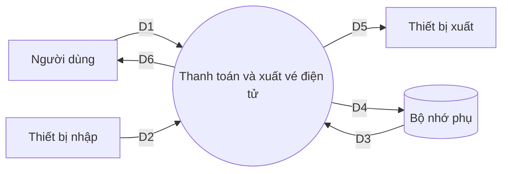

_Hình 2.9: Sơ đồ luồng dữ liệu cho yêu cầu Thanh toán và xuất vé điện tử_

#### 3. Mô tả các luồng dữ liệu

- **D1:** Mã đặt chỗ cần thanh toán.
- **D2:** Kết quả giao dịch do cổng VNPay gửi về qua IPN hoặc Return URL (dòng 2–8 của Bảng 2.9).
- **D3:** Booking (trạng thái, hạn giữ chỗ, tổng thanh toán); lượt thu (mã lượt thu, số tiền, trạng thái); vé của booking và mã số vé của hãng; giá trị kế tiếp của sequence `ticket_number_seq`.
- **D4:** Lượt thu mới (`kind = CHARGE`, `status = PENDING`, hết hạn cùng hạn giữ chỗ); kết quả lượt thu (`SUCCESS` hoặc `FAILED`, mã giao dịch và thời điểm thanh toán phía VNPay, mã phản hồi, toàn bộ tham số); số vé và thời điểm xuất vé của từng vé (bảng `tickets`); trạng thái `ISSUED` và thời điểm xuất vé của booking; hoặc yêu cầu hoàn nguồn `INVALID_PAYMENT` (bảng `refund_requests`).
- **D5:** URL thanh toán đã ký gửi sang cổng VNPay; mã phản hồi IPN trả cho VNPay; email vé điện tử gửi qua máy chủ SMTP.
- **D6:** Kết quả thanh toán (thành công hoặc thất bại) hiển thị trên `C-09`, hoặc thông báo lỗi: quá hạn giữ chỗ (`HOLD_EXPIRED`), thao tác không hợp lệ với trạng thái hiện tại của booking (`INVALID_STATE`).

#### 4. Thuật toán

- **B1:** Nhận D1 từ người dùng.
- **B2:** Kết nối cơ sở dữ liệu.
- **B3:** Đọc D3 (booking) từ bộ nhớ phụ.
- **B4:** Kiểm tra booking đang `PENDING_PAYMENT` và chưa quá hạn giữ chỗ theo `QĐ8.1`. Nếu vi phạm thì đến B15.
- **B5:** Lưu lượt thu mới (D4) xuống bộ nhớ phụ. Xuất D5 URL thanh toán đã ký và chuyển người dùng sang VNPay.
- **B6:** Nhận D2 từ cổng VNPay.
- **B7:** Kiểm tra chữ ký theo `QĐ8.2`. Nếu sai thì đến B15.
- **B8:** Đọc và khóa lượt thu theo `vnp_TxnRef`. Nếu không tìm thấy, hoặc số tiền không khớp theo `QĐ8.2`, thì đến B15.
- **B9:** Nếu lượt thu đã được xử lý trước đó thì không làm gì thêm theo `QĐ8.2`. Đến B14.
- **B10:** Nếu `vnp_ResponseCode` hoặc `vnp_TransactionStatus` khác `00` thì lưu lượt thu `FAILED`. Booking vẫn chờ thanh toán và khách thử lại được trong thời hạn. Đến B14.
- **B11:** Lưu lượt thu `SUCCESS` cùng kết quả giao dịch.
- **B12:** Khóa và đọc lại booking. Nếu booking đang `PENDING_PAYMENT`: cấp số vé cho từng vé = mã số vé của hãng + 10 chữ số từ sequence, chuyển booking sang `ISSUED` theo `QĐ8.3`. Ngược lại: tạo yêu cầu hoàn 100% số tiền của lượt thu, nguồn `INVALID_PAYMENT`, theo `QĐ8.4`. Lưu D4 xuống bộ nhớ phụ và commit.
- **B13:** Nếu booking vừa được xuất vé: xuất D5 email vé điện tử tới email liên hệ.
- **B14:** Trả D6 kết quả thanh toán cho người dùng. Đến B16.
- **B15:** Trả D6 thông báo lỗi.
- **B16:** Đóng kết nối cơ sở dữ liệu.
- **B17:** Kết thúc.

---

### 2.2.9. Yêu cầu 9: Tiếp nhận và xử lý yêu cầu hoàn vé

#### 1. Biểu mẫu và quy định liên quan

- **Biểu mẫu liên quan:** BM9 - Phiếu yêu cầu và xử lý hoàn vé (màn hình `C-10 Hoàn vé`, `S-04 Chi tiết yêu cầu hoàn`). Dòng 1–6 thuộc `C-10`; dòng 7–9 thuộc `S-04`.

_Bảng 2.10: Các trường dữ liệu của biểu mẫu BM9 (Hoàn vé)_

| STT | Tên trường         | Kiểu dữ liệu  |     Bắt buộc      | Ràng buộc / Ý nghĩa                                                                               |
| :-- | :----------------- | :------------ | :---------------: |
| 1   | `code`             | Chuỗi 6 ký tự |        Có         | Mã đặt chỗ                                                                                        |
| 2   | `direction`        | Enum          |        Có         | Chiều cần hoàn: `OUTBOUND` hoặc `RETURN`                                                          |
| 3   | `journeyValue`     | Số nguyên     |     Hệ thống      | Giá trị chiều (VND)                                                                               |
| 4   | `fee`              | Số nguyên     |     Hệ thống      | Phí hoàn (VND)                                                                                    |
| 5   | `refundAmount`     | Số nguyên     |     Hệ thống      | Số tiền được hoàn (VND), chốt khi gửi yêu cầu                                                     |
| 6   | `reason`           | Chuỗi (≤ 500) |        Có         | Lý do khách yêu cầu hoàn                                                                          |
| 7   | Thao tác           | Lựa chọn      |        Có         | Duyệt, Từ chối, Thử lại, Xác nhận hoàn thủ công (chỉ hiện thao tác hợp lệ với trạng thái yêu cầu) |
| 8   | `reason` (từ chối) | Chuỗi (≤ 500) |    Khi từ chối    | Lý do Staff từ chối                                                                               |
| 9   | `note`             | Chuỗi (≤ 500) | Khi hoàn thủ công | Ghi chú của Staff; không bắt buộc khi duyệt                                                       |

- **Quy định liên quan:** `QĐ9.1`, `QĐ9.2`, `QĐ9.3`, `QĐ9.4`, `QĐ9.5`, `QĐ9.6`, nội dung như mục 2.1.1.

#### 2. Sơ đồ luồng dữ liệu

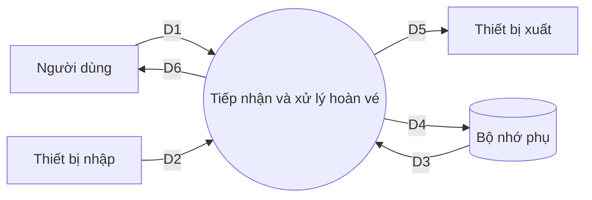

_Hình 2.10: Sơ đồ luồng dữ liệu cho yêu cầu Tiếp nhận và xử lý yêu cầu hoàn vé_

#### 3. Mô tả các luồng dữ liệu

- **D1:** Từ khách: mã đặt chỗ, chiều, lý do. Từ Staff: yêu cầu hoàn, thao tác, lý do từ chối hoặc ghi chú.
- **D2:** Kết quả của VNPay Refund API cho từng lượt hoàn.
- **D3:** Booking, chiều, các chặng và giờ cất cánh, snapshot gói giá, tiền vé, hành lý và mức giảm của chiều; tham số `aftersales.min_hours_before_departure`; các yêu cầu hoàn và đổi đang mở của chiều; yêu cầu hoàn (trạng thái, nguồn, số tiền); các lượt thu thành công của booking và số tiền đã hoàn của từng lượt.
- **D4:** Yêu cầu hoàn mới (`PENDING`, nguồn `CUSTOMER`, các khoản tiền đã chốt) hoặc cập nhật yêu cầu (`APPROVED`, `REJECTED`, `COMPLETED`, lỗi gần nhất, người và thời điểm xử lý, ghi chú); các chặng `CANCELLED`, chiều `REFUNDED`, booking `REFUNDED`; số ghế còn tăng lên (bảng `flight_cabins`); các lượt hoàn (bảng `payments`, `kind = REFUND`, nhà cung cấp `VNPAY` hoặc `MANUAL`).
- **D5:** Yêu cầu hoàn tiền gửi tới VNPay Refund API; email "Từ chối hoàn" hoặc "Đã hoàn tiền" gửi qua máy chủ SMTP.
- **D6:** Với khách: giá trị chiều, phí hoàn, số tiền được hoàn và yêu cầu vừa gửi. Với Staff: chi tiết yêu cầu sau khi xử lý. Hoặc thông báo lỗi: gói giá không cho hoàn (`FARE_RULE_NOT_ALLOWED`), quá hạn hoàn (`DEADLINE_PASSED`), chiều đang có yêu cầu hoàn hoặc đổi chưa xong (`REQUEST_IN_PROGRESS`), thao tác không hợp lệ với trạng thái hiện tại (`INVALID_STATE`), gọi VNPay thất bại (`PAYMENT_GATEWAY_ERROR`).

#### 4. Thuật toán

- **B1:** Nhận D1 từ người dùng.
- **B2:** Kết nối cơ sở dữ liệu.
- **B3:** Đọc D3 từ bộ nhớ phụ, khóa booking và yêu cầu hoàn liên quan.
- **B4:** Nếu khách gửi yêu cầu: kiểm tra theo `QĐ9.1`, vi phạm thì đến B14; tính các khoản tiền theo `QĐ9.2`; lưu yêu cầu `PENDING` nguồn `CUSTOMER`. Đến B13.
- **B5:** Nếu Staff từ chối: yêu cầu phải đang `PENDING`, có nguồn `CUSTOMER` (`QĐ9.6`) và có lý do (`QĐ9.4`), vi phạm thì đến B14; lưu yêu cầu `REJECTED` kèm lý do. Đến B12.
- **B6:** Nếu Staff xác nhận hoàn thủ công: yêu cầu phải đang `APPROVED` và có ghi chú theo `QĐ9.5`, vi phạm thì đến B14; lưu một lượt hoàn `MANUAL` thành công cho phần còn thiếu, chuyển yêu cầu sang `COMPLETED`. Đến B12.
- **B7:** Nếu Staff duyệt: yêu cầu phải đang `PENDING`, vi phạm thì đến B14. Trong một transaction: chuyển các chặng `ACTIVE` của chiều sang `CANCELLED` và trả ghế, chuyển chiều sang `REFUNDED`, chuyển booking sang `REFUNDED` nếu mọi chiều đều `REFUNDED`, chuyển yêu cầu sang `APPROVED` theo `QĐ9.3`; lưu D4 và commit. Đến B9.
- **B8:** Nếu Staff thử lại: yêu cầu phải đang `APPROVED`, vi phạm thì đến B14.
- **B9:** Khóa yêu cầu, tính số còn phải hoàn = số tiền hoàn − tổng các lượt hoàn thành công của yêu cầu. Nếu bằng 0 thì chuyển yêu cầu sang `COMPLETED`, đến B12.
- **B10:** Lấy các lượt thu còn hoàn được, lượt mới nhất trước (nguồn `INVALID_PAYMENT` thì chỉ lấy đúng lượt thu đó). Với từng lượt: xuất D5 yêu cầu hoàn min(số còn phải hoàn, phần chưa hoàn của lượt thu), nhận D2, lưu lượt hoàn `SUCCESS` hoặc `FAILED`.
- **B11:** Nếu đã hoàn đủ thì chuyển yêu cầu sang `COMPLETED`, đến B12. Nếu có lỗi thì giữ yêu cầu ở `APPROVED` và lưu lỗi gần nhất theo `QĐ9.5`, đến B14.
- **B12:** Sau khi commit, xuất D5 email "Từ chối hoàn" (yêu cầu `REJECTED`) hoặc "Đã hoàn tiền" (yêu cầu `COMPLETED`) tới email liên hệ.
- **B13:** Trả D6 kết quả cho người dùng. Đến B15.
- **B14:** Trả D6 thông báo lỗi cho người dùng.
- **B15:** Đóng kết nối cơ sở dữ liệu.
- **B16:** Kết thúc.

---

### 2.2.10. Yêu cầu 10: Đổi lịch trình chuyến bay

#### 1. Biểu mẫu và quy định liên quan

- **Biểu mẫu liên quan:** BM10 - Phiếu đổi lịch trình chuyến bay (màn hình `C-11 Đổi chuyến`).

_Bảng 2.11: Các trường dữ liệu của biểu mẫu BM10 (Đổi lịch trình)_

| STT | Tên trường       | Kiểu dữ liệu              | Bắt buộc | Ràng buộc / Ý nghĩa                                                         |
| :-- | :--------------- | :------------------------ | :------: |
| 1   | `code`           | Chuỗi 6 ký tự             |    Có    | Mã đặt chỗ                                                                  |
| 2   | `direction`      | Enum                      |    Có    | Chiều cần đổi: `OUTBOUND` hoặc `RETURN`                                     |
| 3   | `date`           | Ngày                      |    Có    | Ngày bay mới, dùng để lấy danh sách hành trình thay thế                     |
| 4   | `flightIds`      | Danh sách số nguyên (1–2) |    Có    | Các chuyến của hành trình thay thế đã chọn, gửi khi báo giá và khi xác nhận |
| 5   | `oldFareTotal`   | Số nguyên                 | Hệ thống | Tổng giá vé hiện tại của chiều (VND)                                        |
| 6   | `newFareTotal`   | Số nguyên                 | Hệ thống | Tổng giá vé mới (VND)                                                       |
| 7   | `changeFeeTotal` | Số nguyên                 | Hệ thống | Phí đổi (VND)                                                               |
| 8   | `amountDue`      | Số nguyên                 | Hệ thống | Số tiền phải trả = phí đổi + max(0, giá vé mới − giá vé hiện tại)           |

- **Quy định liên quan:** `QĐ10.1`, `QĐ10.2`, `QĐ10.3`, `QĐ10.4`, `QĐ10.5`, nội dung như mục 2.1.1.

#### 2. Sơ đồ luồng dữ liệu

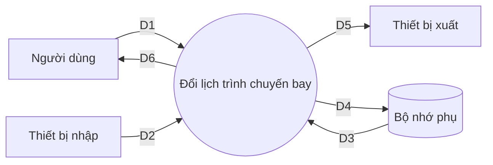

_Hình 2.11: Sơ đồ luồng dữ liệu cho yêu cầu Đổi lịch trình chuyến bay_

#### 3. Mô tả các luồng dữ liệu

- **D1:** Mã đặt chỗ, chiều, ngày bay mới, các chuyến của hành trình thay thế đã chọn, lệnh thanh toán.
- **D2:** Kết quả thanh toán do cổng VNPay gửi về (như D2 của YCNV-08).
- **D3:** Booking và chiều cần đổi (trạng thái, các chặng, giờ cất cánh, snapshot gói giá và phí đổi, tổng giá vé hiện tại), chiều còn lại, các yêu cầu hoàn và đổi đang mở; các chuyến thay thế (trạng thái, số ghế còn, giá bán); tham số `aftersales.min_hours_before_departure`, `booking.hold_minutes`, `booking.min_hours_before_departure`, `search.min_connection_minutes`, `search.max_connection_minutes`, `pricing.child_percent`, `pricing.infant_percent`.
- **D4:** Yêu cầu đổi (bảng `reschedules`: `PENDING_PAYMENT`, các khoản tiền, hạn thanh toán; sau đó `COMPLETED`); các chặng mới `PENDING_CHANGE` rồi `ACTIVE`, các chặng cũ `REPLACED` (bảng `booking_segments`); vé mới kèm giá vé và số vé (bảng `tickets`); số ghế còn (bảng `flight_cabins`); lượt thu phí đổi (bảng `payments`, gắn với yêu cầu đổi).
- **D5:** URL thanh toán gửi sang cổng VNPay; email đổi chuyến thành công gửi qua máy chủ SMTP.
- **D6:** Danh sách hành trình thay thế kèm số tiền phải trả; báo giá; kết quả đổi chuyến; hoặc thông báo lỗi.

#### 4. Thuật toán

- **B1:** Nhận D1 (chiều và ngày bay mới) từ người dùng.
- **B2:** Kết nối cơ sở dữ liệu.
- **B3:** Đọc D3 từ bộ nhớ phụ.
- **B4:** Kiểm tra chiều được đổi theo `QĐ10.1`. Nếu vi phạm thì đến B15.
- **B5:** Tìm hành trình như YCNV-06 với sân bay của chiều, ngày mới, số khách chiếm ghế và hạng ghế của chiều; lọc theo `QĐ10.2` (cùng hãng, cùng gói giá, bỏ hành trình trùng đúng các chuyến hiện tại, thứ tự với chiều còn lại); tính số tiền phải trả theo `QĐ10.3` cho mỗi hành trình. Trả D6 danh sách cho người dùng.
- **B6:** Nhận hành trình người dùng chọn. Kiểm tra lại `QĐ10.1` đến `QĐ10.3` và trả D6 báo giá. Nếu vi phạm thì đến B15.
- **B7:** Khi người dùng xác nhận, mở transaction: khóa chia sẻ các chuyến mới, khóa booking, giữ ghế trên các chuyến mới (thiếu ghế thì rollback và đến B15), tạo các chặng mới `PENDING_CHANGE` và vé mới với giá hiện hành, lưu yêu cầu đổi `PENDING_PAYMENT` với hạn thanh toán = thời điểm hiện tại + `booking.hold_minutes` phút theo `QĐ10.4`.
- **B8:** Nếu số tiền phải trả bằng 0 thì đến B12 trong cùng transaction.
- **B9:** Commit. Khi người dùng bấm thanh toán: lưu lượt thu, xuất D5 URL thanh toán và chuyển người dùng sang VNPay.
- **B10:** Nhận D2 và kiểm tra như B7–B10 của YCNV-08. Nếu thanh toán thất bại thì yêu cầu đổi vẫn chờ thanh toán và người dùng thử lại được trong hạn. Đến B14.
- **B11:** Thanh toán thành công: nếu yêu cầu đổi không còn `PENDING_PAYMENT` thì tạo yêu cầu hoàn `INVALID_PAYMENT` theo `QĐ8.4` và đến B14.
- **B12:** Hoàn tất đổi theo `QĐ10.5`: chuyển các chặng cũ sang `REPLACED` và trả ghế, chuyển các chặng mới sang `ACTIVE`, cấp số vé cho các vé mới, chuyển yêu cầu đổi sang `COMPLETED`. Lưu D4 và commit.
- **B13:** Xuất D5 email đổi chuyến thành công tới email liên hệ.
- **B14:** Trả D6 kết quả cho người dùng. Đến B16.
- **B15:** Trả D6 thông báo lỗi cho người dùng.
- **B16:** Đóng kết nối cơ sở dữ liệu.
- **B17:** Kết thúc.

Yêu cầu đổi quá hạn thanh toán do tiến trình định kỳ xử lý theo `QĐ10.5`: sau hạn thanh toán 5 phút, yêu cầu chuyển `EXPIRED`, các chặng mới chuyển `CANCELLED` và trả ghế.

---

### 2.2.11. Yêu cầu 11: Lập báo cáo doanh thu và dòng tiền

#### 1. Biểu mẫu và quy định liên quan

- **Biểu mẫu liên quan:** BM11 - Báo cáo kinh doanh (màn hình `A-10 Báo cáo`, 3 tab: dòng tiền, doanh số vé, tỉ lệ lấp đầy).

_Bảng 2.12: Các trường dữ liệu của biểu mẫu BM11 (Báo cáo kinh doanh)_

| STT | Tên trường                                         | Kiểu dữ liệu       |           Bắt buộc           | Ràng buộc / Ý nghĩa                                                              |
| :-- | :------------------------------------------------- | :----------------- | :--------------------------: |
| 1   | Loại báo cáo                                       | Lựa chọn (tab)     |              Có              | Dòng tiền, doanh số vé hoặc tỉ lệ lấp đầy                                        |
| 2   | `from`                                             | Ngày               |              Có              | Ngày đầu kỳ (giờ Việt Nam)                                                       |
| 3   | `to`                                               | Ngày               |              Có              | Ngày cuối kỳ (giờ Việt Nam), không trước `from`                                  |
| 4   | `groupBy`                                          | Enum               | Có với dòng tiền và doanh số | Dòng tiền: `DAY`, `MONTH`, `YEAR`; doanh số vé: `AIRLINE`, `ROUTE`               |
| 5   | `airline`                                          | Chuỗi 2 ký tự      |            Không             | Lọc theo hãng, chỉ với tỉ lệ lấp đầy                                             |
| 6   | `charged`, `refunded`, `net`                       | Số nguyên          |           Hệ thống           | Dòng tiền từng kỳ: tổng thu, tổng hoàn, doanh thu ròng (VND); kèm tổng cả khoảng |
| 7   | `ticketCount`, `revenue`                           | Số nguyên          |           Hệ thống           | Doanh số từng nhóm: số vé và tổng giá vé (VND); kèm tổng cả khoảng               |
| 8   | `totalSeats`, `occupiedSeats`, `loadFactorPercent` | Số nguyên, số thực |           Hệ thống           | Tỉ lệ lấp đầy từng chuyến: tổng ghế, ghế đã lấp, tỉ lệ (%)                       |

- **Quy định liên quan:** `QĐ11.1`, `QĐ11.2`, `QĐ11.3`, nội dung như mục 2.1.1.

#### 2. Sơ đồ luồng dữ liệu

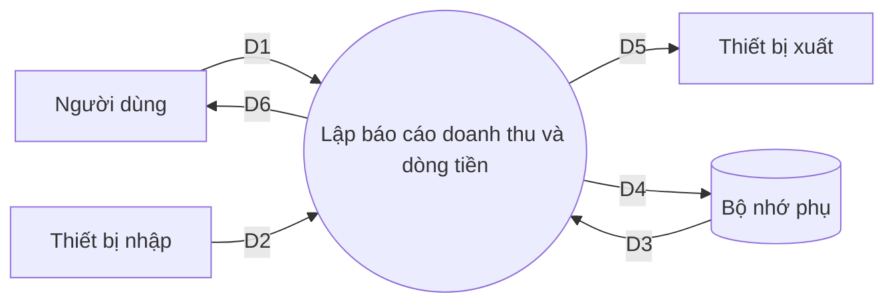

_Hình 2.12: Sơ đồ luồng dữ liệu cho yêu cầu Lập báo cáo doanh thu và dòng tiền_

#### 3. Mô tả các luồng dữ liệu

- **D1:** Loại báo cáo, ngày đầu kỳ, ngày cuối kỳ, cách nhóm (dòng tiền, doanh số) hoặc hãng (tỉ lệ lấp đầy).
- **D2:** Không có.
- **D3:** Các giao dịch thu và hoàn thành công trong kỳ (bảng `payments`); các vé đã xuất trong kỳ cùng chặng, chuyến, hãng và tuyến (bảng `tickets`, `booking_segments`, `flights`); các chuyến `SCHEDULED` cất cánh trong kỳ và số ghế (bảng `flights`, `flight_cabins`).
- **D4:** Không có.
- **D5:** Không có.
- **D6:** Bảng số liệu của báo cáo đã chọn (dòng 6, 7 hoặc 8 của Bảng 2.12), hoặc thông báo lỗi theo trường.

#### 4. Thuật toán

- **B1:** Nhận D1 từ người dùng.
- **B2:** Kết nối cơ sở dữ liệu.
- **B3:** Đọc D3 từ bộ nhớ phụ.
- **B4:** Kiểm tra có đủ ngày đầu và ngày cuối kỳ, ngày cuối không trước ngày đầu. Nếu vi phạm thì đến B9. Kỳ báo cáo tính từ 0 giờ ngày đầu đến hết ngày cuối, theo giờ Việt Nam.
- **B5:** Nếu là dòng tiền: theo `QĐ11.1`, nhóm các giao dịch thành công theo ngày, tháng hoặc năm của thời điểm hoàn tất; mỗi nhóm tính tổng thu (`kind = CHARGE`), tổng hoàn (`kind = REFUND`, gồm cả hoàn thủ công) và doanh thu ròng.
- **B6:** Nếu là doanh số vé: theo `QĐ11.2`, lấy các vé xuất trong kỳ thuộc chặng `ACTIVE`, nhóm theo hãng hoặc theo tuyến, tính số vé và tổng giá vé.
- **B7:** Nếu là tỉ lệ lấp đầy: theo `QĐ11.3`, với mỗi chuyến `SCHEDULED` cất cánh trong kỳ (lọc theo hãng nếu có), tính (tổng ghế − ghế còn) / tổng ghế.
- **B8:** Trả D6 bảng số liệu cho người dùng. Đến B10.
- **B9:** Trả D6 thông báo lỗi cho người dùng.
- **B10:** Đóng kết nối cơ sở dữ liệu.
- **B11:** Kết thúc.

---

### 2.2.12. Yêu cầu 12: Tra cứu booking

#### 1. Biểu mẫu và quy định liên quan

- **Biểu mẫu liên quan:** BM12 - Phiếu tra cứu booking (màn hình `C-08 Booking của tôi`, `C-09 Chi tiết booking`, `S-01 Tra cứu booking`, `S-02 Chi tiết booking`).

_Bảng 2.13: Các trường dữ liệu của biểu mẫu BM12 (Tra cứu booking)_

| STT | Tên trường | Kiểu dữ liệu  |     Bắt buộc     | Ràng buộc / Ý nghĩa                                                                                                |
| :-- | :--------- | :------------ | :--------------: |
| 1   | `q`        | Chuỗi         |      Không       | Chỉ ở `S-01`: mã đặt chỗ, email liên hệ (không phân biệt hoa thường) hoặc số điện thoại liên hệ, so khớp chính xác |
| 2   | `status`   | Enum          |      Không       | Lọc theo trạng thái: `PENDING_PAYMENT`, `ISSUED`, `EXPIRED`, `CANCELLED`, `REFUNDED`                               |
| 3   | Trang      | Số nguyên     |      Không       | Phân trang, 20 booking mỗi trang                                                                                   |
| 4   | `code`     | Chuỗi 6 ký tự | Khi xem chi tiết | Mã đặt chỗ cần xem                                                                                                 |

- **Quy định liên quan:** `QĐ12.1`, `QĐ12.2`, nội dung như mục 2.1.1.

#### 2. Sơ đồ luồng dữ liệu

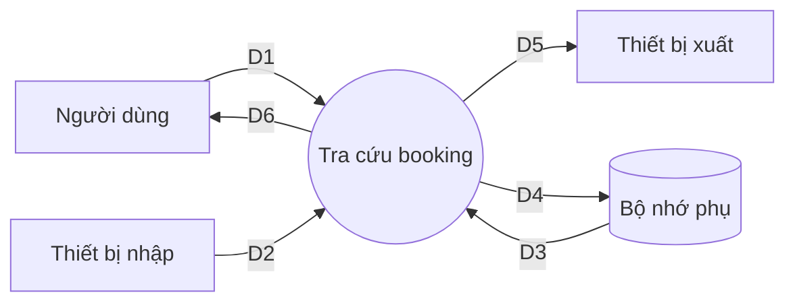

_Hình 2.13: Sơ đồ luồng dữ liệu cho yêu cầu Tra cứu booking_

#### 3. Mô tả các luồng dữ liệu

- **D1:** Tiêu chí tìm (từ khóa, trạng thái, trang) hoặc mã đặt chỗ cần xem; kèm tài khoản đang đăng nhập.
- **D2:** Không có.
- **D3:** Các booking (bảng `bookings`) cùng chiều, chặng, chuyến, hành khách, vé, hành lý, lượt thu và hoàn, yêu cầu hoàn và đổi; tài khoản đã đặt (bảng `users`, chỉ với Staff).
- **D4:** Không có.
- **D5:** Không có.
- **D6:** Danh sách booking (mã đặt chỗ, trạng thái, thông tin liên hệ, tổng tiền, tuyến, ngày bay) hoặc chi tiết một booking theo `QĐ12.2`; hoặc thông báo lỗi không tìm thấy booking (`RESOURCE_NOT_FOUND`).

#### 4. Thuật toán

- **B1:** Nhận D1 từ người dùng.
- **B2:** Kết nối cơ sở dữ liệu.
- **B3:** Đọc D3 từ bộ nhớ phụ theo tiêu chí: Customer chỉ đọc booking của chính mình theo `QĐ12.1`; Staff đọc mọi booking khớp từ khóa theo `QĐ12.2`; lọc theo trạng thái nếu có.
- **B4:** Nếu xem chi tiết mà không tìm thấy booking (kể cả booking của người khác với Customer) thì đến B7.
- **B5:** Với danh sách: sắp xếp mới nhất trước, lấy đúng trang yêu cầu theo `QĐ12.2`.
- **B6:** Trả D6 cho người dùng. Đến B8.
- **B7:** Trả D6 thông báo lỗi không tìm thấy booking (`RESOURCE_NOT_FOUND`).
- **B8:** Đóng kết nối cơ sở dữ liệu.
- **B9:** Kết thúc.

---

### 2.2.13. Yêu cầu 13: Hủy chuyến bay

#### 1. Biểu mẫu và quy định liên quan

- **Biểu mẫu liên quan:** BM13 - Phiếu hủy chuyến bay (màn hình `A-06 Chi tiết chuyến`).

_Bảng 2.14: Các trường dữ liệu của biểu mẫu BM13 (Hủy chuyến bay)_

| STT | Tên trường   | Kiểu dữ liệu    | Bắt buộc | Ràng buộc / Ý nghĩa                          |
| :-- | :----------- | :-------------- | :------: |
| 1   | `id`         | Số nguyên       |    Có    | Mã chuyến cần hủy (chuyến đang xem ở `A-06`) |
| 2   | Xác nhận hủy | Thao tác 2 bước |    Có    | Admin xác nhận hai lần trước khi gửi yêu cầu |
| 3   | `status`     | Enum            | Hệ thống | Trạng thái chuyến sau khi hủy: `CANCELLED`   |

- **Quy định liên quan:** `QĐ13.1`, `QĐ13.2`, nội dung như mục 2.1.1.

#### 2. Sơ đồ luồng dữ liệu

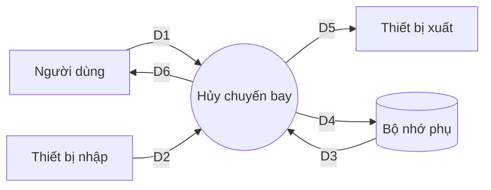

_Hình 2.14: Sơ đồ luồng dữ liệu cho yêu cầu Hủy chuyến bay_

#### 3. Mô tả các luồng dữ liệu

- **D1:** Mã chuyến cần hủy và xác nhận của Admin.
- **D2:** Không có.
- **D3:** Chuyến (trạng thái, giờ cất cánh); các booking `PENDING_PAYMENT` có chặng trên chuyến và voucher của chúng; các yêu cầu đổi `PENDING_PAYMENT` có chặng cũ hoặc chặng mới trên chuyến; các chiều `ACTIVE` của booking `ISSUED` có chặng trên chuyến, giá trị chiều và yêu cầu hoàn `PENDING` của chiều.
- **D4:** Chuyến `CANCELLED`; booking `CANCELLED` cùng các chặng `CANCELLED`, số ghế còn tăng lên và số lượt đã dùng của voucher giảm đi; yêu cầu đổi `CANCELLED` cùng các chặng mới `CANCELLED` và trả ghế; yêu cầu hoàn nguồn `FLIGHT_CANCELLED`, phí 0 (tạo mới hoặc chuyển từ yêu cầu `PENDING` của khách và tính lại số tiền).
- **D5:** Email "Chuyến bay bị hủy" gửi qua máy chủ SMTP tới email liên hệ của các booking `ISSUED` bị ảnh hưởng.
- **D6:** Thông tin chuyến ở trạng thái `CANCELLED`, hoặc thông báo lỗi: chuyến đã bị hủy (`INVALID_STATE`), chuyến đã cất cánh (`DEADLINE_PASSED`).

#### 4. Thuật toán

- **B1:** Nhận D1 từ người dùng.
- **B2:** Kết nối cơ sở dữ liệu.
- **B3:** Mở transaction, đọc D3 từ bộ nhớ phụ, khóa chuyến.
- **B4:** Kiểm tra theo `QĐ13.1`: chuyến đã bị hủy hoặc đã cất cánh thì rollback và đến B11.
- **B5:** Chuyển chuyến sang `CANCELLED`.
- **B6:** Theo `QĐ13.2` (a): khóa các booking bị ảnh hưởng theo mã tăng dần; với mỗi booking `PENDING_PAYMENT`, chuyển các chặng sang `CANCELLED`, trả ghế, trả lượt voucher và chuyển booking sang `CANCELLED`.
- **B7:** Theo `QĐ13.2` (b): với mỗi yêu cầu đổi `PENDING_PAYMENT` có chặng cũ hoặc chặng mới trên chuyến, chuyển yêu cầu và các chặng mới sang `CANCELLED`, trả ghế các chặng mới.
- **B8:** Theo `QĐ13.2` (c): với mỗi chiều `ACTIVE` của booking `ISSUED` có chặng trên chuyến, nếu đã có yêu cầu hoàn `PENDING` thì chuyển nguồn sang `FLIGHT_CANCELLED`, phí 0 và tính lại số tiền; nếu chưa có thì tạo yêu cầu mới nguồn `FLIGHT_CANCELLED`, phí 0, số tiền bằng giá trị chiều. Lưu D4 xuống bộ nhớ phụ và commit. Nếu transaction gặp deadlock thì thử lại từ B3, tối đa 3 lần.
- **B9:** Theo `QĐ13.2` (d): xuất D5 email "Chuyến bay bị hủy".
- **B10:** Trả D6 thông tin chuyến cho người dùng. Đến B12.
- **B11:** Trả D6 thông báo lỗi cho người dùng.
- **B12:** Đóng kết nối cơ sở dữ liệu.
- **B13:** Kết thúc.

---

### 2.2.14. Mô hình hóa yêu cầu thay đổi quy định

Mỗi tham số hệ thống liệt kê ở mục 2.1.2 là một quy định Admin thay đổi được. Admin sửa từng tham số tại màn hình `A-09 Tham số hệ thống` (biểu mẫu BM14). Giá trị mới chỉ áp dụng cho giao dịch tạo sau thời điểm thay đổi.

_Bảng 2.15: Các trường dữ liệu của biểu mẫu BM14 (Tham số hệ thống)_

| STT | Khóa tham số (`key`)                    | Mặc định | Khoảng hợp lệ | Diễn giải                                                          | Quy định bị thay đổi       |
| :-- | :-------------------------------------- | :------: | :-----------: | :----------------------------------------------------------------- |
| 1   | `booking.hold_minutes`                  |    15    |     5–60      | Thời gian giữ chỗ, đồng thời là hạn thanh toán đổi chuyến (phút)   | `QĐ7.5`, `QĐ8.1`, `QĐ10.4` |
| 2   | `booking.min_hours_before_departure`    |    3     |     0–72      | Không bán chuyến cất cánh trong vòng N giờ tới                     | `QĐ6.1`                    |
| 3   | `booking.max_seated_passengers`         |    9     |      1–9      | Số khách chiếm ghế tối đa trong một booking                        | `QĐ6.5`, `QĐ7.1`           |
| 4   | `pricing.child_percent`                 |    90    |     0–100     | Giá vé trẻ em theo % giá người lớn                                 | `QĐ6.5`, `QĐ7.3`           |
| 5   | `pricing.infant_percent`                |    10    |     0–100     | Giá vé em bé theo % giá người lớn                                  | `QĐ6.5`, `QĐ7.3`           |
| 6   | `aftersales.min_hours_before_departure` |    24    |     0–168     | Hạn chót hoàn hoặc đổi, tính trước giờ cất cánh (giờ)              | `QĐ9.1`, `QĐ10.1`          |
| 7   | `search.min_connection_minutes`         |    60    |    30–600     | Thời gian nối chuyến tối thiểu (phút), phải nhỏ hơn giá trị tối đa | `QĐ6.2`                    |
| 8   | `search.max_connection_minutes`         |   720    |    60–1440    | Thời gian nối chuyến tối đa (phút), phải lớn hơn giá trị tối thiểu | `QĐ6.2`                    |

Tám DFD dưới đây có cùng cấu trúc. Với mỗi tham số:

- **D1:** Giá trị mới của tham số.
- **D2:** Không có.
- **D3:** Giá trị hiện tại của tham số (bảng `system_settings`); riêng hai tham số nối chuyến đọc thêm giá trị hiện tại của tham số còn lại.
- **D4:** Giá trị mới, tài khoản người sửa (`updated_by`), thời điểm sửa (`updated_at`).
- **D5:** Không có.
- **D6:** Thông báo cập nhật thành công, hoặc thông báo lỗi giá trị nằm ngoài khoảng hợp lệ (`SETTING_OUT_OF_RANGE`).

Thuật toán chung:

- **B1:** Nhận D1 từ người dùng.
- **B2:** Kết nối cơ sở dữ liệu.
- **B3:** Đọc D3 từ bộ nhớ phụ.
- **B4:** Kiểm tra D1 nằm trong khoảng hợp lệ của tham số (Bảng 2.15), kèm điều kiện riêng của tham số nếu có. Nếu vi phạm thì đến B7.
- **B5:** Lưu D4 xuống bộ nhớ phụ và làm mới cache tham số.
- **B6:** Trả D6 thông báo thành công cho người dùng. Đến B8.
- **B7:** Trả D6 thông báo lỗi cho người dùng.
- **B8:** Đóng kết nối cơ sở dữ liệu.
- **B9:** Kết thúc.

#### 1. Thay đổi thời gian giữ chỗ (`booking.hold_minutes`)

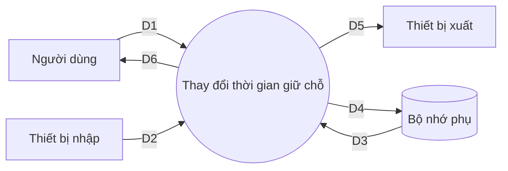

_Hình 2.15: Sơ đồ luồng dữ liệu thay đổi thời gian giữ chỗ_

- **D1:** Thời gian giữ chỗ mới (phút).
- **D3:** Giá trị hiện tại của `booking.hold_minutes`.
- **B4:** D1 thuộc đoạn [5, 60].

#### 2. Thay đổi thời gian tối thiểu trước giờ cất cánh để bán vé (`booking.min_hours_before_departure`)


_Hình 2.16: Sơ đồ luồng dữ liệu thay đổi thời gian tối thiểu trước giờ cất cánh để bán vé_

- **D1:** Số giờ tối thiểu mới.
- **D3:** Giá trị hiện tại của `booking.min_hours_before_departure`.
- **B4:** D1 thuộc đoạn [0, 72].

#### 3. Thay đổi số khách chiếm ghế tối đa (`booking.max_seated_passengers`)

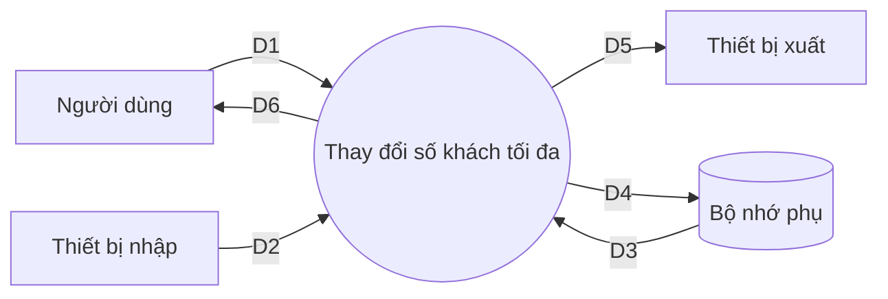

_Hình 2.17: Sơ đồ luồng dữ liệu thay đổi số khách chiếm ghế tối đa_

- **D1:** Số khách chiếm ghế tối đa mới.
- **D3:** Giá trị hiện tại của `booking.max_seated_passengers`.
- **B4:** D1 thuộc đoạn [1, 9].

#### 4. Thay đổi tỉ lệ giá vé trẻ em (`pricing.child_percent`)

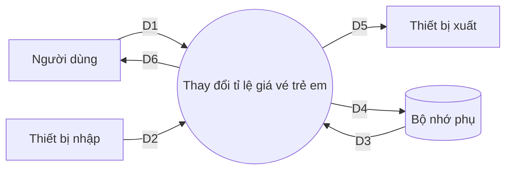

_Hình 2.18: Sơ đồ luồng dữ liệu thay đổi tỉ lệ giá vé trẻ em_

- **D1:** Tỉ lệ giá vé trẻ em mới (%).
- **D3:** Giá trị hiện tại của `pricing.child_percent`.
- **B4:** D1 thuộc đoạn [0, 100].

#### 5. Thay đổi tỉ lệ giá vé em bé (`pricing.infant_percent`)

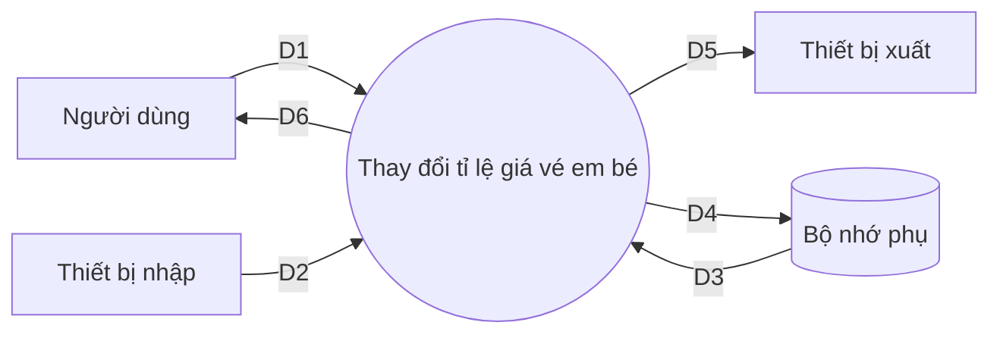

_Hình 2.19: Sơ đồ luồng dữ liệu thay đổi tỉ lệ giá vé em bé_

- **D1:** Tỉ lệ giá vé em bé mới (%).
- **D3:** Giá trị hiện tại của `pricing.infant_percent`.
- **B4:** D1 thuộc đoạn [0, 100].

#### 6. Thay đổi hạn chót hoàn và đổi vé (`aftersales.min_hours_before_departure`)

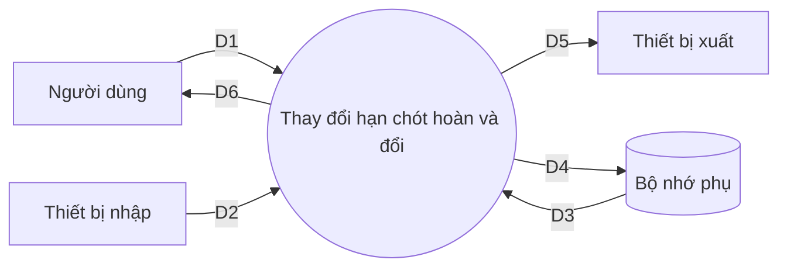

_Hình 2.20: Sơ đồ luồng dữ liệu thay đổi hạn chót hoàn và đổi vé_

- **D1:** Số giờ tối thiểu trước giờ cất cánh mới.
- **D3:** Giá trị hiện tại của `aftersales.min_hours_before_departure`.
- **B4:** D1 thuộc đoạn [0, 168].

#### 7. Thay đổi thời gian nối chuyến tối thiểu (`search.min_connection_minutes`)

```mermaid
flowchart LR
    U["Người dùng"]
    IN["Thiết bị nhập"]
    OUT["Thiết bị xuất"]
    P(("Thay đổi thời gian nối chuyến tối thiểu"))
    DB[("Bộ nhớ phụ")]
    U -- D1 --> P
    P -- D6 --> U
    IN -- D2 --> P
    P -- D5 --> OUT
    DB -- D3 --> P
    P -- D4 --> DB
```

_Hình 2.21: Sơ đồ luồng dữ liệu thay đổi thời gian nối chuyến tối thiểu_

- **D1:** Thời gian nối chuyến tối thiểu mới (phút).
- **D3:** Giá trị hiện tại của `search.min_connection_minutes` và `search.max_connection_minutes`.
- **B4:** D1 thuộc đoạn [30, 600] và nhỏ hơn giá trị hiện tại của `search.max_connection_minutes`.

#### 8. Thay đổi thời gian nối chuyến tối đa (`search.max_connection_minutes`)

```mermaid
flowchart LR
    U["Người dùng"]
    IN["Thiết bị nhập"]
    OUT["Thiết bị xuất"]
    P(("Thay đổi thời gian nối chuyến tối đa"))
    DB[("Bộ nhớ phụ")]
    U -- D1 --> P
    P -- D6 --> U
    IN -- D2 --> P
    P -- D5 --> OUT
    DB -- D3 --> P
    P -- D4 --> DB
```

_Hình 2.22: Sơ đồ luồng dữ liệu thay đổi thời gian nối chuyến tối đa_

- **D1:** Thời gian nối chuyến tối đa mới (phút).
- **D3:** Giá trị hiện tại của `search.max_connection_minutes` và `search.min_connection_minutes`.
- **B4:** D1 thuộc đoạn [60, 1440] và lớn hơn giá trị hiện tại của `search.min_connection_minutes`.
