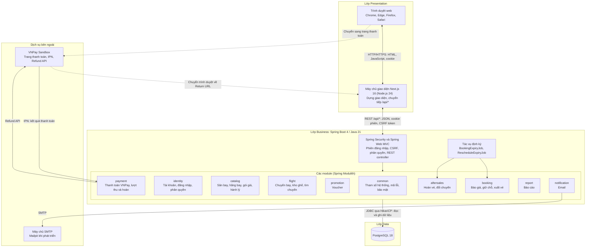

# Chương 3. Thiết kế hệ thống

Chương này trình bày kiến trúc của hệ thống SkyLine theo ba bước thiết kế kiến trúc của môn học: phân rã hệ thống thành các thành phần, bố trí các thành phần và thiết lập quan hệ giữa các thành phần. Hệ thống dùng **kiến trúc 3 lớp** (Presentation, Business, Data) theo mô hình **Client – Server**. Lớp Business là một ứng dụng Spring Boot tổ chức theo kiểu **modular monolith**: một ứng dụng duy nhất, chia thành các module có ranh giới rõ ràng.

---

## 3.1. Kiến trúc hệ thống

### 3.1.1. Các bước thiết kế kiến trúc hệ thống

1. **Phân rã hệ thống.** Hệ thống được chia thành bốn nhóm thành phần theo chức năng:
   - Giao diện người dùng: hiển thị dữ liệu và nhận thao tác của khách hàng, nhân viên và quản trị viên.
   - Xử lý nghiệp vụ: kiểm tra quy định, tính giá, giữ chỗ, thanh toán, hoàn vé, đổi chuyến, báo cáo, xác thực và phân quyền.
   - Lưu trữ dữ liệu.
   - Dịch vụ bên ngoài: cổng thanh toán và máy chủ thư điện tử.

2. **Bố trí các thành phần.** Các nhóm trên được bố trí vào ba lớp và nhóm dịch vụ bên ngoài:
   - **Lớp Presentation:** trình duyệt web của người dùng và máy chủ giao diện Next.js (chạy trên Node.js).
   - **Lớp Business:** máy chủ ứng dụng Spring Boot (Java 21).
   - **Lớp Data:** hệ quản trị cơ sở dữ liệu PostgreSQL 18.
   - **Dịch vụ bên ngoài:** VNPay Sandbox (môi trường thử nghiệm của cổng thanh toán VNPay) và máy chủ SMTP (Simple Mail Transfer Protocol, giao thức gửi thư điện tử). Môi trường phát triển dùng Mailpit làm máy chủ SMTP.
   - Khi triển khai, PostgreSQL, Mailpit, Spring Boot và Next.js chạy thành bốn container Docker do Docker Compose khởi động. Backend chỉ khởi động khi PostgreSQL đã nhận kết nối, frontend chỉ khởi động khi backend đã sẵn sàng (cơ chế `healthcheck`).

3. **Thiết lập quan hệ giữa các thành phần.**
   - Trình duyệt và Next.js giao tiếp qua HTTP/HTTPS: Next.js trả về HTML, mã JavaScript của React và tài nguyên tĩnh.
   - Trình duyệt và Next.js gọi Spring Boot qua REST API (Representational State Transfer, kiểu API dùng các phương thức HTTP `GET`, `POST`... trên tài nguyên; API là Application Programming Interface, giao diện lập trình ứng dụng). Dữ liệu trao đổi ở dạng JSON (JavaScript Object Notation). Mọi request có tiền tố `/api/*` đi tới Next.js, rồi được Next.js chuyển tiếp (rewrite) sang Spring Boot. Request thay đổi dữ liệu kèm cookie phiên đăng nhập và CSRF token (Cross-Site Request Forgery, tấn công giả mạo request từ trang web khác; xem mục 3.1.4).
   - Spring Boot kết nối PostgreSQL qua JDBC (Java Database Connectivity), dùng pool kết nối HikariCP.
   - Spring Boot và VNPay: tham số thanh toán được ký bằng HMAC-SHA512 (mã xác thực thông điệp dùng hàm băm SHA-512). VNPay báo kết quả thanh toán qua hai đường: IPN (Instant Payment Notification, VNPay gọi thẳng máy chủ backend) và Return URL (VNPay chuyển trình duyệt của khách về hệ thống). Khi hoàn tiền, Spring Boot gọi Refund API của VNPay.
   - Spring Boot gửi email qua giao thức SMTP.

---

### 3.1.2. Lựa chọn mô hình kiến trúc

#### 1. Kiến trúc 3 lớp theo mô hình Client – Server

- **Lớp Presentation:** hiển thị dữ liệu và nhận thao tác của người dùng. Lớp này không tính giá và không quyết định trạng thái booking. Nó chỉ lọc và sắp xếp lại kết quả tìm kiếm đã nhận từ server.
- **Lớp Business:** thực hiện 13 yêu cầu nghiệp vụ `YCNV-01` đến `YCNV-13` của chương 2, xác thực người dùng, phân quyền, giữ chỗ, tính giá và điều phối giao dịch.
- **Lớp Data:** lưu dữ liệu, bảo đảm toàn vẹn bằng các ràng buộc (khóa chính, khóa ngoại, `UNIQUE`, `CHECK`, `NOT NULL`) và thực hiện giao dịch theo tính chất ACID (Atomicity, Consistency, Isolation, Durability: tính nguyên tử, nhất quán, cô lập và bền vững).

Theo mô hình Client – Server, phía client là trình duyệt cùng máy chủ Next.js dựng giao diện, phía server là Spring Boot giữ dữ liệu và xử lý nghiệp vụ. Next.js dùng App Router với hai loại thành phần:

- **Server Components:** dựng HTML ở máy chủ Next.js, ví dụ các trang chính sách.
- **Client Components:** chạy trên trình duyệt cho các phần tương tác: đếm ngược hạn giữ chỗ ở `C-09` (Chi tiết booking), lọc và sắp xếp kết quả ở `C-02` (Kết quả tìm kiếm), lưu chuyến bay đã chọn vào `sessionStorage` của trình duyệt trong lúc đặt vé.

#### 2. Modular monolith ở lớp Business

- Toàn bộ backend là một ứng dụng chạy trong một tiến trình. Các module gọi nhau bằng lời gọi hàm trong bộ nhớ và cùng tham gia một transaction cơ sở dữ liệu, nên không cần giao dịch phân tán như kiến trúc microservices.
- Backend gồm 10 module: `common`, `identity`, `catalog`, `flight`, `promotion`, `booking`, `payment`, `aftersales`, `report`, `notification`. Thư viện Spring Modulith quy định ranh giới module: module khác chỉ được dùng các lớp ở gói gốc của module (public API). Các gói con `web` (controller và DTO, Data Transfer Object: đối tượng chở dữ liệu request/response), `domain` (entity và service) và `infra` (repository, client gọi dịch vụ ngoài) là nội bộ. Một test kiến trúc tự động kiểm tra quy tắc này và báo lỗi khi các module phụ thuộc vòng vào nhau.
- Mỗi bảng chỉ do một module ghi. Các module tham chiếu dữ liệu của nhau qua ID, không dùng quan hệ JPA (Java Persistence API, chuẩn ánh xạ đối tượng Java sang bảng) xuyên module; khóa ngoại trong cơ sở dữ liệu vẫn được giữ. Tác động xuyên module (xuất vé sau khi thanh toán, gửi email...) đi qua sự kiện nội bộ (mục 3.1.4).

---

### 3.1.3. Sơ đồ kiến trúc hệ thống



_Hình 3.1: Sơ đồ kiến trúc 3 lớp của hệ thống SkyLine_

---

### 3.1.4. Nguyên tắc tương tác giữa các thành phần

#### 1. Không gọi vượt lớp

Mỗi lớp chỉ gọi lớp liền kề: lớp Presentation gửi request tới lớp Business, chỉ lớp Business truy cập lớp Data. Trình duyệt và Next.js không kết nối thẳng tới PostgreSQL. Mọi thao tác đọc và ghi dữ liệu đi qua REST API của Spring Boot, nơi kiểm tra quyền và quy định nghiệp vụ.

#### 2. Một origin cho trình duyệt

- Trình duyệt chỉ làm việc với máy chủ Next.js (cổng `3000`). Next.js chuyển tiếp các request `/api/*` sang Spring Boot (cổng `8080`). Địa chỉ backend lấy từ biến môi trường `BACKEND_URL`, ví dụ `http://backend:8080` khi chạy bằng Docker Compose.
- Vì frontend và API có cùng origin, hệ thống không cần cấu hình CORS (Cross-Origin Resource Sharing, cơ chế cho phép trang web gọi API ở origin khác). Trình duyệt tự gửi kèm cookie phiên trong mọi request `/api/*`.

#### 3. Phiên đăng nhập và chống CSRF

- **Phiên đăng nhập:** sau khi người dùng đăng nhập ở `C-03` (Đăng nhập), Spring Security tạo phiên phía server và trình duyệt giữ cookie `JSESSIONID`. Cookie có thuộc tính `HttpOnly` (JavaScript không đọc được), `SameSite=Lax` (trình duyệt không gửi cookie trong các request do trang web khác tạo ra, trừ khi người dùng bấm link) và `Secure` (chỉ gửi qua HTTPS, bật bằng cấu hình khi triển khai thật). Phiên hết hạn sau 30 phút không hoạt động. Ở mỗi request đã đăng nhập, hệ thống kiểm tra lại trạng thái tài khoản; tài khoản đã bị khóa (`LOCKED`) thì phiên bị hủy và request bị từ chối.
- **Chống CSRF:** Spring Security đặt CSRF token vào cookie `XSRF-TOKEN`. Frontend đọc cookie này và gửi lại giá trị trong header `X-XSRF-TOKEN` ở mọi request `POST`, `PUT`, `PATCH`, `DELETE`. Trang web khác không đọc được cookie của SkyLine nên không tạo được request hợp lệ.

#### 4. Sự kiện nội bộ giữa các module

- **Listener đồng bộ (`@EventListener`):** chạy trong cùng transaction với nơi phát sự kiện. Ví dụ, khi VNPay báo thanh toán thành công, module `payment` phát sự kiện `PaymentSucceeded`; module `booking` nhận sự kiện và xuất vé. Nếu xuất vé lỗi, cả transaction bị rollback, kể cả kết quả thanh toán. Sự kiện hủy chuyến `FlightCancelled` cũng được `booking` và `aftersales` xử lý đồng bộ theo thứ tự cố định.
- **Listener bất đồng bộ (`@ApplicationModuleListener`):** chạy trên luồng riêng, sau khi transaction chính đã commit. Module `notification` dùng cơ chế này cho mọi email: vé điện tử, kết quả hoàn vé, đổi chuyến, chuyến bay đổi giờ hoặc bị hủy, đặt lại mật khẩu. Lỗi gửi email không làm hỏng giao dịch nghiệp vụ.

#### 5. Kiểm soát đồng thời

- Ghế được trừ bằng một câu `UPDATE` nguyên tử trên bảng kho ghế. Câu lệnh chỉ thành công khi còn đủ ghế, nên hai người đặt cùng lúc không thể làm số ghế còn âm:

  ```sql
  UPDATE flight_cabins
  SET available_seats = available_seats - :seats
  WHERE flight_id = :flightId AND cabin_class = :cabin AND available_seats >= :seats;
  ```

- Trước khi trừ ghế, hệ thống khóa chia sẻ các chuyến bay (`SELECT ... FOR SHARE`) và kiểm tra chuyến còn ở trạng thái `SCHEDULED` (đang mở bán). Khi Admin hủy chuyến (`YCNV-13`), hệ thống khóa độc quyền chuyến đó (`SELECT ... FOR UPDATE`). Hai loại khóa loại trừ nhau, nên không booking nào giữ được ghế trên chuyến vừa bị hủy.
- Mọi giao dịch khóa dữ liệu theo cùng một thứ tự để tránh deadlock (hai giao dịch chờ khóa của nhau): `flights` → `payments` → `bookings` → `refund_requests`/`reschedules` → `flight_cabins` → `vouchers`.

---

### 3.1.5. Luồng hoạt động qua các lớp

#### Luồng 1: Tra cứu chuyến bay (`YCNV-06`)

1. **Lớp Presentation:** người dùng nhập sân bay đi, sân bay đến, ngày đi, số hành khách và hạng ghế ở `C-01` (Tìm chuyến). Trình duyệt mở `C-02` (Kết quả tìm kiếm) và gửi `GET /api/flights/search` kèm các tham số; Next.js chuyển tiếp request sang Spring Boot.
2. **Lớp Business:** Spring Security cho request đi qua vì đây là API công khai. `FlightController` nhận tham số và gọi `FlightSearch` (module `flight`). `FlightSearch` kiểm tra số khách theo `QĐ6.5` và tính thời điểm cất cánh sớm nhất theo `QĐ6.1`.
3. **Lớp Data:** `FlightSearch` dùng `JdbcClient` (lớp thực thi câu SQL của Spring) truy vấn PostgreSQL: các chuyến bay thẳng, và các cặp chuyến nối cùng hãng, 1 điểm dừng, thời gian nối trong khoảng cho phép theo `QĐ6.2`; mỗi chặng còn đủ ghế theo `QĐ6.4`.
4. **Trả kết quả:** `FlightSearch` giữ các gói giá có trên mọi chặng (`QĐ6.4`), tính tổng giá cho toàn bộ hành khách (`QĐ6.5`) và sắp xếp hành trình theo giá thấp nhất tăng dần. Spring Boot trả JSON; `C-02` hiển thị danh sách, người dùng lọc và sắp xếp lại ngay trên trình duyệt.

#### Luồng 2: Đặt vé, giữ chỗ và thanh toán (`YCNV-07`, `YCNV-08`)

1. **Gửi yêu cầu đặt vé:** khách hàng nhập hành khách, thông tin liên hệ, hành lý mua thêm và voucher trên biểu mẫu `BM7` ở `C-07` (Đặt vé). Trình duyệt gửi `POST /api/bookings` dạng JSON kèm cookie `JSESSIONID` và header `X-XSRF-TOKEN`; Next.js chuyển tiếp sang Spring Boot.
2. **Giữ chỗ ở lớp Business:**
   - Spring Security kiểm tra phiên có vai trò `CUSTOMER` và CSRF token.
   - `BookingController` kiểm tra định dạng dữ liệu bằng Bean Validation (chuẩn khai báo ràng buộc trên lớp Java) rồi gọi `BookingService`.
   - `BookingService` kiểm tra hành trình theo `QĐ6.1` đến `QĐ6.4` (qua public API `FlightApi` của module `flight`), kiểm tra hành khách và thông tin liên hệ theo `QĐ7.1`, `QĐ7.2`, tính giá vé và tiền hành lý theo `QĐ7.3`, kiểm tra voucher theo `QĐ7.6`.
   - Trong một transaction: khóa chia sẻ các chuyến và kiểm tra lại trạng thái `SCHEDULED`; trừ ghế từng chặng bằng câu `UPDATE` nguyên tử (thiếu ghế thì rollback và báo lỗi); tăng số lượt đã dùng của voucher; sinh mã đặt chỗ theo `QĐ7.5`; lưu `bookings`, `booking_journeys`, `booking_segments`, `passengers`, `tickets`, `booking_baggage` với giá chốt theo `QĐ7.4`, trạng thái `PENDING_PAYMENT` (chờ thanh toán) và hạn giữ chỗ bằng thời điểm tạo cộng `booking.hold_minutes` phút (mặc định 15).
   - Sau khi commit, hệ thống trả mã đặt chỗ và hạn giữ chỗ cho khách.
3. **Tạo thanh toán:** khách bấm thanh toán ở `C-09` (Chi tiết booking). Module `payment` ghi một lượt thu trạng thái `PENDING` vào bảng `payments`, tạo URL thanh toán VNPay có chữ ký HMAC-SHA512 và hết hạn cùng lúc với hạn giữ chỗ (`QĐ8.1`). Trình duyệt chuyển sang trang thanh toán của VNPay Sandbox.
4. **Xác nhận thanh toán và xuất vé:**
   - VNPay gọi IPN `GET /api/payments/vnpay/ipn` tới Spring Boot. Module `payment` kiểm tra theo `QĐ8.2`: chữ ký hợp lệ, số tiền khớp, mã phản hồi của VNPay báo thành công; mỗi lượt thu chỉ được xử lý một lần. Nếu đạt, lượt thu chuyển `SUCCESS` và module phát sự kiện `PaymentSucceeded`.
   - Module `booking` nhận sự kiện trong cùng transaction: khóa booking (`SELECT ... FOR UPDATE`), chuyển trạng thái sang `ISSUED` (đã xuất vé), cấp cho mỗi hành khách trên mỗi chặng một số vé 13 chữ số theo `QĐ8.3`, rồi phát sự kiện `BookingIssued`.
   - Sau khi commit, module `notification` nhận `BookingIssued`, dựng email vé điện tử từ mẫu Thymeleaf (thư viện mẫu HTML) và gửi qua SMTP tới email liên hệ.
   - VNPay chuyển trình duyệt về Return URL `GET /api/payments/vnpay/return`. Spring Boot xử lý kết quả giống IPN (lượt thu đã xử lý thì không xử lý lại) rồi chuyển hướng về `C-09`, nơi hiển thị kết quả thanh toán và số vé.

---

## 3.2. Mô tả các thành phần trong hệ thống

_Bảng 3.1: Mô tả các thành phần trong hệ thống SkyLine_

| STT | Thành phần                        | Diễn giải                                                                                                                                                                                                                                                                                                                                |
| --- | --------------------------------- | ---------------------------------------------------------------------------------------------------------------------------------------------------------------------------------------------------------------------------------------------------------------------------------------------------------------------------------------- |
| 1   | Trình duyệt web                   | Thuộc lớp Presentation, chạy trên máy của người dùng (Chrome, Edge, Firefox, Safari). Hiển thị giao diện, nhận thao tác, giữ cookie phiên `JSESSIONID` và cookie `XSRF-TOKEN`, gửi request HTTP tới Next.js.                                                                                                                             |
| 2   | Máy chủ giao diện Next.js         | Thuộc lớp Presentation. Next.js 16 (React, TypeScript, Tailwind CSS) chạy trên Node.js 24. Dựng giao diện cho khách hàng, nhân viên và quản trị viên, và chuyển tiếp các request `/api/*` sang Spring Boot.                                                                                                                              |
| 3   | Máy chủ ứng dụng Spring Boot      | Thành phần chính của lớp Business: Spring Boot 4 trên Java 21, chứa các module nghiệp vụ ở dòng 5–14. Quản lý kết nối tới PostgreSQL bằng pool HikariCP.                                                                                                                                                                                 |
| 4   | Spring Security và Spring Web MVC | Chuỗi filter bảo mật kiểm tra phiên đăng nhập, CSRF token và quyền theo URL (`ADMIN` kế thừa mọi quyền của `STAFF`), rồi chuyển request tới REST controller. `GlobalExceptionHandler` đổi mọi lỗi nghiệp vụ thành JSON theo chuẩn RFC 9457 (chuẩn định dạng thông báo lỗi của HTTP API) kèm mã lỗi, để frontend hiển thị đúng thông báo. |
| 5   | Module `identity`                 | Tài khoản người dùng (`users`): đăng ký (`YCNV-01`), đăng nhập, đăng xuất, đặt lại mật khẩu bằng token gửi qua email (hiệu lực 30 phút, bảng `password_reset_tokens`), khóa và mở khóa tài khoản. Mật khẩu băm bằng BCrypt (thuật toán băm mật khẩu có muối).                                                                            |
| 6   | Module `catalog`                  | Danh mục dùng chung: sân bay (`YCNV-02`), hãng hàng không, gói giá (fare family) và bảng giá hành lý mua thêm (`YCNV-03`).                                                                                                                                                                                                               |
| 7   | Module `flight`                   | Lập lịch chuyến bay đơn lẻ hoặc lặp lại (`YCNV-04`), kho ghế theo hạng ghế, tìm chuyến bay thẳng và nối chuyến (`YCNV-06`), kiểm tra và định giá hành trình cho module `booking`, đổi giờ và hủy chuyến (`YCNV-13`), danh sách hành khách của chuyến cho nhân viên.                                                                      |
| 8   | Module `promotion`                | Quản lý voucher (`YCNV-05`): thời hạn, giá trị đơn tối thiểu, mức giảm, số lượt dùng tối đa. Mỗi tài khoản dùng một voucher tối đa một lần.                                                                                                                                                                                              |
| 9   | Module `booking`                  | Báo giá, giữ chỗ có thời hạn (`YCNV-07`), sinh mã đặt chỗ, lưu hành khách và hành lý, hủy booking đang chờ thanh toán, cấp số vé khi thanh toán thành công (`YCNV-08`), tra cứu booking cho khách và nhân viên (`YCNV-12`).                                                                                                              |
| 10  | Module `payment`                  | Tích hợp VNPay: tạo URL thanh toán có chữ ký HMAC-SHA512, xử lý IPN và Return URL (mỗi lượt thu chỉ xử lý một lần), gọi Refund API khi hoàn tiền. Lưu các lượt thu và lượt hoàn trong bảng `payments`.                                                                                                                                   |
| 11  | Module `aftersales`               | Báo giá và tiếp nhận yêu cầu hoàn vé, hàng đợi duyệt hoàn tiền cho nhân viên (`YCNV-09`); đổi chuyến và thanh toán tiền chênh lệch (`YCNV-10`). Tự tạo yêu cầu hoàn khi chuyến bị hủy (`YCNV-13`) hoặc khi khách thanh toán cho booking đã hết chờ thanh toán.                                                                           |
| 12  | Module `report`                   | Truy vấn SQL chỉ đọc bằng `JdbcClient` để lập báo cáo (`YCNV-11`): dòng tiền (tổng thu, tổng hoàn, doanh thu ròng), doanh số vé theo hãng hoặc theo tuyến, tỉ lệ lấp đầy ghế của chuyến.                                                                                                                                                 |
| 13  | Module `notification`             | Nhận sự kiện từ các module khác và gửi email bất đồng bộ qua SMTP từ mẫu Thymeleaf: vé điện tử, kết quả hoàn vé, đổi chuyến, chuyến bay đổi giờ hoặc bị hủy, liên kết đặt lại mật khẩu.                                                                                                                                                  |
| 14  | Module `common`                   | Module mở, mọi module khác được dùng. Đọc và ghi tham số hệ thống trong bảng `system_settings` (Admin đổi được mà không cần khởi động lại ứng dụng), định nghĩa mã lỗi và cấu hình bảo mật chung.                                                                                                                                        |
| 15  | Tác vụ định kỳ                    | Chạy trong Spring Boot, mỗi 60 giây một lần. `BookingExpiryJob` chuyển booking quá hạn giữ chỗ sang `EXPIRED`, trả ghế về kho và trả lượt dùng voucher. `RescheduleExpiryJob` hủy các yêu cầu đổi chuyến quá hạn thanh toán và trả ghế đã giữ cho chuyến mới.                                                                            |
| 16  | PostgreSQL 18                     | Lớp Data. Lưu toàn bộ dữ liệu, thực thi ràng buộc toàn vẹn, khóa dòng (`FOR SHARE`, `FOR UPDATE`) và giao dịch ACID. Cấu trúc bảng được tạo và nâng cấp bằng Flyway (công cụ quản lý phiên bản schema) khi Spring Boot khởi động; Hibernate chỉ kiểm tra entity khớp với bảng, không tự sửa bảng.                                        |
| 17  | VNPay Sandbox                     | Dịch vụ bên ngoài: cổng thanh toán trực tuyến ở chế độ thử nghiệm. Hiển thị trang thanh toán, báo kết quả qua IPN và Return URL, nhận yêu cầu hoàn tiền qua Refund API.                                                                                                                                                                  |
| 18  | Máy chủ SMTP (Mailpit)            | Dịch vụ bên ngoài: nhận email từ module `notification`. Khi phát triển, Mailpit nhận thư ở cổng 1025 và hiển thị trên giao diện web ở cổng 8025, không gửi thư ra Internet.                                                                                                                                                              |
