# Chương 4. Thiết kế dữ liệu

Chương này trình bày quá trình thiết kế cơ sở dữ liệu cho hệ thống SkyLine theo đúng phương pháp và thuật toán thiết kế dữ liệu được giảng dạy trong môn học Nhập môn Công nghệ Phần mềm. Quá trình thiết kế xuất phát từ các yêu cầu nghiệp vụ đã được mô hình hóa ở chương 2, lần lượt giải quyết ba mục tiêu cốt lõi: **tính đúng đắn**, **tính tiến hóa** và **yêu cầu hiệu quả** về thời gian truy xuất cũng như dung lượng lưu trữ.

Kết quả của quá trình là một sơ đồ logic hoàn chỉnh gồm 20 bảng dữ liệu, được cài đặt trên hệ quản trị cơ sở dữ liệu quan hệ PostgreSQL 18 và quản lý tiến trình thay đổi bằng công cụ Flyway migration.

---

## 4.1. Thuật toán thiết kế dữ liệu

Thuật toán thiết kế dữ liệu thực hiện duyệt tuần tự qua 13 yêu cầu nghiệp vụ (`YCNV-01` đến `YCNV-13`) đã xác định ở chương 2. Tại mỗi bước, hệ thống phân tích hai khía cạnh:

1. **Thiết kế dữ liệu với tính đúng đắn:** Xác định biểu mẫu liên quan (BMx), sơ đồ luồng dữ liệu (SĐx), bóc tách các thuộc tính mới, bố trí thuộc tính vào bảng hiện có hoặc tạo bảng mới, xác định các thuộc tính trừu tượng làm khóa chính và cập nhật sơ đồ logic.
2. **Thiết kế dữ liệu với tính tiến hóa:** Xác định các quy định liên quan (QĐx), sơ đồ luồng dữ liệu về việc thay đổi quy định (SĐy), xác định các tham số hệ thống mới, bố trí vào bảng `system_settings` (đóng vai trò bảng `THAMSO` theo slide môn học) và cập nhật sơ đồ logic.

Sau khi xét xong 13 yêu cầu, mục 4.1.14 bổ sung bảng phục vụ yêu cầu hệ thống (đặt lại mật khẩu), mục 4.1.15 xét yêu cầu hiệu quả về thời gian truy xuất (thuộc tính tính toán, chỉ mục) và dung lượng lưu trữ (tách bảng, dùng mã thay cho thông tin chi tiết, các kiểu mã hóa).

---

### 4.1.1. Bước 1: Xét yêu cầu Tiếp nhận đăng ký tài khoản khách hàng (YCNV-01)

#### 1. Thiết kế dữ liệu với tính đúng đắn

- **Biểu mẫu liên quan:** BM1 - Phiếu đăng ký tài khoản (màn hình `C-04 Đăng ký`).
- **Sơ đồ luồng dữ liệu:** Hình 2.2 (Sơ đồ luồng dữ liệu cho yêu cầu Tiếp nhận đăng ký tài khoản khách hàng).
- **Các thuộc tính mới:** `email`, `password_hash`, `full_name`, `phone`, `role`, `status`, `created_at`, `updated_at`.
- **Thiết kế dữ liệu:** Do đây là bước đầu tiên chưa có bảng nào trong cơ sở dữ liệu, tạo bảng mới `users` để lưu trữ thông tin tài khoản người dùng với các thuộc tính trên.
- **Các thuộc tính trừu tượng:** Bổ sung thuộc tính trừu tượng `id` (kiểu số nguyên lớn tự tăng `BIGINT GENERATED ALWAYS AS IDENTITY`) làm khóa chính cho bảng `users`. Thuộc tính `email` thỏa các tính chất của khóa chính (duy nhất, NOT NULL, không sửa được sau khi đăng ký) nhưng là chuỗi dài tới 255 ký tự. Khóa chính kiểu số nguyên giúp khóa ngoại ở các bảng tham chiếu tới `users` ngắn gọn và phép kết nối bảng (JOIN) nhanh hơn; `email` vẫn được giữ duy nhất bằng ràng buộc `UNIQUE`.
- **Sơ đồ logic:** Bảng `users` được hình thành.

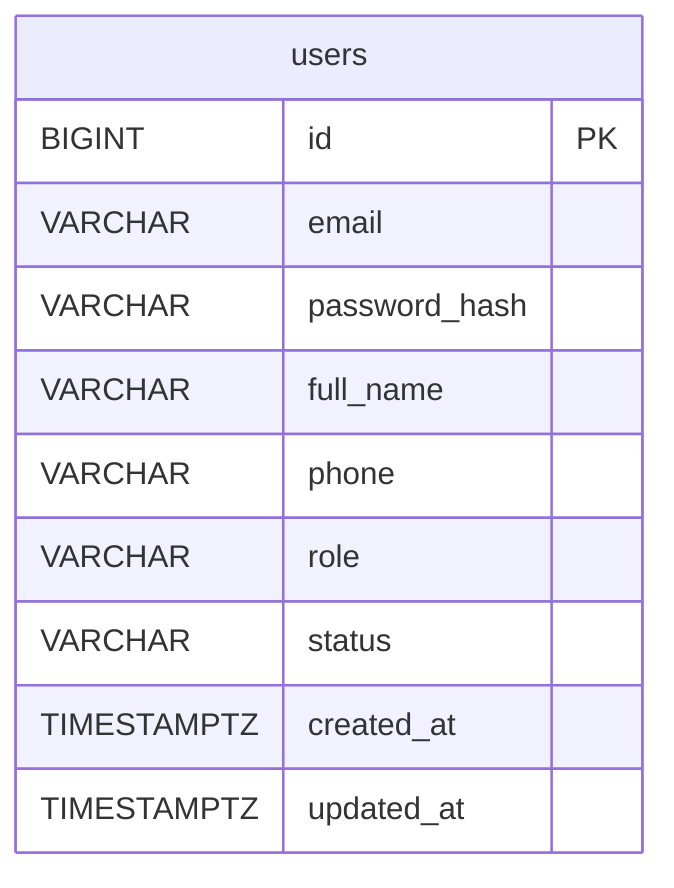

_Hình 4.1: Sơ đồ logic bước 1 (Bảng users)_

#### 2. Thiết kế dữ liệu với tính tiến hóa

- **Quy định liên quan:** `QĐ1.1` (email là định danh đăng nhập, duy nhất, không phân biệt chữ hoa và chữ thường; mật khẩu dài ít nhất 8 ký tự, có cả chữ và số); `QĐ1.2` (tài khoản tự đăng ký có vai trò `CUSTOMER` và trạng thái `ACTIVE`; tài khoản `STAFF` và `ADMIN` do Admin tạo).
- **Sơ đồ luồng dữ liệu về việc thay đổi quy định:** Không có. Hai quy định này không có tham số Admin thay đổi được.
- **Các thuộc tính mới:** Không có.
- **Các tham số mới:** Không có.
- **Thiết kế dữ liệu:** Email được lưu chữ thường, kiểm tra bằng ràng buộc `CHECK (email = lower(email))`, nên ràng buộc `UNIQUE` trên `email` chặn được hai email chỉ khác nhau ở chữ hoa, chữ thường. Miền giá trị của `role` và `status` được kiểm soát bằng ràng buộc `CHECK`. Mật khẩu chỉ được lưu dưới dạng chuỗi băm BCrypt (`password_hash`); độ dài và thành phần của mật khẩu được kiểm tra trước khi băm.
- **Các thuộc tính trừu tượng:** Không có.
- **Sơ đồ logic:** Giữ nguyên Hình 4.1.

---

### 4.1.2. Bước 2: Xét yêu cầu Tiếp nhận thông tin sân bay (YCNV-02)

#### 1. Thiết kế dữ liệu với tính đúng đắn

- **Biểu mẫu liên quan:** BM2 - Phiếu thông tin sân bay (màn hình `A-01 Sân bay`).
- **Sơ đồ luồng dữ liệu:** Hình 2.3 (Sơ đồ luồng dữ liệu cho yêu cầu Tiếp nhận thông tin sân bay).
- **Các thuộc tính mới:** `code`, `name`, `city`, `country_code`, `timezone`, `active`.
- **Thiết kế dữ liệu:** Các thuộc tính này mô tả đối tượng sân bay, không thể bố trí vào bảng `users` hay `password_reset_tokens` đã có. Do đó, tạo bảng mới `airports`.
- **Các thuộc tính trừu tượng:** Không sử dụng thuộc tính trừu tượng làm khóa chính. Thuộc tính `code` (mã IATA 3 ký tự in hoa như `SGN`, `HAN`) là mã định danh quốc tế chuẩn hóa, thỏa mãn trọn vẹn 4 tính chất của khóa chính theo giáo trình: tối thiểu, NOT NULL, không trùng lặp và không thay đổi theo thời gian. Do đó, `code` được chọn làm khóa chính tự nhiên cho bảng `airports`.
- **Sơ đồ logic:** Bổ sung bảng `airports`.

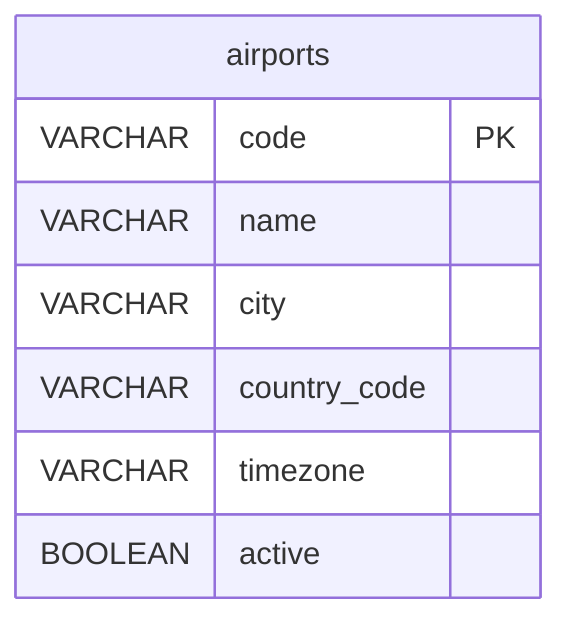

_Hình 4.2: Sơ đồ logic bước 2 (Bảng airports)_

#### 2. Thiết kế dữ liệu với tính tiến hóa

- **Quy định liên quan:** `QĐ2.1` (mã IATA 3 chữ cái in hoa, mã quốc gia ISO 3166-1 alpha-2, múi giờ IANA); `QĐ2.2` (sân bay đã được chuyến bay tham chiếu thì chỉ ngừng kích hoạt, không xóa được).
- **Sơ đồ luồng dữ liệu về việc thay đổi quy định:** Không có. Hai quy định này không có tham số Admin thay đổi được.
- **Các thuộc tính mới:** Không có.
- **Các tham số mới:** Không có.
- **Thiết kế dữ liệu:** Định dạng của `QĐ2.1` được kiểm tra bằng ràng buộc `CHECK` trên `code` và `country_code`. `QĐ2.2` dùng thuộc tính `active` đã có (trường trạng thái kích hoạt của BM2, mặc định `TRUE`): sân bay đã có chuyến bay tham chiếu chỉ được chuyển `active = FALSE`, không bị xóa, nên các chuyến đã có vẫn giữ nguyên tham chiếu.
- **Các thuộc tính trừu tượng:** Không có.
- **Sơ đồ logic:** Giữ nguyên Hình 4.2.

---

### 4.1.3. Bước 3: Xét yêu cầu Tiếp nhận thông tin hãng hàng không, gói giá và bảng giá hành lý (YCNV-03)

#### 1. Thiết kế dữ liệu với tính đúng đắn

- **Biểu mẫu liên quan:** BM3 - Phiếu thông tin hãng hàng không và dịch vụ (màn hình `A-02 Hãng bay`, `A-03 Chi tiết hãng`).
- **Sơ đồ luồng dữ liệu:** Hình 2.4 (Sơ đồ luồng dữ liệu cho yêu cầu Tiếp nhận thông tin hãng hàng không, gói giá và bảng giá hành lý).
- **Các thuộc tính mới:**
  - Hãng hàng không: `code`, `name`, `ticket_prefix`, `active`.
  - Gói giá: `airline_code`, `cabin_class`, `name`, `carry_on_kg`, `checked_baggage_kg`, `refundable`, `refund_fee`, `changeable`, `change_fee`, `active`.
  - Bảng giá hành lý mua thêm: `airline_code`, `weight_kg`, `price`, `active`.
- **Thiết kế dữ liệu:** Các thuộc tính này không thể đưa vào các bảng đã có. Do tính chất phân rã thực thể và tránh lặp thông tin, hệ thống tạo 3 bảng mới:
  - Bảng `airlines`: Lưu thông tin danh mục hãng hàng không.
  - Bảng `fare_families`: Lưu danh mục các gói giá dịch vụ của hãng bay. Thiết lập quan hệ 1-n từ `airlines` sang `fare_families` thông qua khóa ngoại `airline_code` tham chiếu tới `airlines(code)`.
  - Bảng `baggage_options`: Lưu các mức hành lý ký gửi mua thêm của hãng. Thiết lập quan hệ 1-n từ `airlines` sang `baggage_options` thông qua khóa ngoại `airline_code` tham chiếu tới `airlines(code)`.
- **Các thuộc tính trừu tượng:**
  - Bảng `airlines`: Dùng mã IATA 2 ký tự `code` làm khóa chính tự nhiên (mã hóa diễn nghĩa).
  - Bảng `fare_families`: Cặp (`airline_code`, `name`) là khóa nghiệp vụ. Sử dụng thuộc tính trừu tượng `id` (BIGINT GENERATED ALWAYS AS IDENTITY) làm khóa chính nhân tạo nhằm đơn giản hóa việc tham chiếu từ các bảng chuyến bay và đặt vé sau này.
  - Bảng `baggage_options`: Cặp (`airline_code`, `weight_kg`) là khóa nghiệp vụ. Sử dụng thuộc tính trừu tượng `id` (BIGINT GENERATED ALWAYS AS IDENTITY) làm khóa chính nhân tạo.
- **Sơ đồ logic:** Bổ sung 3 bảng `airlines`, `fare_families`, `baggage_options` và thiết lập các mối quan hệ liên kết.

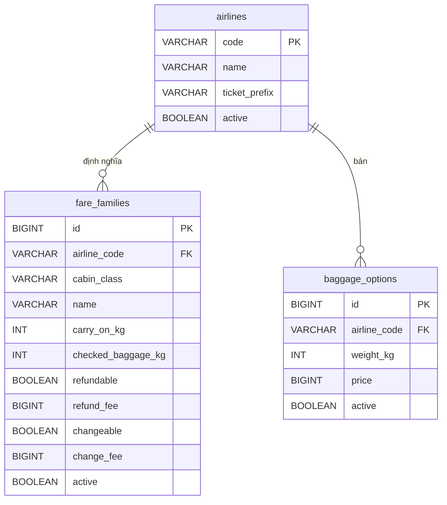

_Hình 4.3: Sơ đồ logic bước 3 (Bảng airlines, fare_families, baggage_options)_

#### 2. Thiết kế dữ liệu với tính tiến hóa

- **Quy định liên quan:** `QĐ3.1` (mã hãng 2 ký tự, mã số vé 3 chữ số, cả hai duy nhất); `QĐ3.2` (tên gói giá và mức kg hành lý không trùng nhau trong một hãng); `QĐ3.3` (gói giá và mức hành lý đã được tham chiếu chỉ ngừng kích hoạt, không xóa; booking lưu bản chụp quy định gói giá tại lúc giữ chỗ).
- **Sơ đồ luồng dữ liệu về việc thay đổi quy định:** Không có. Các quy định này không có tham số Admin thay đổi được.
- **Các thuộc tính mới:** Không có. Cờ `active` của cả 3 bảng đã có từ BM3.
- **Các tham số mới:** Không có.
- **Thiết kế dữ liệu:**
  - `QĐ3.1`: ràng buộc `CHECK` kiểm tra định dạng `airlines.code` và `ticket_prefix`; `ticket_prefix` có thêm ràng buộc `UNIQUE`.
  - `QĐ3.2`: ràng buộc bảng `UNIQUE (airline_code, name)` trên `fare_families` và `UNIQUE (airline_code, weight_kg)` trên `baggage_options`.
  - `QĐ3.3`: dùng cờ `active` thay cho xóa. Phần bản chụp quy định gói giá được thiết kế ở bước 7.
- **Các thuộc tính trừu tượng:** Không có.
- **Sơ đồ logic:** Giữ nguyên Hình 4.3.

---

### 4.1.4. Bước 4: Xét yêu cầu Lập lịch chuyến bay (YCNV-04)

#### 1. Thiết kế dữ liệu với tính đúng đắn

- **Biểu mẫu liên quan:** BM4 - Phiếu lập lịch chuyến bay (màn hình `A-05 Tạo chuyến`).
- **Sơ đồ luồng dữ liệu:** Hình 2.5 (Sơ đồ luồng dữ liệu cho yêu cầu Lập lịch chuyến bay).
- **Các thuộc tính mới:**
  - Chuyến bay: `airline_code`, `flight_number`, `departure_airport`, `arrival_airport`, `departure_time`, `arrival_time`, `aircraft_model`, `status`, `created_at`, `updated_at`.
  - Kho ghế theo hạng: `flight_id`, `cabin_class`, `total_seats`, `available_seats`.
  - Giá bán theo gói: `flight_id`, `fare_family_id`, `price`.
- **Thiết kế dữ liệu:**
  - Tạo bảng `flights` lưu thông tin từng chuyến bay cụ thể. Bảng có 3 khóa ngoại: `airline_code` tham chiếu `airlines(code)`, `departure_airport` và `arrival_airport` tham chiếu `airports(code)`.
  - Do mỗi chuyến bay có nhiều hạng ghế (`ECONOMY`, `BUSINESS`...), thông tin kho ghế không thể gộp vào `flights` mà không vi phạm tính chuẩn hóa. Tạo bảng mới `flight_cabins` lưu trữ kho ghế, thiết lập quan hệ 1-n từ `flights` sang `flight_cabins` qua khóa ngoại `flight_id`.
  - Do mỗi chuyến bay áp dụng nhiều gói giá khác nhau và mỗi gói giá được bán trên nhiều chuyến bay, đây là quan hệ nhiều - nhiều (n-n) giữa `flights` và `fare_families`. Theo quy tắc thiết kế dữ liệu của môn học, quan hệ n-n được phân rã thành hai quan hệ 1-n thông qua một bảng trung gian: tạo bảng mới `flight_fares` chứa hai khóa ngoại `flight_id` (trỏ tới `flights`) và `fare_family_id` (trỏ tới `fare_families`), kèm thuộc tính giá bán cơ sở `price`.
- **Các thuộc tính trừu tượng:**
  - Bảng `flights`: Bộ 3 thuộc tính (`airline_code`, `flight_number`, `departure_time`) xác định duy nhất một chuyến bay. Sử dụng thuộc tính trừu tượng `id` (BIGINT GENERATED ALWAYS AS IDENTITY) làm khóa chính nhân tạo để tối ưu hóa hiệu năng khóa ngoại.
  - Bảng `flight_cabins`: Tổ hợp (`flight_id`, `cabin_class`) là khóa tự nhiên. Thêm thuộc tính trừu tượng `id` làm khóa chính.
  - Bảng `flight_fares`: Tổ hợp (`flight_id`, `fare_family_id`) là khóa tự nhiên. Thêm thuộc tính trừu tượng `id` làm khóa chính.
- **Sơ đồ logic:** Bổ sung 3 bảng `flights`, `flight_cabins`, `flight_fares` và các liên kết tới `airlines`, `airports`, `fare_families`.

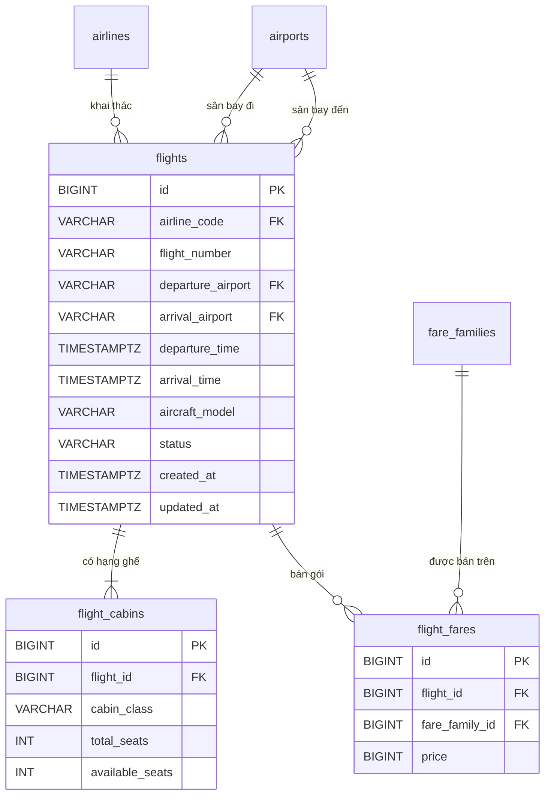

_Hình 4.4: Sơ đồ logic bước 4 (Bảng flights, flight_cabins, flight_fares)_

#### 2. Thiết kế dữ liệu với tính tiến hóa

- **Quy định liên quan:** `QĐ4.1` (định dạng số hiệu, giờ hạ cánh sau giờ cất cánh, sân bay đi khác đến, không trùng chuyến); `QĐ4.2` (mỗi chuyến có ít nhất một hạng ghế, giá bán thuộc gói giá hợp lệ); `QĐ4.3` (tạo chuyến hàng loạt tối đa 180 ngày); `QĐ4.4` (chỉ tạo chuyến cho hãng và sân bay đang kích hoạt).
- **Sơ đồ luồng dữ liệu về việc thay đổi quy định:** Không có. Giới hạn 180 ngày của `QĐ4.3` là hằng số, Admin không thay đổi được.
- **Các thuộc tính mới:** Không có.
- **Các tham số mới:** Không có.
- **Thiết kế dữ liệu:** `QĐ4.1` được cài đặt trong cơ sở dữ liệu bằng các ràng buộc `CHECK` (định dạng số hiệu, mã hãng khớp hai ký tự đầu của số hiệu, sân bay đi khác sân bay đến, giờ hạ cánh sau giờ cất cánh) và `UNIQUE (airline_code, flight_number, departure_time)` (chặn trùng chuyến). `QĐ4.2` và `QĐ4.4` dùng dữ liệu đã có (`fare_families.cabin_class`, cờ `active` của `airlines` và `airports`) và được kiểm tra khi xử lý.
- **Các thuộc tính trừu tượng:** Không có.
- **Sơ đồ logic:** Giữ nguyên Hình 4.4.

---

### 4.1.5. Bước 5: Xét yêu cầu Tiếp nhận mã giảm giá (voucher) (YCNV-05)

#### 1. Thiết kế dữ liệu với tính đúng đắn

- **Biểu mẫu liên quan:** BM5 - Phiếu tạo mã giảm giá (màn hình `A-07 Voucher`).
- **Sơ đồ luồng dữ liệu:** Hình 2.6 (Sơ đồ luồng dữ liệu cho yêu cầu Tiếp nhận mã giảm giá).
- **Các thuộc tính mới:** `code`, `description`, `discount_type`, `discount_value`, `max_discount`, `min_order_amount`, `valid_from`, `valid_to`, `usage_limit`, `used_count`, `active`, `created_at`.
- **Thiết kế dữ liệu:** Không thể bố trí các thuộc tính này vào các bảng hiện có. Tạo bảng mới `vouchers` để lưu trữ các chương trình khuyến mại và mã giảm giá.
- **Các thuộc tính trừu tượng:** Thuộc tính `code` là duy nhất trong nghiệp vụ. Tuy nhiên, hệ thống bổ sung thuộc tính trừu tượng `id` (BIGINT GENERATED ALWAYS AS IDENTITY) làm khóa chính nhân tạo để làm khóa ngoại trong bảng đơn đặt vé sau này, giúp tiết kiệm bộ nhớ và chỉ mục.
- **Sơ đồ logic:** Bổ sung bảng `vouchers`.

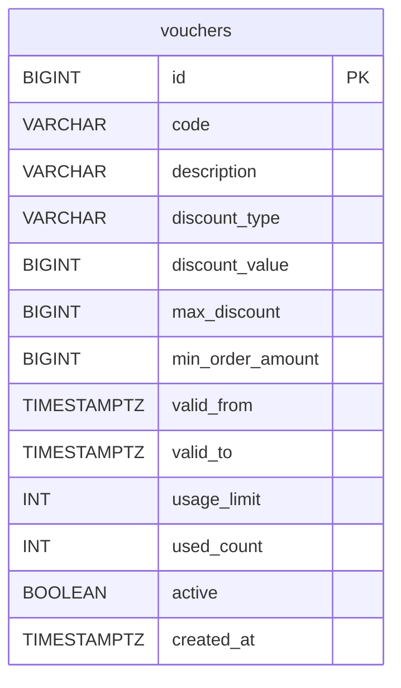

_Hình 4.5: Sơ đồ logic bước 5 (Bảng vouchers)_

#### 2. Thiết kế dữ liệu với tính tiến hóa

- **Quy định liên quan:** `QĐ5.1` (mã duy nhất, thời hạn hợp lệ); `QĐ5.2` (hai loại giảm giá: theo phần trăm `PERCENT` kèm mức giảm tối đa, hoặc số tiền cố định `FIXED`); `QĐ5.3` (điều kiện kích hoạt, thời hạn, giới hạn lượt dùng, giá trị đơn tối thiểu, mỗi tài khoản dùng một voucher tối đa một lần).
- **Sơ đồ luồng dữ liệu về việc thay đổi quy định:** Không có. Các quy định này không có tham số Admin thay đổi được.
- **Các thuộc tính mới:** Không có.
- **Các tham số mới:** Không có.
- **Thiết kế dữ liệu:** Mỗi voucher tự mang điều kiện áp dụng của nó (`discount_type`, `discount_value`, `max_discount`, `min_order_amount`, `usage_limit`, thời hạn), nên Admin tạo chương trình giảm giá mới bằng cách thêm bản ghi vào `vouchers`, không cần sửa cấu trúc bảng. Các ràng buộc `CHECK` của bảng chặn dữ liệu sai: thời điểm kết thúc sau thời điểm bắt đầu, loại `PERCENT` có mức giảm không quá 100, chỉ loại `PERCENT` mới có `max_discount`, `used_count` không vượt `usage_limit`. Điều kiện "mỗi tài khoản dùng một voucher tối đa một lần" cần dữ liệu đặt vé nên được thiết kế ở bước 7.
- **Các thuộc tính trừu tượng:** Không có.
- **Sơ đồ logic:** Giữ nguyên Hình 4.5.

---

### 4.1.6. Bước 6: Xét yêu cầu Tra cứu chuyến bay (YCNV-06)

#### 1. Thiết kế dữ liệu với tính đúng đắn

- **Biểu mẫu liên quan:** BM6 - Phiếu tra cứu chuyến bay (màn hình `C-01 Tìm chuyến`, `C-02 Kết quả tìm kiếm`).
- **Sơ đồ luồng dữ liệu:** Hình 2.7 (Sơ đồ luồng dữ liệu cho yêu cầu Tra cứu chuyến bay).
- **Các thuộc tính mới:** Không phát sinh thuộc tính lưu trữ thực thể mới. Yêu cầu tra cứu chỉ thực hiện đọc dữ liệu (`SELECT`) từ các bảng đã thiết kế ở các bước trước: `flights`, `flight_cabins`, `flight_fares`, `fare_families`, `airports`, `airlines`.
- **Thiết kế dữ liệu:** Giữ nguyên các bảng đã có.
- **Các thuộc tính trừu tượng:** Không có.
- **Sơ đồ logic:** Giữ nguyên cấu trúc các bảng hiện tại.

#### 2. Thiết kế dữ liệu với tính tiến hóa

- **Quy định liên quan:**
  - `QĐ6.1`: Không mở bán chuyến bay cất cánh trong vòng N giờ tới (quy định thời gian tối thiểu trước giờ khởi hành).
  - `QĐ6.2`: Quy định khoảng thời gian nối chuyến hợp lệ đối với hành trình 2 chặng (tối thiểu và tối đa).
  - `QĐ6.5`: Quy định số khách chiếm ghế tối đa trong một lượt tìm kiếm và đặt vé; quy định tỷ lệ phần trăm tính giá vé cho trẻ em và em bé so với người lớn.
- **Sơ đồ luồng dữ liệu về việc thay đổi quy định:**
  - Hình 2.16: Thay đổi thời gian tối thiểu trước giờ cất cánh để bán vé (`booking.min_hours_before_departure`).
  - Hình 2.17: Thay đổi số khách chiếm ghế tối đa (`booking.max_seated_passengers`).
  - Hình 2.18: Thay đổi giá vé trẻ em (`pricing.child_percent`).
  - Hình 2.19: Thay đổi giá vé em bé (`pricing.infant_percent`).
  - Hình 2.21: Thay đổi thời gian nối chuyến tối thiểu (`search.min_connection_minutes`).
  - Hình 2.22: Thay đổi thời gian nối chuyến tối đa (`search.max_connection_minutes`).
- **Các thuộc tính mới:** `key`, `value`, `description`, `updated_at`, `updated_by`.
- **Các tham số mới:**
  - `booking.min_hours_before_departure` (mặc định 3 giờ).
  - `booking.max_seated_passengers` (mặc định 9 khách).
  - `pricing.child_percent` (mặc định 90%).
  - `pricing.infant_percent` (mặc định 10%).
  - `search.min_connection_minutes` (mặc định 60 phút).
  - `search.max_connection_minutes` (mặc định 720 phút).
- **Thiết kế dữ liệu:** Theo phương pháp thiết kế dữ liệu của môn học (mục V trong slide chương 6 về Bảng THAMSO), để hệ thống có tính tiến hóa cao nhất và cho phép quản trị viên thay đổi các quy định nghiệp vụ trên mà không phải sửa mã nguồn hay cấu trúc bảng, hệ thống áp dụng **Cách 1** của slide: thiết kế bảng tham số dạng cặp khóa - giá trị `(TenThamSo, GiaTri)`.
  - Tạo bảng mới `system_settings` đóng vai trò bảng `THAMSO`.
  - Bảng gồm: `key` (chuỗi định danh tham số, làm khóa chính), `value` (giá trị tham số, lưu dạng chuỗi để lưu được số nguyên, phần trăm hay cấu hình), `description` (diễn giải ý nghĩa nghiệp vụ), `updated_at` (thời điểm cập nhật) và khóa ngoại `updated_by` tham chiếu tới `users(id)` để kiểm soát lịch sử thay đổi của Quản trị viên.
  - Sáu tham số mới nêu trên được nạp thành các bản ghi của bảng `system_settings`.
  - Đúng như slide quy định cho bảng `THAMSO`, Admin chỉ xem và sửa giá trị các tham số tại màn hình `A-09 Tham số hệ thống`; hệ thống không cho thêm hoặc xóa tham số.
- **Các thuộc tính trừu tượng:** Không có (`key` là khóa chính tự nhiên).
- **Sơ đồ logic:** Bổ sung bảng `system_settings` liên kết với bảng `users`.

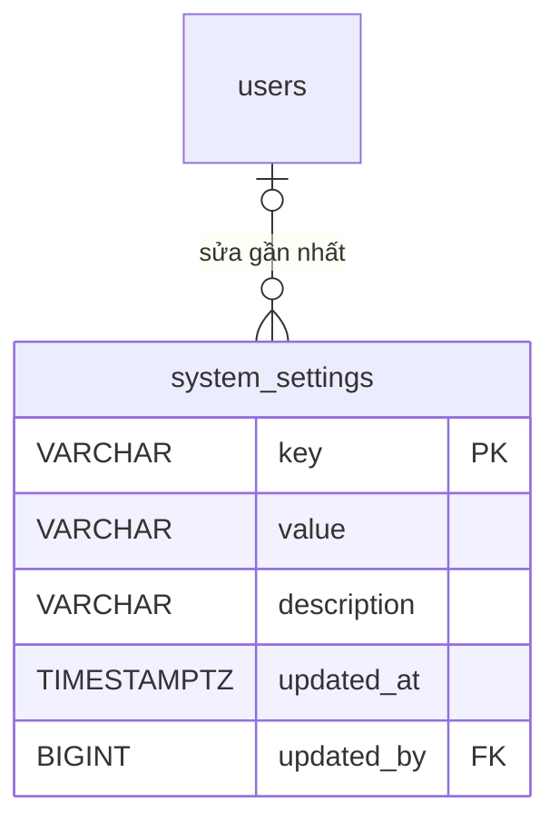

_Hình 4.6: Sơ đồ logic bước 6 (Tính tiến hóa - Bảng system_settings)_

---

### 4.1.7. Bước 7: Xét yêu cầu Tiếp nhận đặt vé và giữ chỗ (YCNV-07)

#### 1. Thiết kế dữ liệu với tính đúng đắn

- **Biểu mẫu liên quan:** BM7 - Phiếu đặt vé máy bay (màn hình `C-07 Đặt vé`).
- **Sơ đồ luồng dữ liệu:** Hình 2.8 (Sơ đồ luồng dữ liệu cho yêu cầu Tiếp nhận đặt vé và giữ chỗ).
- **Các thuộc tính mới:**
  - Đơn đặt vé: `code`, `user_id`, `status`, `contact_name`, `contact_email`, `contact_phone`, `voucher_id`, `fare_total`, `baggage_total`, `discount_total`, `total_amount`, `hold_expires_at`, `created_at`, `updated_at`.
  - Chiều bay: `booking_id`, `direction`, `status`, `airline_code`, `fare_family_id`, `discount_amount`.
  - Chặng bay: `journey_id`, `flight_id`, `seq`, `status`, `created_at`.
  - Hành khách: `booking_id`, `type`, `last_name`, `first_name`, `gender`, `date_of_birth`, `nationality`, `passport_number`, `passport_expiry`.
  - Vé: `segment_id`, `passenger_id`.
  - Hành lý mua thêm: `journey_id`, `passenger_id`, `baggage_option_id`.
- **Thiết kế dữ liệu:** Đơn đặt vé có cấu trúc nhiều cấp (đơn → chiều → chặng, đơn → hành khách). Các thuộc tính trên không bố trí được vào các bảng đã có nên được tách thành 6 bảng mới:
  - Bảng `bookings`: Thông tin chung của đơn đặt vé, người đặt (`user_id` trỏ tới `users`), voucher áp dụng (`voucher_id` trỏ tới `vouchers`), thông tin liên hệ và các khoản tiền.
  - Bảng `booking_journeys`: Từng chiều bay của đơn (chiều đi `OUTBOUND`, chiều về `RETURN`), quan hệ 1-n từ `bookings`. Mỗi chiều có hãng khai thác (`airline_code` trỏ tới `airlines`) và gói giá đã chọn (`fare_family_id` trỏ tới `fare_families`).
  - Bảng `booking_segments`: Từng chặng bay cấu thành một chiều (chặng 1, chặng 2 khi nối chuyến), quan hệ 1-n từ `booking_journeys`, có khóa ngoại `flight_id` trỏ tới `flights(id)`.
  - Bảng `passengers`: Danh sách hành khách của đơn, quan hệ 1-n từ `bookings`.
  - Bảng `tickets`: Một vé ứng với đúng một hành khách trên đúng một chặng bay. Giữa `booking_segments` và `passengers` là quan hệ n-n, nên `tickets` là bảng trung gian chứa hai khóa ngoại `segment_id` và `passenger_id`.
  - Bảng `booking_baggage`: Một mức hành lý mua thêm ứng với đúng một hành khách trên đúng một chiều bay. Giữa `booking_journeys` và `passengers` là quan hệ n-n, nên `booking_baggage` là bảng trung gian chứa khóa ngoại `journey_id`, `passenger_id`, kèm khóa ngoại `baggage_option_id` trỏ tới mức hành lý đã chọn.
- **Các thuộc tính trừu tượng:** Cả 6 bảng dùng thuộc tính trừu tượng `id` (`BIGINT GENERATED ALWAYS AS IDENTITY`) làm khóa chính. Mã đặt chỗ `code` (6 ký tự) của `bookings` không làm khóa chính nhưng có ràng buộc `UNIQUE`.
- **Sơ đồ logic:** Bổ sung cụm 6 bảng đặt vé và các liên kết tới `users`, `vouchers`, `airlines`, `fare_families`, `flights`, `baggage_options`.

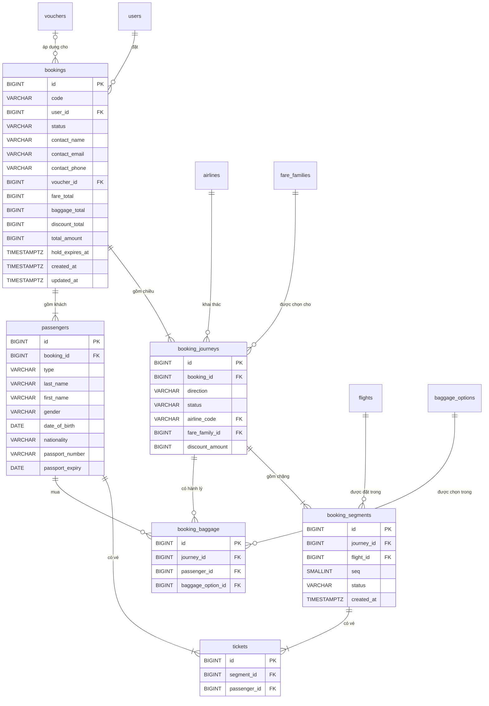

_Hình 4.7: Sơ đồ logic bước 7 (Tính đúng đắn - Cụm bảng đặt vé)_

#### 2. Thiết kế dữ liệu với tính tiến hóa

- **Quy định liên quan:**
  - `QĐ7.1`, `QĐ7.2`: Loại khách theo tuổi; họ tên in hoa không dấu; quốc tịch và hộ chiếu khi có chặng quốc tế; thông tin liên hệ bắt buộc.
  - `QĐ7.3`: Cách tính giá vé, tiền hành lý, tạm tính và tổng thanh toán; mỗi khách chọn tối đa một mức hành lý mỗi chiều.
  - `QĐ7.4`: Khi giữ chỗ, hệ thống chốt (snapshot) giá người lớn từng chặng, giá từng vé, giá hành lý và quy định gói giá. Admin thay đổi giá hay gói giá sau đó không ảnh hưởng booking đã tạo.
  - `QĐ7.5`: Hạn giữ chỗ = thời điểm tạo + `booking.hold_minutes` phút (mặc định 15); mã đặt chỗ 6 ký tự, duy nhất.
  - `QĐ7.6`: Voucher phải thỏa `QĐ5.3`; mức giảm được chia cho từng chiều.
- **Sơ đồ luồng dữ liệu về việc thay đổi quy định:** Hình 2.15 (Thay đổi thời gian giữ chỗ `booking.hold_minutes`). Các tham số `booking.max_seated_passengers`, `pricing.child_percent` và `pricing.infant_percent` cũng áp dụng khi đặt vé nhưng đã được thêm ở bước 6 (Hình 2.17–2.19).
- **Các thuộc tính mới:** Các thuộc tính snapshot theo `QĐ7.4`:
  - `booking_journeys`: `fare_family_name`, `cabin_class`, `carry_on_kg`, `checked_baggage_kg`, `refundable`, `refund_fee`, `changeable`, `change_fee`.
  - `booking_segments`: `adult_price` (giá người lớn của chặng).
  - `tickets`: `fare_amount` (giá vé của từng hành khách trên chặng).
  - `booking_baggage`: `weight_kg`, `price`.
- **Các tham số mới:** `booking.hold_minutes` (mặc định 15 phút), thêm thành một bản ghi của bảng `system_settings`; cấu trúc bảng `system_settings` không đổi.
- **Thiết kế dữ liệu:**
  - Các thuộc tính snapshot được bố trí vào các bảng giao dịch đã có, thay vì chỉ đọc qua khóa ngoại tới bảng danh mục. Khi Admin sửa giá bán hoặc gói giá, booking đã tạo vẫn giữ giá và điều kiện tại lúc giữ chỗ.
  - `QĐ7.1`, `QĐ7.2`: Ràng buộc `CHECK` trên `passengers` kiểm tra miền giá trị `type`, `gender` và định dạng `last_name`, `first_name`, `nationality`, `passport_number`. Điều kiện về tuổi và hạn hộ chiếu phụ thuộc ngày bay nên được kiểm tra khi xử lý.
  - `QĐ7.3`: Ràng buộc `CHECK (total_amount = fare_total + baggage_total - discount_total)` trên `bookings` và `UNIQUE (journey_id, passenger_id)` trên `booking_baggage`.
  - `QĐ7.5`: Ràng buộc `CHECK` định dạng và `UNIQUE` trên `bookings.code`.
  - `QĐ7.6`: Thuộc tính `discount_amount` lưu phần giảm đã chia cho từng chiều. Chỉ mục duy nhất một phần `uq_bookings_voucher_user` trên `bookings(voucher_id, user_id)`, chỉ xét các booking có voucher và ở trạng thái `PENDING_PAYMENT`, `ISSUED`, `REFUNDED`, bảo đảm mỗi tài khoản dùng một voucher tối đa một lần (`QĐ5.3`); booking hết hạn hoặc bị hủy không còn tính, nên tài khoản dùng lại được voucher đó.
- **Các thuộc tính trừu tượng:** Không có.
- **Sơ đồ logic:** Bổ sung các cột snapshot vào 4 bảng (Hình 4.8 chỉ vẽ khóa chính và các cột mới của từng bảng).

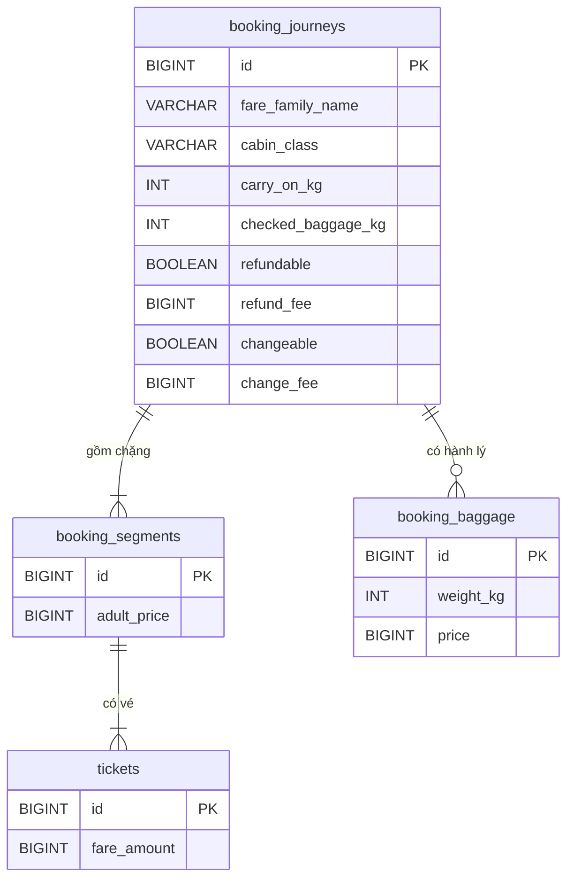

_Hình 4.8: Sơ đồ logic bước 7 (Tính tiến hóa - Các cột snapshot)_

---

### 4.1.8. Bước 8: Xét yêu cầu Thanh toán và xuất vé điện tử (YCNV-08)

#### 1. Thiết kế dữ liệu với tính đúng đắn

- **Biểu mẫu liên quan:** BM8 - Phiếu thanh toán và vé điện tử (màn hình `C-09 Chi tiết booking`, cổng thanh toán VNPay).
- **Sơ đồ luồng dữ liệu:** Hình 2.9 (Sơ đồ luồng dữ liệu cho yêu cầu Thanh toán và xuất vé điện tử).
- **Các thuộc tính mới:**
  - Lượt thu tiền: `booking_id`, `kind`, `provider`, `status`, `amount`, `txn_ref`, `provider_txn_no`, `provider_txn_date`, `response_code`, `raw_response`, `expires_at`, `created_at`, `completed_at`.
  - Xuất vé: `issued_at` của đơn đặt vé; `ticket_number`, `issued_at` của vé.
- **Thiết kế dữ liệu:**
  - Một booking có thể có nhiều lượt thu (khách thử lại khi thanh toán lỗi), nên lượt thu không bố trí được vào `bookings`. Tạo bảng mới `payments` ghi mọi lượt thu tiền qua VNPay, phục vụ đối soát, với khóa ngoại `booking_id` tham chiếu `bookings(id)`. Các trường VNPay gửi về được lưu vào: `vnp_TxnRef` → `txn_ref`, `vnp_TransactionNo` → `provider_txn_no`, `vnp_PayDate` → `provider_txn_date`, `vnp_ResponseCode` → `response_code`; toàn bộ tham số VNPay gửi về được lưu trong `raw_response`.
  - Bố trí thuộc tính xuất vé vào bảng đã có:
    - Bảng `bookings`: thêm `issued_at`, thời điểm xuất vé.
    - Bảng `tickets`: thêm `ticket_number` (số vé điện tử 13 chữ số, lấy 10 chữ số cuối từ dãy số tự tăng toàn hệ thống `ticket_number_seq`) và `issued_at`. Hai cột này để trống (NULL) cho tới khi vé được xuất.
- **Các thuộc tính trừu tượng:** Thuộc tính `id` (`BIGINT GENERATED ALWAYS AS IDENTITY`) làm khóa chính cho bảng `payments`. Mã lượt thu gửi sang cổng thanh toán `txn_ref` do hệ thống sinh và có ràng buộc `UNIQUE`.
- **Sơ đồ logic:** Bổ sung bảng `payments` liên kết với `bookings`, thêm cột xuất vé vào `bookings` và `tickets`.

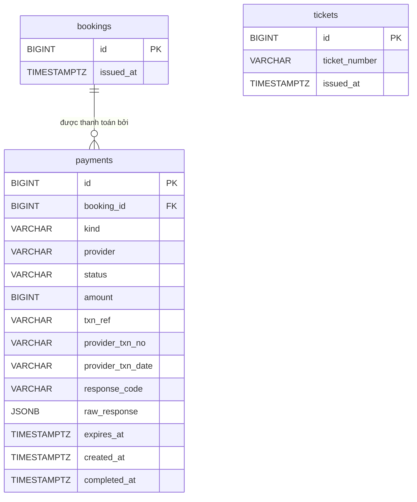

_Hình 4.9: Sơ đồ logic bước 8 (Bảng payments và cột xuất vé)_

#### 2. Thiết kế dữ liệu với tính tiến hóa

- **Quy định liên quan:**
  - `QĐ8.1`: Chỉ tạo lượt thu khi booking đang `PENDING_PAYMENT` và còn hạn giữ chỗ; link thanh toán hết hạn cùng lúc hết hạn giữ chỗ; khách được thử lại nhiều lần.
  - `QĐ8.2`: Thanh toán thành công khi chữ ký hợp lệ, số tiền khớp và hai mã kết quả của VNPay đều bằng `00`; kết quả của mỗi lượt thu chỉ được xử lý một lần.
  - `QĐ8.3`: Booking chuyển `ISSUED`; mỗi hành khách trên mỗi chặng nhận một số vé 13 chữ số.
  - `QĐ8.4`: Thanh toán thành công nhưng booking không còn chờ thanh toán thì hệ thống tự tạo yêu cầu hoàn nguồn `INVALID_PAYMENT`.
- **Sơ đồ luồng dữ liệu về việc thay đổi quy định:** Không có sơ đồ mới. Hạn của link thanh toán dùng lại tham số `booking.hold_minutes` (bước 7, Hình 2.15).
- **Các thuộc tính mới:** Không có.
- **Các tham số mới:** Không có.
- **Thiết kế dữ liệu:**
  - `QĐ8.1`: Mỗi lượt thu có `expires_at` riêng, gán bằng hạn giữ chỗ của booking.
  - `QĐ8.2`: `txn_ref` duy nhất giúp tìm đúng lượt thu khi VNPay gửi kết quả. Ràng buộc `CHECK ((status = 'PENDING') = (completed_at IS NULL))` gắn thời điểm hoàn tất với trạng thái kết thúc (`SUCCESS` hoặc `FAILED`) của lượt thu.
  - `QĐ8.3`: `ticket_number` có ràng buộc `CHECK` định dạng 13 chữ số và `UNIQUE`; ràng buộc `CHECK ((ticket_number IS NULL) = (issued_at IS NULL))` bảo đảm vé có số vé thì có thời điểm xuất và ngược lại.
  - `QĐ8.4`: Cần bảng yêu cầu hoàn, được thiết kế ở bước 9.
  - Cột `kind` phân biệt lượt thu (`CHARGE`) với lượt hoàn (`REFUND`, dùng từ bước 9); cột `provider` phân biệt giao dịch qua VNPay với hoàn tiền thủ công (`MANUAL`). Nhờ đó lượt thu và lượt hoàn dùng chung một bảng. Muốn thêm loại giao dịch hoặc cổng thanh toán mới thì chỉ cần mở rộng miền giá trị trong ràng buộc `CHECK` của hai cột này, không phải tạo bảng mới.
- **Các thuộc tính trừu tượng:** Không có.
- **Sơ đồ logic:** Giữ nguyên Hình 4.9.

---

### 4.1.9. Bước 9: Xét yêu cầu Tiếp nhận và xử lý yêu cầu hoàn vé (YCNV-09)

#### 1. Thiết kế dữ liệu với tính đúng đắn

- **Biểu mẫu liên quan:** BM9 - Phiếu yêu cầu và xử lý hoàn vé (màn hình `C-10 Hoàn vé`, `S-03 Yêu cầu hoàn`, `S-04 Chi tiết yêu cầu hoàn`).
- **Sơ đồ luồng dữ liệu:** Hình 2.10 (Sơ đồ luồng dữ liệu cho yêu cầu Tiếp nhận và xử lý yêu cầu hoàn vé).
- **Các thuộc tính mới:**
  - Yêu cầu hoàn: `booking_id`, `journey_id`, `payment_id`, `source`, `status`, `base_amount`, `fee_amount`, `refund_amount`, `reason`, `staff_note`, `last_error`, `requested_by`, `processed_by`, `processed_at`, `completed_at`, `created_at`.
  - Lượt hoàn tiền: `refund_request_id`, `original_payment_id`.
- **Thiết kế dữ liệu:**
  - Tạo bảng mới `refund_requests` theo dõi vòng đời của một yêu cầu hoàn. Các trường của BM9 được lưu vào: giá trị chiều → `base_amount`, phí hoàn → `fee_amount`, số tiền được hoàn → `refund_amount`, lý do của khách → `reason`, lý do từ chối hoặc ghi chú hoàn thủ công của Staff → `staff_note`. Bảng có các khóa ngoại:
    - `booking_id` tham chiếu `bookings(id)`.
    - `journey_id` tham chiếu `booking_journeys(id)` (hoàn theo đơn vị chiều; riêng yêu cầu hoàn do thanh toán không hợp lệ, nguồn `INVALID_PAYMENT`, thì `journey_id` là NULL).
    - `payment_id` tham chiếu `payments(id)`: lượt thu cần hoàn, chỉ dùng cho nguồn `INVALID_PAYMENT`.
    - `requested_by` và `processed_by` tham chiếu `users(id)`: khách gửi yêu cầu (NULL khi hệ thống tự tạo) và nhân viên xử lý.
  - Lượt hoàn tiền được ghi vào bảng `payments` đã có với `kind = 'REFUND'`. Bảng `payments` thêm hai khóa ngoại:
    - `refund_request_id` tham chiếu `refund_requests(id)`: lượt hoàn thuộc yêu cầu hoàn nào.
    - `original_payment_id` tham chiếu chính bảng `payments(id)`: lượt hoàn được hoàn vào lượt thu `CHARGE` nào. Từ đó tính được phần chưa hoàn của từng lượt thu khi chia số tiền hoàn theo `QĐ9.3`.
- **Các thuộc tính trừu tượng:** Thuộc tính `id` (`BIGINT GENERATED ALWAYS AS IDENTITY`) làm khóa chính cho bảng `refund_requests`.
- **Sơ đồ logic:** Bổ sung bảng `refund_requests`, các liên kết tới `bookings`, `booking_journeys`, `users`, `payments`, và hai khóa ngoại mới của `payments`.

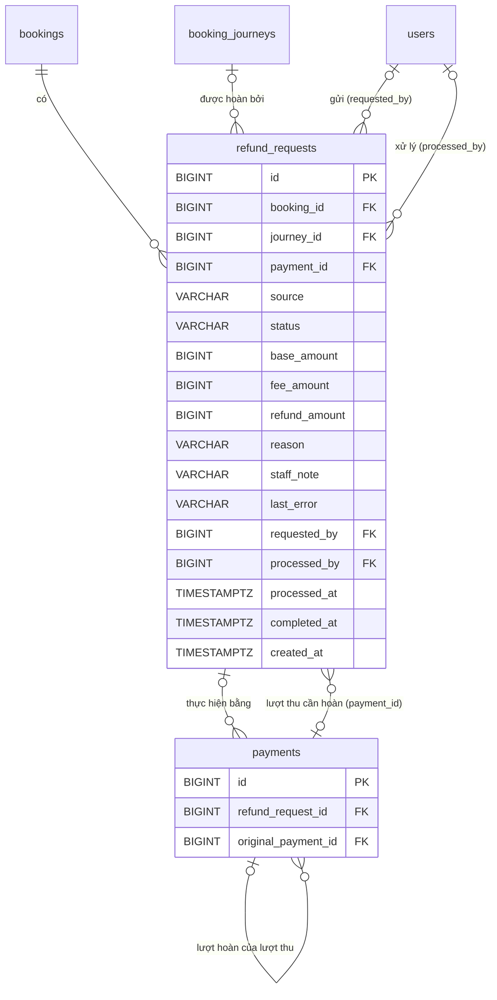

_Hình 4.10: Sơ đồ logic bước 9 (Bảng refund_requests và liên kết hoàn tiền)_

#### 2. Thiết kế dữ liệu với tính tiến hóa

- **Quy định liên quan:**
  - `QĐ9.1`: Điều kiện gửi yêu cầu hoàn, gồm hạn chót trước giờ cất cánh `aftersales.min_hours_before_departure` giờ (mặc định 24) và chiều không có yêu cầu hoàn đang mở.
  - `QĐ9.2`: Số tiền hoàn = max(0, giá trị chiều − phí hoàn), chốt khi gửi yêu cầu.
  - `QĐ9.3`: Staff duyệt thì trả ghế và hoàn tiền qua VNPay, chia vào các lượt thu thành công, lượt mới nhất trước.
  - `QĐ9.4`: Từ chối phải ghi lý do.
  - `QĐ9.5`: Cổng thanh toán lỗi thì yêu cầu giữ ở `APPROVED` kèm thông báo lỗi; Staff thử lại hoặc xác nhận đã hoàn thủ công.
  - `QĐ9.6`: Yêu cầu do hệ thống tạo (nguồn `FLIGHT_CANCELLED`, `INVALID_PAYMENT`) có phí bằng 0 và không thể bị từ chối.
- **Sơ đồ luồng dữ liệu về việc thay đổi quy định:** Hình 2.20 (Thay đổi hạn chót hoàn và đổi vé `aftersales.min_hours_before_departure`).
- **Các thuộc tính mới:** Không có.
- **Các tham số mới:** `aftersales.min_hours_before_departure` (mặc định 24 giờ), thêm thành một bản ghi của bảng `system_settings`; cấu trúc bảng không đổi.
- **Thiết kế dữ liệu:**
  - `QĐ9.1`: Chỉ mục duy nhất một phần `uq_refund_open_journey` trên `refund_requests(journey_id)`, chỉ xét các yêu cầu `PENDING` hoặc `APPROVED`, bảo đảm mỗi chiều có tối đa một yêu cầu hoàn đang mở.
  - `QĐ9.2`: Ràng buộc `CHECK (refund_amount = GREATEST(base_amount - fee_amount, 0))`.
  - `QĐ9.4`, `QĐ9.5`: `staff_note` lưu lý do từ chối hoặc ghi chú hoàn thủ công; `last_error` lưu lỗi gần nhất của cổng thanh toán. Hoàn thủ công được ghi thành lượt hoàn có `provider = 'MANUAL'`.
  - `QĐ9.6`: Ràng buộc `CHECK (source = 'CUSTOMER' OR fee_amount = 0)` và `CHECK (source = 'CUSTOMER' OR status <> 'REJECTED')`. Hai ràng buộc `CHECK` khác bảo đảm yêu cầu nguồn `INVALID_PAYMENT` không gắn với chiều (`journey_id` NULL) mà gắn với lượt thu (`payment_id` khác NULL), còn các nguồn khác thì ngược lại.
- **Các thuộc tính trừu tượng:** Không có.
- **Sơ đồ logic:** Giữ nguyên Hình 4.10.

---

### 4.1.10. Bước 10: Xét yêu cầu Đổi lịch trình chuyến bay (YCNV-10)

#### 1. Thiết kế dữ liệu với tính đúng đắn

- **Biểu mẫu liên quan:** BM10 - Phiếu đổi lịch trình chuyến bay (màn hình `C-11 Đổi chuyến`).
- **Sơ đồ luồng dữ liệu:** Hình 2.11 (Sơ đồ luồng dữ liệu cho yêu cầu Đổi lịch trình chuyến bay).
- **Các thuộc tính mới:**
  - Yêu cầu đổi chuyến: `booking_id`, `journey_id`, `status`, `old_fare_total`, `new_fare_total`, `change_fee_total`, `amount_due`, `hold_expires_at`, `created_at`, `completed_at`.
  - Chặng bay mới của yêu cầu đổi: `reschedule_id` của chặng bay.
  - Lượt thu tiền đổi chuyến: `reschedule_id` của lượt thu.
- **Thiết kế dữ liệu:**
  - Tạo bảng mới `reschedules` theo dõi quá trình đổi lịch trình cho một chiều bay. Bảng có khóa ngoại `booking_id` trỏ tới `bookings(id)` và `journey_id` trỏ tới `booking_journeys(id)`.
  - Bảng `booking_segments` thêm khóa ngoại `reschedule_id` trỏ tới `reschedules(id)`. Khi khách xác nhận đổi, các chặng bay mới được tạo trong `booking_segments` ở trạng thái `PENDING_CHANGE` và gắn với yêu cầu đổi.
  - Bảng `payments` thêm khóa ngoại `reschedule_id` trỏ tới `reschedules(id)`. Nếu đổi chuyến phải trả thêm tiền (`amount_due > 0`), lượt thu tiền qua cổng thanh toán tham chiếu tới yêu cầu đổi này.
- **Các thuộc tính trừu tượng:** Thuộc tính `id` (`BIGINT GENERATED ALWAYS AS IDENTITY`) làm khóa chính cho bảng `reschedules`.
- **Sơ đồ logic:** Bổ sung bảng `reschedules`, các liên kết tới `bookings`, `booking_journeys`, và khóa ngoại `reschedule_id` của `booking_segments`, `payments`.

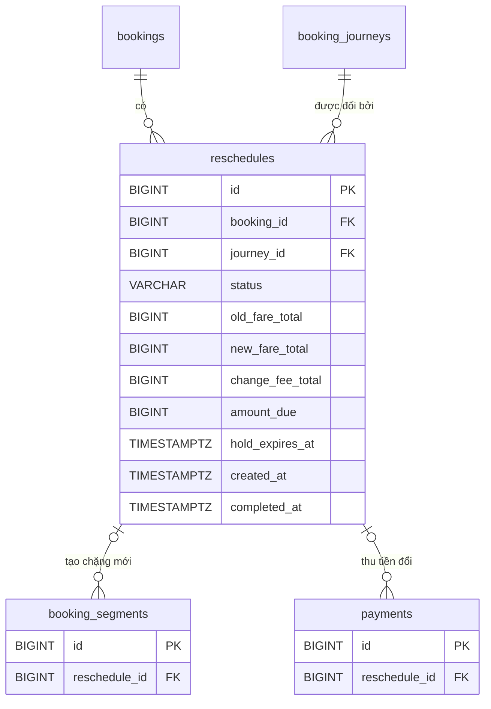

_Hình 4.11: Sơ đồ logic bước 10 (Bảng reschedules)_

#### 2. Thiết kế dữ liệu với tính tiến hóa

- **Quy định liên quan:**
  - `QĐ10.1`: Đổi theo đơn vị chiều, điều kiện như `QĐ9.1` (gồm hạn chót `aftersales.min_hours_before_departure`), gói giá phải cho phép đổi.
  - `QĐ10.2`: Hành trình mới cùng sân bay đi, sân bay đến, cùng hãng và cùng gói giá.
  - `QĐ10.3`: Số tiền phải trả = phí đổi + max(0, tổng giá vé mới − tổng giá vé hiện tại).
  - `QĐ10.4`: Chặng mới được giữ ghế ở trạng thái `PENDING_CHANGE`, hạn thanh toán = thời điểm xác nhận + `booking.hold_minutes` phút.
  - `QĐ10.5`: Thanh toán xong thì chặng cũ chuyển `REPLACED`, chặng mới chuyển `ACTIVE`; quá hạn thì yêu cầu đổi chuyển `EXPIRED`, các chặng mới chuyển `CANCELLED`.
- **Sơ đồ luồng dữ liệu về việc thay đổi quy định:** Không có sơ đồ mới. Yêu cầu này dùng lại hai tham số đã có: `booking.hold_minutes` (Hình 2.15) và `aftersales.min_hours_before_departure` (Hình 2.20).
- **Các thuộc tính mới:** Không có.
- **Các tham số mới:** Không có.
- **Thiết kế dữ liệu:**
  - `QĐ10.1`: Chỉ mục duy nhất một phần `uq_reschedules_open_journey` trên `reschedules(journey_id)`, chỉ xét các yêu cầu `PENDING_PAYMENT`, bảo đảm mỗi chiều có tối đa một yêu cầu đổi đang chờ thanh toán.
  - `QĐ10.3`: Ràng buộc `CHECK (amount_due = change_fee_total + GREATEST(new_fare_total - old_fare_total, 0))`.
  - `QĐ10.4`: Ràng buộc `CHECK (status <> 'PENDING_CHANGE' OR reschedule_id IS NOT NULL)` trên `booking_segments`: chặng đang chờ đổi phải gắn với một yêu cầu đổi.
  - `QĐ10.5`: Chỉ mục duy nhất một phần `uq_segments_active_seq` trên `booking_segments(journey_id, seq)`, chỉ xét các chặng `ACTIVE`, bảo đảm mỗi vị trí chặng của một chiều chỉ có một chặng `ACTIVE`. Chặng cũ chuyển `REPLACED` và được giữ lại làm lịch sử, không bị xóa.
- **Các thuộc tính trừu tượng:** Không có.
- **Sơ đồ logic:** Giữ nguyên Hình 4.11.

---

### 4.1.11. Bước 11: Xét yêu cầu Lập báo cáo doanh thu và dòng tiền (YCNV-11)

#### 1. Thiết kế dữ liệu với tính đúng đắn

- **Biểu mẫu liên quan:** BM11 - Báo cáo kinh doanh (màn hình `A-10 Báo cáo`).
- **Sơ đồ luồng dữ liệu:** Hình 2.12 (Sơ đồ luồng dữ liệu cho yêu cầu Lập báo cáo doanh thu và dòng tiền).
- **Các thuộc tính mới:** Không có. Báo cáo được tổng hợp bằng truy vấn (`SUM`, `COUNT`, `GROUP BY`) trên các bảng đã có:
  - Báo cáo dòng tiền: Tổng hợp từ bảng `payments`, gồm các lượt thu thành công (`kind = 'CHARGE'`, `status = 'SUCCESS'`) và các lượt hoàn thành công (`kind = 'REFUND'`, `status = 'SUCCESS'`), theo thời điểm hoàn tất `completed_at`.
  - Báo cáo doanh số vé: Tổng hợp từ bảng `tickets`, `booking_segments`, `flights`, `airlines` theo thời điểm xuất vé `issued_at`.
  - Báo cáo tỉ lệ lấp đầy: Tính từ tổng số ghế và số ghế còn lại trên bảng `flight_cabins`.
- **Thiết kế dữ liệu:** Giữ nguyên các bảng đã có, không tạo bảng tổng hợp. Để truy vấn báo cáo nhanh, hệ thống tạo các chỉ mục `ix_payments_completed` trên `payments(completed_at)` và `ix_tickets_issued_at` trên `tickets(issued_at)` (mục 4.1.15).
- **Các thuộc tính trừu tượng:** Không có.
- **Sơ đồ logic:** Giữ nguyên.

#### 2. Thiết kế dữ liệu với tính tiến hóa

- **Quy định liên quan:** `QĐ11.1` (dòng tiền theo thời điểm hoàn tất giao dịch, giờ Việt Nam, nhóm theo ngày, tháng hoặc năm); `QĐ11.2` (doanh số các vé đã xuất thuộc chặng `ACTIVE`, nhóm theo hãng hoặc theo tuyến); `QĐ11.3` (tỉ lệ lấp đầy của các chuyến `SCHEDULED` cất cánh trong kỳ, ghế đang giữ chỗ cũng tính là đã lấp).
- **Sơ đồ luồng dữ liệu về việc thay đổi quy định:** Không có. Các quy định này không có tham số Admin thay đổi được.
- **Các thuộc tính mới:** Không có.
- **Các tham số mới:** Không có.
- **Thiết kế dữ liệu:** Các tiêu chí lọc và nhóm chỉ dùng thuộc tính đã có (`completed_at`, `issued_at`, `airline_code`, `departure_airport`, `arrival_airport`, `departure_time`), nên thêm cách nhóm mới không cần sửa cấu trúc bảng. Với `QĐ11.3`, ghế đang giữ chỗ đã bị trừ khỏi `available_seats` ngay khi giữ chỗ, nên tỉ lệ lấp đầy tính trực tiếp từ `total_seats` và `available_seats`.
- **Các thuộc tính trừu tượng:** Không có.
- **Sơ đồ logic:** Giữ nguyên.

---

### 4.1.12. Bước 12: Xét yêu cầu Tra cứu booking (YCNV-12)

#### 1. Thiết kế dữ liệu với tính đúng đắn

- **Biểu mẫu liên quan:** BM12 - Phiếu tra cứu booking (màn hình `C-08 Booking của tôi`, `C-09 Chi tiết booking`, `S-01 Tra cứu booking`, `S-02 Chi tiết booking`).
- **Sơ đồ luồng dữ liệu:** Hình 2.13 (Sơ đồ luồng dữ liệu cho yêu cầu Tra cứu booking).
- **Các thuộc tính mới:** Không có. Chi tiết booking được đọc bằng phép kết nối bảng (`JOIN`) từ `bookings` tới các bảng liên quan: `booking_journeys`, `booking_segments`, `passengers`, `tickets`, `booking_baggage`, `payments`, `reschedules`, `refund_requests`. Staff tìm booking theo các thuộc tính đã có của `bookings`: `code`, `contact_email`, `contact_phone`.
- **Thiết kế dữ liệu:** Giữ nguyên các bảng. Để tải nhanh danh sách booking của một khách theo thứ tự mới nhất trước, hệ thống tạo chỉ mục `ix_bookings_user` trên `bookings(user_id, created_at DESC)`.
- **Các thuộc tính trừu tượng:** Không có.
- **Sơ đồ logic:** Giữ nguyên.

#### 2. Thiết kế dữ liệu với tính tiến hóa

- **Quy định liên quan:** `QĐ12.1` (Customer chỉ xem booking của mình; Staff và Admin xem mọi booking); `QĐ12.2` (danh sách mới nhất trước, lọc theo trạng thái, có phân trang; Staff tìm theo mã đặt chỗ, email hoặc số điện thoại liên hệ).
- **Sơ đồ luồng dữ liệu về việc thay đổi quy định:** Không có. Các quy định này không có tham số Admin thay đổi được.
- **Các thuộc tính mới:** Không có.
- **Các tham số mới:** Không có.
- **Thiết kế dữ liệu:** Phân quyền dựa trên thuộc tính đã có: `users.role` của người tra cứu và `bookings.user_id` của booking.
- **Các thuộc tính trừu tượng:** Không có.
- **Sơ đồ logic:** Giữ nguyên.

---

### 4.1.13. Bước 13: Xét yêu cầu Hủy chuyến bay (YCNV-13)

#### 1. Thiết kế dữ liệu với tính đúng đắn

- **Biểu mẫu liên quan:** BM13 - Phiếu hủy chuyến bay (màn hình `A-06 Chi tiết chuyến`).
- **Sơ đồ luồng dữ liệu:** Hình 2.14 (Sơ đồ luồng dữ liệu cho yêu cầu Hủy chuyến bay).
- **Các thuộc tính mới:** Không có.
- **Thiết kế dữ liệu:** Các bảng đã có đáp ứng được nghiệp vụ hủy chuyến. Mọi thay đổi dưới đây được cập nhật trong cùng một giao dịch (transaction):
  - Chuyển `flights.status` sang `CANCELLED`.
  - Booking `PENDING_PAYMENT` có chặng trên chuyến chuyển `bookings.status = 'CANCELLED'`, trả ghế vào `flight_cabins.available_seats` và trả lượt dùng vào `vouchers.used_count`.
  - Yêu cầu đổi đang chờ thanh toán có chặng cũ hoặc chặng mới trên chuyến chuyển `reschedules.status = 'CANCELLED'`, các chặng mới được trả ghế.
  - Mỗi chiều `ACTIVE` của booking `ISSUED` có chặng trên chuyến được tạo một bản ghi `refund_requests` với `source = 'FLIGHT_CANCELLED'`, `fee_amount = 0`. Nếu chiều đó đã có yêu cầu hoàn `PENDING` của khách, yêu cầu đó được chuyển sang nguồn `FLIGHT_CANCELLED`, phí 0 và tính lại số tiền hoàn.
- **Các thuộc tính trừu tượng:** Không có.
- **Sơ đồ logic:** Giữ nguyên.

#### 2. Thiết kế dữ liệu với tính tiến hóa

- **Quy định liên quan:** `QĐ13.1` (chỉ hủy chuyến chưa cất cánh và chưa bị hủy; hủy chuyến không đảo ngược được); `QĐ13.2` (các hệ quả của việc hủy chuyến nêu ở phần trên và email thông báo cho khách).
- **Sơ đồ luồng dữ liệu về việc thay đổi quy định:** Không có. Các quy định này không có tham số Admin thay đổi được.
- **Các thuộc tính mới:** Không có.
- **Các tham số mới:** Không có.
- **Thiết kế dữ liệu:** Ràng buộc `CHECK` trên `flights.status` chỉ cho hai giá trị `SCHEDULED` và `CANCELLED`. Khóa ngoại `booking_segments.flight_id` không có `ON DELETE CASCADE`, nên chuyến đã có booking không xóa được mà chỉ chuyển sang `CANCELLED`; dữ liệu đặt vé của chuyến vẫn được giữ lại.
- **Các thuộc tính trừu tượng:** Không có.
- **Sơ đồ logic:** Giữ nguyên.

---

### 4.1.14. Thiết kế dữ liệu cho yêu cầu hệ thống

Ngoài 13 yêu cầu nghiệp vụ, yêu cầu hệ thống về tính bảo mật (mục 2.1.3, ý "Đặt lại mật khẩu": link đặt lại mật khẩu dùng một lần và hết hạn sau 30 phút) cần lưu thêm dữ liệu.

- **Các thuộc tính mới:** `user_id`, `token_hash`, `expires_at`, `used_at`, `created_at`.
- **Thiết kế dữ liệu:** Một tài khoản có thể yêu cầu đặt lại mật khẩu nhiều lần, mỗi lần sinh một token mới, nên các thuộc tính trên không bố trí được vào `users`. Tạo bảng mới `password_reset_tokens`, quan hệ 1-n từ `users` qua khóa ngoại `user_id`.
  - Bảng chỉ lưu giá trị băm SHA-256 của token (`token_hash`, có ràng buộc `UNIQUE`), không lưu token gốc gửi qua email.
  - `expires_at` = thời điểm tạo + 30 phút. Thời hạn này là hằng số, Admin không thay đổi được.
  - `used_at` ghi thời điểm token được dùng; token đã có `used_at` không dùng lại được.
- **Các thuộc tính trừu tượng:** Thuộc tính `id` (`BIGINT GENERATED ALWAYS AS IDENTITY`) làm khóa chính cho bảng `password_reset_tokens`.
- **Sơ đồ logic:** Bổ sung bảng `password_reset_tokens` liên kết 1-n với `users`.

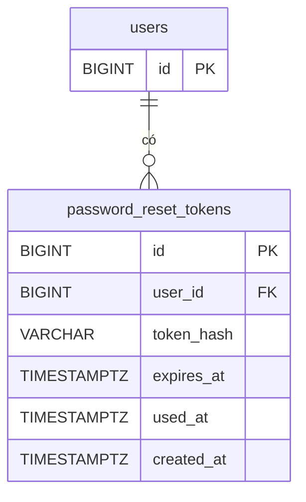

_Hình 4.12: Sơ đồ logic cho yêu cầu hệ thống (Bảng password_reset_tokens)_

---

### 4.1.15. Thiết kế dữ liệu với yêu cầu hiệu quả

Sau khi thiết kế theo tính đúng đắn và tính tiến hóa, cơ sở dữ liệu được xét thêm theo yêu cầu hiệu quả về thời gian truy xuất và dung lượng lưu trữ.

#### 1. Hiệu quả về thời gian truy xuất

- **Thuộc tính tính toán:**
  Thuộc tính tính toán là thuộc tính mà giá trị của nó được tính dựa trên giá trị của các thuộc tính khác. Lưu sẵn thuộc tính tính toán giúp tránh quét bảng và tính tổng mỗi lần đọc. Đổi lại, giá trị của chúng phải được tự động cập nhật khi có thay đổi liên quan:
  - `flight_cabins.available_seats`: Số ghế còn trống của một hạng ghế trên chuyến bay. Khi tìm chuyến hay đặt vé, hệ thống đọc trực tiếp cột này thay vì đếm số khách đã giữ chỗ trên các bảng đặt vé. Khi giữ chỗ, hệ thống trừ ghế bằng một câu lệnh `UPDATE` nguyên tử: `UPDATE flight_cabins SET available_seats = available_seats - :seats WHERE flight_id = :id AND cabin_class = :class AND available_seats >= :seats`; khi hủy hoặc hết hạn thì cộng trả lại. Kết hợp với ràng buộc `CHECK (available_seats BETWEEN 0 AND total_seats)`, cơ chế này chặn bán vượt số ghế khi nhiều khách đặt vé cùng lúc.
  - `vouchers.used_count`: Số lượt voucher đã được dùng. Tăng khi giữ chỗ thành công, giảm khi booking bị hủy hoặc hết hạn. Hệ thống kiểm tra giới hạn lượt dùng (`used_count < usage_limit`) mà không cần đếm trên bảng `bookings`.
  - `bookings.fare_total`, `baggage_total`, `discount_total`, `total_amount`: Tổng giá vé, tổng tiền hành lý, mức giảm và tổng thanh toán của đơn. Được tính một lần khi giữ chỗ và kiểm tra bằng ràng buộc `CHECK (total_amount = fare_total + baggage_total - discount_total)`.
  - `reschedules.amount_due`: Số tiền phải trả khi đổi chuyến (`change_fee_total + max(0, new_fare_total - old_fare_total)`).
  - `refund_requests.refund_amount`: Số tiền thực hoàn cho khách (`max(0, base_amount - fee_amount)`).

- **Chỉ mục:**
  Ngoài các thuộc tính tính toán, hệ thống tạo chỉ mục cho các truy vấn thường dùng:
  - Tìm chuyến bay: `ix_flights_route_time` trên `(departure_airport, arrival_airport, departure_time)` phục vụ tìm chuyến bay thẳng và chặng 2 của hành trình nối chuyến; `ix_flights_origin_time` trên `(departure_airport, departure_time)` phục vụ tìm chặng 1 của hành trình nối chuyến.
  - Chỉ mục một phần (partial index), chỉ đánh chỉ mục các dòng thỏa điều kiện lọc nên kích thước nhỏ:
    - `ix_bookings_hold`: trên `hold_expires_at` với điều kiện `WHERE status = 'PENDING_PAYMENT'`, phục vụ tiến trình tự hủy giữ chỗ quá hạn chạy mỗi phút.
    - `ix_reschedules_hold`: trên `hold_expires_at` với điều kiện `WHERE status = 'PENDING_PAYMENT'`, phục vụ tự hủy yêu cầu đổi chuyến quá hạn.
    - `ix_payments_completed`: trên `completed_at` với điều kiện `WHERE status = 'SUCCESS'`, phục vụ báo cáo dòng tiền.
    - `ix_tickets_issued_at`: trên `issued_at` với điều kiện `WHERE issued_at IS NOT NULL`, phục vụ báo cáo doanh số vé.

#### 2. Hiệu quả về dung lượng lưu trữ

- **Tách bảng thông tin tổng quát và thông tin chi tiết:**
  - Đơn đặt vé: `bookings` chứa thông tin tổng quát (người đặt, thông tin liên hệ, các khoản tiền, trạng thái); `booking_journeys`, `booking_segments`, `passengers`, `tickets`, `booking_baggage` chứa thông tin chi tiết. Thông tin liên hệ và tổng tiền không bị lặp lại trên mỗi hành khách hay mỗi chặng.
  - Chuyến bay: `flights` chứa thông tin tổng quát của chuyến; `flight_cabins` và `flight_fares` chứa kho ghế và giá bán theo từng hạng ghế, từng gói giá.
- **Thêm đối tượng mới và dùng mã thay cho thông tin chi tiết:** Sân bay, hãng bay, gói giá và mức hành lý được tách thành các bảng danh mục (`airports`, `airlines`, `fare_families`, `baggage_options`). Các bảng khác chỉ lưu mã hoặc khóa của chúng (VD `flights` lưu `departure_airport = 'SGN'`), không lưu lặp lại tên sân bay, thành phố hay tên hãng trên mỗi chuyến bay, mỗi vé.
- **Mức chuẩn hóa:** Mọi thuộc tính chứa giá trị nguyên tố (danh sách hành khách, chặng bay, vé đều tách thành bảng riêng, không lưu dạng mảng hay chuỗi phân cách). Thông tin của sân bay, hãng bay, gói giá nằm ở bảng danh mục, không phụ thuộc bắc cầu qua bảng giao dịch. Một số chỗ có chủ đích lưu dư thừa, đổi dung lượng lấy thời gian truy xuất hoặc tính tiến hóa:
  - Các thuộc tính tính toán ở mục 1 (VD `total_amount` suy ra được từ `fare_total`, `baggage_total`, `discount_total`).
  - Các cột snapshot của bước 7 (VD `booking_journeys.fare_family_name`, `refund_fee`): giá trị chép từ danh mục tại lúc giữ chỗ, phải giữ nguyên khi danh mục thay đổi (`QĐ7.4`).
  - `booking_journeys.airline_code`: suy ra được từ `fare_family_id` (qua `fare_families.airline_code`) nhưng được lưu kèm chiều bay.

  Theo slide môn học, dạng chuẩn của cơ sở dữ liệu là dạng chuẩn thấp nhất trong các quan hệ của nó. Vì các ngoại lệ trên, cơ sở dữ liệu không đạt trọn dạng chuẩn 3 (3NF); các bảng còn lại không có phụ thuộc bắc cầu.

- **Các kiểu mã hóa:**
  - **Mã hóa liên tiếp:** Khóa chính `id` tự tăng của các bảng; phần 10 chữ số cuối của số vé lấy từ dãy số tự tăng `ticket_number_seq`.
  - **Mã hóa diễn nghĩa:** Mã IATA 3 ký tự của sân bay (`airports.code`, VD `SGN`, `HAN`) và mã IATA 2 ký tự của hãng bay (`airlines.code`, VD `VN`, `VJ`). Mã ngắn (2–3 ký tự) nên khóa ngoại tham chiếu tới chúng nhỏ, và dữ liệu vẫn dễ đọc.
  - **Mã hóa phân đoạn:** Số hiệu chuyến bay (`flight_number`) gồm đoạn mã hãng 2 ký tự và đoạn số chuyến 1–4 chữ số (VD `VN213`). Số vé (`ticket_number`) gồm đúng 13 chữ số: đoạn 3 chữ số đầu là mã số vé của hãng (`airlines.ticket_prefix`), đoạn 10 chữ số sau là mã liên tiếp toàn hệ thống.

---

## 4.2. Sơ đồ logic hoàn chỉnh

Sơ đồ logic hoàn chỉnh gộp kết quả của các bước ở mục 4.1: 20 bảng dữ liệu với đầy đủ thuộc tính, khóa chính (PK), khóa ngoại (FK) và 35 liên kết ứng với 35 khóa ngoại.

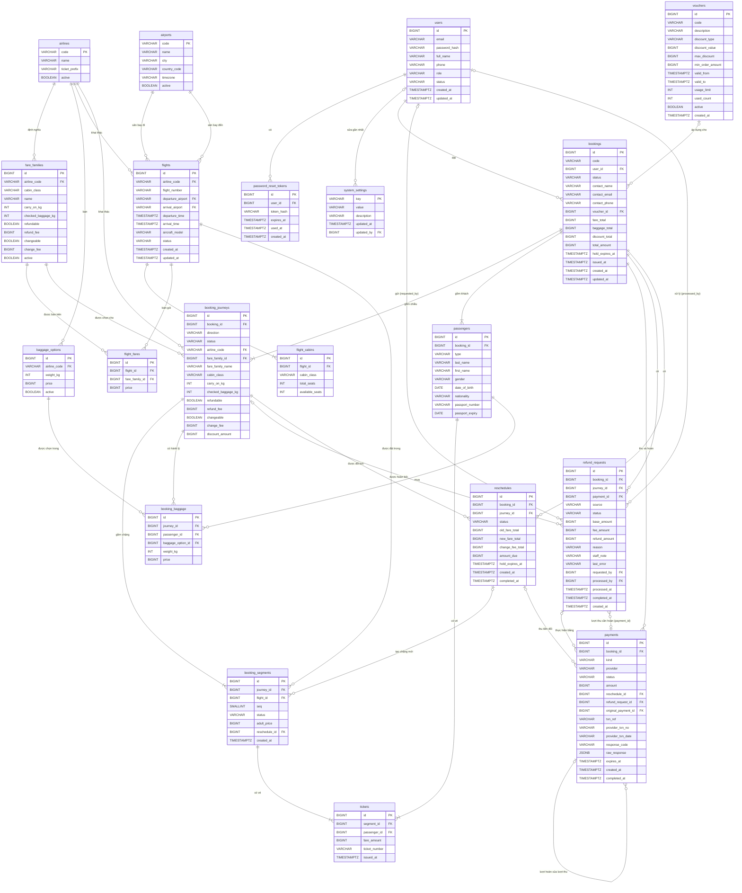

_Hình 4.13: Sơ đồ logic hoàn chỉnh của cơ sở dữ liệu hệ thống_

---

## 4.3. Danh sách các bảng dữ liệu (table) trong sơ đồ

Cơ sở dữ liệu của hệ thống gồm 20 bảng, liệt kê theo nhóm nghiệp vụ: tài khoản và tham số hệ thống, danh mục, chuyến bay, khuyến mại, đặt vé, hậu mãi (đổi chuyến, hoàn vé), thanh toán.

_Bảng 4.1: Danh sách các bảng dữ liệu trong sơ đồ logic_

| STT | Tên bảng dữ liệu        | Diễn giải                                                                       |
| :-: | :---------------------- | :------------------------------------------------------------------------------ |
|  1  | `users`                 | Tài khoản người dùng hệ thống (khách hàng, nhân viên vận hành, quản trị viên)   |
|  2  | `password_reset_tokens` | Token dùng một lần để đặt lại mật khẩu cho tài khoản người dùng                 |
|  3  | `system_settings`       | Tham số nghiệp vụ hệ thống thay đổi động (đóng vai trò bảng THAMSO)             |
|  4  | `airports`              | Danh mục sân bay kèm mã IATA, thành phố, quốc gia và múi giờ IANA               |
|  5  | `airlines`              | Danh mục hãng hàng không kèm mã IATA và tiền tố vé điện tử 3 chữ số             |
|  6  | `fare_families`         | Danh mục gói giá dịch vụ của hãng bay, quy định hành lý và phí hoàn/đổi         |
|  7  | `baggage_options`       | Bảng giá các mức hành lý ký gửi mua thêm của từng hãng bay                      |
|  8  | `flights`               | Lịch trình các chuyến bay khai thác (số hiệu, hành trình, giờ bay, tàu bay)     |
|  9  | `flight_cabins`         | Kho ghế và bộ đếm số ghế còn khả dụng theo từng hạng ghế trên mỗi chuyến bay    |
| 10  | `flight_fares`          | Bảng giá bán cơ sở (giá người lớn) của từng gói giá trên mỗi chuyến bay         |
| 11  | `vouchers`              | Mã giảm giá khuyến mại kèm điều kiện áp dụng, thời hạn và giới hạn lượt dùng    |
| 12  | `bookings`              | Thông tin đơn đặt vé tổng thể, người liên hệ, mã đặt chỗ và các giá trị tiền    |
| 13  | `booking_journeys`      | Chiều bay của đơn đặt vé kèm snapshot điều kiện gói giá tại thời điểm giữ chỗ   |
| 14  | `booking_segments`      | Chặng bay cụ thể cấu thành chiều bay, trỏ tới chuyến bay và lưu giá snapshot    |
| 15  | `passengers`            | Danh sách hành khách đi trong đơn đặt vé (họ tên, loại khách, giấy tờ tùy thân) |
| 16  | `tickets`               | Vé máy bay điện tử phân rã theo 1 hành khách × 1 chặng bay, kèm số vé 13 số     |
| 17  | `booking_baggage`       | Dịch vụ hành lý ký gửi mua thêm phân rã theo 1 hành khách × 1 chiều bay         |
| 18  | `reschedules`           | Yêu cầu đổi lịch trình chuyến bay kèm biểu phí và chênh lệch cần thanh toán     |
| 19  | `refund_requests`       | Yêu cầu hoàn vé theo đơn vị chiều kèm biểu phí và trạng thái phê duyệt          |
| 20  | `payments`              | Sổ cái kế toán theo dõi mọi giao dịch thu tiền (CHARGE) và hoàn tiền (REFUND)   |

---

## 4.4. Mô tả từng bảng dữ liệu

Phần này mô tả chi tiết cấu trúc thuộc tính, kiểu dữ liệu, các ràng buộc toàn vẹn và ý nghĩa nghiệp vụ của toàn bộ 20 bảng dữ liệu.

### 4.4.1. Bảng users (Tài khoản người dùng)

_Bảng 4.2: Cấu trúc bảng users_

| STT | Thuộc tính      | Kiểu dữ liệu | Ràng buộc                                                          | Diễn giải                                              |
| :-: | :-------------- | :----------- | :----------------------------------------------------------------- | :----------------------------------------------------- |
|  1  | `id`            | BIGINT       | PRIMARY KEY, GENERATED ALWAYS AS IDENTITY                          | Khóa chính tự tăng của tài khoản                       |
|  2  | `email`         | VARCHAR(255) | NOT NULL, UNIQUE, CHECK (email = lower(email))                     | Địa chỉ email đăng nhập, duy nhất, luôn lưu chữ thường |
|  3  | `password_hash` | VARCHAR(100) | NOT NULL                                                           | Chuỗi băm mật khẩu bảo mật theo thuật toán BCrypt      |
|  4  | `full_name`     | VARCHAR(100) | NOT NULL                                                           | Họ và tên đầy đủ của chủ tài khoản                     |
|  5  | `phone`         | VARCHAR(20)  | NOT NULL                                                           | Số điện thoại liên hệ của chủ tài khoản                |
|  6  | `role`          | VARCHAR(20)  | NOT NULL, CHECK (role IN ('CUSTOMER', 'STAFF', 'ADMIN'))           | Vai trò của tài khoản trong hệ thống                   |
|  7  | `status`        | VARCHAR(20)  | NOT NULL, DEFAULT 'ACTIVE', CHECK (status IN ('ACTIVE', 'LOCKED')) | Trạng thái hoạt động của tài khoản                     |
|  8  | `created_at`    | TIMESTAMPTZ  | NOT NULL, DEFAULT now()                                            | Thời điểm tạo tài khoản (theo giờ UTC)                 |
|  9  | `updated_at`    | TIMESTAMPTZ  | NOT NULL, DEFAULT now()                                            | Thời điểm cập nhật thông tin tài khoản gần nhất        |

### 4.4.2. Bảng password_reset_tokens (Token đặt lại mật khẩu)

_Bảng 4.3: Cấu trúc bảng password_reset_tokens_

| STT | Thuộc tính   | Kiểu dữ liệu | Ràng buộc                                  | Diễn giải                                     |
| :-: | :----------- | :----------- | :----------------------------------------- | :-------------------------------------------- |
|  1  | `id`         | BIGINT       | PRIMARY KEY, GENERATED ALWAYS AS IDENTITY  | Khóa chính tự tăng                            |
|  2  | `user_id`    | BIGINT       | NOT NULL, FOREIGN KEY REFERENCES users(id) | Tài khoản yêu cầu đặt lại mật khẩu            |
|  3  | `token_hash` | VARCHAR(64)  | NOT NULL, UNIQUE                           | Giá trị băm SHA-256 của token gửi qua email   |
|  4  | `expires_at` | TIMESTAMPTZ  | NOT NULL                                   | Thời điểm hết hạn của token (sau 30 phút tạo) |
|  5  | `used_at`    | TIMESTAMPTZ  | NULL                                       | Thời điểm token được sử dụng thành công       |
|  6  | `created_at` | TIMESTAMPTZ  | NOT NULL, DEFAULT now()                    | Thời điểm khởi tạo token                      |

### 4.4.3. Bảng system_settings (Tham số hệ thống - Bảng THAMSO)

_Bảng 4.4: Cấu trúc bảng system_settings_

| STT | Thuộc tính    | Kiểu dữ liệu | Ràng buộc                              | Diễn giải                                          |
| :-: | :------------ | :----------- | :------------------------------------- | :------------------------------------------------- |
|  1  | `key`         | VARCHAR(100) | PRIMARY KEY                            | Khóa định danh của tham số nghiệp vụ               |
|  2  | `value`       | VARCHAR(100) | NOT NULL                               | Giá trị hiện hành của tham số (lưu dạng chuỗi)     |
|  3  | `description` | VARCHAR(255) | NOT NULL                               | Diễn giải ý nghĩa và phạm vi áp dụng của tham số   |
|  4  | `updated_at`  | TIMESTAMPTZ  | NOT NULL, DEFAULT now()                | Thời điểm thay đổi giá trị tham số gần nhất        |
|  5  | `updated_by`  | BIGINT       | NULL, FOREIGN KEY REFERENCES users(id) | Tài khoản quản trị viên thực hiện thay đổi giá trị |

### 4.4.4. Bảng airports (Danh mục sân bay)

_Bảng 4.5: Cấu trúc bảng airports_

| STT | Thuộc tính     | Kiểu dữ liệu | Ràng buộc                                     | Diễn giải                                         |
| :-: | :------------- | :----------- | :-------------------------------------------- | :------------------------------------------------ |
|  1  | `code`         | VARCHAR(3)   | PRIMARY KEY, CHECK (code ~ '^[A-Z]{3}$')      | Khóa chính tự nhiên, mã IATA 3 ký tự in hoa       |
|  2  | `name`         | VARCHAR(100) | NOT NULL                                      | Tên gọi chính thức của sân bay                    |
|  3  | `city`         | VARCHAR(100) | NOT NULL                                      | Thành phố trực thuộc của sân bay                  |
|  4  | `country_code` | VARCHAR(2)   | NOT NULL, CHECK (country_code ~ '^[A-Z]{2}$') | Mã quốc gia 2 ký tự theo chuẩn ISO 3166-1 alpha-2 |
|  5  | `timezone`     | VARCHAR(50)  | NOT NULL                                      | Tên múi giờ theo cơ sở dữ liệu IANA               |
|  6  | `active`       | BOOLEAN      | NOT NULL, DEFAULT TRUE                        | Trạng thái kích hoạt phục vụ khai thác            |

### 4.4.5. Bảng airlines (Danh mục hãng hàng không)

_Bảng 4.6: Cấu trúc bảng airlines_

| STT | Thuộc tính      | Kiểu dữ liệu | Ràng buộc                                              | Diễn giải                                          |
| :-: | :-------------- | :----------- | :----------------------------------------------------- | :------------------------------------------------- |
|  1  | `code`          | VARCHAR(2)   | PRIMARY KEY, CHECK (code ~ '^[A-Z0-9]{2}$')            | Khóa chính tự nhiên, mã IATA 2 ký tự của hãng bay  |
|  2  | `name`          | VARCHAR(100) | NOT NULL                                               | Tên thương mại của hãng hàng không                 |
|  3  | `ticket_prefix` | VARCHAR(3)   | NOT NULL, UNIQUE, CHECK (ticket_prefix ~ '^[0-9]{3}$') | Mã tiền tố 3 chữ số dùng tạo số vé máy bay điện tử |
|  4  | `active`        | BOOLEAN      | NOT NULL, DEFAULT TRUE                                 | Trạng thái kích hoạt mở bán của hãng               |

### 4.4.6. Bảng fare_families (Danh mục gói giá dịch vụ)

_Bảng 4.7: Cấu trúc bảng fare_families_

| STT | Thuộc tính           | Kiểu dữ liệu | Ràng buộc                                                                            | Diễn giải                                                  |
| :-: | :------------------- | :----------- | :----------------------------------------------------------------------------------- | :--------------------------------------------------------- |
|  1  | `id`                 | BIGINT       | PRIMARY KEY, GENERATED ALWAYS AS IDENTITY                                            | Khóa chính tự tăng của gói giá                             |
|  2  | `airline_code`       | VARCHAR(2)   | NOT NULL, FOREIGN KEY REFERENCES airlines(code)                                      | Hãng hàng không sở hữu gói giá                             |
|  3  | `cabin_class`        | VARCHAR(20)  | NOT NULL, CHECK (cabin_class IN ('ECONOMY', 'PREMIUM_ECONOMY', 'BUSINESS', 'FIRST')) | Hạng khoang ghế áp dụng                                    |
|  4  | `name`               | VARCHAR(50)  | NOT NULL                                                                             | Tên gói giá (ví dụ: Phổ thông Tiết kiệm, Thương gia)       |
|  5  | `carry_on_kg`        | INT          | NOT NULL, CHECK (carry_on_kg >= 0)                                                   | Khối lượng hành lý xách tay miễn cước (kg)                 |
|  6  | `checked_baggage_kg` | INT          | NOT NULL, CHECK (checked_baggage_kg >= 0)                                            | Khối lượng hành lý ký gửi miễn cước kèm theo (kg)          |
|  7  | `refundable`         | BOOLEAN      | NOT NULL                                                                             | Cờ quy định vé có được phép hoàn hay không                 |
|  8  | `refund_fee`         | BIGINT       | NOT NULL, DEFAULT 0, CHECK (refund_fee >= 0)                                         | Mức phí hoàn vé quy định (cho mỗi khách chiếm ghế / chiều) |
|  9  | `changeable`         | BOOLEAN      | NOT NULL                                                                             | Cờ quy định vé có được phép đổi chuyến hay không           |
| 10  | `change_fee`         | BIGINT       | NOT NULL, DEFAULT 0, CHECK (change_fee >= 0)                                         | Mức phí đổi vé quy định (cho mỗi khách chiếm ghế / chiều)  |
| 11  | `active`             | BOOLEAN      | NOT NULL, DEFAULT TRUE                                                               | Trạng thái kích hoạt áp dụng gói giá                       |

_Ràng buộc bảng:_ `UNIQUE (airline_code, name)`.

### 4.4.7. Bảng baggage_options (Bảng giá hành lý ký gửi mua thêm)

_Bảng 4.8: Cấu trúc bảng baggage_options_

| STT | Thuộc tính     | Kiểu dữ liệu | Ràng buộc                                       | Diễn giải                                        |
| :-: | :------------- | :----------- | :---------------------------------------------- | :----------------------------------------------- |
|  1  | `id`           | BIGINT       | PRIMARY KEY, GENERATED ALWAYS AS IDENTITY       | Khóa chính tự tăng của gói hành lý               |
|  2  | `airline_code` | VARCHAR(2)   | NOT NULL, FOREIGN KEY REFERENCES airlines(code) | Hãng hàng không cung cấp dịch vụ                 |
|  3  | `weight_kg`    | INT          | NOT NULL, CHECK (weight_kg > 0)                 | Khối lượng hành lý mua thêm (kg)                 |
|  4  | `price`        | BIGINT       | NOT NULL, CHECK (price > 0)                     | Đơn giá bán (cho mỗi hành khách / mỗi chiều bay) |
|  5  | `active`       | BOOLEAN      | NOT NULL, DEFAULT TRUE                          | Trạng thái mở bán gói hành lý                    |

_Ràng buộc bảng:_ `UNIQUE (airline_code, weight_kg)`.

### 4.4.8. Bảng flights (Lịch trình chuyến bay)

_Bảng 4.9: Cấu trúc bảng flights_

| STT | Thuộc tính          | Kiểu dữ liệu | Ràng buộc                                                                   | Diễn giải                                        |
| :-: | :------------------ | :----------- | :-------------------------------------------------------------------------- | :----------------------------------------------- |
|  1  | `id`                | BIGINT       | PRIMARY KEY, GENERATED ALWAYS AS IDENTITY                                   | Khóa chính tự tăng của chuyến bay                |
|  2  | `airline_code`      | VARCHAR(2)   | NOT NULL, FOREIGN KEY REFERENCES airlines(code)                             | Hãng hàng không khai thác chuyến bay             |
|  3  | `flight_number`     | VARCHAR(6)   | NOT NULL, CHECK (flight_number ~ '^[A-Z0-9]{2}[0-9]{1,4}$')                 | Số hiệu chuyến bay (mã hãng + 1-4 chữ số)        |
|  4  | `departure_airport` | VARCHAR(3)   | NOT NULL, FOREIGN KEY REFERENCES airports(code)                             | Mã sân bay cất cánh                              |
|  5  | `arrival_airport`   | VARCHAR(3)   | NOT NULL, FOREIGN KEY REFERENCES airports(code)                             | Mã sân bay hạ cánh                               |
|  6  | `departure_time`    | TIMESTAMPTZ  | NOT NULL                                                                    | Thời điểm cất cánh dự kiến (lưu theo giờ UTC)    |
|  7  | `arrival_time`      | TIMESTAMPTZ  | NOT NULL                                                                    | Thời điểm hạ cánh dự kiến (lưu theo giờ UTC)     |
|  8  | `aircraft_model`    | VARCHAR(50)  | NULL                                                                        | Kiểu loại tàu bay khai thác (ví dụ: Airbus A321) |
|  9  | `status`            | VARCHAR(20)  | NOT NULL, DEFAULT 'SCHEDULED', CHECK (status IN ('SCHEDULED', 'CANCELLED')) | Trạng thái chuyến bay (đang mở bán hoặc đã hủy)  |
| 10  | `created_at`        | TIMESTAMPTZ  | NOT NULL, DEFAULT now()                                                     | Thời điểm tạo chuyến bay trên hệ thống           |
| 11  | `updated_at`        | TIMESTAMPTZ  | NOT NULL, DEFAULT now()                                                     | Thời điểm cập nhật thông tin chuyến bay gần nhất |

_Ràng buộc bảng:_

- `CHECK (left(flight_number, 2) = airline_code)`
- `CHECK (departure_airport <> arrival_airport)`
- `CHECK (arrival_time > departure_time)`
- `UNIQUE (airline_code, flight_number, departure_time)`

### 4.4.9. Bảng flight_cabins (Kho ghế theo hạng của chuyến bay)

_Bảng 4.10: Cấu trúc bảng flight_cabins_

| STT | Thuộc tính        | Kiểu dữ liệu | Ràng buộc                                                                            | Diễn giải                                        |
| :-: | :---------------- | :----------- | :----------------------------------------------------------------------------------- | :----------------------------------------------- |
|  1  | `id`              | BIGINT       | PRIMARY KEY, GENERATED ALWAYS AS IDENTITY                                            | Khóa chính tự tăng                               |
|  2  | `flight_id`       | BIGINT       | NOT NULL, FOREIGN KEY REFERENCES flights(id) ON DELETE CASCADE                       | Chuyến bay áp dụng kho ghế                       |
|  3  | `cabin_class`     | VARCHAR(20)  | NOT NULL, CHECK (cabin_class IN ('ECONOMY', 'PREMIUM_ECONOMY', 'BUSINESS', 'FIRST')) | Hạng ghế tương ứng trên chuyến bay               |
|  4  | `total_seats`     | INT          | NOT NULL, CHECK (total_seats > 0)                                                    | Tổng dung lượng ghế được thiết lập cho hạng      |
|  5  | `available_seats` | INT          | NOT NULL                                                                             | Thuộc tính tính toán: Số ghế còn khả dụng mở bán |

_Ràng buộc bảng:_

- `UNIQUE (flight_id, cabin_class)`
- `CHECK (available_seats BETWEEN 0 AND total_seats)`

### 4.4.10. Bảng flight_fares (Giá bán theo gói giá của chuyến bay)

_Bảng 4.11: Cấu trúc bảng flight_fares_

| STT | Thuộc tính       | Kiểu dữ liệu | Ràng buộc                                                      | Diễn giải                                          |
| :-: | :--------------- | :----------- | :------------------------------------------------------------- | :------------------------------------------------- |
|  1  | `id`             | BIGINT       | PRIMARY KEY, GENERATED ALWAYS AS IDENTITY                      | Khóa chính tự tăng                                 |
|  2  | `flight_id`      | BIGINT       | NOT NULL, FOREIGN KEY REFERENCES flights(id) ON DELETE CASCADE | Chuyến bay áp dụng giá bán                         |
|  3  | `fare_family_id` | BIGINT       | NOT NULL, FOREIGN KEY REFERENCES fare_families(id)             | Gói giá áp dụng mở bán                             |
|  4  | `price`          | BIGINT       | NOT NULL, CHECK (price > 0)                                    | Giá vé bán cơ sở (áp dụng cho 1 người lớn / chặng) |

_Ràng buộc bảng:_ `UNIQUE (flight_id, fare_family_id)`.

### 4.4.11. Bảng vouchers (Mã giảm giá khuyến mại)

_Bảng 4.12: Cấu trúc bảng vouchers_

| STT | Thuộc tính         | Kiểu dữ liệu | Ràng buộc                                               | Diễn giải                                                    |
| :-: | :----------------- | :----------- | :------------------------------------------------------ | :----------------------------------------------------------- |
|  1  | `id`               | BIGINT       | PRIMARY KEY, GENERATED ALWAYS AS IDENTITY               | Khóa chính tự tăng của voucher                               |
|  2  | `code`             | VARCHAR(30)  | NOT NULL, UNIQUE, CHECK (code ~ '^[A-Z0-9]{3,30}$')     | Mã ký tự khuyến mại nhập khi thanh toán                      |
|  3  | `description`      | VARCHAR(255) | NOT NULL                                                | Diễn giải nội dung chương trình ưu đãi                       |
|  4  | `discount_type`    | VARCHAR(10)  | NOT NULL, CHECK (discount_type IN ('PERCENT', 'FIXED')) | Phương thức giảm giá (theo tỷ lệ % hoặc số tiền cố định)     |
|  5  | `discount_value`   | BIGINT       | NOT NULL, CHECK (discount_value > 0)                    | Mức giảm (tỷ lệ 1-100% hoặc số tiền đồng)                    |
|  6  | `max_discount`     | BIGINT       | NULL, CHECK (max_discount > 0)                          | Mức tiền giảm tối đa (chỉ áp dụng cho loại PERCENT)          |
|  7  | `min_order_amount` | BIGINT       | NOT NULL, DEFAULT 0, CHECK (min_order_amount >= 0)      | Giá trị tạm tính tối thiểu của đơn hàng để được áp dụng      |
|  8  | `valid_from`       | TIMESTAMPTZ  | NOT NULL                                                | Thời điểm bắt đầu có hiệu lực áp dụng                        |
|  9  | `valid_to`         | TIMESTAMPTZ  | NOT NULL                                                | Thời điểm kết thúc hiệu lực áp dụng                          |
| 10  | `usage_limit`      | INT          | NULL, CHECK (usage_limit > 0)                           | Giới hạn số lượt sử dụng tối đa toàn hệ thống (NULL: vô hạn) |
| 11  | `used_count`       | INT          | NOT NULL, DEFAULT 0                                     | Thuộc tính tính toán: Tổng số lượt đã áp dụng thành công     |
| 12  | `active`           | BOOLEAN      | NOT NULL, DEFAULT TRUE                                  | Trạng thái kích hoạt lưu hành voucher                        |
| 13  | `created_at`       | TIMESTAMPTZ  | NOT NULL, DEFAULT now()                                 | Thời điểm tạo voucher trên hệ thống                          |

_Ràng buộc bảng:_

- `CHECK (valid_to > valid_from)`
- `CHECK (discount_type <> 'PERCENT' OR discount_value <= 100)`
- `CHECK (discount_type = 'PERCENT' OR max_discount IS NULL)`
- `CHECK (used_count >= 0 AND (usage_limit IS NULL OR used_count <= usage_limit))`

### 4.4.12. Bảng bookings (Đơn đặt vé)

_Bảng 4.13: Cấu trúc bảng bookings_

| STT | Thuộc tính        | Kiểu dữ liệu | Ràng buộc                                                                                     | Diễn giải                                            |
| :-: | :---------------- | :----------- | :-------------------------------------------------------------------------------------------- | :--------------------------------------------------- |
|  1  | `id`              | BIGINT       | PRIMARY KEY, GENERATED ALWAYS AS IDENTITY                                                     | Khóa chính tự tăng của đơn đặt vé                    |
|  2  | `code`            | VARCHAR(6)   | NOT NULL, UNIQUE, CHECK (code ~ '^[A-HJ-NP-Z2-9]{6}$')                                        | Mã đặt chỗ (PNR) 6 ký tự in hoa, loại trừ 0, O, 1, I |
|  3  | `user_id`         | BIGINT       | NOT NULL, FOREIGN KEY REFERENCES users(id)                                                    | Tài khoản khách hàng thực hiện đặt vé                |
|  4  | `status`          | VARCHAR(20)  | NOT NULL, CHECK (status IN ('PENDING_PAYMENT', 'ISSUED', 'EXPIRED', 'CANCELLED', 'REFUNDED')) | Trạng thái vòng đời của đơn đặt vé                   |
|  5  | `contact_name`    | VARCHAR(100) | NOT NULL                                                                                      | Họ và tên người liên hệ nhận thông tin vé            |
|  6  | `contact_email`   | VARCHAR(255) | NOT NULL                                                                                      | Địa chỉ email nhận vé điện tử và thông báo           |
|  7  | `contact_phone`   | VARCHAR(20)  | NOT NULL                                                                                      | Số điện thoại liên hệ khẩn cấp                       |
|  8  | `voucher_id`      | BIGINT       | NULL, FOREIGN KEY REFERENCES vouchers(id)                                                     | Mã giảm giá áp dụng cho đơn (nếu có)                 |
|  9  | `fare_total`      | BIGINT       | NOT NULL, CHECK (fare_total >= 0)                                                             | Thuộc tính tính toán: Tổng tiền vé cơ sở của đơn     |
| 10  | `baggage_total`   | BIGINT       | NOT NULL, CHECK (baggage_total >= 0)                                                          | Thuộc tính tính toán: Tổng tiền hành lý mua thêm     |
| 11  | `discount_total`  | BIGINT       | NOT NULL, CHECK (discount_total >= 0)                                                         | Thuộc tính tính toán: Tổng số tiền được giảm trừ     |
| 12  | `total_amount`    | BIGINT       | NOT NULL, CHECK (total_amount >= 0)                                                           | Thuộc tính tính toán: Tổng tiền thanh toán cuối cùng |
| 13  | `hold_expires_at` | TIMESTAMPTZ  | NOT NULL                                                                                      | Thời điểm hết hạn thời gian giữ chỗ thanh toán       |
| 14  | `issued_at`       | TIMESTAMPTZ  | NULL                                                                                          | Thời điểm thanh toán thành công và xuất vé điện tử   |
| 15  | `created_at`      | TIMESTAMPTZ  | NOT NULL, DEFAULT now()                                                                       | Thời điểm tạo đơn giữ chỗ                            |
| 16  | `updated_at`      | TIMESTAMPTZ  | NOT NULL, DEFAULT now()                                                                       | Thời điểm cập nhật đơn hàng gần nhất                 |

_Ràng buộc bảng:_

- `CHECK (total_amount = fare_total + baggage_total - discount_total)`
- `CHECK (voucher_id IS NOT NULL OR discount_total = 0)`
- Chỉ mục duy nhất một phần `uq_bookings_voucher_user`: `UNIQUE (voucher_id, user_id) WHERE voucher_id IS NOT NULL AND status IN ('PENDING_PAYMENT', 'ISSUED', 'REFUNDED')` (mỗi tài khoản dùng một voucher tối đa một lần)

### 4.4.13. Bảng booking_journeys (Chiều bay của đơn đặt vé)

_Bảng 4.14: Cấu trúc bảng booking_journeys_

| STT | Thuộc tính           | Kiểu dữ liệu | Ràng buộc                                                                            | Diễn giải                                       |
| :-: | :------------------- | :----------- | :----------------------------------------------------------------------------------- | :---------------------------------------------- |
|  1  | `id`                 | BIGINT       | PRIMARY KEY, GENERATED ALWAYS AS IDENTITY                                            | Khóa chính tự tăng                              |
|  2  | `booking_id`         | BIGINT       | NOT NULL, FOREIGN KEY REFERENCES bookings(id)                                        | Đơn đặt vé sở hữu chiều bay                     |
|  3  | `direction`          | VARCHAR(10)  | NOT NULL, CHECK (direction IN ('OUTBOUND', 'RETURN'))                                | Hướng bay (chiều đi hoặc chiều về)              |
|  4  | `status`             | VARCHAR(10)  | NOT NULL, DEFAULT 'ACTIVE', CHECK (status IN ('ACTIVE', 'REFUNDED'))                 | Trạng thái hiệu lực của chiều bay               |
|  5  | `airline_code`       | VARCHAR(2)   | NOT NULL, FOREIGN KEY REFERENCES airlines(code)                                      | Hãng hàng không khai thác chiều bay             |
|  6  | `fare_family_id`     | BIGINT       | NOT NULL, FOREIGN KEY REFERENCES fare_families(id)                                   | Gói giá được lựa chọn                           |
|  7  | `fare_family_name`   | VARCHAR(50)  | NOT NULL                                                                             | Snapshot tên gói giá tại thời điểm giữ chỗ      |
|  8  | `cabin_class`        | VARCHAR(20)  | NOT NULL, CHECK (cabin_class IN ('ECONOMY', 'PREMIUM_ECONOMY', 'BUSINESS', 'FIRST')) | Snapshot hạng khoang ghế                        |
|  9  | `carry_on_kg`        | INT          | NOT NULL                                                                             | Snapshot khối lượng hành lý xách tay miễn cước  |
| 10  | `checked_baggage_kg` | INT          | NOT NULL                                                                             | Snapshot khối lượng hành lý ký gửi miễn cước    |
| 11  | `refundable`         | BOOLEAN      | NOT NULL                                                                             | Snapshot điều kiện cho phép hoàn vé             |
| 12  | `refund_fee`         | BIGINT       | NOT NULL                                                                             | Snapshot mức phí hoàn vé quy định               |
| 13  | `changeable`         | BOOLEAN      | NOT NULL                                                                             | Snapshot điều kiện cho phép đổi chuyến          |
| 14  | `change_fee`         | BIGINT       | NOT NULL                                                                             | Snapshot mức phí đổi vé quy định                |
| 15  | `discount_amount`    | BIGINT       | NOT NULL, DEFAULT 0, CHECK (discount_amount >= 0)                                    | Số tiền voucher được phân bổ giảm cho chiều này |

_Ràng buộc bảng:_ `UNIQUE (booking_id, direction)`.

### 4.4.14. Bảng booking_segments (Chặng bay của đơn đặt vé)

_Bảng 4.15: Cấu trúc bảng booking_segments_

| STT | Thuộc tính      | Kiểu dữ liệu | Ràng buộc                                                                         | Diễn giải                                                      |
| :-: | :-------------- | :----------- | :-------------------------------------------------------------------------------- | :------------------------------------------------------------- |
|  1  | `id`            | BIGINT       | PRIMARY KEY, GENERATED ALWAYS AS IDENTITY                                         | Khóa chính tự tăng của chặng bay                               |
|  2  | `journey_id`    | BIGINT       | NOT NULL, FOREIGN KEY REFERENCES booking_journeys(id)                             | Chiều bay sở hữu chặng                                         |
|  3  | `flight_id`     | BIGINT       | NOT NULL, FOREIGN KEY REFERENCES flights(id)                                      | Chuyến bay cụ thể được đặt chỗ                                 |
|  4  | `seq`           | SMALLINT     | NOT NULL, CHECK (seq IN (1, 2))                                                   | Thứ tự chặng trong chiều bay (1: chặng đầu, 2: chặng nối tiếp) |
|  5  | `status`        | VARCHAR(20)  | NOT NULL, CHECK (status IN ('ACTIVE', 'PENDING_CHANGE', 'CANCELLED', 'REPLACED')) | Trạng thái hiệu lực giữ chỗ của chặng                          |
|  6  | `adult_price`   | BIGINT       | NOT NULL, CHECK (adult_price > 0)                                                 | Snapshot giá bán người lớn của chuyến bay tại lúc giữ chỗ      |
|  7  | `reschedule_id` | BIGINT       | NULL, FOREIGN KEY REFERENCES reschedules(id)                                      | Mã yêu cầu đổi lịch trình đã sinh ra chặng này (nếu có)        |
|  8  | `created_at`    | TIMESTAMPTZ  | NOT NULL, DEFAULT now()                                                           | Thời điểm tạo chặng bay trong hệ thống                         |

_Ràng buộc bảng:_

- `CHECK (status <> 'PENDING_CHANGE' OR reschedule_id IS NOT NULL)`
- Chỉ mục duy nhất một phần `uq_segments_active_seq`: `UNIQUE (journey_id, seq) WHERE status = 'ACTIVE'` (mỗi vị trí chặng của một chiều có tối đa một chặng `ACTIVE`)

### 4.4.15. Bảng passengers (Danh sách hành khách)

_Bảng 4.16: Cấu trúc bảng passengers_

| STT | Thuộc tính        | Kiểu dữ liệu | Ràng buộc                                              | Diễn giải                                        |
| :-: | :---------------- | :----------- | :----------------------------------------------------- | :----------------------------------------------- |
|  1  | `id`              | BIGINT       | PRIMARY KEY, GENERATED ALWAYS AS IDENTITY              | Khóa chính tự tăng của hành khách                |
|  2  | `booking_id`      | BIGINT       | NOT NULL, FOREIGN KEY REFERENCES bookings(id)          | Đơn đặt vé chứa hành khách                       |
|  3  | `type`            | VARCHAR(10)  | NOT NULL, CHECK (type IN ('ADULT', 'CHILD', 'INFANT')) | Phân loại độ tuổi hành khách                     |
|  4  | `last_name`       | VARCHAR(50)  | NOT NULL, CHECK (last_name ~ '^[A-Z]+( [A-Z]+)\*$')    | Họ (in hoa không dấu)                            |
|  5  | `first_name`      | VARCHAR(50)  | NOT NULL, CHECK (first_name ~ '^[A-Z]+( [A-Z]+)\*$')   | Tên đệm và tên (in hoa không dấu)                |
|  6  | `gender`          | VARCHAR(10)  | NOT NULL, CHECK (gender IN ('MALE', 'FEMALE'))         | Giới tính                                        |
|  7  | `date_of_birth`   | DATE         | NOT NULL                                               | Ngày tháng năm sinh của hành khách               |
|  8  | `nationality`     | VARCHAR(2)   | NULL, CHECK (nationality ~ '^[A-Z]{2}$')               | Quốc tịch (bắt buộc đối với chặng bay quốc tế)   |
|  9  | `passport_number` | VARCHAR(20)  | NULL, CHECK (passport_number ~ '^[A-Z0-9]{6,20}$')     | Số hộ chiếu (bắt buộc đối với chặng bay quốc tế) |
| 10  | `passport_expiry` | DATE         | NULL                                                   | Ngày hết hạn của hộ chiếu                        |

### 4.4.16. Bảng tickets (Vé máy bay điện tử)

_Bảng 4.17: Cấu trúc bảng tickets_

| STT | Thuộc tính      | Kiểu dữ liệu | Ràng buộc                                             | Diễn giải                                               |
| :-: | :-------------- | :----------- | :---------------------------------------------------- | :------------------------------------------------------ |
|  1  | `id`            | BIGINT       | PRIMARY KEY, GENERATED ALWAYS AS IDENTITY             | Khóa chính tự tăng của tấm vé                           |
|  2  | `segment_id`    | BIGINT       | NOT NULL, FOREIGN KEY REFERENCES booking_segments(id) | Chặng bay áp dụng vé                                    |
|  3  | `passenger_id`  | BIGINT       | NOT NULL, FOREIGN KEY REFERENCES passengers(id)       | Hành khách sở hữu vé                                    |
|  4  | `fare_amount`   | BIGINT       | NOT NULL, CHECK (fare_amount >= 0)                    | Tiền vé áp dụng riêng cho hành khách này trên chặng     |
|  5  | `ticket_number` | VARCHAR(13)  | NULL, UNIQUE, CHECK (ticket_number ~ '^[0-9]{13}$')   | Số vé điện tử 13 chữ số (cấp khi thanh toán thành công) |
|  6  | `issued_at`     | TIMESTAMPTZ  | NULL                                                  | Thời điểm chính thức phát hành vé điện tử               |

_Ràng buộc bảng:_

- `UNIQUE (segment_id, passenger_id)`
- `CHECK ((ticket_number IS NULL) = (issued_at IS NULL))`

### 4.4.17. Bảng booking_baggage (Hành lý ký gửi mua thêm)

_Bảng 4.18: Cấu trúc bảng booking_baggage_

| STT | Thuộc tính          | Kiểu dữ liệu | Ràng buộc                                             | Diễn giải                                          |
| :-: | :------------------ | :----------- | :---------------------------------------------------- | :------------------------------------------------- |
|  1  | `id`                | BIGINT       | PRIMARY KEY, GENERATED ALWAYS AS IDENTITY             | Khóa chính tự tăng                                 |
|  2  | `journey_id`        | BIGINT       | NOT NULL, FOREIGN KEY REFERENCES booking_journeys(id) | Chiều bay đăng ký mua hành lý                      |
|  3  | `passenger_id`      | BIGINT       | NOT NULL, FOREIGN KEY REFERENCES passengers(id)       | Hành khách đăng ký mua thêm hành lý                |
|  4  | `baggage_option_id` | BIGINT       | NOT NULL, FOREIGN KEY REFERENCES baggage_options(id)  | Gói cước hành lý được chọn                         |
|  5  | `weight_kg`         | INT          | NOT NULL, CHECK (weight_kg > 0)                       | Snapshot số cân hành lý tại thời điểm đăng ký mua  |
|  6  | `price`             | BIGINT       | NOT NULL, CHECK (price > 0)                           | Snapshot đơn giá hành lý tại thời điểm đăng ký mua |

_Ràng buộc bảng:_ `UNIQUE (journey_id, passenger_id)`.

### 4.4.18. Bảng reschedules (Yêu cầu đổi lịch trình chuyến bay)

_Bảng 4.19: Cấu trúc bảng reschedules_

| STT | Thuộc tính         | Kiểu dữ liệu | Ràng buộc                                                                            | Diễn giải                                               |
| :-: | :----------------- | :----------- | :----------------------------------------------------------------------------------- | :------------------------------------------------------ |
|  1  | `id`               | BIGINT       | PRIMARY KEY, GENERATED ALWAYS AS IDENTITY                                            | Khóa chính tự tăng của yêu cầu đổi                      |
|  2  | `booking_id`       | BIGINT       | NOT NULL, FOREIGN KEY REFERENCES bookings(id)                                        | Đơn đặt vé cần thực hiện đổi chuyến                     |
|  3  | `journey_id`       | BIGINT       | NOT NULL, FOREIGN KEY REFERENCES booking_journeys(id)                                | Chiều bay cụ thể được yêu cầu đổi                       |
|  4  | `status`           | VARCHAR(20)  | NOT NULL, CHECK (status IN ('PENDING_PAYMENT', 'COMPLETED', 'EXPIRED', 'CANCELLED')) | Trạng thái xử lý yêu cầu đổi lịch trình                 |
|  5  | `old_fare_total`   | BIGINT       | NOT NULL, CHECK (old_fare_total >= 0)                                                | Tổng tiền vé của các chặng bay cũ trước khi đổi         |
|  6  | `new_fare_total`   | BIGINT       | NOT NULL, CHECK (new_fare_total >= 0)                                                | Tổng tiền vé của các chặng bay mới lựa chọn             |
|  7  | `change_fee_total` | BIGINT       | NOT NULL, CHECK (change_fee_total >= 0)                                              | Tổng mức phí đổi chuyến quy định                        |
|  8  | `amount_due`       | BIGINT       | NOT NULL                                                                             | Thuộc tính tính toán: Tổng số tiền khách cần thanh toán |
|  9  | `hold_expires_at`  | TIMESTAMPTZ  | NOT NULL                                                                             | Hạn chót thanh toán giữ chỗ chặng bay mới               |
| 10  | `created_at`       | TIMESTAMPTZ  | NOT NULL, DEFAULT now()                                                              | Thời điểm khách gửi yêu cầu đổi lịch trình              |
| 11  | `completed_at`     | TIMESTAMPTZ  | NULL                                                                                 | Thời điểm thanh toán thành công và hoàn tất đổi chặng   |

_Ràng buộc bảng:_

- `CHECK (amount_due = change_fee_total + GREATEST(new_fare_total - old_fare_total, 0))`
- Chỉ mục duy nhất một phần `uq_reschedules_open_journey`: `UNIQUE (journey_id) WHERE status = 'PENDING_PAYMENT'` (mỗi chiều có tối đa một yêu cầu đổi đang chờ thanh toán)

### 4.4.19. Bảng refund_requests (Yêu cầu hoàn vé)

_Bảng 4.20: Cấu trúc bảng refund_requests_

| STT | Thuộc tính      | Kiểu dữ liệu | Ràng buộc                                                                       | Diễn giải                                                       |
| :-: | :-------------- | :----------- | :------------------------------------------------------------------------------ | :-------------------------------------------------------------- |
|  1  | `id`            | BIGINT       | PRIMARY KEY, GENERATED ALWAYS AS IDENTITY                                       | Khóa chính tự tăng của yêu cầu hoàn                             |
|  2  | `booking_id`    | BIGINT       | NOT NULL, FOREIGN KEY REFERENCES bookings(id)                                   | Đơn đặt vé có yêu cầu hoàn tiền                                 |
|  3  | `journey_id`    | BIGINT       | NULL, FOREIGN KEY REFERENCES booking_journeys(id)                               | Chiều bay yêu cầu hoàn (NULL khi hoàn thanh toán lỗi)           |
|  4  | `payment_id`    | BIGINT       | NULL, FOREIGN KEY REFERENCES payments(id)                                       | Lượt thu gốc cần hoàn khi nguồn là INVALID_PAYMENT              |
|  5  | `source`        | VARCHAR(20)  | NOT NULL, CHECK (source IN ('CUSTOMER', 'FLIGHT_CANCELLED', 'INVALID_PAYMENT')) | Nguồn gốc phát sinh yêu cầu hoàn                                |
|  6  | `status`        | VARCHAR(20)  | NOT NULL, CHECK (status IN ('PENDING', 'APPROVED', 'REJECTED', 'COMPLETED'))    | Trạng thái phê duyệt và giải ngân yêu cầu hoàn                  |
|  7  | `base_amount`   | BIGINT       | NOT NULL, CHECK (base_amount >= 0)                                              | Giá trị gốc tính hoàn (giá trị chiều bay hoặc lượt thu)         |
|  8  | `fee_amount`    | BIGINT       | NOT NULL, CHECK (fee_amount >= 0)                                               | Mức khấu trừ phí hoàn theo quy định                             |
|  9  | `refund_amount` | BIGINT       | NOT NULL                                                                        | Thuộc tính tính toán: Số tiền thực tế hoàn trả cho khách        |
| 10  | `reason`        | VARCHAR(500) | NULL                                                                            | Lý do yêu cầu hoàn vé do khách hàng nhập                        |
| 11  | `staff_note`    | VARCHAR(500) | NULL                                                                            | Ghi chú của nhân viên khi duyệt/từ chối hoặc hoàn thủ công      |
| 12  | `last_error`    | VARCHAR(500) | NULL                                                                            | Thông điệp lỗi chi tiết từ cổng VNPay nếu hoàn tự động thất bại |
| 13  | `requested_by`  | BIGINT       | NULL, FOREIGN KEY REFERENCES users(id)                                          | Khách hàng tạo yêu cầu (NULL nếu hệ thống tự tạo)               |
| 14  | `processed_by`  | BIGINT       | NULL, FOREIGN KEY REFERENCES users(id)                                          | Nhân viên vận hành tiếp nhận xử lý yêu cầu                      |
| 15  | `processed_at`  | TIMESTAMPTZ  | NULL                                                                            | Thời điểm nhân viên phê duyệt hoặc từ chối yêu cầu              |
| 16  | `completed_at`  | TIMESTAMPTZ  | NULL                                                                            | Thời điểm cổng thanh toán hoàn tiền thành công                  |
| 17  | `created_at`    | TIMESTAMPTZ  | NOT NULL, DEFAULT now()                                                         | Thời điểm ghi nhận yêu cầu hoàn vé                              |

_Ràng buộc bảng:_

- `CHECK (refund_amount = GREATEST(base_amount - fee_amount, 0))`
- `CHECK ((source = 'INVALID_PAYMENT') = (journey_id IS NULL))`
- `CHECK ((source = 'INVALID_PAYMENT') = (payment_id IS NOT NULL))`
- `CHECK (source = 'CUSTOMER' OR fee_amount = 0)`
- `CHECK (source = 'CUSTOMER' OR status <> 'REJECTED')`
- Chỉ mục duy nhất một phần `uq_refund_open_journey`: `UNIQUE (journey_id) WHERE status IN ('PENDING', 'APPROVED')` (mỗi chiều có tối đa một yêu cầu hoàn đang mở)

### 4.4.20. Bảng payments (Sổ cái giao dịch thanh toán và hoàn tiền)

_Bảng 4.21: Cấu trúc bảng payments_

| STT | Thuộc tính            | Kiểu dữ liệu | Ràng buộc                                                    | Diễn giải                                                        |
| :-: | :-------------------- | :----------- | :----------------------------------------------------------- | :--------------------------------------------------------------- |
|  1  | `id`                  | BIGINT       | PRIMARY KEY, GENERATED ALWAYS AS IDENTITY                    | Khóa chính tự tăng của lượt giao dịch                            |
|  2  | `booking_id`          | BIGINT       | NOT NULL, FOREIGN KEY REFERENCES bookings(id)                | Đơn đặt vé liên quan tới giao dịch tài chính                     |
|  3  | `kind`                | VARCHAR(10)  | NOT NULL, CHECK (kind IN ('CHARGE', 'REFUND'))               | Phân loại giao dịch (thu tiền đơn hàng hoặc hoàn tiền)           |
|  4  | `provider`            | VARCHAR(10)  | NOT NULL, CHECK (provider IN ('VNPAY', 'MANUAL'))            | Kênh thực hiện giao dịch (cổng VNPay hoặc thủ công)              |
|  5  | `status`              | VARCHAR(10)  | NOT NULL, CHECK (status IN ('PENDING', 'SUCCESS', 'FAILED')) | Trạng thái kết quả của lượt giao dịch                            |
|  6  | `amount`              | BIGINT       | NOT NULL, CHECK (amount > 0)                                 | Số tiền của lượt giao dịch (đồng)                                |
|  7  | `reschedule_id`       | BIGINT       | NULL, FOREIGN KEY REFERENCES reschedules(id)                 | Mã yêu cầu đổi chuyến (nếu là lượt thu phí đổi chuyến)           |
|  8  | `refund_request_id`   | BIGINT       | NULL, FOREIGN KEY REFERENCES refund_requests(id)             | Mã yêu cầu hoàn vé (bắt buộc khi kind = REFUND)                  |
|  9  | `original_payment_id` | BIGINT       | NULL, FOREIGN KEY REFERENCES payments(id)                    | Khóa ngoại đệ quy trỏ tới lượt thu gốc khi hoàn tiền             |
| 10  | `txn_ref`             | VARCHAR(40)  | NOT NULL, UNIQUE                                             | Mã tham chiếu giao dịch độc nhất gửi sang cổng thanh toán        |
| 11  | `provider_txn_no`     | VARCHAR(30)  | NULL                                                         | Mã giao dịch do cổng thanh toán VNPay cấp và phản hồi            |
| 12  | `provider_txn_date`   | VARCHAR(14)  | NULL                                                         | Thời điểm thanh toán ghi nhận tại cổng VNPay (GMT+7)             |
| 13  | `response_code`       | VARCHAR(10)  | NULL                                                         | Mã phản hồi kết quả trả về từ cổng thanh toán ('00': thành công) |
| 14  | `raw_response`        | JSONB        | NULL                                                         | Toàn bộ dữ liệu phản hồi dạng JSON phục vụ đối soát kiểm toán    |
| 15  | `expires_at`          | TIMESTAMPTZ  | NULL                                                         | Thời điểm hết hạn của đường dẫn thanh toán                       |
| 16  | `created_at`          | TIMESTAMPTZ  | NOT NULL, DEFAULT now()                                      | Thời điểm tạo lượt giao dịch thanh toán                          |
| 17  | `completed_at`        | TIMESTAMPTZ  | NULL                                                         | Thời điểm giao dịch hoàn tất thành công hoặc thất bại            |

_Ràng buộc bảng:_

- `CHECK ((kind = 'REFUND') = (original_payment_id IS NOT NULL))`
- `CHECK ((kind = 'REFUND') = (refund_request_id IS NOT NULL))`
- `CHECK (kind = 'CHARGE' OR reschedule_id IS NULL)`
- `CHECK (provider = 'VNPAY' OR kind = 'REFUND')`
- `CHECK (kind = 'CHARGE' OR status <> 'PENDING')`
- `CHECK ((status = 'PENDING') = (completed_at IS NULL))`
