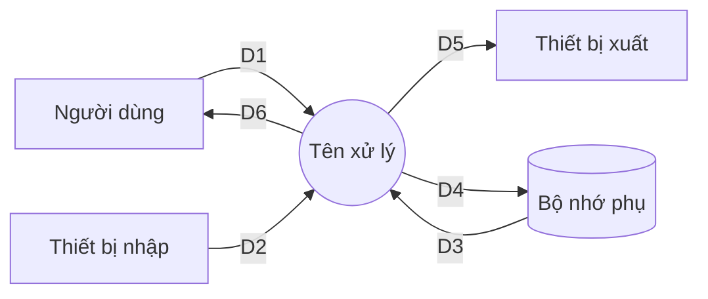

# Quy tắc viết báo cáo đồ án (cho AI agent)

Thư mục `report/` chứa báo cáo đồ án môn **Nhập môn Công nghệ Phần mềm** cho hệ thống Flight Booking System. Phạm vi hiện tại: trang bìa và chương 1–4.

**Đọc trước khi viết bất kỳ nội dung nào:** [`docs/guide/REPORT_GUIDELINE.md`](../docs/guide/REPORT_GUIDELINE.md). Phần 1 của file đó là quy tắc bắt buộc (giữ nguyên thuật ngữ tiếng Anh, văn phong kỹ thuật, zero hallucination, Mermaid, placeholder ảnh, giữ đúng cột bảng). Phần 2 là dàn ý. File này chỉ bổ sung những gì guideline chưa nói.

## 1. Cấu trúc file

Mỗi chương là một file Markdown riêng, đặt trực tiếp trong `report/`:

| File                      | Nội dung                                        |
| ------------------------- | ----------------------------------------------- |
| `00-trang-bia.md`         | Trang bìa                                       |
| `01-gioi-thieu.md`        | Chương 1. Giới thiệu tổng quan về đề tài        |
| `02-yeu-cau.md`           | Chương 2. Xác định và mô hình hóa yêu cầu       |
| `03-thiet-ke-he-thong.md` | Chương 3. Thiết kế hệ thống                     |
| `04-thiet-ke-du-lieu.md`  | Chương 4. Thiết kế dữ liệu                      |
| `SCREENSHOTS.md`          | Danh sách ảnh chụp màn hình người dùng cần chụp |
| `images/`                 | Ảnh chụp màn hình do người dùng thêm vào        |

- Mỗi file bắt đầu bằng một heading `#` là tên chương. Mục con đánh số theo dàn ý: `## 2.1`, `### 2.1.1`.
- Hình và bảng đánh số theo chương: `Hình 2.1`, `Bảng 2.1`, ghi chú thích ngay dưới hình, ngay trên bảng.
- Không gộp nhiều chương vào một file.

## 2. Nguồn dữ liệu

Mọi nội dung về hệ thống phải lấy từ các nguồn dưới đây. Khi nêu yêu cầu hoặc quy định, giữ mã gốc (`FR-xx`, `BR-xx`, `UF-xx`, `C-xx`/`S-xx`/`A-xx`, `Q-xx`) để truy vết.

| Chương | Nguồn trong repo                                                                                                           | Slide môn học (`docs/ref/software/`)                                                                                                                 |
| ------ | -------------------------------------------------------------------------------------------------------------------------- | ---------------------------------------------------------------------------------------------------------------------------------------------------- |
| 1      | `docs/PRD.md` §1–3; quy trình thực hiện: `docs/superpowers/plans/2026-10-09-00-roadmap.md` và các plan cùng thư mục        | —                                                                                                                                                    |
| 2.1    | `docs/PRD.md` §5 (FR), §6 (BR), §7 (tham số hệ thống), §8 (yêu cầu phi chức năng)                                          | `CHUONG 2 - XAC DINH YEU CAU.pdf`                                                                                                                    |
| 2.2    | `docs/PRD.md` §5–7; màn hình và form: `docs/APP_FLOW.md`; luồng xử lý: `docs/TDD.md` §6 và source code `backend/`          | `CHUONG 3 - PHAN TICH YEU CAU.pdf`, `CHUONG 3 - PHAN TICH YEU CAU (tiep theo).pdf`, `CHUONG 3 - HUONG DAN MO HINH HOA YEU CAU THAY DOI QUI DINH.pdf` |
| 3      | `docs/TDD.md` §1–3; `docker-compose.yml`; mục "Backend architecture" trong `CLAUDE.md` gốc                                 | `CHUONG 4 - THIET KE HE THONG.pdf`, `CHUONG 4 - Vi du Kien truc 3 lop.pdf`                                                                           |
| 4      | `docs/BACKEND_SCHEMA.md` (DDL §5, quan hệ §3, enum §4, ràng buộc §6); migration `backend/src/main/resources/db/migration/` | `CHUONG 6 - THIET KE DU LIEU.pdf`, `CHUONG 6 - THIET KE DU LIEU (tiep theo).pdf`                                                                     |

- Khi tài liệu và source code mâu thuẫn, source code là hiện trạng thật; ghi mâu thuẫn vào ghi chú `CẦN BỔ SUNG` (mục 5) để người dùng quyết định.
- Đọc slide bằng cách mở trực tiếp file PDF (Claude: `Read` với tham số `pages`). `pdftotext` làm mất dấu tiếng Việt và bỏ qua nội dung trong hình.
- Thắc mắc về phương pháp của môn học (cách phân loại yêu cầu, ký hiệu DFD, thuật toán thiết kế dữ liệu...) thì tra slide, không dựa vào kiến thức chung.

## 3. Phương pháp của môn học theo từng chương

Báo cáo trình bày theo đúng phương pháp trong slide, kể cả khi hệ thống thật được xây dựng theo cách khác. Tóm tắt dưới đây lấy từ slide; khi cần chi tiết, mở slide tương ứng ở mục 2.

### Chương 2.1. Phân loại yêu cầu

- **Yêu cầu nghiệp vụ**: lưu trữ, tra cứu, tính toán, kết xuất. Mỗi yêu cầu gắn với biểu mẫu (BMx) và quy định (Qx) liên quan.
- **Yêu cầu chất lượng**: tính tiến hóa, tính tiện dụng, tính hiệu quả, tính tương thích.
- **Yêu cầu hệ thống**: tính an toàn, tính bảo mật.
- Tham số hệ thống mà Admin thay đổi được (PRD §7) là căn cứ cho tính tiến hóa ("thay đổi quy định").

### Chương 2.2. Sơ đồ luồng dữ liệu (DFD)

Mỗi yêu cầu nghiệp vụ có một mục gồm 4 phần theo thứ tự:

1. **Biểu mẫu và quy định liên quan**: các trường của form/màn hình (lấy từ `APP_FLOW.md` và request DTO) và các `BR-xx` áp dụng.
2. **Sơ đồ**: luôn vẽ đủ 4 tác nhân (Người dùng, Thiết bị nhập, Thiết bị xuất, Bộ nhớ phụ) và 6 luồng D1–D6, dùng mẫu ở mục 4.
3. **Mô tả các luồng dữ liệu**: D1 thông tin từ người dùng; D2 từ thiết bị nhập khác chuẩn; D3 đọc từ bộ nhớ phụ; D4 ghi xuống bộ nhớ phụ; D5 đưa ra thiết bị xuất khác chuẩn; D6 trả về người dùng. Luồng không có thì ghi `Không có`. D là dữ liệu, không phải hành động.
4. **Thuật toán**: các bước `B1, B2, ...` theo khung của slide: nhận D1 → kết nối cơ sở dữ liệu → đọc D3 → kiểm tra quy định / tính toán (nếu vi phạm thì nhảy tới bước đóng kết nối) → lưu D4 → xuất D5 → trả D6 → đóng kết nối cơ sở dữ liệu → kết thúc. Các bước kiểm tra phải khớp với `BR-xx` và logic thật trong source code.

Mỗi tham số hệ thống thay đổi được cũng có một DFD "thay đổi quy định" theo slide `HUONG DAN MO HINH HOA YEU CAU THAY DOI QUI DINH`.

### Chương 3. Thiết kế hệ thống

- Trình bày theo các bước thiết kế kiến trúc trong slide: phân rã hệ thống thành các thành phần, bố trí các thành phần, thiết lập quan hệ giữa chúng.
- Xác định kiểu kiến trúc theo các kiến trúc trong slide (3 lớp Presentation/Business/Data, Client–Server...) rồi ánh xạ vào công nghệ thật (Next.js, Spring Boot modular monolith, PostgreSQL, VNPay, SMTP).
- Mục 3.2 dùng đúng bảng 3 cột `STT | Thành phần | Diễn giải` của guideline, theo cách trình bày của slide `Vi du Kien truc 3 lop`.

### Chương 4. Thiết kế dữ liệu

Dàn ý chương 4 trong guideline chưa đầy đủ ("4.1. Thuật toán thiết kế dữ liệu: Bước"). Dùng thuật toán trong slide chương 6 làm khung:

- **Bước 1..n**: lần lượt xét từng yêu cầu nghiệp vụ của chương 2, theo thứ tự đã liệt kê ở 2.1. Với mỗi yêu cầu:
  - _Tính đúng đắn_: biểu mẫu liên quan (BMx), sơ đồ luồng dữ liệu (Sx), các thuộc tính mới, thiết kế dữ liệu (bố trí thuộc tính mới vào bảng đã có hoặc tạo bảng mới), các thuộc tính trừu tượng, sơ đồ logic.
  - _Tính tiến hóa_: quy định liên quan (Qx), sơ đồ luồng dữ liệu về việc thay đổi quy định (Sy), các thuộc tính mới, các tham số mới, thiết kế dữ liệu, các thuộc tính trừu tượng, sơ đồ logic.
- Sau các bước: thiết kế với yêu cầu hiệu quả (thuộc tính tính toán, tách bảng) nếu schema thật có các trường hợp đó.
- Sơ đồ logic ở mỗi bước chỉ thêm bảng/cột mới so với bước trước, sơ đồ cuối cùng khớp toàn bộ `BACKEND_SCHEMA.md`.
- Dùng tên bảng và cột thật trong DDL (`snake_case`), không đổi sang quy ước viết hoa của slide. Bảng `system_settings` đóng vai trò bảng `THAMSO` của slide.
- Muốn thêm bảng mô tả chi tiết (cột, kiểu, ràng buộc) mà guideline chưa có mẫu thì hỏi người dùng về số cột và tên cột trước.

## 4. Sơ đồ Mermaid

Mọi sơ đồ dùng block ` ```mermaid `. Bọc nhãn có dấu ngoặc, dấu `/` hoặc dấu `:` trong nháy kép (`P(("Đặt vé"))`, `A["Next.js (frontend)"]`) để Mermaid không lỗi cú pháp.

DFD (chương 2.2), giữ nguyên bố cục và tên tác nhân, chỉ đổi tên xử lý:



- Kiến trúc (chương 3): `flowchart TB` với mỗi lớp là một `subgraph`.
- Sơ đồ logic (chương 4): `erDiagram`, ghi `PK`/`FK` và quan hệ 1-n đúng với khóa ngoại trong DDL.

## 5. Ảnh chụp màn hình và thông tin còn thiếu

**Ảnh chụp màn hình.** Tại chỗ cần ảnh, đặt đúng 2 dòng sau (dòng đầu theo cú pháp của guideline, dòng sau là chỗ ảnh đã đặt sẵn tên file):

```markdown
[👉 CHÚ Ý: Người dùng chèn ảnh chụp màn hình C-07 Đặt vé — bước nhập hành khách tại đây]

<!--  -->
```

Tên file theo mẫu `ch<số chương>-<mã màn hình>-<mô tả-ngắn>.png`. Đồng thời thêm một dòng vào bảng trong `SCREENSHOTS.md` để người dùng biết cần chụp gì, ở đâu, với dữ liệu nào. Người dùng chụp xong sẽ lưu ảnh vào `images/`, xóa dòng placeholder và bỏ comment dòng ảnh.

**Thông tin còn thiếu.** Khi nguồn ở mục 2 không có thông tin cần cho nội dung hoặc bảng biểu, đặt ghi chú sau tại đúng vị trí, rồi viết tiếp phần còn lại:

```markdown
[❓ CẦN BỔ SUNG: <thông tin cần người dùng cung cấp hoặc quyết định>]
```

Trang bìa (tên đề tài, mã lớp, số thứ tự nhóm, thành viên) luôn chờ người dùng cung cấp.

## 6. Hoàn thành một chương

Một chương chỉ được coi là xong khi:

- Mọi mục trong dàn ý của guideline (và khung chương 4 ở mục 3) đều có nội dung hoặc ghi chú `CẦN BỔ SUNG`.
- Mọi yêu cầu nghiệp vụ liệt kê ở 2.1 đều có mục DFD ở 2.2 (chương 2) và có bước tương ứng (chương 4).
- Mọi bảng giữ đúng số cột và tên cột của guideline.
- Mọi placeholder ảnh đều có dòng tương ứng trong `SCREENSHOTS.md`.

Cuối lượt làm việc, báo lại cho người dùng danh sách các ghi chú `CẦN BỔ SUNG` và các ảnh cần chụp mới phát sinh trong chương đó.
